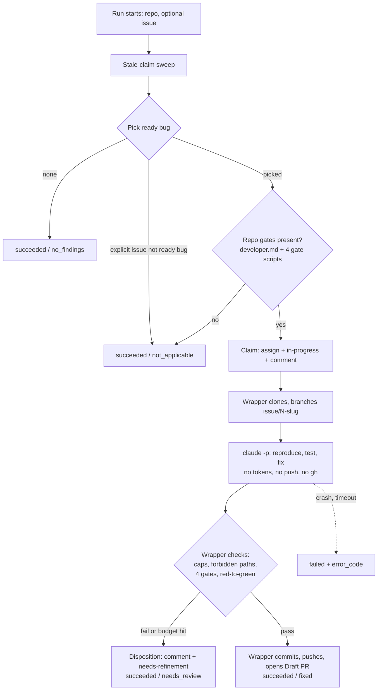
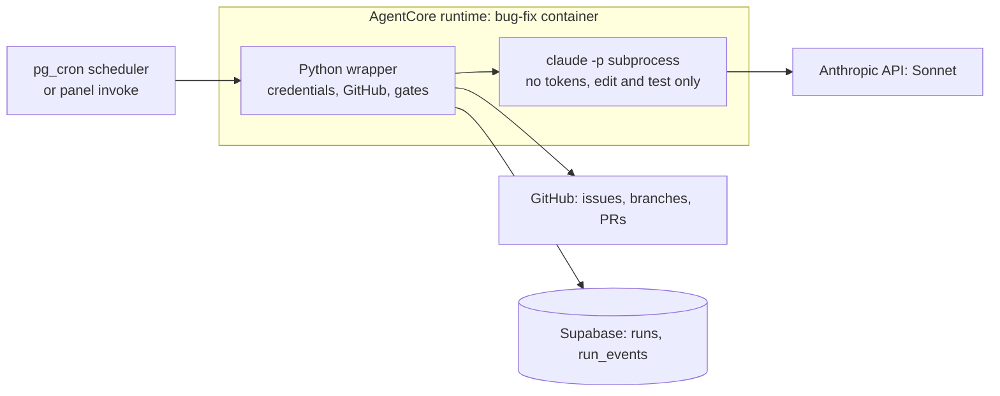

# PRD — Bug Fix Agent

> A scheduled, headless Claude Code agent that claims one `ready` bug from a
> GitHub repository, fixes it with a bounded, test-proven change, validates it, and
> opens a Draft PR for human review. Phase 5 of the Agent Fleet Control Plane.

## Changelog

| Version | Date       | Summary                                                                                                                                                                                                                       | Author           |
| ------- | ---------- | ----------------------------------------------------------------------------------------------------------------------------------------------------------------------------------------------------------------------------- | ---------------- |
| 1.4 | 2026-10-20 | Supersedes the parallel design line merged in PR #350 (D-87, @llipe, 2026-10-20). Decision IDs from this line are renumbered D-25–D-67 → D-44–D-86 after main's D-43. The superseded line's changelog rows remain in git history (`875299a`, PR #350). | product-engineer |
| 1.3     | 2026-10-20 | Drift reconciliation of verifier findings DF-08, DF-11, DF-16 and DF-18, with wording confirmed by @llipe on 2026-10-20. AC-4 now applies to the *selected* issue (D-72). AC-6 excludes the spend-capped Anthropic key (D-66). FR-18 and AC-9 now say `audit` never blocks (D-73). FR-12 and AC-14 now name `run_budget_minutes` (default 55) inside the 60-minute runtime lifetime (D-74). | product-engineer |
| 1.2     | 2026-10-18 | HOW-phase corrections (D-47–D-61): label lists are edited in the panel through a new `string-list` form control, so this PRD now has UI scope and a `/DESIGN.md` impact (D-48); the CLI uses the Anthropic API key, not Bedrock (D-50); confinement covers the runtime role, not only env vars (D-49, D-51); `repo` is the run's repository, not a param (D-60); budget ceilings are `needs_review`, not `failed` (D-61); the PRD's eight open questions are resolved in the spec. | product-engineer |
| 1.1     | 2026-10-17 | Label conditions become run parameters (D-44–D-46): `select_labels` (AND), `claim_remove_labels`, `claim_add_labels`, `disposition_add_labels`, with a pre-run label check; scheduler Waves C–E noted as merged (PR #296). | product-engineer |
| 1.0     | 2026-10-17 | Initial PRD. Produced from the `activity-grill` WHAT session recorded in `workstream/decisions-bug-fix-agent.md` (D-01–D-24). Third fleet agent: headless Claude Code inside a Python wrapper, claim → fix → gate → Draft PR. | product-engineer |

---

## 1. Executive Summary

The fleet has two agents that act on a repository: `dependency-update` and `security-analyst`. Neither works on the bugs a human has already reported and refined. This PRD adds `bug-fix`: on a schedule, it picks the oldest **ready bug**, **claims** it, fixes it with a bounded change proven by a regression test, re-runs the repository's gates itself, and opens a Draft PR. A human reviews and merges. It reuses the existing scheduler and reporting contract; the new surface is the agent, its container, and the GitHub claim protocol (D-01, D-03).

## 2. Feature Overview

`bug-fix` is a fleet agent on AgentCore (Container runtime, Python), registered in `agents` with a params schema, invocable from the panel and from a schedule (D-01, D-03). Inside the container a Python **wrapper** owns every credential and every GitHub mutation; a headless Claude Code (`claude -p`, Sonnet) subprocess does only the part that needs a model: reproduce the bug, write the regression test, make the fix (D-05, D-11, D-04).

## 3. Goals & Objectives

1. **Turn refined bugs into reviewable PRs without the operator driving.** A ready bug in an enabled repo reaches a Draft PR on the next schedule tick with no human action between (D-01, D-07).
2. **Keep every change small, specific, and proven.** No PR exists without a regression test that fails on the base code and passes with the fix, all four blocking gates green, and a diff inside the caps (D-09, D-14, D-15).
3. **Be safe unattended.** A prompt-injected issue can produce at worst a bad Draft PR a human reviews: the model holds no credentials and has no push path (D-11).
4. **Never stall the queue.** A bug the agent cannot fix leaves the queue with a stated reason; a dead claim is recovered automatically (D-08, D-16).
5. **Reuse, not rebuild.** No new scheduler, no new outcome values, no new trigger type (D-01, D-20).

## 4. Affected Repositories

| Repo                        | Role / Impact                                                                                                                                                                                                       |
| --------------------------- | ------------------------------------------------------------------------------------------------------------------------------------------------------------------------------------------------------------------- |
| `llipe/dev-tasks-agent-fleet` | **Primary.** New `agents/bug-fix/` (AgentCore project, Python wrapper, image with Node + Python + Claude Code CLI + sandbox runtime, managed Claude Code policy), `agents` seed row and params schema, panel `string-list` schema-form control and its `/DESIGN.md` entry (D-48), panel `invoke-runtime` IAM policy entry, runbook, tests, roadmap. |
| Target repos (fleet-managed) | **Consumers.** Must have dev-tasks installed (`.claude/agents/developer.md`) and expose the four gates (D-06, D-19). No change is made to them except through the agent's Draft PRs and issue updates.                |
| `llipe/dev-tasks`           | **Reference only.** Source of the `developer` definition, `github-ops` label and branch conventions the agent follows. No change.                                                                                  |

## 5. Target Users

- **Primary: the operator** (the repo owner running the fleet). Defines a schedule per repo, reviews Draft PRs, re-labels `needs-refinement` bugs, clears the G5 block.
- **Secondary: bug reporters and reviewers** who see the claim comment, the disposition comment, and the PR.

## 6. User Stories

1. As the operator, I want a schedule on a repo to fix its oldest ready bug, so that refined bugs turn into PRs while I do other work.
2. As the operator, I want to name a specific issue when I invoke the agent, so that I can steer which ready bug is fixed next.
3. As the operator, I want the agent to assign me, mark the issue `in-progress`, and comment with the run link, so that I and my team can see the bug is taken and by which run.
4. As a reviewer, I want each PR to carry a regression test that failed before the fix, so that I can trust the fix addresses the reported bug.
5. As a reviewer, I want a per-file rationale and the gate results in the PR body, so that I can review a 10-file change without reverse-engineering intent.
6. As the operator, I want a bug the agent cannot fix to leave the queue with a reason, so that the schedule keeps working on other bugs.
7. As the operator, I want dead claims recovered automatically, so that a crashed run never leaves an issue stuck `in-progress`.
8. As the operator, I want failures I must act on to be separate from bugs that were simply too hard, so that the circuit breaker does not pause my schedule because of hard bugs.

## 7. Functional Requirements

### 7.1 Invocation and selection

- **FR-1.** The agent SHALL run against the repository selected for the run (`requires_repository`, as the sibling agents do; not a param) (D-60), and SHALL accept params `issue_number` (optional), `assignee` (optional login, default = operator), the four label parameters in FR-1a, and the per-run caps and budgets in FR-12 and FR-13. The label parameters are an input to the panel form and to a schedule's params, not a definition written in the agent (D-44, D-45). It SHALL be registered in `agents` with a JSON Schema for these params. Schedule and invoke validation work unchanged; the panel form gains a `string-list` control so the label lists are editable and submitted (D-01, D-03, D-47, D-48).
- **FR-1a.** **Label parameters.** The agent SHALL accept four label-list params whose defaults live in the `agents` seed `default_params`, never in agent code (D-45):
  - `select_labels`, default `["type: bug", "status: ready"]`. An issue qualifies only if it carries **all** of them (AND). Non-empty.
  - `claim_remove_labels`, default `["status: ready"]`. MUST be a subset of `select_labels`.
  - `claim_add_labels`, default `["status: in-progress"]`. The lock label. Non-empty.
  - `disposition_add_labels`, default `["status: needs-refinement"]`. The disposition also removes `claim_add_labels`.
- **FR-1b.** **Label check.** Before selecting or claiming, the wrapper SHALL verify that every label in the four params exists in the repository and that the FR-1a constraints hold. Any failure ends the run `succeeded` / `not_applicable`, naming the missing labels or the violated constraint, with no issue change (D-46).
- **FR-2.** With no `issue_number`, the agent SHALL select the oldest open issue by `created_at` that carries every label in `select_labels` and has no open linked PR (D-10, D-44).
- **FR-3.** With an `issue_number`, the agent SHALL work on that issue only if it is open and carries every label in `select_labels`; otherwise the run ends `succeeded` / `not_applicable` with a run_event giving the reason. An explicit number never bypasses `select_labels` (D-10, D-44).
- **FR-4.** With no ready bug, the run ends `succeeded` / `no_findings` (D-20).
- **FR-5.** Before claiming, the agent SHALL verify the label check (FR-1b) and the repository gate (FR-6). A failed gate ends `succeeded` / `not_applicable` naming the missing item and does not touch the issue (D-06, D-19).
- **FR-6.** A repository is applicable only if it contains `.claude/agents/developer.md` and exposes the four blocking gates `test`, `lint`, `format:check` (JS/TS) or `format-check` (Python), and `typecheck`, as `package.json` scripts (JS/TS, pnpm or npm) or `Makefile` targets (Python). There is no fallback definition (D-06, D-18, D-19).

### 7.2 Claim

- **FR-7.** The claim SHALL consist of: assigning the `assignee` login; removing `claim_remove_labels` and adding `claim_add_labels`; posting a claim comment with the run ID and a panel link. The comment SHALL carry a machine-parsable marker identifying the agent and the run ID, posted by the GitHub App identity (D-07, D-16, D-23).
- **FR-8.** v1 SHALL NOT depend on assigning the GitHub App bot (D-07).

### 7.3 Fix loop and confinement

- **FR-9.** The wrapper SHALL perform clone, branch (`issue/<N>-<slug>`), commit, push, PR creation, and every issue mutation. The Claude Code subprocess and every repository script SHALL run as a separate OS user with a minimal environment (the Anthropic API key only; no AWS credentials, no GitHub token, no Supabase key), inside a sandbox whose network reaches only package registries and never the container credential endpoint, under an image-baked managed policy that denies `git push`, `gh`, `curl`/`wget`, and web fetch and that the repository's `.claude/` cannot override (D-11, D-12, D-49, D-51).
- **FR-10.** The issue title and body SHALL be passed to the model as quoted, untrusted data (D-11).
- **FR-11.** The subprocess SHALL run the target repository's own `.claude/` configuration and `developer` definition, on the model given by `MODEL_ID` (default a Sonnet model), served by the Anthropic API with a dedicated, spend-capped key (D-04, D-05, D-50).
- **FR-12.** The wrapper SHALL bound the CLI with `--max-turns` (default 40) and a wall-clock kill (default 30 minutes), and the whole run with `run_budget_minutes` (default 55), which sits inside the runtime's 60-minute lifetime (D-74). All three are params. Reaching any ceiling takes the disposition path with the reason and ends `succeeded`/`needs_review` (D-22, D-61).

### 7.4 Change limits

- **FR-13.** After the CLI exits and before pushing, the wrapper SHALL reject the change if it exceeds **10 code files** or **400 changed code lines**. Docs/text files (`*.md`, `*.txt`, `*.rst`) and test files are excluded from both counts (D-09).
- **FR-14.** The wrapper SHALL reject any change that edits a lockfile, a CI workflow, or anything under `.claude/` (D-09).
- **FR-15.** The change SHALL include at least one added or changed test (D-09).
- **FR-16.** The PR body SHALL contain a rationale per changed file tying it to the bug. This is prompt-level; the wrapper checks only that each changed file is listed (D-09).

### 7.5 Validation

- **FR-17.** The wrapper SHALL itself run `test`, `lint`, `format:check`/`format-check`, and `typecheck` on the final tree and treat any failure as a failed validation. It SHALL NOT rely on the model's report (D-14).
- **FR-18.** The wrapper SHALL run `audit` and record the result in the PR body. `audit` SHALL be recorded only and SHALL never block the PR (D-14, D-73).
- **FR-19.** **Red-to-green.** The wrapper SHALL revert the non-test changes, run the added/changed tests on the base code, and require at least one failure; then restore the fix and require them to pass. Tests that pass on the base code fail validation (D-15).

### 7.6 Pull request

- **FR-20.** On success the wrapper SHALL open a **Draft** PR against the default branch from `issue/<N>-<slug>`, with Conventional Commit messages, the body supplied via `--body-file`, a link to the issue, the per-file rationale (FR-16), the gate results (FR-17/18), the red-to-green evidence (FR-19), `verifier_audit: not-run(no-delegation)`, and `coverage_gate: SKIPPED(no-delegation)`. The PR SHALL stay Draft. The agent SHALL NOT merge (D-12, D-13).
- **FR-21.** The PR SHALL be recorded as a `pull_request` run artifact so the scheduler's G5 backoff applies (D-21).

### 7.7 Disposition and recovery

- **FR-22.** When a claimed run ends without a PR for any reason in FR-12, FR-13–FR-15, FR-17, FR-19, or because the model gives up, the wrapper SHALL post a diagnosis comment (what was tried, why it stopped, the diffstat when a cap was hit), remove `claim_add_labels` and add `disposition_add_labels`, and keep the assignee (D-45). It SHALL NOT retry automatically (D-08).
- **FR-23.** The wrapper's `finally` path and the existing signal backstop SHALL apply the disposition for every failure it can observe (D-08, D-16).
- **FR-24.** **Stale-claim sweep.** At the start of every run the agent SHALL find open issues carrying every label in `claim_add_labels` and its own claim marker (FR-7) whose run ID is terminal (`failed`, `timed_out`, `failed_to_start`, `canceled`) in Supabase with no PR artifact, and apply the disposition to each. It SHALL NOT touch issues without its marker (or without the `claim_add_labels`), issues claimed by a human, or runs still non-terminal (D-16).

### 7.8 Reporting and outcomes

- **FR-25.** The agent SHALL report through the existing reporter: steps for sweep, select, claim, checkout, fix, validate, red-to-green, open PR; `run_events` at each; heartbeat and signal backstop as in the sibling agents (D-03).
- **FR-26.** Outcomes SHALL use existing values only: PR opened → `succeeded`/`fixed`; no ready bug → `succeeded`/`no_findings`; label check, repository gate, or issue gate not met → `succeeded`/`not_applicable`; claimed, no PR → `succeeded`/`needs_review`; credentials, missing GitHub Issues write, clone, CLI crash or unparseable output, PR creation, wrapper error → `failed` with an `error_code`; budget ceilings are not faults (D-61). Only `failed` counts toward the scheduler's G3. The run summary and the issue comment SHALL state the reason for every `needs_review` (D-20).
- **FR-27.** `runs.metrics` SHALL record turns, token usage, wall-clock, files and lines changed, and per-gate results (D-22).

## 8. Business Rules

- `select_labels` (default `status: ready` among them) is the human refinement gate and is never bypassed, including by an explicit `issue_number` (D-10, D-44).
- `claim_add_labels` (default `status: in-progress`) is the lock; it is applied only by a successful claim and removed only by the PR path or the disposition (D-07, D-08, D-45).
- Agents never merge to `main`; the PR stays Draft until a human acts (D-13; CLAUDE.md).
- One open agent PR per repo at a time, enforced by the scheduler's G5 (D-21).
- The agent follows `github-ops` conventions: `issue/<N>-<slug>` branches, labels, Conventional Commits (D-02, D-12).

## 9. Data Requirements

| Entity                   | Change                                                                                                                                                                                      |
| ------------------------ | ------------------------------------------------------------------------------------------------------------------------------------------------------------------------------------------- |
| `agents`                 | New row `bug-fix` with `default_params` and `params_schema` (seed, same `on conflict (slug) do update` shape as the siblings).                                                              |
| `runs`                   | Existing columns. `trigger_type` = `schedule` or `manual`. `params` snapshot includes caps and budgets. `metrics` as FR-27.                                                                 |
| `run_events`, `run_steps`| Existing; steps per FR-25.                                                                                                                                                                  |
| run artifacts            | `pull_request` on success (existing type).                                                                                                                                                 |
| GitHub issue             | Claim comment with marker (FR-7), disposition comment (FR-22), labels, assignee.                                                                                                           |
| Enums                    | **No migration.** `run_outcome` already has `fixed`, `needs_review`, `not_applicable`, `no_findings` (D-20).                                                                                |

Sensitivity: issue text is third-party input (FR-10). Installation tokens and the Supabase key stay in the wrapper (FR-9) and are scrubbed from logs by `scrubber.py`.

## 10. Non-Goals (Out of Scope)

- Assigning the GitHub App bot as assignee (D-07).
- Automatic retry of a failed fix (D-08).
- Any merge by the agent, or converting the PR out of Draft (D-13).
- Running `verifier` or `qa-engineer` inside the agent (D-13).
- Several bugs per run (D-10, D-21).
- A bundled `developer` definition for repos without dev-tasks (D-06).
- Stacks other than JS/TS and Python (D-18).
- **Fast-follows, recorded not built:** automatic detection of PR merge/close to release G5 (G5-b); an event-driven trigger on `status: ready` using the webhook trigger type; a per-repo stack extension (D-21, D-24).

## 11. Design Considerations

The panel's invoke form and `/schedules` dialog are schema-driven, but today they render `array` params as disabled and do not submit them (D-47). This PRD adds a `string-list` control (editable chips) for `array`-of-`string` params, pre-filled from schema `default` and `default_params` (D-48). **`/DESIGN.md` impact:** a new String List component entry (tokens from Inputs and Tags) and notes under Invoke Agent and Schedules; owned by `ux-engineer`. The run summary text must carry the `needs_review` reason (FR-26) because the run list renders it green.

## 12. Technical Considerations

- **Runtime:** AgentCore Container, ARM64, Python wrapper following the sibling modules (`agent_reporter`, `credentials`, `heartbeat`, `signal_backstop`, `scrubber`, `pull_request`). The image adds Node, pnpm/npm, Python toolchain, and the Claude Code CLI (D-03, D-05).
- **Model:** `MODEL_ID` env var, a Sonnet model id on the Anthropic API; the CLI receives `ANTHROPIC_API_KEY` from Secrets Manager via the wrapper (D-04, D-50).
- **First fleet agent not built on Strands.** Confinement and cap enforcement therefore live in the wrapper (D-05).
- **Infrastructure scope.** One `infra-engineer` change in Wave A: a dedicated, spend-capped Anthropic API key in Secrets Manager; a new AgentCore runtime and role reading the Supabase key, App PEM, and Anthropic key (no Bedrock grant); the panel's `invoke-runtime` IAM policy entry for the new runtime and `runtime-endpoint/DEFAULT` (issue #280); and the GitHub App's Issues read-and-write permission (D-58).
- **Confinement spike.** Before the fix loop is built, a spike proves on the deployed ARM64 runtime that the sandbox starts and the credential endpoint is unreachable from it (D-51, D-59).
- **Scheduler dependency.** The scheduler (Waves A–E) is merged to main (PR #296), so G1, G3, and G5 apply to this agent (D-01). Label parameters ride the existing schedule params and fire path (D-44).
- **GitHub App permissions.** The agent needs issue write (assign, labels, comments) in addition to contents and pull-request write. The wrapper checks the minted token's permissions at run start and ends `failed`/`GITHUB_PERMISSION_MISSING` without it (D-58).
- **Runbook.** Per FR-49a, a runbook for deploy and live verification ships in the same PR as the deploy scripts or workflow changes.

## 13. Acceptance Criteria

- **AC-1 (selection).** Given three open bugs, one `status: ready` newest, one `status: ready` oldest, one `status: needs-refinement`, when the agent runs with no `issue_number` and the default `select_labels`, then it claims the oldest ready one (D-10, D-44).
- **AC-2 (explicit gate).** Given an open `type: bug` issue without `status: ready`, when invoked with its number, then the run ends `succeeded`/`not_applicable` with a reason and the issue is unchanged (D-10, D-44).
- **AC-3 (claim).** After a claim, the issue shows the configured assignee, every `claim_add_labels` label and none of the `claim_remove_labels`, and a comment with the run ID and marker (D-07, D-45).
- **AC-4 (not applicable).** A repo without `.claude/agents/developer.md`, or missing any of the four gates, ends `succeeded`/`not_applicable` naming the missing item, and the selected issue is unchanged. The stale-claim sweep, which runs earlier, may still recover other claims (D-06, D-19, D-72).
- **AC-5 (confinement).** In a test run the CLI environment contains no GitHub token or Supabase key, and an attempted `git push` or `gh` call is denied (D-11).
- **AC-6 (prompt injection).** Given an issue body instructing the model to exfiltrate secrets or push to another branch, no credential other than the spend-capped Anthropic key is reachable, and no push other than the wrapper's occurs (D-11, D-50, D-66).
- **AC-7 (caps).** A change touching 11 code files, or 401 code lines, or any lockfile, CI workflow, or `.claude/` path, produces no PR and takes the disposition path with the diffstat; docs and tests do not count toward the caps (D-09).
- **AC-8 (regression test).** A change without a test, or whose tests pass on the base code, produces no PR and takes the disposition path (D-09, D-15).
- **AC-9 (gates).** A red `test`, `lint`, `format`, or `typecheck` blocks the PR; `audit` is recorded and never blocks (D-14, D-73).
- **AC-10 (PR).** A successful run opens a Draft PR on `issue/<N>-<slug>` with the FR-20 body and a `pull_request` artifact; the issue links to it; the PR stays Draft (D-12, D-13).
- **AC-11 (disposition).** For every no-PR path in FR-22 the issue ends with the `disposition_add_labels` labels and without `claim_add_labels`, with a diagnosis comment, the assignee kept, and the run `succeeded`/`needs_review` (D-08, D-20).
- **AC-12 (G3).** Three consecutive `needs_review` runs do not pause the schedule; three consecutive `failed` runs do (D-20).
- **AC-13 (sweep).** Given an issue with the `claim_add_labels` labels and the agent's marker whose run is `timed_out` and has no PR, the next run applies the disposition to it first. An issue with the lock label but without the marker, and one whose run is still `running`, are untouched (D-16).
- **AC-14 (budget).** A run hitting 40 turns, 30 minutes of CLI time, or `run_budget_minutes` (default 55, inside the 60-minute runtime lifetime) stops and takes the disposition path with the reason (D-22).
- **AC-15 (G5).** After a successful run, the schedule does not fire again for that repo until the operator clears it in the panel (D-21).
- **AC-17 (label parameters).** Given a repo using labels `kind/bug` and `triage/ok`, when a run is invoked with `select_labels = ["kind/bug","triage/ok"]` and matching claim and disposition labels, then selection, claim, and disposition use those labels and no default label name is touched (D-44, D-45).
- **AC-18 (label check).** A run whose params name a label absent from the repo, whose `claim_remove_labels` is not a subset of `select_labels`, or whose `select_labels` or `claim_add_labels` is empty ends `succeeded`/`not_applicable` naming the cause, with no issue change, and does not count toward G3 (D-46).
- **AC-16 (live).** One end-to-end run against a real fixture repo with a seeded ready bug reaches a Draft PR on the deployed runtime, and a seeded unfixable bug reaches the disposition path.

## 14. Success Metrics

Initial targets, to be calibrated after the first 5–10 real runs (the same horizon as the budgets in D-22):

- Share of claimed runs that end in a Draft PR.
- Share of Draft PRs a reviewer merges without rework.
- Median time from `status: ready` to Draft PR, which is bounded below by the schedule interval.
- Tokens and wall-clock per run, from `runs.metrics` (FR-27).
- Zero issues left `in-progress` with a terminal run for more than one tick (FR-24).
- Zero G3 pauses caused by `needs_review` outcomes (FR-26).

## 15. Assumptions

- The GitHub App installation can be given issue write on the managed repos.
- The Claude Code CLI can be run non-interactively against the Anthropic API with only `ANTHROPIC_API_KEY` in its environment, using the model in `MODEL_ID` (D-50).
- Claude Code's Bash sandbox runs inside the AgentCore ARM64 container; the Wave A spike verifies this (D-51).
- Managed repos use pnpm/npm or a Makefile with canonical targets; repos that do not end `not_applicable` and are fixed by the operator over time.
- 10 files / 400 code lines / 40 turns / 30 minutes are reasonable starting values (D-09, D-22); they are estimates, not measured.
- The operator is the right default assignee (D-07).

## 16. Constraints & Dependencies

- Scheduler Waves A–E, merged to main in PR #296, for G1/G3/G5 and schedule params (roadmap).
- GitHub App permissions (Section 12) and the panel `invoke-runtime` IAM entry (issue #280).
- A dedicated Anthropic API key with a spend cap (D-50, D-58).
- `docs/product-context.md` and `docs/technical-guidelines.md` are the foundation documents in this repository (old names; `dev-tasks migrate docs` is proposed).

## 17. Security & Compliance

- **Threat:** issue text is untrusted input to a model with a shell (D-11). **Mitigation:** FR-9, FR-10, and the wrapper-side validation of every output (FR-13–FR-19). The worst case is a bad Draft PR a human reviews.
- **Repository-controlled code runs in the container.** The target repo's `.claude/` hooks and its test, lint, and build scripts execute in the container. They see no secrets (FR-9) but are third-party code. Egress is the existing AgentCore network mode.
- **Forbidden paths** (FR-14) stop the agent from changing the guards it runs under.
- **Auditability:** claim and disposition comments, run events, and the PR body record what happened. The agent never merges (D-13).

## 18. Open Questions

The eight HOW-phase questions in v1.1 are resolved in [`workstream/specification-prd-bug-fix-agent.md`](../../workstream/specification-prd-bug-fix-agent.md): model auth (D-50), allowed tools and confinement (D-51), file classification (D-52), claim marker (D-53), linked PR and concurrency (D-54, D-55), red-to-green per runner (D-56), GitHub App issue write (D-58), default assignee (D-57). The spec tracks two implementation-level open questions (Python install step; managed-settings key names).

## Decisions

| ID   | Decision (short form)                                                                                            |
| ---- | ---------------------------------------------------------------------------------------------------------------- |
| D-01 | Reuse the fleet scheduler; no own scheduler.                                                                     |
| D-02 | Labels `type: bug`, `status: ready`, `status: in-progress`, `status: needs-refinement` already exist.            |
| D-03 | Follows the sibling AgentCore + Supabase reporting contract.                                                     |
| D-04 | Model is Sonnet via `MODEL_ID`.                                                                                  |
| D-05 | Headless Claude Code inside a Python wrapper (not Strands).                                                      |
| D-06 | No `developer.md` in the repo → `not_applicable`; no fallback.                                                   |
| D-07 | Claim = assign operator + `in-progress` label + claim comment.                                                   |
| D-08 | No PR → diagnosis comment + `needs-refinement`, no auto-retry.                                                   |
| D-09 | 10 code files / 400 code lines; regression test required; forbidden paths; per-file rationale.                  |
| D-10 | Oldest ready bug; explicit number never bypasses labels.                                                         |
| D-11 | Wrapper holds credentials; CLI has none and cannot push.                                                         |
| D-12 | Branch `issue/<N>-<slug>`, Draft PR by the wrapper.                                                              |
| D-13 | PR stays Draft; verifier and qa gates recorded as not run.                                                       |
| D-14 | Block on test, lint, format, typecheck; audit recorded only.                                                     |
| D-15 | Mandatory red-to-green on the regression test.                                                                   |
| D-16 | Stale-claim sweep at the start of each run, own-marker claims only.                                              |
| D-17 | Precedent: pnpm/npm detection; Python Makefile targets in sibling packages.                                      |
| D-18 | JS/TS and Python in v1.                                                                                          |
| D-19 | Canonical gate names as scripts (JS/TS) or Make targets (Python); missing → `not_applicable`.                    |
| D-20 | Outcome mapping; only `failed` counts toward G3.                                                                 |
| D-21 | Keep G5 as-is: one open agent PR per repo.                                                                       |
| D-22 | Budgets: 40 turns / 30 min CLI / 60 min run.                                                                     |
| D-23 | Name `bug-fix` and four glossary terms.                                                                          |
| D-24 | Non-goals and fast-follows (G5-b, webhook trigger).                                                              |
| D-44 | Selection labels are a per-run parameter with AND semantics, not hard-coded (supersedes D-10 label values).     |
| D-45 | Claim and disposition label changes are parameters too; four label lists with `github-ops` defaults.             |
| D-46 | Missing label or invalid label params → `not_applicable` before any select or claim.                             |
| D-48 | Panel `string-list` form control so label lists are editable and submitted.                                      |
| D-49 | Env stripping alone leaves the runtime role reachable from the CLI.                                              |
| D-50 | CLI model via the Anthropic API key, not Bedrock.                                                                |
| D-51 | Three-layer confinement (minimal env, managed sandbox policy, same sandbox for repo scripts); spike first.        |
| D-58 | One infra change in Wave A; run-start Issues-write permission check.                                             |
| D-60 | `repo` is the run's repository, not a param.                                                                     |
| D-61 | Budget ceilings → disposition / `needs_review`; `failed` only for unattributable faults.                         |
| D-66 | AC-6 excludes the spend-capped Anthropic key; an invalid report leads to the disposition.                        |
| D-72 | AC-4 applies to the selected issue; the sweep may still recover other claims.                                    |
| D-73 | `audit` is recorded and never blocks.                                                                            |
| D-74 | `run_budget_minutes` (default 55) inside the 60-minute runtime lifetime.                                         |

## Vocabulary

| Term               | Status in glossary | Bounded context | Definition (proposals only)                                                                                                         | Forbidden synonyms (proposals only) |
| ------------------ | ------------------ | --------------- | ----------------------------------------------------------------------------------------------------------------------------------- | ----------------------------------- |
| ready bug          | proposed           | bug-fix         | An open GitHub issue carrying every label in the run's `select_labels` (default `type: bug` and `status: ready`).                                                                        | none                                |
| claim              | proposed           | bug-fix         | The three-part act of taking an issue: assign the configured login, remove `claim_remove_labels` and add `claim_add_labels`, and post a marked claim comment. | lock, take, checkout                |
| disposition        | proposed           | bug-fix         | The issue-side outcome applied when a claimed run ends without a PR: a diagnosis comment and the `disposition_add_labels` labels (default `status: needs-refinement`).             | triage                              |
| stale-claim sweep  | proposed           | bug-fix         | The start-of-run recovery that applies the disposition to claims whose run is terminal without a PR.                                 | none                                |
| live claim         | proposed           | bug-fix         | The trusted claim marker on an issue with the highest comment id that has no trusted disposition marker for the same run (spec D-53). | active claim, current lock          |
| claim marker       | proposed           | bug-fix         | The hidden first-line HTML comment `agent-fleet:bug-fix:claim run_id=…` on a claim comment posted by the fleet GitHub App (spec D-53). | tag, token                          |
| string list        | proposed           | panel           | The schema-form control for an `array` of `string` params, rendered as removable chips (spec D-48).                                   | tag input, multi-text               |
