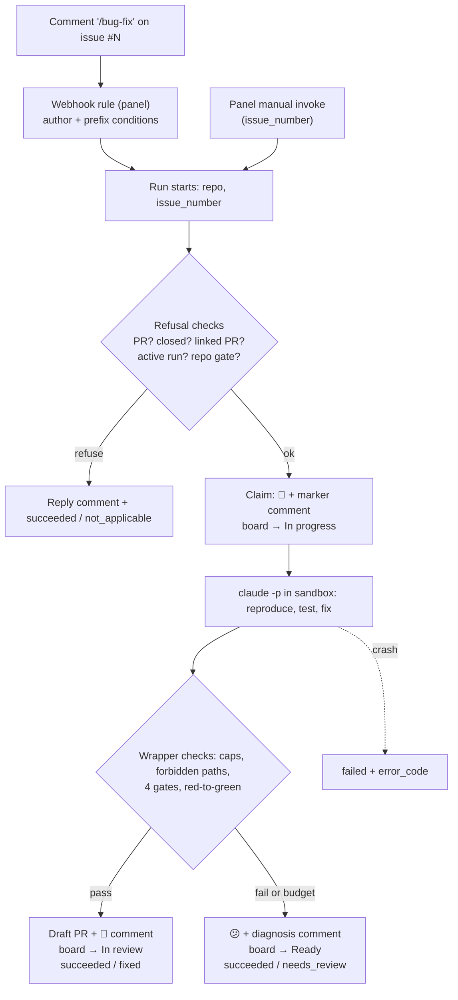
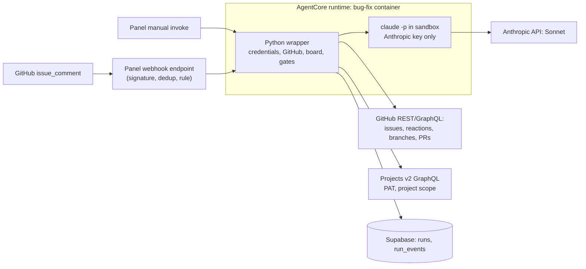

# PRD — Bug Fix Agent

> A headless Claude Code agent, started by a `/bug-fix` comment on a GitHub issue, that
> fixes that one issue with a bounded, test-proven change, validates it, and opens a
> Draft PR for human review. Phase 5 of the Agent Fleet Control Plane.

## Changelog

| Version | Date       | Summary | Author |
| ------- | ---------- | ------- | ------ |
| 2.1 | 2026-10-22 | Drift reconciliation of verifier DF-29 (Critical), accepted by @llipe. The webhook trigger's per-repo G1/G5 guardrails no longer apply to issue-scoped agents (`agents.guardrail_scope = 'issue'`, D-107). A `/bug-fix` that the trigger blocks gets a 👎 reaction from the panel (D-108). New FR-35–FR-36 and AC-25–AC-26; the panel is now an affected component. | product-engineer |
| 2.0 | 2026-10-22 | **Issue-mode rewrite** from the WHAT session D-88–D-102, confirmed by @llipe on 2026-10-21. A run is now triggered by a `/bug-fix` comment through the webhook trigger (PR #398) and works on that one issue in a single shot (D-90). Removed: labels, selection queue, schedules, assignee, stale-claim sweep, `string-list` UI (D-90, D-93–D-96). Who may trigger is set by webhook configuration (D-91). Five refusal cases, each with a reply (D-92). The claim is now reactions plus marker comments (D-93). Projects v2 board updates are added, using a `project`-scoped PAT and auto-detecting the linked board, on a best-effort basis (D-97–D-102). The rules of engagement are unchanged. FR and AC numbers are kept: removed items are marked, and new ones are FR-28–FR-34 and AC-19–AC-24. | product-engineer |
| 1.4 | 2026-10-20 | Supersedes the parallel design line merged in PR #350 (D-87, @llipe, 2026-10-20). Decision IDs from this line are renumbered D-25–D-67 → D-44–D-86 after main's D-43. The superseded line's changelog rows remain in git history (`875299a`, PR #350). | product-engineer |
| 1.3     | 2026-10-20 | Drift reconciliation of verifier findings DF-08, DF-11, DF-16 and DF-18, with wording confirmed by @llipe on 2026-10-20. AC-4 now applies to the *selected* issue (D-72). AC-6 excludes the spend-capped Anthropic key (D-66). FR-18 and AC-9 now say `audit` never blocks (D-73). FR-12 and AC-14 now name `run_budget_minutes` (default 55) inside the 60-minute runtime lifetime (D-74). | product-engineer |
| 1.2     | 2026-10-18 | HOW-phase corrections (D-47–D-61): label lists are edited in the panel through a new `string-list` form control, so this PRD now has UI scope and a `/DESIGN.md` impact (D-48); the CLI uses the Anthropic API key, not Bedrock (D-50); confinement covers the runtime role, not only env vars (D-49, D-51); `repo` is the run's repository, not a param (D-60); budget ceilings are `needs_review`, not `failed` (D-61); the PRD's eight open questions are resolved in the spec. | product-engineer |
| 1.1     | 2026-10-17 | Label conditions become run parameters (D-44–D-46): `select_labels` (AND), `claim_remove_labels`, `claim_add_labels`, `disposition_add_labels`, with a pre-run label check; scheduler Waves C–E noted as merged (PR #296). | product-engineer |
| 1.0     | 2026-10-17 | Initial PRD. Produced from the `activity-grill` WHAT session recorded in `workstream/decisions-bug-fix-agent.md` (D-01–D-24). Third fleet agent: headless Claude Code inside a Python wrapper, claim → fix → gate → Draft PR. | product-engineer |

---

## 1. Executive Summary

The fleet has two agents that act on a repository: `dependency-update` and `security-analyst`. Neither works on the bugs a human has reported. This PRD adds `bug-fix`. A person writes `/bug-fix` on an issue; the webhook trigger invokes the agent on AgentCore for that issue. The agent **claims** the issue, fixes it with a bounded change proven by a regression test, re-runs the repository's gates itself, and opens a Draft PR, which a human reviews and merges. The issue carries everything the fix needs (one shot). There are no labels and no queue. If the repository has a linked GitHub Projects board, the agent moves the issue's card as it works (D-90, D-97).

## 2. Feature Overview

`bug-fix` is a fleet agent on Amazon Bedrock AgentCore (Container runtime, Python), registered in `agents` with a params schema (D-03, D-89). It is started by a webhook rule on an `issue_comment` event, or manually from the panel with an issue number (D-90, D-96). Inside the container a Python **wrapper** owns every credential and every GitHub mutation. A headless Claude Code subprocess (`claude -p`, on the Anthropic API) does only the part that needs a model: reproduce the bug, write the regression test, make the fix (D-05, D-11, D-50).

## 3. Goals & Objectives

1. **Turn a reported bug into a reviewable PR on request.** A `/bug-fix` comment reaches a Draft PR, or a stated reason, with no further human action (D-90).
2. **Keep every change small, specific, and proven.** No PR exists without a regression test that fails on the base code and passes with the fix, all four blocking gates green, and a diff inside the caps (D-09, D-14, D-15).
3. **Be safe with untrusted input.** A prompt-injected issue can produce at worst a bad Draft PR that a human reviews. The model holds no credential other than its own spend-capped key and has no push path (D-11, D-49–D-51, D-62).
4. **Always answer.** Every triggered run leaves a visible result on the issue: a reaction plus a comment for a refusal, a PR, or a diagnosis (D-92, D-93).
5. **Reuse, not rebuild.** The existing webhook trigger, reporting contract and outcome values are used as they are. There is no new trigger code and no new enum (D-20, D-88).

## 4. Affected Repositories

| Repo | Role / Impact |
| ---- | ------------- |
| `llipe/dev-tasks-agent-fleet` | **Primary.** Panel webhook trigger: `agents.guardrail_scope` migration and guardrail change (D-107), plus a best-effort 👎 reaction on blocked deliveries (D-108). New `agents/bug-fix/`: AgentCore project, Python wrapper, an image with Node, Python, the Claude Code CLI and the sandbox runtime, and the managed Claude Code policy. Also: the `agents` seed row and params schema, the panel `invoke-runtime` IAM entry, the runbook (including the recommended webhook rule, D-91), tests and roadmap. **No panel UI change** (D-95). |
| Target repos (fleet-managed) | **Consumers.** Must have dev-tasks installed (`.claude/agents/developer.md`) and expose the four gates (D-06, D-19). They change only through the agent's Draft PRs, comments and reactions. A linked Projects v2 board, if any, has its cards moved (D-102). |
| `llipe/dev-tasks` | **Reference.** Source of the `developer` definition and the `github-ops` branch conventions. Its Projects board conventions (#5 "Dev-tasks") give the default status names (D-100). |

## 5. Target Users

- **Primary: the operator** (the repo owner). Configures the webhook rule, writes `/bug-fix` on an issue, and reviews Draft PRs.
- **Secondary: collaborators** allowed by the webhook rule to trigger runs, and reviewers who read the comments and the PR.

## 6. User Stories

1. As the operator, I want to write `/bug-fix` on an issue so that the agent turns that issue into a Draft PR while I do other work.
2. As the operator, I want to invoke the agent from the panel with an issue number, so that I can run it without a comment.
3. As the operator, I want the agent to react and comment on the issue when it starts, so that everyone can see the bug is being worked on and by which run.
4. As a reviewer, I want each PR to carry a regression test that failed before the fix, so that I can trust the fix addresses the reported bug.
5. As a reviewer, I want a per-file rationale and the gate results in the PR body, so that I can review the change without reverse-engineering its intent.
6. As the operator, I want a bug the agent can't fix to get a diagnosis comment, so that I know why and can improve the issue and try again.
7. As the operator, I want a `/bug-fix` that can't proceed (a PR, a closed issue, a run already active) to get a short reply, so that the trigger never fails silently.
8. As the operator, I want the issue's card on my Projects board to move to In progress, In review or back to Ready, so that the board reflects the agent's work without my updating it.
9. As the operator, I want failures I must act on to be separate from bugs that were simply too hard, so that the trigger's circuit breaker doesn't trip because of hard bugs.

## 7. Functional Requirements

### 7.1 Invocation and applicability

- **FR-1.** The agent SHALL run against the repository selected for the run (`requires_repository`, not a param) (D-60). It SHALL accept params `issue_number` (**required**), `trigger_comment_id` (optional), the Projects params in FR-33, and the per-run caps and budgets in FR-12 and FR-13. It SHALL be registered in `agents` with a JSON Schema for these params, validated by the existing invoke and webhook paths (D-03, D-93).
- **FR-1a.** *(Removed in v2.0: label parameters, D-90, D-93.)*
- **FR-1b.** *(Removed in v2.0: label check, D-93.)*
- **FR-2.** *(Removed in v2.0: oldest-ready-bug selection, D-90.)*
- **FR-3.** The agent SHALL work on the issue named by `issue_number` only. Labels SHALL have no effect on whether it proceeds (D-90).
- **FR-4.** *(Removed in v2.0: `no_findings` for an empty queue, D-90.)*
- **FR-5.** **Refusal cases.** Before claiming, the agent SHALL end the run `succeeded`/`not_applicable` **without claiming**, and SHALL post one short reply comment giving the reason, when any of these holds (D-92):
  - (a) the number is a pull request, not an issue (D-88);
  - (b) the issue is closed;
  - (c) an open PR is already linked to the issue, by closing reference or by an `issue/<N>-…` head branch (D-55);
  - (d) another bug-fix run is active on the issue, shown by a trusted claim marker whose run is not terminal;
  - (e) the repository gate (FR-6) fails, naming the missing item.
- **FR-6.** A repository is applicable only if it contains `.claude/agents/developer.md` and exposes the four blocking gates `test`, `lint`, `format:check` (JS/TS) or `format-check` (Python), and `typecheck`, as `package.json` scripts (JS/TS, pnpm or npm) or `Makefile` targets (Python). There is no fallback definition (D-06, D-18, D-19).

### 7.2 Claim

- **FR-7.** The claim SHALL consist of:
  - adding a 👀 reaction to the triggering comment, when `trigger_comment_id` is given;
  - posting a claim comment with the run ID and a panel link. The comment carries a machine-parsable marker identifying the agent and the run ID, and is posted by the GitHub App identity.

  The claim SHALL NOT change labels or assignees (D-93, D-53).
- **FR-8.** v1 SHALL NOT assign anyone to the issue (D-93).

### 7.3 Fix loop and confinement

- **FR-9.** The wrapper SHALL perform clone, branch (`issue/<N>-<slug>`), commit, push, PR creation, and every issue, reaction and board mutation. Confinement is unchanged from v1.4 (D-11, D-12, D-49, D-51, D-62):
  - the Claude Code subprocess and every repository script run as a separate OS user;
  - they get a minimal environment: the Anthropic API key only, with no AWS credentials, GitHub token, Projects token or Supabase key;
  - they run inside a sandbox whose network reaches only package registries, never the container credential endpoint;
  - an image-baked managed policy denies `git push`, `gh`, `curl`/`wget` and web fetch, and the repository's `.claude/` can't override it;
  - the wrapper's own git runs only against its own clone.
- **FR-10.** The issue title and body SHALL be passed to the model as quoted, untrusted data (D-11).
- **FR-11.** The subprocess SHALL run the target repository's own `.claude/` configuration and `developer` definition, on the model given by `MODEL_ID` (default a Sonnet model), served by the Anthropic API with a dedicated, spend-capped key (D-04, D-05, D-50).
- **FR-12.** The wrapper SHALL bound the CLI with `--max-turns` (default 40) and a wall-clock kill (default 30 minutes), and the whole run with `run_budget_minutes` (default 55), which sits inside the runtime's 60-minute lifetime (D-74). All three are params. Reaching any ceiling takes the disposition path with the reason and ends `succeeded`/`needs_review` (D-22, D-61).

### 7.4 Change limits

- **FR-13.** After the CLI exits and before pushing, the wrapper SHALL reject the change if it exceeds **10 code files** or **400 changed code lines**. Docs/text files and test files are excluded from both counts (D-09, D-52).
- **FR-14.** The wrapper SHALL reject any change that edits a lockfile, anything under `.github/`, or anything under `.claude/` (D-09, D-69, D-84).
- **FR-15.** The change SHALL include at least one added or changed test (D-09).
- **FR-16.** The PR body SHALL contain a rationale per changed file tying it to the bug. This is prompt-level; the wrapper checks only that each changed file is listed (D-09).

### 7.5 Validation

- **FR-17.** The wrapper SHALL itself run `test`, `lint`, `format:check`/`format-check`, and `typecheck` on the final tree and treat any failure as a failed validation. It SHALL NOT rely on the model's report (D-14).
- **FR-18.** The wrapper SHALL run `audit` and record the result in the PR body. `audit` SHALL be recorded only and SHALL never block the PR (D-14, D-73).
- **FR-19.** **Red-to-green.** The wrapper SHALL run the added/changed tests on the base code and require at least one failure, then on the fixed code and require them to pass. Tests that pass on the base code fail validation (D-15, D-56, D-64).

### 7.6 Pull request

- **FR-20.** On success the wrapper SHALL open a **Draft** PR against the default branch from `issue/<N>-<slug>`. It uses Conventional Commit messages and supplies the body via `--body-file`. The body contains `Fixes #<N>`, the per-file rationale (FR-16), the gate results (FR-17/18), the red-to-green evidence (FR-19), `verifier_audit: not-run(no-delegation)` and `coverage_gate: SKIPPED(no-delegation)`. Model text is neutralized (D-65). The PR SHALL stay Draft, and the agent SHALL NOT merge (D-12, D-13). The agent SHALL then add a 🚀 reaction to the triggering comment and post a comment linking the PR (D-93).
- **FR-21.** The PR SHALL be recorded as a `pull_request` run artifact (D-21).

### 7.7 Disposition

- **FR-22.** When a claimed run ends without a PR, the wrapper SHALL add a 😕 reaction to the triggering comment and post a diagnosis comment. This applies to every reason in FR-12, FR-13–FR-15, FR-17 and FR-19, and when the model gives up. The comment says what was tried, why it stopped, and the diffstat when a cap was hit, with model text neutralized (D-85). The issue SHALL stay open with labels and assignees untouched, so a later `/bug-fix` can retry. The agent SHALL NOT retry automatically (D-08, D-93).
- **FR-23.** The wrapper's `finally` path and the signal backstop SHALL apply the disposition for every failure they can observe, but only once the race post-check has confirmed that this run owns the claim (D-81).
- **FR-24.** *(Removed in v2.0: stale-claim sweep, D-94.)* A run killed outright leaves its claim comment. The reaper marks the run `timed_out`, and the webhook-run notifications report it. Once the run is terminal, refusal case FR-5(d) no longer applies, so a new `/bug-fix` can proceed.

### 7.8 Reporting and outcomes

- **FR-25.** The agent SHALL report through the existing reporter: steps for refusal checks, claim, checkout, fix, validate, red-to-green, open PR, and board update; `run_events` at each; heartbeat and signal backstop as in the sibling agents (D-03).
- **FR-26.** Outcomes SHALL use existing values only:
  - PR opened → `succeeded`/`fixed`;
  - a refusal case (FR-5) or a missing or invalid param → `succeeded`/`not_applicable`;
  - claimed but no PR → `succeeded`/`needs_review`;
  - a fault → `failed` with an `error_code`. Faults are: credentials, missing GitHub Issues write, GitHub or Supabase unavailable, rejected GitHub write, clone or install, CLI crash, PR creation, and wrapper errors (D-61, D-67).

  Budget ceilings and board-update failures are not faults. Only `failed` counts toward the webhook rule's circuit breaker. The run summary and the issue comment SHALL state the reason for every `needs_review` and `not_applicable` (D-20).
- **FR-27.** `runs.metrics` SHALL record turns, token usage, wall-clock, files and lines changed, per-gate results, and board-update results (D-22, D-102).

### 7.9 Trigger (new in v2.0)

- **FR-28.** The agent SHALL be triggerable by a webhook rule on GitHub `issue_comment` events, configured in the panel, with no new trigger code (D-88, D-90). The runbook SHALL document the recommended rule:
  - event `issue_comment`, `action equals created`, `comment.body prefix /bug-fix`;
  - `comment.author_association in [OWNER, MEMBER, COLLABORATOR]`;
  - repository from `repository.full_name`;
  - `issue_number` from `issue.number`, and `trigger_comment_id` from `comment.id`.
- **FR-29.** Who may trigger a run SHALL be decided by the webhook rule's configuration alone. The agent SHALL NOT check the commenter's permission (D-91).
- **FR-30.** Schedules SHALL NOT be a supported trigger. No schedule is seeded or recommended (D-96).
- **FR-35.** **Guardrail scope.** `agents` SHALL have a `guardrail_scope` (`repo` default, or `issue`). For agents with `issue` scope, the webhook trigger SHALL NOT apply the per-repo G1 (active run) and G5 (open PR) guardrails; G4 (the shared concurrency cap) still applies. `bug-fix` is seeded with `issue` scope, and its own refusals `active_run` and `linked_pr` are the per-issue equivalents (D-107).
- **FR-36.** **Blocked reaction.** When an `issue_comment` delivery matched a rule but no run started (G4 concurrency cap, a rule disabled by its breaker, or `route_rejected`), the panel SHALL add a 👎 reaction to the triggering comment, best effort, using a GitHub App installation token. It SHALL NOT react to `no_match` deliveries and SHALL NOT post a comment (D-108).

### 7.10 Projects v2 board (new in v2.0)

- **FR-31.** The agent SHALL detect the Projects v2 boards linked to the run's repository (`repository.projectsV2`) using a dedicated token (FR-34). When exactly one board is linked, or the `project` param names one, it SHALL set the issue's card status: **claim → `In progress`**, **Draft PR → `In review`**, **disposition → `Ready`**. It adds the issue to the board when no card exists (D-101, D-102).
- **FR-32.** When no board is linked, the agent SHALL make no board call beyond detection. When several are linked and no `project` param is given, it SHALL skip the update and log a `run_event` asking for the override. Refusal cases (FR-5) SHALL NOT touch the board (D-102).
- **FR-33.** Optional params: `project` (`owner/number`, overriding detection) and `status_in_progress`, `status_in_review`, `status_ready` (defaults `In progress`, `In review`, `Ready`). A status name that doesn't exist on the board is logged and skipped (D-100, D-102).
- **FR-34.** Board calls SHALL use a classic personal access token limited to the `project` scope. It is stored as `agent-fleet/prod/GITHUB_PROJECTS_TOKEN` in Secrets Manager, read only by the wrapper, never placed in the CLI or sandbox environment, and added to the scrubber. All board work is **best effort**: a missing token, an API error or a missing status never changes the run outcome and never counts toward the circuit breaker (D-98, D-99).

## 8. Business Rules

- The issue is the whole task. The agent doesn't read other issues or ask follow-up questions (one shot) (D-90).
- Who may trigger a run is a webhook-configuration decision (D-91).
- Only one bug-fix run works on an issue at a time. A second `/bug-fix` while one is active is refused with a reply (D-92).
- Agents never merge to `main`; the PR stays Draft until a human acts (D-13; CLAUDE.md).
- The agent follows `github-ops` conventions: `issue/<N>-<slug>` branches and Conventional Commits (D-12).
- The board reflects the agent's state, but is never needed for the agent to work (D-99).

## 9. Data Requirements

| Entity | Change |
| ------ | ------ |
| `agents` | New row `bug-fix` with `default_params` and `params_schema` (seed, same `on conflict (slug) do update` shape as the siblings). `issue_number` required. |
| `runs` | Existing columns. `trigger_type` = `webhook` or `manual`. The `params` snapshot includes `issue_number`, caps and budgets. `metrics` as FR-27. |
| `run_events`, `run_steps` | Existing; steps per FR-25. |
| run artifacts | `pull_request` on success (existing type). |
| `webhook_rules` | No schema change. One operator-configured rule per repo, per the runbook (FR-28). |
| GitHub issue | Claim, success, refusal and diagnosis comments with markers; 👀, 🚀 and 😕 reactions on the triggering comment. No labels or assignees. |
| Projects v2 item | The Status field of the issue's card on the linked board (FR-31). |
| Secrets | New `agent-fleet/prod/GITHUB_PROJECTS_TOKEN` (FR-34), alongside the Anthropic key, the Supabase key and the App PEM. |
| Enums | **No migration** (D-20). |

Sensitivity: issue text is third-party input (FR-10). The installation token, the Projects token and the Supabase key stay in the wrapper (FR-9, FR-34) and are scrubbed from logs.

## 10. Non-Goals (Out of Scope)

- Label-based selection, a queue of ready bugs, and schedules (D-90, D-96).
- Assigning anyone, including the App bot (D-93).
- Automatic retry of a failed fix (D-08).
- Any merge by the agent, or converting the PR out of Draft (D-13).
- Running `verifier` or `qa-engineer` inside the agent (D-13).
- Several issues per run (D-90).
- A bundled `developer` definition for repos without dev-tasks (D-06).
- Stacks other than JS/TS and Python (D-18).
- Starting a run from a board move. User-owned boards emit no `projects_v2_item` webhooks (D-101).
- A stale-claim sweep (D-94).
- **Follow-ups, recorded as separate issues:** a panel Settings UI for updating the `GITHUB_PROJECTS_TOKEN` secret (D-99); a panel `string-list` schema-form control, if another agent needs list params (D-95).

## 11. Design Considerations

No panel UI change and **no `/DESIGN.md` impact** in this PRD (D-95). The webhook rule editor and the invoke form already handle the params. The run summary text must carry the reason for `needs_review` and `not_applicable` (FR-26), because the run list renders both as succeeded.

## 12. Technical Considerations

- **Runtime:** AgentCore Container, ARM64, Python wrapper following the sibling modules. The image adds Node, pnpm/npm, the Python toolchain, the Claude Code CLI and the sandbox runtime (D-03, D-05, D-89).
- **Model:** `MODEL_ID`, a Sonnet model on the Anthropic API. The CLI receives only `ANTHROPIC_API_KEY` (D-50).
- **Trigger:** the existing webhook trigger (PR #398): HMAC verification, dedup, the bot-author guard, the per-rule circuit breaker and notifications (D-88). A rule can't exclude PR comments, so refusal case FR-5(a) handles them (D-88).
- **Infrastructure scope.** One `infra-engineer` change in Wave A:
  - the dedicated, spend-capped Anthropic key;
  - the **Projects PAT** (`project` scope) in Secrets Manager;
  - a new AgentCore runtime and role that reads the Supabase key, the App PEM, the Anthropic key and the Projects token, with no Bedrock grant;
  - the panel's `invoke-runtime` IAM entry (issue #280);
  - the GitHub App's Issues read-and-write permission, which reactions and comments need (D-58, D-99).
- **Confinement spike** before the fix loop, on the deployed runtime (D-51, D-59).
- **Runbook:** deploy, the recommended webhook rule (FR-28), linking a board to a repo, token rotation, and live verification, shipped with the deploy scripts (FR-49a).

## 13. Acceptance Criteria

- **AC-1 (trigger).** Given the runbook's webhook rule, when an allowed user comments `/bug-fix` on open issue #N, then a `bug-fix` run starts with `issue_number = N` and `trigger_comment_id` set. A comment that doesn't start with `/bug-fix`, or comes from an author the rule doesn't allow, starts no run (D-88, D-91).
- **AC-2 (refusals).** Each FR-5 case ends the run `succeeded`/`not_applicable` with one reply comment naming the reason. There is no claim marker, no reaction other than the reply, and no board change. The cases are: (a) a PR number, (b) a closed issue, (c) an issue with an open linked PR, (d) an issue with an active bug-fix run, (e) a repo without `developer.md` or one of the gates (D-92).
- **AC-3 (claim).** After a claim, the triggering comment has a 👀 reaction, and the issue has a claim comment with the run link and marker. Labels and assignees are unchanged (D-93).
- **AC-4 (not applicable).** A repo without `.claude/agents/developer.md`, or missing any of the four gates, ends `succeeded`/`not_applicable` naming the missing item, with only the reply comment on the issue (D-06, D-19, D-92).
- **AC-5 (confinement).** In a test run the CLI environment contains no GitHub token, Projects token or Supabase key, and an attempted `git push` or `gh` call is denied (D-11, D-99).
- **AC-6 (prompt injection).** Given an issue body instructing the model to exfiltrate secrets or push to another branch, no credential other than the spend-capped Anthropic key is reachable, and no push other than the wrapper's occurs (D-11, D-50, D-66).
- **AC-7 (caps).** A change touching 11 code files, or 401 code lines, or any lockfile, `.github/` or `.claude/` path, produces no PR and takes the disposition path with the diffstat; docs and tests do not count toward the caps (D-09, D-84).
- **AC-8 (regression test).** A change without a test, or whose tests pass on the base code, produces no PR and takes the disposition path (D-09, D-15).
- **AC-9 (gates).** A red `test`, `lint`, `format`, or `typecheck` blocks the PR; `audit` is recorded and never blocks (D-14, D-73).
- **AC-10 (PR).** A successful run opens a Draft PR on `issue/<N>-<slug>` with the FR-20 body and a `pull_request` artifact. The triggering comment gets a 🚀 reaction and the issue a comment linking the PR. The PR stays Draft (D-12, D-13, D-93).
- **AC-11 (disposition).** For every no-PR path in FR-22, the triggering comment gets a 😕 reaction and the issue a diagnosis comment. The issue stays open with labels and assignees unchanged, and the run ends `succeeded`/`needs_review` (D-08, D-20, D-93).
- **AC-12 (circuit breaker).** Repeated `needs_review` or `not_applicable` runs don't trip the webhook rule's per-rule circuit breaker; repeated `failed` runs do (D-20).
- **AC-13.** *(Removed in v2.0: sweep, D-94.)*
- **AC-14 (budget).** A run hitting 40 turns, 30 minutes of CLI time, or `run_budget_minutes` (default 55, inside the 60-minute runtime lifetime) stops and takes the disposition path with the reason (D-22).
- **AC-15.** *(Removed in v2.0: G5 schedule backoff, D-96.)*
- **AC-16 (live).** On a fixture repo with the runbook's webhook rule, `/bug-fix` on a seeded fixable issue reaches a Draft PR on the deployed runtime, and on a seeded unfixable issue it reaches the disposition path.
- **AC-17.** *(Removed in v2.0: label parameters, D-93.)*
- **AC-18.** *(Removed in v2.0: label check, D-93.)*
- **AC-19 (manual invoke).** A panel invoke of `bug-fix` with an `issue_number` and no `trigger_comment_id` runs the same flow, posting comments but no reactions (FR-1, FR-7).
- **AC-20 (concurrency).** Two `/bug-fix` comments posted moments apart produce one claim and one refusal (or one race-loss withdrawal), never two Draft PRs (D-54, D-92).
- **AC-21 (board: linked).** In a repo with exactly one linked board, the issue's card is `In progress` after the claim, `In review` after the Draft PR, or `Ready` after a disposition. An issue with no card is added to the board (D-102).
- **AC-22 (board: none or ambiguous).** In a repo with no linked board, no board call is made beyond detection. With several linked boards and no `project` param, no card moves and a `run_event` asks for the override (D-102).
- **AC-23 (board: best effort).** With the Projects token missing or invalid, or the status name not on the board, the run outcome matches the same run without a board, and the problem is a `run_event` (D-99).
- **AC-25 (no repo-wide block).** With a bug-fix Draft PR already open for issue #A, and while a run is active on issue #B, `/bug-fix` on issue #C in the same repo starts a run. `/bug-fix` on #A or #B is refused by the agent with a reply (`linked_pr`, `active_run`), not skipped silently by the trigger (D-107).
- **AC-26 (blocked reaction).** When the shared concurrency cap is full, or the rule is disabled by its breaker, a `/bug-fix` comment gets a 👎 reaction and no run. A comment that matches no rule gets no reaction. A reaction failure is recorded on the delivery and changes nothing else (D-108).
- **AC-24 (crash then retry).** After a run is killed outright and the reaper marks it `timed_out`, a new `/bug-fix` on the same issue proceeds; refusal (d) no longer applies (D-94).

## 14. Success Metrics

Initial targets, calibrated after the first 5–10 real runs:

- Share of claimed runs that end in a Draft PR.
- Share of Draft PRs a reviewer merges without rework.
- Median time from `/bug-fix` to a Draft PR or a diagnosis.
- Tokens, cost and wall-clock per run, from `runs.metrics` (FR-27).
- Zero `/bug-fix` comments left without a visible answer, apart from runs killed outright (FR-5, FR-20, FR-22).
- Zero circuit-breaker trips caused by `needs_review` or `not_applicable` (FR-26).

## 15. Assumptions

- The GitHub App installation can be given issue write (comments, reactions) on the managed repos.
- The Claude Code CLI can be run non-interactively against the Anthropic API with only `ANTHROPIC_API_KEY` in its environment (D-50).
- Claude Code's Bash sandbox runs inside the AgentCore ARM64 container; the Wave A spike verifies this (D-51).
- A classic PAT with the `project` scope can read linked boards and update item status on user-owned Projects v2 boards; the spike verifies this against the live API (D-98, D-99).
- Issues meant for `/bug-fix` contain enough detail to reproduce the bug (one shot). An issue that doesn't contain enough ends with a diagnosis, not a PR (D-90).
- 10 files / 400 code lines / 40 turns / 30 minutes are reasonable starting values (D-09, D-22).

## 16. Constraints & Dependencies

- The webhook trigger, merged in PR #398: rules, conditions, payload-to-param mapping, dedup, circuit breaker, notifications.
- GitHub App permissions (Section 12) and the panel `invoke-runtime` IAM entry (issue #280).
- A dedicated Anthropic API key with a spend cap (D-50, D-58), and the Projects PAT (D-99).
- `docs/product-context.md` and `docs/technical-guidelines.md` are the foundation documents in this repository (old names; `dev-tasks migrate docs` is proposed).

## 17. Security & Compliance

- **Threat: untrusted input.** Issue text is untrusted input to a model with a shell (D-11). **Mitigation:** FR-9, FR-10, and the wrapper-side validation of every output (FR-13–FR-19). The worst case is a bad Draft PR that a human reviews.
- **Threat: who can trigger.** On a public repo, anyone who can comment could trigger a run if the webhook rule allows it. **Mitigation:** the runbook's rule restricts `author_association` (FR-28, FR-29). The Anthropic key's spend cap bounds the cost of a misconfigured rule.
- **Panel holds the App key** (D-108). The internet-facing panel can now read the GitHub App private key, solely to add the 👎 reaction. Its role is scoped to that one secret, and the call is limited to one reaction per matched-but-blocked delivery. This is an accepted trade-off.
- **New secret.** The Projects PAT stays in the wrapper only, has the `project` scope only, and is scrubbed from logs (FR-34).
- **Repository-controlled code runs in the container.** The target repo's scripts execute sandboxed and see no secrets (FR-9).
- **Forbidden paths** (FR-14) stop the agent from changing the guards it runs under.
- **Auditability:** claim, refusal, success and diagnosis comments, run events, and the PR body record what happened. The agent never merges (D-13).

## 18. Open Questions

For the HOW phase (spec v2.0):

1. Where the board update sits in the step order, and how to map item and field IDs (GraphQL `projectV2` field and option IDs).
2. Whether the refusal reply also uses a marker (so refusals are machine-recognizable), and its exact wording.
3. What the spike must prove for the Projects PAT: user-owned board read and write, and `repository.projectsV2` visibility.
4. How existing Wave A stories and issues map onto v2.0: which are rewritten, closed or added.

## Decisions

| ID   | Decision (short form) |
| ---- | --------------------- |
| D-03 | Follows the sibling AgentCore + Supabase reporting contract. |
| D-04 | Model is Sonnet via `MODEL_ID`. |
| D-05 | Headless Claude Code inside a Python wrapper (not Strands). |
| D-06 | No `developer.md` in the repo → `not_applicable`; no fallback. |
| D-08 | No PR → diagnosis comment, no auto-retry. |
| D-09 | 10 code files / 400 code lines; regression test required; forbidden paths; per-file rationale. |
| D-11 | Wrapper holds credentials; CLI has none and cannot push. |
| D-12 | Branch `issue/<N>-<slug>`, Draft PR by the wrapper. |
| D-13 | PR stays Draft; verifier and qa gates recorded as not run. |
| D-14 | Block on test, lint, format, typecheck; audit recorded only. |
| D-15 | Mandatory red-to-green on the regression test. |
| D-18 | JS/TS and Python in v1. |
| D-19 | Canonical gate names as scripts (JS/TS) or Make targets (Python); missing → `not_applicable`. |
| D-20 | Outcome mapping; only `failed` counts toward the breaker. |
| D-22 | Budgets: 40 turns / 30 min CLI / 55 min run. |
| D-49 | Env stripping alone leaves the runtime role reachable from the CLI. |
| D-50 | CLI model via the Anthropic API key, not Bedrock. |
| D-51 | Three-layer confinement; spike first. |
| D-54 | Pre-check, claim, post-claim race check. |
| D-55 | Linked PR = closing reference or `issue/<N>-` branch. |
| D-58 | One infra change in Wave A; run-start Issues-write check. |
| D-60 | `repo` is the run's repository, not a param. |
| D-61 | Budget ceilings → `needs_review`; `failed` only for unattributable faults. |
| D-62 | Wrapper git only on its own clone. |
| D-65 | Model-text neutralizer. |
| D-66 | AC-6 excludes the spend-capped Anthropic key. |
| D-73 | `audit` is recorded and never blocks. |
| D-74 | `run_budget_minutes` (default 55) inside the 60-minute runtime lifetime. |
| D-81 | Disposition only after confirmed ownership. |
| D-84 | Case-insensitive forbidden-path matching. |
| D-85 | Neutralizer on every agent comment with model text. |
| D-88 | The webhook trigger supports `/bug-fix` by configuration; a rule can't exclude PR comments. |
| D-89 | Runtime is Bedrock AgentCore; the model comes from the Anthropic API. |
| D-90 | Issue mode, one shot, `/bug-fix` trigger, labels ignored. |
| D-91 | Authorization lives in the webhook configuration; the runbook documents the rule. |
| D-92 | Five refusal cases, each with a reply comment. |
| D-93 | Claim = reactions plus marker comments; no labels, no assignee; params reduced. |
| D-94 | Stale-claim sweep removed. |
| D-95 | `string-list` control removed; #365 closed. |
| D-96 | Schedules don't apply to bug-fix. |
| D-97 | Projects v2 board updates are in v1. |
| D-98 | The App token can't write user-owned boards. |
| D-99 | Classic PAT, `project` scope, wrapper-only, best effort; Settings UI as a follow-up. |
| D-100 | Board #5 Status options. |
| D-101 | Linked-board detection works; board moves can't trigger runs. |
| D-102 | Auto-detected board, default status mapping, optional overrides. |
| D-107 | `agents.guardrail_scope = 'issue'` lifts G1/G5 for bug-fix; G4 stays. |
| D-108 | The panel adds 👎 on matched-but-blocked deliveries; best effort; App PEM read. |

## Vocabulary

| Term | Status in glossary | Bounded context | Definition (proposals only) | Forbidden synonyms (proposals only) |
| ---- | ------------------ | --------------- | --------------------------- | ----------------------------------- |
| claim | proposed | bug-fix | Taking an issue for one run: a 👀 reaction on the triggering comment and a claim comment carrying the agent's marker and run link. | lock, take, checkout |
| disposition | proposed | bug-fix | The issue-side result when a claimed run ends without a PR: a 😕 reaction and a diagnosis comment, leaving the issue open for a retry. | triage |
| claim marker | proposed | bug-fix | The hidden first-line HTML comment `agent-fleet:bug-fix:claim run_id=…` on a claim comment posted by the fleet GitHub App. | tag, token |
| refusal | proposed | bug-fix | The `not_applicable` result of a triggered run that can't proceed (FR-5), answered with one reply comment and no claim. | rejection, skip |
| trigger comment | proposed | bug-fix | The issue comment starting with `/bug-fix` that started a run, and the target of its reactions. | command, slash comment |
| linked board | proposed | bug-fix | The single Projects v2 board linked to the run's repository, whose card for the issue the agent moves. | project, kanban |
