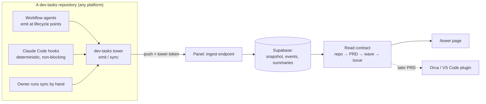
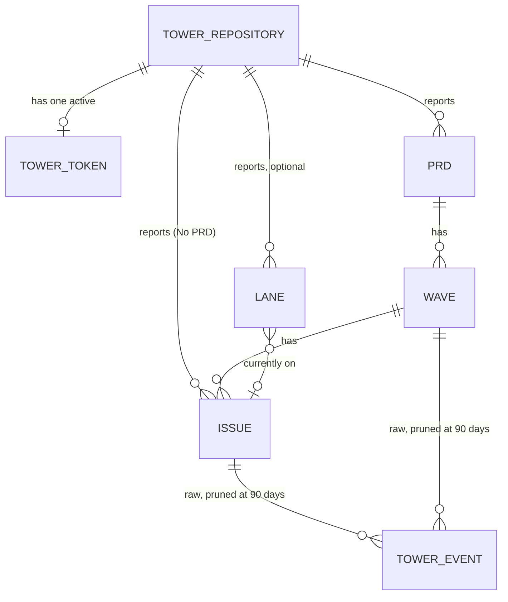

# PRD: control-tower — the state of dev-tasks work across repositories

## Changelog

| Version | Date       | Summary                                                                                           | Author                    |
| ------- | ---------- | ------------------------------------------------------------------------------------------------- | ------------------------- |
| 1.0     | 2026-11-25 | Initial draft. Decisions D-01 to D-17 in `workstream/decisions-control-tower.md`. | @llipe / product-engineer |
| 1.1     | 2026-11-25 | Approved by @llipe. No requirement changed. The glossary append for the 13 proposed Vocabulary terms was refused: the bounded context `panel` does not resolve because the technical guidelines have no package map (D-17). The rows stay `proposed` until it exists. | @llipe / product-engineer |
| 1.2     | 2026-11-25 | Factual corrections from `workstream/research-control-tower.md`; no requirement changed. FR-2, §12 and §17 no longer cite a hashed-at-rest or constant-time token precedent in the webhook code: webhook secrets are in Vault and the URL token is plain text, so token hashing and verification are new. §12 states what Realtime covers today. §17 counts logout as a public surface. | product-engineer |
| 1.3     | 2026-11-25 | FR-8 rewritten, confirmed by @llipe in the HOW phase (D-21): the newest observed result per item wins, a snapshot never erases, and each push names its branch. Two lanes pushing from different worktrees no longer overwrite each other. OQ-3 resolved. | @llipe / product-engineer |

## 1. Executive Summary

The panel shows what the fleet agents did. It shows nothing about the work those repositories are doing under the dev-tasks workflow: which PRD is moving, which wave is stuck, which issue has been waiting on the owner for a day. That state exists, but it is spread over PRD files, `docs/roadmap.md`, `workstream/` artifacts, GitHub issues and pull requests, and, for a crew running parallel-lanes, a registry on a separate branch. This PRD adds the **Control Tower**: a `/tower` section of the panel that shows, for every registered repository, PRD → wave → issue with the progress, times, rework and cost of each (D-03). The data is pushed by the dev-tasks CLI with a per-repository token (D-04, D-05, D-11); the panel reads no repository itself.

## 2. Feature Overview

The Control Tower has two halves. This PRD owns the receiving half and the contract between them; a companion PRD in `llipe/dev-tasks` owns the sending half (D-16).

What the page shows, at three levels (D-08, D-09):

- **PRD** — a rollup: status, waves shipped, issues shipped, a progress bar, last activity.
- **Wave** — an eight-stage ladder recorded per stage, so a skipped stage is a visible gap, not a lower count.
- **Issue** — an eight-step pipeline with the result of each step and the time between steps.

A repository running parallel-lanes additionally shows its crew and what is waiting on the owner (D-10). A repository without lanes shows everything else, unchanged (D-01).

Delivery is in three waves (D-16):

| Wave                | Ships                                                                                                     |
| ------------------- | --------------------------------------------------------------------------------------------------------- |
| A — Ingest          | Tower repository registration, tower tokens, the ingest endpoint and contract, storage, the retention job |
| B — Tower           | The `/tower` page: hierarchy, wave ladder, issue pipeline, metrics, live updates, stale flag               |
| C — Crew and cost   | Lanes strip, "Waiting on you", lane chips, model and tokens                                               |

## 3. Goals & Objectives

1. **One place to see the state of dev-tasks work.** For every tower repository: every PRD, its waves, their issues, and where each stands, without opening GitHub or the repository.
2. **Show where time goes.** Time per step, elapsed time, time waiting on the owner, and rework are visible per issue and summed per wave and PRD (D-13).
3. **Show gaps, not only progress.** A wave marked shipped with no audit, or an issue whose coverage gate was skipped, is visible as such (D-08, D-09).
4. **Evidence only.** Every status on the page derives from something the workflow produced. The page has no manually set status, and a value that was not reported reads "not reported", never zero (D-13).
5. **Work for any dev-tasks repository.** Parallel-lanes adds information; its absence removes none of the rest (D-01, D-10).
6. **Never block the work it observes.** A failed or missing push degrades the tower, not the workflow (D-06).

## 4. Affected Repositories

| Repo                          | Role / Impact                                                                                                                                                                                                                       |
| ----------------------------- | ----------------------------------------------------------------------------------------------------------------------------------------------------------------------------------------------------------------------------------- |
| `llipe/dev-tasks-agent-fleet` | This PRD. Supabase schema for tower data, the ingest endpoint, token issuance, the read contract, the `/tower` pages, the retention job, `/DESIGN.md` additions.                                                                    |
| `llipe/dev-tasks`             | Companion PRD, written there (D-16): `dev-tasks tower login`, `sync` and `emit`; agent instructions that emit at lifecycle points; Claude Code hooks; the lanes registry reader. It cites this PRD's ingestion contract by version. |

## 5. Target Users

- **Primary:** the owner, as the person who approves plans, answers questions and merges to `main` across several repositories, and who needs to know where they are the bottleneck.
- **Secondary:** the owner supervising a parallel-lanes crew, who needs to see which workflow agent holds which lane and what each waits on.

There is no external user. The Control Tower sits behind the panel's existing login.

## 6. User Stories

1. As the owner, I want to register a repository and receive a token, so that its dev-tasks CLI can report to the Control Tower.
2. As the owner, I want to revoke or rotate a repository's token, so that a leaked token stops working without affecting other repositories.
3. As the owner, I want to see every PRD of a repository with how many of its waves and issues have shipped, so that I know which features are moving.
4. As the owner, I want each wave to show which of its eight stages have evidence, so that a wave that skipped its audit is visible.
5. As the owner, I want each issue to show its eight steps with the result of each and the time between them, so that I can see where an issue is and how long each step took.
6. As the owner, I want to see how long an issue has been waiting on me and how many times a gate was repeated, so that I can find where the process loses time.
7. As the owner, I want the page to update while I watch and to tell me when a repository has gone quiet, so that I never mistake a broken reporter for a calm day.
8. As the owner running a crew, I want to see each crew member's lane and status and the list of things waiting on me, so that I can unblock the crew from one page.
9. As the owner, I want to see the model and tokens spent on an issue and summed per wave, so that I know what a wave cost.
10. As the owner, I want shipped work to stay available with its times and counts, so that I can compare waves months later.

## 7. Functional Requirements

### Wave A — Ingest

- **FR-1.** The panel lets the owner register a **tower repository** by `owner/name`. A repository is registered at most once (D-11).
- **FR-2.** Registering a tower repository issues one **tower token**. The panel shows it once, as it does for webhook signing secrets, and stores only a hash of it (D-11). Hashing is new to the panel: webhook secrets are kept recoverable in Vault because verifying a signature needs them, and a tower token never needs to be read back.
- **FR-3.** The owner can rotate or revoke a tower token per repository. A rotated or revoked token is rejected on its next use. Removing a tower repository revokes its token (D-11).
- **FR-4.** A tower token grants exactly one capability: writing Control Tower data for its own repository. It grants no read, and no access to agents, runs, schedules, webhooks or any other repository's tower data (D-11).
- **FR-5.** The panel exposes one ingest endpoint that accepts a **push** authenticated by a tower token. It rejects a push with a missing, unknown or revoked token, and a push that names a repository other than the token's (D-04, D-11).
- **FR-6.** A push is one of two kinds (D-05):
  - a **snapshot**: the full hierarchy of the repository at one moment — its PRDs, their waves, the issues of each wave, issues with no PRD, and, when present, the lanes registry;
  - a **tower event**: one thing that happened — an issue step or wave stage changed result, a block was raised or cleared, a pull request was linked, a session ended with its model and token usage.
- **FR-7.** The ingestion contract is versioned. Every push states its contract version, and the endpoint rejects a version it does not support with a response that names the versions it does (D-16).
- **FR-8.** Every step and stage result in a push carries the time it was observed, and every push states the branch it was built from. For each step or stage the panel keeps the result with the newest observed time. A snapshot adds and updates items and never removes them; an item leaves the open picture only when a snapshot built from the default branch no longer contains it, and it is then kept as history. A tower event updates only the item it names. The panel rejects an observed time more than a few minutes in the future (D-21).
- **FR-9.** Ingestion is idempotent: a push delivered twice changes nothing the second time. An event that arrives out of order never moves an item backward in time.
- **FR-10.** A tower event that names an issue, wave or PRD the panel has not seen is stored and shown as soon as a snapshot supplies its place in the hierarchy. It is never dropped.
- **FR-11.** The panel records, per tower repository, when its last push arrived and whether the last push was accepted (D-05, D-14).
- **FR-12.** For each issue, wave and PRD the panel keeps a **summary** permanently: step or stage results, their timestamps, rework count, linked pull requests, the workflow agents involved, and token totals (D-15).
- **FR-13.** A daily job deletes the raw tower events of an issue 90 days after it shipped. Summaries are never pruned. A summary whose events were pruned is final (D-15).
- **FR-14.** The panel serves all Control Tower data through one documented **read contract**: a single shape for repository → PRD → wave → issue with the metrics of each. The `/tower` pages read only through it. It is available only to a logged-in session (D-12).

### Wave B — Tower

- **FR-15.** `/tower` lists tower repositories. Each repository shows its count of PRDs and issues, its last-reported time, and expands to its PRDs (D-03, D-14).
- **FR-16.** A PRD row shows: its name, its status (`Not started`, `In progress`, `Done`), waves shipped of total, issues shipped of total, a progress bar, and last activity. It has no pipeline of its own (D-09).
- **FR-17.** A wave row shows the eight **wave stages** — Refine, Spec, Stories, Publish, Plan, Build, Audit, Ship — each recorded independently as having evidence or not. The Build stage shows issues shipped of total (D-09).
- **FR-18.** A wave row also shows elapsed time, the count of blocked issues, the age of its oldest open issue, and the sums of its issues' rework and pull requests. It expands to its issues (D-09, D-13).
- **FR-19.** An issue row shows the eight **issue steps** — Plan, Test design, Build, Quality gates, Coverage gate, Fidelity audit, Merged, Shipped — each with one result: `passed`, `failed`, `skipped` with its reason, `in progress`, or `pending` (D-08).
- **FR-20.** The Build step shows sub-tasks done of total while in progress. The Fidelity audit step shows the count of drift findings. The Coverage gate step shows `PASS`, `FAIL` or `SKIPPED` with the recorded reason (D-08).
- **FR-21.** An issue that is not part of a wave shows Merged and Shipped as one step (D-08).
- **FR-22.** An issue with no PRD appears under a "No PRD" group in its repository (D-09).
- **FR-23.** Between two consecutive issue steps the row shows the time from the earlier step passing to the later one passing (D-13).
- **FR-24.** An issue row shows: elapsed time from its first event to now, or to Shipped; time waiting on the owner; rework count; linked pull requests, each as a link; the event count; and the workflow agents that reported on it (D-13).
- **FR-25.** **Rework** counts each time a gate failed and was repeated: a failed quality gate, a coverage gate `FAIL`, an audit that returned drift findings, and changes requested on the pull request (D-13).
- **FR-26.** Time waiting on the owner is the sum of the periods in which a block on the owner was reported for the issue. With no block ever reported, it reads "not reported" (D-13).
- **FR-27.** Any value the pushes did not supply reads "not reported". The page never renders an unreported value as zero, empty or passed (D-13).
- **FR-28.** By default the page shows open work and work shipped in the last 14 days. A filter shows everything (D-15).
- **FR-29.** A change that reaches the panel while `/tower` is open appears without a reload (D-14).
- **FR-30.** The elapsed time of an open issue advances in the browser from the last known timestamp (D-14).
- **FR-31.** A tower repository with open work and no push inside the staleness threshold is marked **stale**: its data stays visible, visibly dimmed, with the last-reported time. The threshold defaults to 24 hours and is a setting. A repository with no open work is never stale (D-14).
- **FR-32.** A tower repository that has never pushed shows an empty state that names the next action on the CLI side.

### Wave C — Crew and cost

- **FR-33.** A tower repository whose snapshot carries a lanes registry shows a **Lanes** strip: one card per crew member with its lane, its status (`idle`, `active`, `blocked`, `review`, `done`), its current issue and when it last updated (D-10).
- **FR-34.** Beside the strip, a **Waiting on you** list shows each item of the registry's digest: what is waiting, which lane holds it, and the suggested reply (D-10).
- **FR-35.** A wave or issue row held by a lane carries a chip naming the workflow agent and the lane (D-10).
- **FR-36.** A tower repository whose snapshot carries no lanes registry shows no strip, no list and no lane chips, and is otherwise identical (D-01, D-10).
- **FR-37.** A lanes registry the CLI reported as unreadable is shown as "registry could not be read", with the time. It is never shown as an empty crew (D-10).
- **FR-38.** An issue row shows the model and the token total reported for it. Usage attributed to a wave and not to one issue is shown on the wave row. Wave and PRD rows show the sums (D-07, D-13).
- **FR-39.** Model and tokens read "not reported" for work whose platform reports none. Token counts are accepted only from a session-end tower event, never from a workflow agent's own statement (D-07).

## 8. Business Rules

- **BR-1.** The dev-tasks CLI is the only source of Control Tower data. The panel does not call GitHub and does not read a repository to build or correct the tower (D-05).
- **BR-2.** There is no manual status. Nothing on `/tower` can be edited, overridden or marked done by hand (D-08, D-09).
- **BR-3.** A wave stage is recorded per stage. A later stage with evidence does not imply an earlier one (D-09).
- **BR-4.** GitHub and the repository's own artifacts remain the source of truth. When the tower disagrees with them, they are right and the next snapshot corrects the tower (D-05).
- **BR-5.** "Agent" and "run" keep their panel meaning — a fleet agent on AgentCore and one execution of it. A dev-tasks role or crew member is a **workflow agent**, in the page, the data and the code (D-17).
- **BR-6.** A push that fails is the sender's to retry or drop. The panel never calls back to a repository (D-06).

## 9. Data Requirements

Entities the feature introduces, at the level of what must be stored. The specification decides tables and columns.

| Entity           | Holds                                                                                                                                              | Sensitivity                              |
| ---------------- | -------------------------------------------------------------------------------------------------------------------------------------------------- | ---------------------------------------- |
| Tower repository | `owner/name`, registration time, last push time and outcome, staleness threshold                                                                   | Low                                      |
| Tower token      | A hash of the token, issue and revocation times                                                                                                    | **Secret.** The plain token is never stored |
| PRD              | Slug, title, status, last activity                                                                                                                 | Low                                      |
| Wave             | Name, scope line, the eight stage results with timestamps, summary                                                                                 | Low                                      |
| Issue            | Number, title, the eight step results with timestamps, sub-task progress, linked pull requests, summary                                            | Low                                      |
| Lane             | Crew member, lane id, status, current issue, last update; the "Waiting on you" items                                                               | Low to medium: free text written by the coordinator |
| Tower event      | Kind, the item it concerns, the workflow agent, timestamp, and for a session end the model and token usage                                         | Low                                      |

Titles, scope lines and digest text come from the reporting repository, which may be private. They are stored and shown only inside the panel's login boundary.

## 10. Non-Goals (Out of Scope)

- **Embedding and plugins.** No embeddable view, no read tokens, no Orca or VS Code plugin. A plugin is a later PRD that reads the FR-14 contract (D-12).
- **The sending side.** `dev-tasks tower` commands, agent instructions and hooks are specified in `llipe/dev-tasks` (D-16).
- **Pulling from GitHub.** The panel does not use its GitHub App for Control Tower data (D-05).
- **Acting on work.** The tower is read-only: no approving, unblocking, re-running, or messaging a lane from the page.
- **Estimates, due dates and velocity.** dev-tasks records none of them (D-13).
- **Reviving the static board.** `prd-factory-board` in `llipe/dev-tasks` stays parked (D-02, D-03).
- **Linking fleet agent runs to tower issues.** A `bug-fix` or `code-review` run on an issue is not shown on that issue's tower row in this PRD.
- **Notifications.** No email or bell entry for a stale repository or a new "Waiting on you" item.

## 11. Design Considerations

- `/DESIGN.md` (Nocturne) is the contract. The page reuses the app shell, nav item, tags, status pill and section label already defined there.
- **DESIGN.md impact — to add:** a stage/step track (eight nodes with connectors, five result states, a duration label on each connector, horizontal scroll on overflow); a collapsible hierarchy row for repository, PRD and wave; a crew card for the Lanes strip; a stale treatment (dimmed block plus a "stale" pill); a "not reported" value style that cannot be confused with zero.
- **DESIGN.md impact — to check:** the status tokens (§2.4) cover the five step results, including `skipped`, without a new color.
- The reference image supplied with the request shows the intended density: one row per issue, the pipeline on the left, times and counts on the right. Its wording and steps are replaced by those of D-08, D-09 and D-17.
- The two ladders use different words on purpose — **stage** for a wave, **step** for an issue — so that Plan, Build and Ship on one are never read as the other (D-17).
- Accessibility: a step's result is conveyed by text and icon, not by color alone; every node is reachable by keyboard and exposes its step, result and time to assistive technology.

## 12. Technical Considerations

- **Stack.** Next.js panel on Fly.io with Supabase as the system of record and Supabase Realtime for live updates, ; no new infrastructure. Today Realtime is published only for runs and run events and reaches the browser through a server-side relay; extending that to tower data is for the specification.
- **Ingest endpoint.** It is a public route authenticated by its own credential, like `POST /api/webhooks/[token]`. Its size cap and fail-closed behavior should follow that precedent. Token verification is new: the webhook route looks its URL token up in plain text and verifies a signature, which a tower token does not have.
- **Token handling.** Reuse the show-once reveal of webhook endpoints. Hashing at rest has no precedent in the panel and is specified new.
- **Access to stored data.** Tower tables follow the panel's current row-level-security posture; the browser never reads them directly.
- **Retention.** The daily prune follows the webhook-delivery prune.
- **Release gate.** The auth release gate should assert that the ingest endpoint rejects a push without a valid token, as it does for webhooks and internal endpoints.
- **Contract ownership.** The ingestion contract and the read contract are documented in this repository. The dev-tasks PRD cites the ingestion contract by version (D-16).
- **Order across repositories (D-16):** Wave A here → `sync` in dev-tasks → Wave B here → `emit` and hooks in dev-tasks → Wave C here. Wave A is verified with hand-made pushes, and Wave B with a snapshot fixture, so neither waits on the other repository.
- **Infrastructure scope.** Migrations against the shared Supabase project and a deploy. An `infra-engineer` pass is recommended for the live migration push and the deploy.

## 13. Acceptance Criteria

| ID    | Criterion                                                                                                                                                                                       | Validation        |
| ----- | ----------------------------------------------------------------------------------------------------------------------------------------------------------------------------------------------- | ----------------- |
| AC-1  | Given a newly registered tower repository, when registration completes, then the token is shown once, and reloading the page never shows it again.                                              | E2E               |
| AC-2  | Given a valid token, when a snapshot for its repository is pushed, then the push is accepted and the repository's last-reported time updates.                                                   | Integration       |
| AC-3  | Given no token, an unknown token or a revoked token, when a push is sent, then it is rejected and nothing is stored.                                                                            | Integration, release gate |
| AC-4  | Given a valid token for repository X, when a push names repository Y, then it is rejected and nothing is stored.                                                                                | Integration       |
| AC-5  | Given a rotated token, when the old token is used, then the push is rejected; when the new token is used, it is accepted.                                                                       | Integration       |
| AC-6  | Given a push that was already accepted, when the same push is sent again, then stored data is unchanged.                                                                                        | Integration       |
| AC-7  | Given a push with an unsupported contract version, when it is sent, then it is rejected with the supported versions named.                                                                      | Integration       |
| AC-8  | Given a tower event for an issue no snapshot has described, when a snapshot containing that issue arrives, then the event's effect is visible on the issue.                                     | Integration       |
| AC-9  | Given a snapshot with two PRDs, one with two waves, when `/tower` is opened, then the repository, both PRDs, both waves and every issue appear at the right level with the rollup counts correct. | E2E               |
| AC-10 | Given a wave whose roadmap row reads Done and whose audit has no evidence, when the wave row renders, then Ship shows evidence and Audit shows none.                                            | Unit, E2E         |
| AC-11 | Given an issue with a coverage gate skipped for a reason, when its row renders, then that step reads skipped and shows the reason.                                                              | Unit, E2E         |
| AC-12 | Given an issue with no wave, when its row renders, then Merged and Shipped appear as one step.                                                                                                  | Unit              |
| AC-13 | Given an issue whose quality gates failed once and whose audit returned drift once, when its row renders, then rework reads 2.                                                                  | Unit              |
| AC-14 | Given an issue with no reported block and no reported token usage, when its row renders, then waiting on the owner and tokens each read "not reported", not 0.                                   | Unit, E2E         |
| AC-15 | Given `/tower` is open, when a tower event for a visible issue is accepted, then the row changes without a reload.                                                                              | E2E               |
| AC-16 | Given a repository with open work whose last push is older than the threshold, when `/tower` renders, then it is marked stale and still shows its data and last-reported time.                  | Unit, E2E         |
| AC-17 | Given a repository whose issues are all shipped and whose last push is older than the threshold, when `/tower` renders, then it is not marked stale.                                            | Unit              |
| AC-18 | Given an issue shipped more than 14 days ago, when `/tower` opens with the default filter, then it is hidden; with the "everything" filter it is shown with its times and counts.                 | E2E               |
| AC-19 | Given an issue shipped more than 90 days ago, when the retention job runs, then its raw events are gone and its summary still renders the same row.                                             | Integration       |
| AC-20 | Given a snapshot with a lanes registry, when `/tower` renders, then one card per crew member and the "Waiting on you" items appear; given a snapshot without one, neither appears and the hierarchy is the same. | E2E               |
| AC-21 | Given a snapshot reporting an unreadable registry, when `/tower` renders, then the strip reads "registry could not be read".                                                                     | Unit              |
| AC-22 | Given session-end events with model and token usage for an issue, when its row renders, then the model and the token total appear and the wave row shows the sum.                               | Unit, E2E         |
| AC-23 | Given a logged-out browser, when `/tower` or the read contract is requested, then access is refused as for every other panel page.                                                              | Release gate      |

## 14. Success Metrics

1. A real wave in one tower repository is followed from Plan to Ship on `/tower` with no step corrected by hand and no status the owner knows to be wrong.
2. For that wave, the owner can name the slowest step and the rework count from the page alone.
3. A repository whose reporting is broken is marked stale within the threshold, not shown as healthy.
4. A repository without parallel-lanes and a repository with it both render correctly from the same contract version.

## 15. Assumptions

- **A-1.** Workflow agents emit tower events when their instructions say so. This is the least tested assumption in the PRD; the manual and batch-boundary `sync` exists to correct what they miss, and a missed event costs timing detail, not correctness (D-06).
- **A-2.** The projects-tracking conventions (PRD and wave tracking issues, sub-issues, status comments) are in use in a reporting repository. A repository without them reports what the CLI can still derive, and the rest reads "not reported".
- **A-3.** One owner uses the tower. Nothing is scoped per viewer.
- **A-4.** Push volume is small: tens of events per issue, a handful of active repositories.
- **A-5.** The owner accepted every recommendation in the WHAT phase except one, which they extended (D-06). The PRD therefore reflects the recommendations more than a contested design.

## 16. Constraints & Dependencies

- **Depends on the dev-tasks companion PRD** for any real data. Until it ships `sync`, the tower is exercised by fixtures and hand-made pushes only (D-16).
- **Depends on parallel-lanes' registry format** for Wave C. The registry is plain-language markdown written by the coordinator; reading it is the CLI's job, and its format can drift (D-10).
- **Token attribution is a heuristic.** Usage is attributed by branch name; a main-thread session that spans several stories is attributed to the wave (D-07).
- **Model and tokens exist only where Claude Code hooks run.** Other platforms report none (D-07).
- **The glossary append is blocked.** The technical guidelines have no package map, so the bounded context of the Vocabulary terms cannot be resolved and they cannot be appended on approval (D-17).

## 17. Security & Compliance

- The ingest endpoint is a new public write surface, alongside login, logout and webhooks. It must reject before parsing more than it needs, cap body size, verify the token without leaking it through timing, and fail closed.
- A tower token is write-only and bound to one repository, so a leaked token can falsify one repository's status and nothing else. It is revocable per repository (D-11).
- The token is stored hashed and shown once. It must not appear in logs, error messages or the delivery record.
- Pushed text is untrusted input: it is rendered as text, never as markup, and never interpreted as an instruction.
- Reading tower data requires the panel login. No tower data is reachable with a tower token (D-11, D-12).
- The release gate asserts both boundaries: an unauthenticated push is rejected, and an unauthenticated read is refused.

## 18. Open Questions

- **OQ-1.** Is the staleness threshold one setting for the panel or one per repository? FR-31 fixes only the 24-hour default.
- **OQ-2.** Is rate limiting per token needed on the ingest endpoint in v1, or is the body-size cap enough at this volume? For the specification.
- **OQ-3.** Resolved in v1.3 by FR-8: the newest observed result per item wins and a snapshot never erases (D-21).
- **OQ-4.** Should a rollup also be shown per repository (total open issues waiting on the owner across PRDs)? Not requested; cheap once the read contract exists.

## Decisions

All IDs refer to `workstream/decisions-control-tower.md`.

| ID   | Decision (short form)                                                                                                   |
| ---- | ----------------------------------------------------------------------------------------------------------------------- |
| D-01 | Parallel-lanes is a dev-tasks working mode for persistent multi-agent work; the tower works with and without it         |
| D-02 | `prd-factory-board` in `llipe/dev-tasks` is parked prior art; projects-tracking is delivered                            |
| D-03 | The Control Tower is a `/tower` section of the Agent Fleet panel                                                        |
| D-04 | Data arrives by push: a panel-issued token configured in the dev-tasks CLI                                              |
| D-05 | Push only: the CLI sends the hierarchy and the events; the panel reads no repository and does not call GitHub for this  |
| D-06 | Three triggers: agents emit at lifecycle points, Claude hooks fire deterministically, `sync` runs by hand; never blocking |
| D-07 | Claude hooks capture model and tokens, attributed by branch name; other platforms show "not reported"                   |
| D-08 | Issue pipeline of eight steps with five possible results                                                                |
| D-09 | Wave ladder of eight stages recorded per stage; the PRD is a rollup; issues without a PRD group under "No PRD"          |
| D-10 | Optional Lanes strip with crew cards and "Waiting on you", plus lane chips                                              |
| D-11 | One write-only tower token per repository, shown once, stored hashed, revocable                                         |
| D-12 | Embedding is out of scope; one documented read contract is kept                                                         |
| D-13 | Metrics: time per step, elapsed, waiting on the owner, rework, PRs, events, cost; unreported is never zero              |
| D-14 | Live updates, last-reported time, stale flag after 24 hours with open work                                              |
| D-15 | Summaries kept permanently; raw events pruned 90 days after ship; default view is open work plus 14 days                |
| D-16 | Two PRDs; this one owns the contract and ships three waves; a companion PRD in `llipe/dev-tasks` owns the sending side  |
| D-17 | Thirteen domain terms; "workflow agent" for the dev-tasks side; "agent" and "run" keep their panel meaning              |
| D-21 | Newest observed result per item wins; a snapshot never erases; each push names its branch                            |

## Vocabulary

| Term             | Status in glossary | Bounded context | Definition (proposals only)                                                                                                    | Forbidden synonyms (proposals only)     |
| ---------------- | ------------------ | --------------- | ------------------------------------------------------------------------------------------------------------------------------ | --------------------------------------- |
| Control Tower    | proposed           | panel           | The `/tower` section of the panel: the view of dev-tasks work across repositories.                                             | dashboard, board, factory board         |
| Tower repository | proposed           | panel           | A repository registered to report to the Control Tower.                                                                        | project, workspace                      |
| Tower token      | proposed           | panel           | The write-only credential one tower repository uses to push.                                                                   | API key, secret                         |
| Push             | proposed           | panel           | One delivery of data from the dev-tasks CLI to the panel.                                                                      | delivery, upload, report                |
| Snapshot         | proposed           | panel           | A push carrying the full hierarchy of a tower repository at one moment.                                                        | sync, dump                              |
| Tower event      | proposed           | panel           | A push carrying one thing that happened to an issue, wave or session.                                                          | run event, log, activity                |
| Wave             | proposed           | panel           | A delivery slice of a PRD, as dev-tasks defines it; a PRD's "phase" is a wave.                                                 | phase, milestone, sprint                |
| Wave stage       | proposed           | panel           | One of the eight positions on a wave's ladder: Refine, Spec, Stories, Publish, Plan, Build, Audit, Ship.                       | step, gate, phase                       |
| Issue step       | proposed           | panel           | One of the eight positions on an issue's pipeline: Plan, Test design, Build, Quality gates, Coverage gate, Fidelity audit, Merged, Shipped. | stage, gate, phase            |
| Rework           | proposed           | panel           | One occurrence of a gate failing and being repeated on an issue.                                                               | rejection, retry, bounce                |
| Lane             | proposed           | panel           | A unit of scope held by one crew member, as parallel-lanes defines it.                                                         | track, stream, session                  |
| Workflow agent   | proposed           | panel           | A dev-tasks role or crew member that reports on work, such as developer, verifier, danny or linus.                             | agent, bot, worker                      |
| Stale            | proposed           | panel           | The state of a tower repository with open work and no push inside the staleness threshold.                                     | offline, dead, disconnected             |
