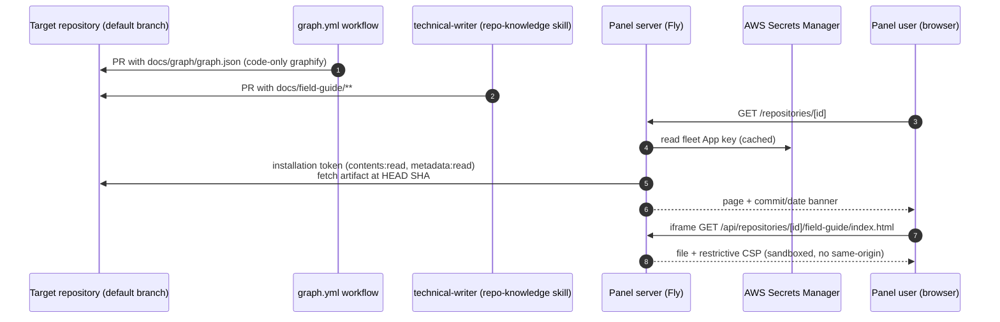
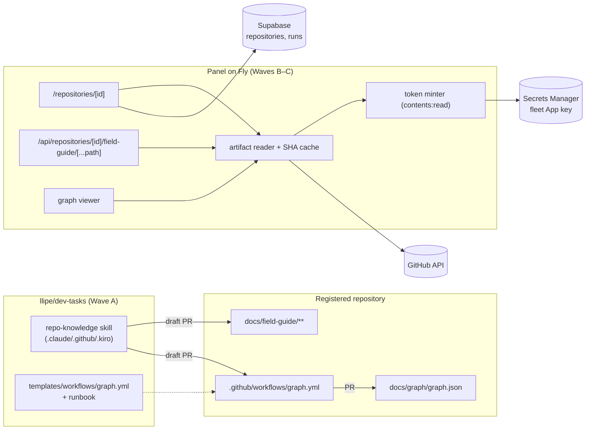

# PRD — Repository Knowledge Views

## Changelog

| Version | Date       | Summary                                                                                                   | Author           |
| ------- | ---------- | --------------------------------------------------------------------------------------------------------- | ---------------- |
| 1.0     | 2026-11-26 | Initial version from the WHAT-phase grilling (D-01–D-17, `workstream/decisions-repo-knowledge-views.md`). | product-engineer |

---

## 1. Executive Summary

The panel knows which repositories the fleet works on, but it shows nothing about what those repositories are. This PRD adds a per-repository page that renders two **knowledge artifacts** each repository owns and commits — a browsable **field guide** and a **dependency graph** generated by [graphify](https://github.com/Graphify-Labs/graphify) — next to the agent activity the panel already records (D-04, D-05). The repository stays the source of truth; the panel only reads (D-06).

## 2. Feature Overview

Three deliverables, across two repositories:

1. **A repository page in the panel** (`/repositories/[id]`) with three tabs: **Field guide**, **Dependency graph**, **Agent activity**. Workflow telemetry (dev-tasks planner, developer and verifier activity) is a separate PRD; its slot shows a "not yet collected" state (D-05).
2. **A `repo-knowledge` skill in `llipe/dev-tasks`**, owned by `technical-writer`, that defines the field-guide contract, ships a field-guide starter kit and the `graph.yml` workflow template, and installs them into a consumer repository by draft PR (D-10, D-12, D-16).
3. **Adoption in `dev-tasks-agent-fleet`**: its own dependency graph and its own field guide, written by `technical-writer` with the skill (D-09, D-10).

The flow below shows how an artifact gets from a repository to a viewer.

## 3. Goals & Objectives

- **G1.** A panel user can open any registered repository and, within one click, read its field guide and explore its dependency graph, or see exactly which artifact is missing and where it was expected (D-06).
- **G2.** Adding knowledge views to a new repository needs no panel change: install the `repo-knowledge` skill output, merge the PRs (D-10, D-12).
- **G3.** The panel never executes repository-supplied script with its own origin, and never holds a token that can write to a repository (D-07, D-14).
- **G4.** `dev-tasks-agent-fleet` and `llipe/riel` both render in the panel at the end of Wave D (D-17).

## 4. Affected Repositories

| Repo                         | Role / Impact                                                                                                                                                                                 |
| ---------------------------- | --------------------------------------------------------------------------------------------------------------------------------------------------------------------------------------------- |
| `llipe/dev-tasks`            | Wave A. New `repo-knowledge` skill on `.claude/`, `.github/`, `.kiro/`; field-guide contract and starter kit; `templates/workflows/graph.yml` + runbook; `bundle-manifest.json`; registry docs. |
| `llipe/dev-tasks-agent-fleet` | Waves B–D. Infra pass (IAM), panel read path, repository page, viewers, `/DESIGN.md`; adopts the workflow and gets its own field guide.                                                        |
| `llipe/riel`                 | No change. Its existing `docs/field-guide/` is the reference implementation and the second repository rendered (D-02, D-10). It shows a graph only if it later installs `graph.yml`.           |

## 5. Target Users

- **Primary — the operator** (Llipe): runs the fleet across several repositories and needs a quick, current picture of each one before triggering or reviewing agent work.
- **Secondary — a newcomer or agent** joining a repository: needs the zero-context field guide and a map of the code.

## 6. User Stories

1. As an operator, I want a page per repository so that its guide, its code map, and its agent runs sit in one place.
2. As an operator, I want to read a repository's field guide in the panel exactly as its authors built it, including its internal pages and images.
3. As an operator, I want to see how old a field guide is, so that I know whether to trust it or ask for a refresh.
4. As an operator, I want to search the dependency graph for a file or symbol and see what it imports and what calls it, so that I can judge the blast radius of a change.
5. As an operator, I want to jump from a graph node to its source file on GitHub at the commit being shown.
6. As an operator, I want a clear empty state when a repository has no field guide or no graph, naming the path the panel looked for.
7. As a repository maintainer, I want one command path (the `repo-knowledge` skill) that installs the graph workflow and scaffolds a field guide, so that onboarding a repository takes one draft PR each.
8. As `technical-writer`, I want a written field-guide contract and update prompt, so that every guide I write renders in the panel without special cases.

## 7. Functional Requirements

### 7.1 Repository page (Wave B)

- **FR-1.** The panel **MUST** serve `/repositories/[id]` for every non-archived registered repository, linked from each row of the Repositories list (D-03, D-04).
- **FR-2.** The page **MUST** carry three tabs: Field guide, Dependency graph, Agent activity. The selected tab **SHOULD** be addressable in the URL (D-05).
- **FR-3.** The Agent activity tab **MUST** list that repository's runs from the existing `runs` data (filtered by `repository_id`), reusing the run-history row component and links. It **MUST NOT** add new telemetry (D-05).
- **FR-4.** The Agent activity tab **MUST** show a "Workflow telemetry — not yet collected" placeholder that names the follow-up PRD (D-05).
- **FR-5.** The page **MUST** sit behind the existing `proxy.ts` fail-closed gate; every authenticated user sees every repository's page. No new role is introduced (D-15).

### 7.2 Read path (Wave B)

- **FR-6.** The panel **MUST** read knowledge artifacts from the repository's default branch through the GitHub API, at fixed paths: `docs/field-guide/**` (entry `index.html`) and `docs/graph/graph.json` (optional `docs/graph/GRAPH_REPORT.md`). It **MUST NOT** copy them into Supabase (D-06).
- **FR-7.** The panel **MUST** obtain access by minting a fleet-App installation token server-side, down-scoped with GitHub's `permissions` parameter to `contents: read` and `metadata: read`. The App private key **MUST** be read from AWS Secrets Manager through the panel's AWS role, which **MUST** gain `secretsmanager:GetSecretValue` on that one secret and nothing else (D-13, D-14).
- **FR-8.** Tokens **MUST** be cached in memory only until shortly before expiry, **MUST NOT** be logged, and **MUST NOT** reach the browser in any response, header, or HTML (D-14).
- **FR-9.** Artifact reads **MUST** be cached server-side keyed by `(repository, commit SHA, path)`. Each tab **MUST** display the commit SHA (short) and commit date it renders (D-06).
- **FR-10.** A missing artifact **MUST** render a "not present" empty state naming the expected path and linking to the `repo-knowledge` skill instructions. A GitHub error (rate limit, 5xx, revoked installation) **MUST** render a distinct, retryable error state, never the "not present" state (D-06).

### 7.3 Field guide tab (Waves B–C)

- **FR-11.** Field-guide files **MUST** be served by an authenticated route `/api/repositories/[id]/field-guide/[...path]` that fetches the file per FR-6, sets the content type from the extension, and refuses any path that resolves outside `docs/field-guide/` (D-07).
- **FR-12.** Every field-guide response **MUST** carry a restrictive Content-Security-Policy: no `connect-src` to the panel origin, external scripts and fonts only from the artifact-allowed CDNs (cdnjs.cloudflare.com, cdn.jsdelivr.net, unpkg.com, Google Fonts) (D-07).
- **FR-13.** The tab **MUST** render the guide in an `<iframe sandbox="allow-scripts allow-popups">` — never `allow-same-origin` — pointed at the route's `index.html`. Relative links, extra pages and assets **MUST** resolve through the same route. The panel **MUST NOT** rewrite guide HTML (D-07).
- **FR-14.** Panel chrome around the frame **MUST** be limited to the commit/date banner, the staleness indicator, and an "Open full screen" link to the route (D-07).
- **FR-15.** The tab **MUST** show staleness: the date of the last commit under `docs/field-guide/` and the number of commits the default branch has moved since. Above 30 days **or** 100 commits it **MUST** switch to the warning treatment. It is advisory: no block, no notification (D-11).

### 7.4 Dependency graph tab (Wave C)

- **FR-16.** The viewer **MUST** be panel-native, reading `graph.json` only; the panel **MUST NOT** render graphify's `graph.html` (D-08).
- **FR-17.** The viewer **MUST** declare the graphify `schema_version` range it supports and show an explicit "unsupported graph format" error, naming the found and supported versions, for anything else (D-08).
- **FR-18.** The viewer **MUST** provide: node search by label; filters by `file_type` and `relation`; `INFERRED` and `AMBIGUOUS` edges hidden by default with a toggle; click-to-focus on a node's neighbourhood; a link from a focused node to `source_file` on GitHub at the rendered commit (D-08).
- **FR-19.** Above a node threshold (set in the spec), the viewer **MUST** open in a community-aggregated view and let the user expand a community (D-08).
- **FR-20.** When `GRAPH_REPORT.md` exists, the viewer **MUST** render it as sanitised Markdown in a side panel (no raw HTML) (D-08).
- **FR-21.** The viewer **MUST** use `/DESIGN.md` tokens and follow the panel's light/dark theme (D-08).

### 7.5 `repo-knowledge` skill (Wave A, `llipe/dev-tasks`)

- **FR-22.** dev-tasks **MUST** ship a `repo-knowledge` skill on all three platforms (`.claude/skills/`, `.github/skills/`, `.kiro/skills/`), listed in `bundle-manifest.json` and in the AGENTS.md skill registry, with `technical-writer` as owner and consumer (D-10, D-16).
- **FR-23.** The skill **MUST** define the **field-guide contract**: required `docs/field-guide/index.html`; optional extra pages and assets under `docs/field-guide/`; `docs/field-guide/README.md` with a section-to-source map, a paste-ready update prompt, and a "Last revision" stamp (date + commit); page rules — self-contained page (inline CSS/JS), external scripts only from allowed CDNs pinned to exact versions, stylesheets only from Google Fonts, theme tokens with light/dark, no sideways scroll at 390 px, no download or print buttons, English only. These are riel's page rules, generalised (D-02, D-10).
- **FR-24.** The skill **MUST** ship a starter kit: a README template and a generic update prompt derived from riel's, with riel-specific sections replaced by a generic section set (D-10).
- **FR-25.** The skill **MUST** provide two procedures — *create/refresh a field guide* and *install the graph workflow* — and **MUST** deliver every change to a consumer repository as a draft PR, never a direct push (D-10, D-12).
- **FR-26.** `technical-writer`'s agent definition on all three platforms **MUST** name field-guide creation and refresh as its responsibility and reference the skill (D-10).

### 7.6 `graph.yml` workflow template (Wave A, `llipe/dev-tasks`)

- **FR-27.** dev-tasks **MUST** ship `templates/workflows/graph.yml`, listed in `bundle-manifest.json` (D-12).
- **FR-28.** The workflow **MUST** install a pinned `graphifyy` version, run code-only extraction with `GRAPHIFY_BACKEND=none` (no LLM, no secret), and write `docs/graph/graph.json` and `docs/graph/GRAPH_REPORT.md` (D-01, D-09).
- **FR-29.** It **MUST** open or update a single PR titled `chore(graph): refresh dependency graph` only when the graph changed, and **MUST NOT** push to the default branch (D-09).
- **FR-30.** Triggers: weekly schedule, `workflow_dispatch`, and push to the default branch filtered to code paths (D-09).
- **FR-31.** A runbook (`docs/runbooks/graph-workflow.md` or equivalent) **MUST** ship in the same PR as the template (FR-49a) (D-09).

### 7.7 Adoption (Wave D, `dev-tasks-agent-fleet`)

- **FR-32.** `dev-tasks-agent-fleet` **MUST** receive `graph.yml` through the `repo-knowledge` skill in a draft PR, and its first generated graph **MUST** be merged (D-09, D-12).
- **FR-33.** `technical-writer` **MUST** write `dev-tasks-agent-fleet`'s own field guide under `docs/field-guide/`, conforming to the contract (D-10).
- **FR-34.** Both `dev-tasks-agent-fleet` and `llipe/riel` **MUST** be verified live in the deployed panel (D-17).

## 8. Business Rules

- **BR-1.** The repository wins. When an artifact and its sources disagree, the sources are correct; the panel never edits, caches beyond a commit, or "fixes" an artifact (D-02, D-06).
- **BR-2.** Read-only. No panel code path may request a token with write permissions (D-14).
- **BR-3.** Repository script is untrusted. It runs only inside the sandboxed frame with no same-origin access (D-07).
- **BR-4.** Nothing reaches a default branch without a PR: neither the graph workflow nor the skill pushes directly (D-09, D-12).
- **BR-5.** Staleness is information, not a gate (D-11).

## 9. Data Requirements

No new tables, enums, or migrations. The page reads existing `repositories` and `runs` rows. Knowledge artifacts live only in each repository's Git tree (D-06).

| Data                        | Where                                     | Sensitivity                                                       |
| --------------------------- | ----------------------------------------- | ----------------------------------------------------------------- |
| Field guide files           | `docs/field-guide/**` in the repository    | Same as repository contents; may describe internals              |
| `graph.json`, `GRAPH_REPORT.md` | `docs/graph/` in the repository        | Same as repository contents; exposes file/symbol names            |
| Fleet App private key       | AWS Secrets Manager (existing)             | Secret; read by panel server only, never logged                   |
| Installation token          | Panel server memory                        | Secret; down-scoped, short-lived, never sent to the browser       |
| Server-side artifact cache  | Panel server memory, keyed by commit SHA   | Same as repository contents                                       |

graphify's `graph.json` is NetworkX node-link: nodes carry `id`, `label`, `file_type`, `source_file`; edges carry `source`, `target`, `relation`, `confidence` (`EXTRACTED` / `INFERRED` / `AMBIGUOUS`), optional `confidence_score`; top level carries `schema_version` and `graphify_version` (D-01).

## 10. Non-Goals (Out of Scope)

- dev-tasks workflow telemetry (planner, developer, verifier activity): separate PRD (D-05).
- Copying artifacts into Supabase or Supabase Storage (D-06).
- Rendering graphify's `graph.html` (D-08).
- An LLM semantic pass over docs in the graph; a graph-generating fleet agent (D-09). Either may be a later wave.
- Automatic generation or refresh of field guides by CI or a fleet agent (D-10).
- Per-repository visibility or roles; `prd-panel-auth-and-rls` remains DEFERRED (D-15).
- A separate read-only GitHub App (D-14).
- Changes to `llipe/riel`.

## 11. Design Considerations

- Follows `/DESIGN.md` (Nocturne tokens, `KLabel`, tab and empty-state patterns). **DESIGN.md impact:** add the repository page layout (§5.x), a tab-bar component if none exists, the knowledge-artifact empty and error states, the staleness indicator (normal/warning), and graph-viewer tokens (node colours by `file_type`, edge styles by `confidence`), all with light/dark values.
- The field-guide frame fills the content region; "Open full screen" opens the route in a new tab.
- The graph viewer **MUST** be keyboard-operable for search, filters and node focus, and **MUST** offer a text alternative for the focused node (its incoming and outgoing relations as a list).
- Phone width: the page **MUST NOT** scroll sideways at 390 px; the graph canvas and frame scroll or scale inside their own containers.

## 12. Technical Considerations

The components and their new dependencies are shown below.

- **First GitHub client in the panel.** The panel makes no GitHub API calls today (D-13). The spec chooses the client (Octokit or `fetch`), JWT signing for the App, and token caching.
- **Infra pass required (Wave B).** Adding `secretsmanager:GetSecretValue` to the panel role is an IAM change and **SHOULD** run through `infra-engineer` with backup and revert (product-engineer rule 10).
- **Rate limits.** The SHA-keyed cache plus one HEAD-SHA lookup per page view keeps GitHub calls bounded; the spec sets the cache TTL and the HEAD lookup cadence.
- **Untrusted HTML.** Isolation is the iframe sandbox (no `allow-same-origin`) plus CSP on the route. The spec fixes the exact CSP and confirms the route's cookies cannot be read from the frame.
- **Known riel incompatibility.** riel's `api.html` fetches `../api/openapi.yaml`, outside `docs/field-guide/`; under FR-11 that request is refused, so its API page will show its own fallback. Accepted, not fixed here.
- **Graph library.** Pinned, chosen in the spec for size and performance at the aggregation threshold.
- **Left for the HOW phase:** graph library; size caps for `graph.json` and individual field-guide files; cache TTL; aggregation node threshold; exact CSP; supported `schema_version` range; graphify version pin.
- Foundation docs in this repository still use the pre-rename names (`docs/product.md`, `docs/tech.md`); `dev-tasks migrate docs` is recommended.

## 13. Acceptance Criteria

- **AC-1.** Given a registered repository, when a user opens `/repositories/[id]`, then three tabs render and Agent activity lists exactly that repository's runs (FR-1–FR-3).
- **AC-2.** Given a repository without `docs/field-guide/index.html`, when the Field guide tab opens, then a "not present" state names `docs/field-guide/index.html`; given a GitHub 5xx, a retryable error state renders instead (FR-10).
- **AC-3.** Given riel's field guide, when the tab opens, then `index.html`, `internals.html` and every `screens/*.webp` load through the proxy route with no console errors other than the known `api.html` fetch (FR-11–FR-13).
- **AC-4.** Given a request for `/api/repositories/[id]/field-guide/../../README.md` or an encoded equivalent, then the route returns 4xx and reads nothing (FR-11).
- **AC-5.** Given script inside the guide that tries `parent.document`, `document.cookie` or `fetch('/api/…')` against the panel, then each fails (FR-12, FR-13).
- **AC-6.** Given a guide whose last commit is 31 days old, or 101 commits behind, then the staleness label shows the warning treatment; at 29 days and 99 commits it does not (FR-15).
- **AC-7.** Given a valid `graph.json`, when a user searches a node, focuses it, and toggles `INFERRED` edges, then the neighbourhood and edge set update and the source link opens `source_file` at the rendered SHA (FR-18).
- **AC-8.** Given a `graph.json` with an unsupported `schema_version`, then the viewer shows the unsupported-format error naming both versions (FR-17).
- **AC-9.** No response body, header, log line or HTML from the panel contains an installation token; a token minted by the panel cannot create a branch or file (FR-7, FR-8).
- **AC-10.** In dev-tasks, the `repo-knowledge` skill exists on all three platforms, is in `bundle-manifest.json` and the AGENTS.md registry, and `validate` passes (FR-22).
- **AC-11.** Running `graph.yml` on a repository with unchanged code opens no PR; after a code change it opens or updates exactly one `chore(graph): refresh dependency graph` PR, and it never pushes to the default branch (FR-28–FR-30).
- **AC-12.** `dev-tasks-agent-fleet` and `llipe/riel` both render their available artifacts in the deployed panel (FR-32–FR-34).
- **AC-13.** The repository page does not scroll sideways at 390 px in light or dark theme (§11).

## 14. Success Metrics

- Both reference repositories render live at the end of Wave D (G4).
- Onboarding a third repository takes two merged draft PRs (graph workflow, field guide) and no panel change (G2).
- Zero findings in the Wave B/C security review for token exposure or frame escape (G3).
- p95 time-to-first-render of a cached tab under 1 s; uncached under 3 s (refined in the spec).

## 15. Assumptions

- The fleet App (`4687256`) is installed on every registered repository and already holds Contents permission (D-13).
- GitHub honours down-scoped installation tokens (`permissions` on the access-token request) for this App.
- graphify's code-only mode produces a useful graph for TypeScript and Python without an LLM (D-01).
- Repositories are small enough that `graph.json` fits a size cap set in the spec.

## 16. Constraints & Dependencies

- Wave order: A ∥ B; C after B; D after A and C (D-17).
- Wave B depends on an `infra-engineer` pass for the IAM change.
- Wave A ships in `llipe/dev-tasks` and reaches this repository through `dev-tasks update`.
- graphify is a fast-moving external tool (0.9.x, v8 branch); the template pins a version and the viewer pins a schema range (D-08, D-09).

## 17. Security & Compliance

- Untrusted repository HTML is isolated by the sandbox and CSP (D-07); covered by AC-4, AC-5.
- The panel role gains read access to a write-capable App key. Accepted trade-off (D-14). Mitigations: the grant is limited to one secret ARN, tokens are down-scoped, the key is never logged, and the Wave B infra change records a revert.
- No token ever reaches the browser (FR-8, AC-9).
- Path traversal is refused at the route (FR-11, AC-4).
- `GRAPH_REPORT.md` is rendered sanitised (FR-20).
- The page inherits the existing auth gate; per-repository access control is deferred (D-15).

## 18. Open Questions

None at WHAT level. HOW-phase items are listed in §12.

## Decisions

| ID   | Decision (short form)                                                                                         |
| ---- | ------------------------------------------------------------------------------------------------------------- |
| D-01 | graphify: Python CLI, code-only offline mode, `graph.json` node-link output, LLM only for docs                |
| D-02 | riel's `docs/field-guide/` is the reference implementation                                                    |
| D-03 | New views live under `panel/app/(panel)/` behind `proxy.ts`                                                   |
| D-04 | Per registered repository, not this repository only                                                            |
| D-05 | Three tabs; Agent activity reuses `runs`; workflow telemetry is a separate PRD                                |
| D-06 | Repository-owned artifacts at fixed paths, read live from GitHub, SHA-keyed cache, no Supabase copy          |
| D-07 | Field guide in a sandboxed iframe via an authenticated proxy route with restrictive CSP                       |
| D-08 | Panel-native graph viewer over `graph.json`; schema-version guard                                             |
| D-09 | `graph.yml`: code-only, PR-based, weekly/dispatch/push; this repository adopts first                          |
| D-10 | Field-guide contract + `repo-knowledge` skill in dev-tasks, owned by `technical-writer`; writes this repo's guide |
| D-11 | Advisory staleness: >30 days or >100 commits                                                                   |
| D-12 | `graph.yml` lives in dev-tasks `templates/workflows/`, installed by the skill                                 |
| D-13 | The panel has no GitHub credential today                                                                       |
| D-14 | Reuse the fleet App; down-scoped `contents:read` tokens; IAM via infra pass                                   |
| D-15 | Existing auth gate; no new roles                                                                               |
| D-16 | Vocabulary: knowledge artifact, field guide, dependency graph; skill `repo-knowledge`                         |
| D-17 | Four waves: A dev-tasks; B read path; C viewers; D adoption                                                   |

## Vocabulary

| Term               | Status in glossary | Bounded context | Definition (proposals only)                                                                                                                                                                 | Forbidden synonyms (proposals only) |
| ------------------ | ------------------ | --------------- | ------------------------------------------------------------------------------------------------------------------------------------------------------------------------------------------ | ----------------------------------- |
| Knowledge artifact | proposed           | panel           | A repository-owned file committed at a fixed path that the panel reads live from GitHub and renders: a field guide or a dependency graph.                                                  | doc snapshot, synced doc            |
| Field guide        | proposed           | panel           | A derived, self-contained HTML guide to a repository under `docs/field-guide/` (entry `index.html`), following the field-guide contract and maintained by `technical-writer`; its sources win over it. | wiki, handbook, portal docs         |
| Dependency graph   | proposed           | panel           | graphify's code-only output at `docs/graph/graph.json`: files and symbols and their `imports`/`calls` relations, in NetworkX node-link format.                                             | knowledge graph, code map           |
