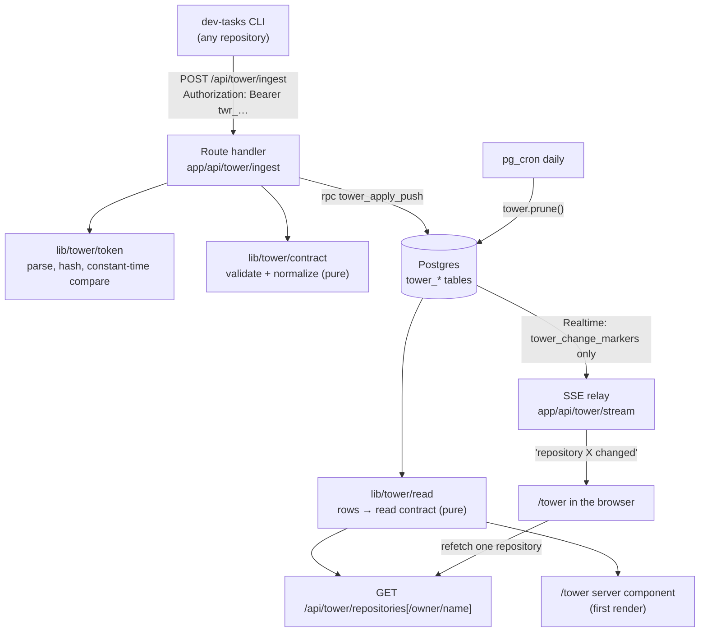
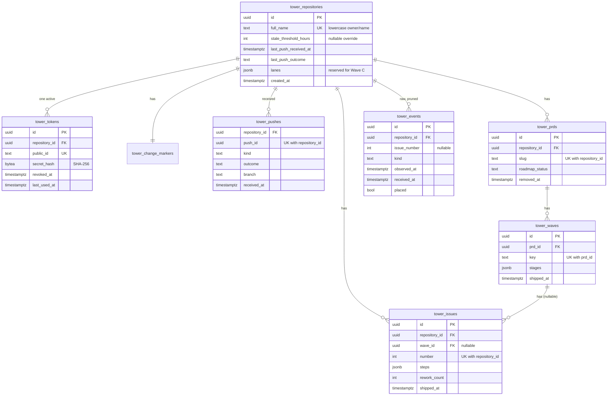
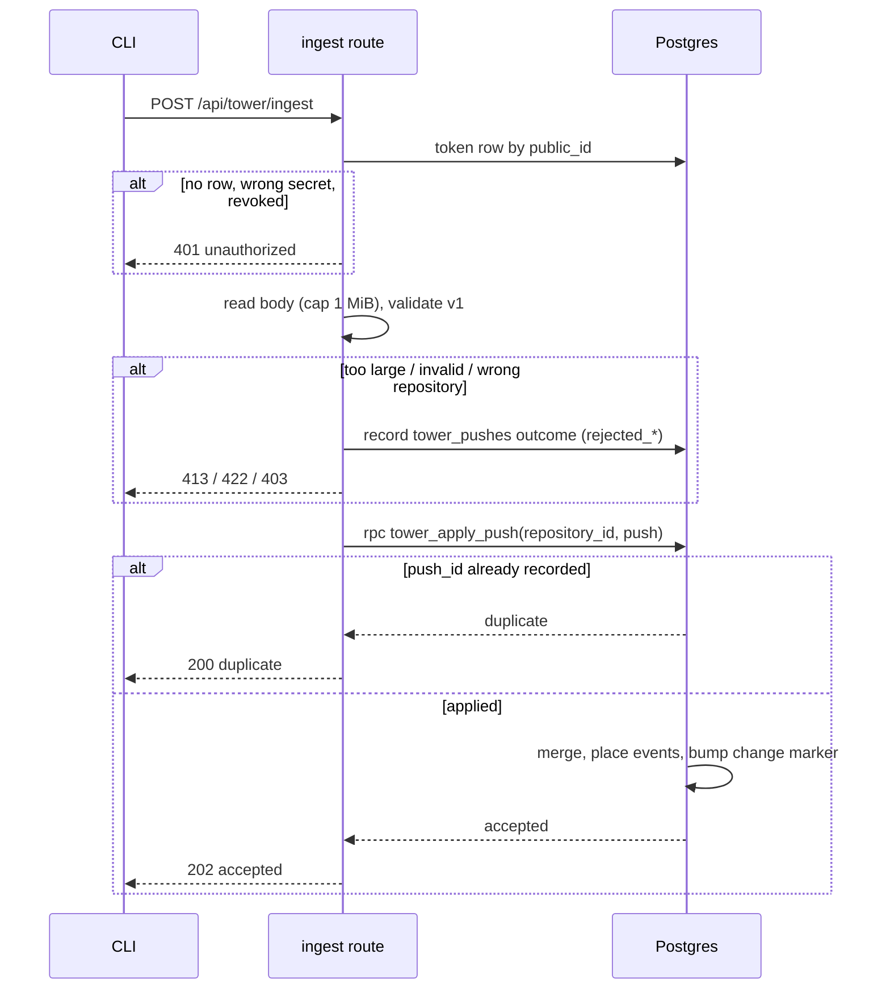
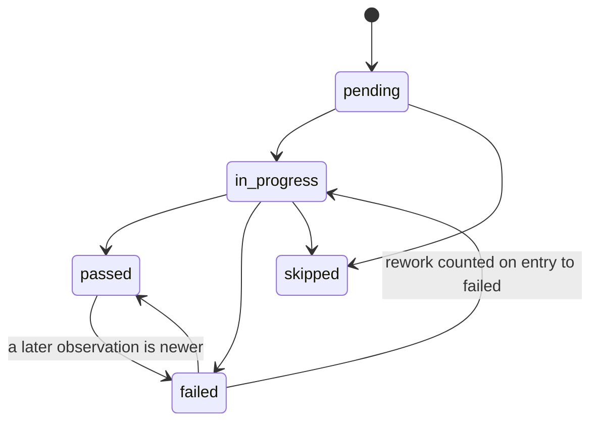

# Technical Specification: control-tower (Waves A and B)

## Changelog

| Version | Date       | Summary                                                                                                  | Author                    |
| ------- | ---------- | -------------------------------------------------------------------------------------------------------- | ------------------------- |
| 1.0     | 2026-11-26 | Initial draft for Waves A and B. HOW decisions D-18 to D-31 in `workstream/decisions-control-tower.md`. | @llipe / product-engineer |
| 1.1     | 2026-11-26 | Approved by @llipe, including SQ-1 (merge logic in one database function), SQ-2 (`changes_requested` event kind) and SQ-3 (removal guard). No content changed. | @llipe / product-engineer |

## 1. Executive Summary

The Control Tower is built as a push-fed read model inside the panel. The dev-tasks CLI posts snapshots and tower events to one bearer-authenticated endpoint; a single database function merges each push into six `tower_*` tables under a "newest observed result wins" rule; one server module turns those rows into the read contract that both the `/tower` page and its browser refetches consume (D-20, D-21, D-22, D-23, D-27). This specification covers Wave A (ingest, tokens, storage, retention, read contract, minimal `/tower`) and Wave B (the hierarchy page with live updates). Wave C is specified later; ingestion contract version 1 already accepts its data (D-18).

## 2. Reference Documents

- PRD: [`docs/requirements/prd-control-tower.md`](../docs/requirements/prd-control-tower.md) v1.4.
- Decisions: `workstream/decisions-control-tower.md`, D-01 to D-31. IDs below are unqualified.
- Research: `workstream/research-control-tower.md` (SHA `f21fa20d`). Cited as R§n and, for its contradictions, C1–C9.
- Technical guidelines: `docs/technical-guidelines.md` §4 API design, §5 authentication, §6 security (deny-all RLS), §7 data (migrations, the 1,000-row PostgREST limit, the local `service_role` grant gap), §11 testing.
- `/TESTING.md` (no data-layer mocks at Layer 2.5; security-negative tests required on auth paths), `/DESIGN.md` (Nocturne), ADR-007 (the auth boundary is a release gate).
- Companion brief: `workstream/brief-dev-tasks-control-tower.md`.

## 3. Affected Repositories

| Repository                    | Role                    | Scope of Changes                                                                                                                                                                                              |
| ----------------------------- | ----------------------- | ------------------------------------------------------------------------------------------------------------------------------------------------------------------------------------------------------------- |
| `llipe/dev-tasks-agent-fleet` | Panel and system of record | Supabase migrations (`tower_*` tables, `tower` schema, functions, cron, Realtime publication); `panel/lib/tower/`; `panel/app/api/tower/`; `panel/app/(panel)/tower/`; `panel/components/tower/`; route policy; release gate; contract documents; runbook; `/DESIGN.md`. |
| `llipe/dev-tasks`             | Sender (companion PRD)  | None under this specification. It consumes §6.1 as ingestion contract version 1.                                                                                                                              |

## 4. System Architecture

The diagram shows the path of a push and the path of a read. Nothing in the panel reaches out to a repository or to GitHub (BR-1).



Module boundaries:

| Module                          | Responsibility                                                                                          | Server-only |
| ------------------------------- | ------------------------------------------------------------------------------------------------------- | ----------- |
| `panel/lib/tower/contract.ts`   | Ingestion contract v1 types, validation, normalization. Pure.                                            | no (types shared) |
| `panel/lib/tower/token.ts`      | Token generation, parsing, hashing, constant-time verification.                                         | yes         |
| `panel/lib/tower/ingest.ts`     | The receive pipeline: authenticate → size → validate → apply → respond. Mirrors `lib/webhooks/receive.ts` in shape, not in auth (C1–C3). | yes |
| `panel/lib/tower/queries.ts`    | Service-role reads and the `tower_apply_push` call. Paged.                                              | yes         |
| `panel/lib/tower/read.ts`       | Rows → read contract: durations, elapsed, staleness, rollups, filters. Pure.                            | no          |
| `panel/lib/tower/names.ts`      | The eight step names and eight stage names, in order, for contract version 1.                           | no          |
| `panel/lib/domain/tower-repository-save.ts` | Register, rotate, revoke, remove, threshold. Follows `webhook-endpoint-save.ts`.            | yes         |

## 5. Data Model & Database Design

Six tables hold tower data, one per level plus pushes and raw events (D-22). All are in `public`, prefixed `tower_` (D-31), deny-all RLS with no policies, read and written only by `service_role` (guidelines §6). A `tower` schema holds configuration and functions, as `webhook` does (R§4). No table references `repositories` (D-19).



### 5.1 Tables

**`tower_repositories`** — `full_name` is stored lowercase and checked against `^[a-z0-9_.-]+/[a-z0-9_.-]+$`; unique (FR-1). `stale_threshold_hours` is null or 1–720 (D-29). `last_push_outcome` is `accepted` or `rejected` (FR-11). `lanes` and `lanes_observed_at` store the latest lanes block untouched until Wave C reads it (D-18).

**`tower_tokens`** — `public_id` is 12 lowercase base32 characters, unique. `secret_hash` is the SHA-256 of the secret, 32 bytes. A partial unique index on `(repository_id) where revoked_at is null` enforces one active token per repository (D-11). Rotation inserts the new row and sets `revoked_at` on the old one in one statement. Deleting a repository cascades.

**`tower_change_markers`** — one row per repository: `repository_id` (PK), `seq bigint`, `changed_at`. It is the only tower table in the `supabase_realtime` publication and carries no tower content (D-24).

**`tower_pushes`** — the idempotency record and the counter source (D-25, D-28): unique `(repository_id, push_id)`; `kind` (`snapshot`, `event`); `outcome` (`accepted`, `duplicate`, `rejected_payload`, `rejected_size`, `rejected_repository`); `contract_version`; `branch`; `is_default_branch`; `received_at`. Rows older than 30 days are pruned.

**`tower_prds`** — `slug` unique per repository; `title`; `roadmap_status` (`not_started`, `in_progress`, `done`); `last_activity_at`; `seen_on_default boolean`; `removed_at`.

**`tower_waves`** — `key` unique per PRD (the wave's name as the roadmap writes it, or `All`); `name`; `scope`; `position`; `stages jsonb` (§5.2); `first_observed_at`; `shipped_at`; `seen_on_default`; `removed_at`.

**`tower_issues`** — `number` unique per repository; `title`; `prd_id` and `wave_id` nullable (FR-22); `steps jsonb` (§5.2); `subtasks_done`, `subtasks_total`; `coverage_gate` (`PASS`, `FAIL`, `SKIPPED`, null) and `coverage_gate_reason`; `drift_findings` (nullable int); `pull_requests jsonb`; `blocked_on_owner_since` (nullable); the summary columns `first_observed_at`, `shipped_at`, `rework_count`, `rework_keys text[]`, `waiting_seconds`, `waiting_reported boolean`, `event_count`, `workflow_agents text[]`, `tokens_total bigint` (nullable), `models text[]`; `summary_final_at` (set when its events are pruned); `seen_on_default`; `removed_at`.

**`tower_events`** — raw tower events and the only table the 90-day job empties (D-15, D-22): `repository_id`, `push_id`, `kind`, `issue_number`, `prd_slug`, `wave_key` (all nullable), `workflow_agent`, `observed_at`, `received_at`, `payload jsonb`, `placed boolean`. An event for an item no snapshot has described is stored with `placed = false` and applied when the item appears (FR-10).

Indexes: `tower_issues (repository_id, shipped_at)`, `tower_issues (wave_id)`, `tower_events (repository_id, issue_number)`, `tower_events (repository_id) where placed = false`, `tower_pushes (repository_id, received_at)`.

### 5.2 Result cells

`steps` and `stages` are objects keyed by the eight names of `names.ts`. Each cell is:

```json
{ "result": "passed", "observed_at": "2026-11-26T14:03:11Z", "received_at": "2026-11-26T14:03:12Z",
  "reason": null, "evidence": { "kind": "file", "ref": "workstream/tasks-…-plan.md" }, "branch": "story/S-216-…" }
```

`result` is one of `passed`, `failed`, `skipped`, `in_progress`, `pending` (D-08, D-31). `reason` is required when `result` is `skipped`. `evidence.kind` is `file`, `pull_request`, `gate` or `issue`. A wave stage uses the same cell: `passed` means the stage has evidence, `pending` means it has none, and `in_progress` is used by Build (FR-17). A check constraint rejects a key outside the eight names. A missing key means "not reported" (FR-27), which is distinct from `pending`.

### 5.3 Functions and jobs

- **`public.tower_apply_push(p_repository_id uuid, p_push jsonb) returns jsonb`** — `security definer`, executable by `service_role` only. Applies one validated push in one transaction (§8.1). Returns `{ outcome, placed_events }`.
- **`tower.config`** — key/value table like `webhook.config`: `stale_threshold_hours` = `24`, `event_retention_days` = `90`, `push_retention_days` = `30`, `default_window_days` = `14` (D-14, D-15, D-29).
- **`tower.prune()`** — deletes `tower_events` of issues whose `shipped_at` is older than `event_retention_days`, sets `summary_final_at` on those issues, and deletes `tower_pushes` older than `push_retention_days`. The predicate is ship time, not `created_at`, so it is a new function and not a copy of `webhook.prune_deliveries()` (C6). Events with no issue (wave-level session ends) are pruned by their wave's `shipped_at`. Scheduled with `cron.schedule('tower-prune', '37 3 * * *', …)`.

### 5.4 Migrations

Additive only, in `supabase/migrations/` with the `YYYYMMDDHHMMSS_name.sql` convention (R§3), one per concern: schema and enums-as-checks, `tower.config`, `tower_apply_push`, prune and cron, Realtime publication. No existing table is altered (D-30). The `rls-deny-all` integration test enumerates public base tables and covers the new ones without a change (R§8).

## 6. API Design

### 6.1 Ingestion contract, version 1

Documented for senders in `docs/reference/tower-ingestion-contract.md`, with JSON fixtures in `panel/tests/fixtures/tower/` that the validator's tests load (D-16).

**Request.** `POST /api/tower/ingest`, `Authorization: Bearer twr_<public_id>.<secret>`, `Content-Type: application/json`, body at most 1 MiB (D-23).

Envelope, common to both kinds:

```json
{
  "contract_version": 1,
  "push_id": "0f6c…-uuid",
  "repository": "llipe/riel",
  "kind": "snapshot",
  "branch": "integration/ops-console",
  "is_default_branch": false,
  "sent_at": "2026-11-26T14:03:11Z",
  "sender": { "cli_version": "0.19.0", "platform": "claude-code" }
}
```

A **snapshot** adds:

```json
{
  "prds": [{
    "slug": "ops-console", "title": "…", "roadmap_status": "in_progress",
    "waves": [{
      "key": "Wave B", "name": "Wave B — Staff", "scope": "…", "position": 2,
      "stages": { "refine": { "result": "passed", "observed_at": "…", "evidence": { "kind": "file", "ref": "docs/requirements/prd-ops-console.md" } } }
    }]
  }],
  "issues": [{
    "number": 912, "title": "…", "prd_slug": "ops-console", "wave_key": "Wave B",
    "steps": { "build": { "result": "in_progress", "observed_at": "…", "evidence": { "kind": "pull_request", "ref": "915" } } },
    "subtasks": { "done": 3, "total": 7 },
    "coverage_gate": { "value": "SKIPPED", "reason": "docs-only change" },
    "drift_findings": 2,
    "pull_requests": [{ "number": 915, "url": "…", "state": "open", "base": "integration/ops-console" }],
    "blocked_on_owner": { "since": "2026-11-26T11:20:00Z", "note": "…" }
  }],
  "lanes": { "status": "ok", "observed_at": "…", "crew": [], "waiting_on_owner": [] }
}
```

`prd_slug` and `wave_key` are null for an issue with no PRD or no wave. `lanes` is optional; `status` is `ok` or `unreadable`. It is validated and stored, and not displayed before Wave C (D-18).

An **event** adds one `event` object:

| `event.kind`          | Required fields                                                              | Effect                                                  |
| --------------------- | ---------------------------------------------------------------------------- | ------------------------------------------------------- |
| `step_result`         | `issue_number`, `step`, `result`, `observed_at`; `reason` when skipped       | Merges one issue step                                    |
| `stage_result`        | `prd_slug`, `wave_key`, `stage`, `result`, `observed_at`                      | Merges one wave stage                                    |
| `block_raised`        | `issue_number`, `observed_at`, `on_owner`                                    | Opens a waiting interval when `on_owner` is true        |
| `block_cleared`       | `issue_number`, `observed_at`                                                | Closes the open waiting interval                         |
| `pull_request_linked` | `issue_number`, `pull_request` (`number`, `url`, `state`, `base`)             | Adds or updates a linked pull request                    |
| `changes_requested`   | `issue_number`, `pull_request.number`, `review_id`, `observed_at`             | Counts one rework                                        |
| `session_ended`       | `observed_at`, `usage` (`model`, `input_tokens`, `output_tokens`); `issue_number` or `prd_slug` + `wave_key` | Adds to token totals. Stored now, displayed in Wave C |

Every event may carry `workflow_agent` (a string) and `evidence`. Unknown top-level or event fields are ignored, so a later minor addition does not break a version-1 receiver. An unknown `event.kind`, an unknown step or stage name, or an unknown `result` is rejected.

**Responses.** Every body is JSON `{ "status": "…" }` plus the fields shown.

| Status | When                                                                                   | Body                                                        |
| ------ | -------------------------------------------------------------------------------------- | ----------------------------------------------------------- |
| 202    | Accepted and applied                                                                   | `{ "status": "accepted", "placed_events": n }`              |
| 200    | `push_id` already seen for this repository (D-25)                                      | `{ "status": "duplicate" }`                                 |
| 401    | Header missing or malformed, token unknown, token revoked — one fixed body for all (D-23) | `{ "status": "unauthorized" }`                           |
| 403    | Valid token, `repository` is not the token's                                           | `{ "status": "forbidden" }`                                 |
| 413    | Body over 1 MiB                                                                        | `{ "status": "too_large", "limit_bytes": 1048576 }`         |
| 422    | Not JSON, fails validation, or unsupported `contract_version` (FR-7)                   | `{ "status": "invalid", "supported_versions": [1], "errors": [{ "path": "…", "message": "…" }] }` |
| 429    | Reserved. Not returned in version 1 (D-28)                                             | —                                                           |
| 500    | Unhandled error; only the error name is logged, as the webhook route does (R§1)        | `{ "status": "error" }`                                     |

`errors` holds at most 20 entries and never echoes a value from the request.

### 6.2 Read contract, version 1

Documented in `docs/reference/tower-read-contract.md`. Served to a logged-in session only; the paths are class `api`, so an unauthenticated request gets 401 JSON from `proxy.ts` (D-27, C7).

- **`GET /api/tower/repositories`** → `{ "read_contract_version": 1, "generated_at": "…", "repositories": [RepositorySummary] }`
- **`GET /api/tower/repositories/{owner}/{name}?scope=recent|all`** → `{ "read_contract_version": 1, "generated_at": "…", "repository": RepositoryTree }`. `scope` defaults to `recent`: open work plus anything shipped inside `default_window_days` (FR-28). 404 for an unregistered repository.
- **`GET /api/tower/stream`** → `text/event-stream`. One event type, `changed`, with data `{ "repository": "owner/name", "seq": n }`, and a comment heartbeat every 25 seconds (D-24).

Shapes (fields that were not reported are `null`, never `0`; FR-27):

```ts
type RepositorySummary = {
  full_name: string; prd_count: number; open_issue_count: number; issue_count: number;
  last_push_received_at: string | null; last_push_outcome: "accepted" | "rejected" | null;
  has_open_work: boolean; stale: boolean; stale_threshold_hours: number; threshold_source: "default" | "repository";
  pushes_last_day: { accepted: number; rejected: number };
};
type RepositoryTree = RepositorySummary & { prds: Prd[]; no_prd_issues: Issue[] };
type Prd = { slug: string; title: string; status: "not_started" | "in_progress" | "done";
  waves_shipped: number; waves_total: number; issues_shipped: number; issues_total: number;
  last_activity_at: string | null; waves: Wave[] };
type Cell = { result: Result; observed_at: string; reason: string | null; evidence: Evidence | null } | null;
type Wave = { key: string; name: string; scope: string | null; stages: Record<StageName, Cell>;
  issues_shipped: number; issues_total: number; blocked_count: number;
  first_observed_at: string | null; shipped_at: string | null; oldest_open_issue_since: string | null;
  rework_total: number; pull_request_total: number; issues: Issue[] };
type Issue = { number: number; title: string; in_wave: boolean; steps: Record<StepName, Cell>;
  step_gaps_seconds: (number | null)[];           // 7 entries, between consecutive steps
  subtasks: { done: number; total: number } | null;
  coverage_gate: { value: "PASS" | "FAIL" | "SKIPPED"; reason: string | null } | null;
  drift_findings: number | null;
  first_observed_at: string | null; shipped_at: string | null;
  waiting_seconds: number | null; waiting_since: string | null;
  rework_count: number; pull_requests: PullRequest[]; event_count: number; workflow_agents: string[] };
```

Open-ended durations are sent as an anchor timestamp (`first_observed_at`, `waiting_since`), not as a number, so the browser can tick them (FR-30). The page's first render calls `buildRepositoryTree()` from `lib/tower/read.ts`; the route handlers return the same function's output, and one test asserts both equal the shared fixture (D-27).

### 6.3 Server Actions

In `panel/app/(panel)/tower/actions.ts`, following `webhooks/actions.ts` (R§2): `registerTowerRepository(fullName)` → the plain token, once; `rotateTowerToken(repositoryId)` → the new plain token, once; `revokeTowerToken(repositoryId)`; `removeTowerRepository(repositoryId)`; `setTowerStaleThreshold(repositoryId, hours | null)`. Each requires the session the panel's actions already require.

## 7. Authentication & Authorization Design

| Surface                                   | Caller          | Credential                 | Route class (`route-policy.ts`) | Failure         |
| ----------------------------------------- | --------------- | -------------------------- | ------------------------------- | --------------- |
| `POST /api/tower/ingest`                  | dev-tasks CLI   | Tower token, bearer header | `internal` (passes the login gate, as `/api/webhooks/**` does; R§1) | 401 fixed body |
| `GET /api/tower/repositories/**`, `/api/tower/stream` | Browser | Panel session       | `api`                           | 401 JSON        |
| `/tower` page and Server Actions          | Browser         | Panel session              | page                            | 302 to `/login` |

**Token.** `twr_` + 12 base32 characters (public id) + `.` + 43 base64url characters (32 random bytes from `randomBytes`, as webhook secrets are generated; R§2). Only `SHA-256(secret)` is stored (D-11, D-23).

**Verification, in this order** (D-23): (1) parse the header with one anchored regular expression; a mismatch is 401 with no database call. (2) Look the row up by `public_id`. (3) Hash the presented secret and compare with `timingSafeEqual` against the stored hash, or against a fixed dummy hash when no row was found, so an unknown id and a wrong secret take the same path. (4) A row with `revoked_at` set is 401. (5) Only then read the body. `last_used_at` is updated at most once a minute per token.

**Scope.** The token resolves to exactly one `repository_id`, and `tower_apply_push` receives that id from the server, never from the payload. The payload's `repository` is only compared to it (403 on mismatch; FR-4, FR-5). No read path accepts a tower token.

## 8. Business Logic Implementation

### 8.1 Applying a push (`tower_apply_push`)

The sequence shows the pipeline with its rejection paths.



Inside one transaction the function:

1. Locks the `tower_repositories` row (`for update`), so two pushes for one repository apply in sequence.
2. Inserts into `tower_pushes` with `on conflict do nothing`; if no row was inserted it returns `duplicate` and changes nothing else (D-25, FR-9).
3. **Snapshot:** upserts PRDs, waves and issues by their natural keys; merges every result cell by the rule in §8.2; sets `seen_on_default` on every item present when `is_default_branch` is true; then, only for a default-branch snapshot, sets `removed_at` on items that have `seen_on_default = true` and are absent from it. An item that has only ever been seen on other branches is never removed (D-21, FR-8). A removed item that reappears has `removed_at` cleared.
4. **Event:** inserts the `tower_events` row, then applies it if its item exists, else leaves `placed = false`.
5. After a snapshot, applies every unplaced event of the repository whose item now exists, oldest first (FR-10).
6. Updates the summary columns of every issue touched (§8.3), `last_activity_at` on its PRD, and `last_push_received_at` / `last_push_outcome` on the repository.
7. Increments the repository's `tower_change_markers.seq`.

`observed_at` values more than 5 minutes after the server's clock are rejected at validation with 422 (D-21). `received_at` is always the database clock.

### 8.2 Merge rule

For one cell with stored value `S` and incoming value `I`:

- no `S` → store `I`;
- `I.observed_at > S.observed_at` → store `I`;
- otherwise keep `S`.

Ties keep the stored cell, so replays and reordered deliveries cannot move a result backward (FR-9). The scalar fields of an issue or wave (`title`, `subtasks`, `coverage_gate`, `drift_findings`, `pull_requests`, `roadmap_status`) follow the same rule against a per-row `content_observed_at`, taken from the push's newest cell time or `sent_at`.

The state diagram shows the results a step moves through; any transition is allowed when the incoming observation is newer.



### 8.3 Summary rules

Computed in the database at apply time, because they need the transition and the events (D-20):

- **Rework** (FR-25). `rework_count` increments once per distinct key added to `rework_keys`:
  - `gate:<step>:<observed_at>` when `quality_gates` or `coverage_gate` enters `failed` from any other result;
  - `audit:<evidence.ref>:<observed_at>` when a `fidelity_audit` observation arrives with `drift_findings > 0`;
  - `review:<pull_request>:<review_id>` for each `changes_requested` event.
  Keys make the count idempotent across snapshots and events that report the same failure.
- **Waiting on the owner** (FR-26). `block_raised` with `on_owner` true, or a snapshot's `blocked_on_owner.since`, sets `blocked_on_owner_since` if unset and sets `waiting_reported`. `block_cleared`, or a newer snapshot without `blocked_on_owner`, adds the closed interval to `waiting_seconds` and clears it. With `waiting_reported` false the read contract sends `waiting_seconds: null`.
- **First observation and ship.** `first_observed_at` is the minimum `observed_at` seen for the issue. `shipped_at` is the `observed_at` of the `shipped` step's `passed` cell.
- **Counts.** `event_count` counts placed events; `workflow_agents` is the distinct set of `workflow_agent` values; `tokens_total` and `models` accumulate from `session_ended` and stay null when none arrived (FR-39).

Computed at read time in `lib/tower/read.ts`, pure functions over rows:

- **Step gaps** (FR-23). For consecutive steps `a`, `b`: `b.observed_at − a.observed_at` when both cells are `passed` or `skipped` and the difference is not negative; otherwise `null`.
- **Merged and Shipped as one** (FR-21). `in_wave: false` when `wave_id` is null; the page then renders seven nodes.
- **Staleness** (FR-31). `stale = has_open_work && now − last_push_received_at > threshold`, with `threshold = repository override ?? tower.config default` (D-29). `has_open_work` is true when any non-removed issue has no `shipped_at`. A repository that never pushed is not stale; it shows the empty state (FR-32).
- **Rollups** (FR-16, FR-18). Counts and sums over non-removed children. `oldest_open_issue_since` is the minimum `first_observed_at` among open issues.
- **Default window** (FR-28). `scope=recent` keeps items with no `shipped_at` or `shipped_at` within `default_window_days`, and keeps a wave or PRD when any of its children is kept.

### 8.4 Requirement mapping

| PRD requirement | Where it is met |
| --- | --- |
| FR-1 to FR-4 | §5.1 `tower_repositories`, `tower_tokens`; §6.3; §7 |
| FR-5 to FR-7 | §6.1; §7 |
| FR-8 to FR-10 | §8.1, §8.2 |
| FR-11 | §5.1 `last_push_*`, `tower_pushes`; §6.2 `pushes_last_day` |
| FR-12, FR-13 | §5.1 summary columns; §5.3 `tower.prune()` |
| FR-14 | §6.2 |
| FR-15 to FR-22 | §6.2 shapes; §10 |
| FR-23 to FR-27 | §8.3; §6.2 nulls |
| FR-28 | §8.3 default window |
| FR-29, FR-30 | §6.2 stream and anchor timestamps; §10.3 |
| FR-31, FR-32 | §8.3 staleness; §10 |
| FR-33 to FR-39 | Wave C specification. Version 1 accepts and stores `lanes` and `session_ended` (§6.1, §5.1) |

## 9. Integration Details

- **Supabase Realtime.** One migration adds `tower_change_markers` to the `supabase_realtime` publication. The relay route subscribes with the service-role client to `postgres_changes` on that table and forwards `{ repository, seq }`, on the model of `app/api/runs/[id]/events/stream/route.ts` (R§5). It does not reuse that relay's per-run cursor (C4): there is nothing to replay, because a client that reconnects simply refetches.
- **pg_cron.** One job, `tower-prune` (§5.3).
- **dev-tasks CLI.** The only external caller. It retries or drops on its own; the panel never calls back (BR-6). A 5xx or a timeout is safe to retry with the same `push_id`.
- **No GitHub, no AWS, no Vault.** The token is hashed in the table, so no Vault secret is created (C1).

## 10. User Interface & Client Behavior

`/DESIGN.md` is the contract. The `ux-engineer` sketch pass recommended at PRD approval should settle the track's exact layout before the Wave B stories are written.

### 10.1 Navigation and files

A `NavItem` "Control Tower" is added to the hard-coded list in `panel/components/shell/Sidebar.tsx` (R§6). Page at `panel/app/(panel)/tower/page.tsx` with a sibling `page.module.css`; components in `panel/components/tower/`.

### 10.2 Wave A — repositories and tokens

- A list of tower repositories: name, last-reported time, last push outcome, pushes accepted and rejected in the last day (D-28, D-30).
- "Register repository": one input for `owner/name`, validated against the pattern of §5.1 on the client and again on the server. A duplicate reports that the repository is already registered.
- On success the token is revealed once in the existing `SecretReveal` dialog pattern (R§2), with the exact `dev-tasks tower login` line to paste.
- Per repository: rotate (confirm, then reveal once), revoke (confirm), remove (confirm, names what is deleted), and the stale threshold field showing which value is in effect (D-29).
- Empty state for the list, and for a repository with no push yet: the next CLI step (FR-32). The page states that the hierarchy arrives with the next wave (D-30).

### 10.3 Wave B — hierarchy

- **Repository block** (collapsible): name, PRD and issue counts, last-reported time, a stale pill and dimmed body when `stale` (FR-15, FR-31), a scope toggle "Recent / Everything" (FR-28).
- **PRD row** (collapsible): name, status pill, "n of m waves", "n of m issues", progress bar, last activity (FR-16).
- **Wave row** (collapsible): the stage track of eight nodes; "n of m issues shipped" on Build; elapsed, blocked count, oldest open issue age, rework and pull-request totals (FR-17, FR-18).
- **Issue row:** number and title; the step track of eight nodes, or seven when `in_wave` is false (FR-21); the gap label on each connector (FR-23); sub-task progress on Build, drift count on Fidelity audit, the coverage value and reason on Coverage gate (FR-20); on the right: elapsed, waiting on you, rework, pull requests as links, event count, workflow agents as tags (FR-24).
- **"No PRD" group** after the PRDs of a repository (FR-22).
- **Not reported.** A `null` cell renders as a distinct "not reported" node, and a `null` metric as the text "not reported" (FR-27).
- **Live.** A client component opens one `EventSource` to `/api/tower/stream`, collects `changed` signals for 1 second, then refetches each named repository once and replaces that block's data (D-24). On error it closes the stream, polls `GET /api/tower/repositories` every 30 seconds, shows "live updates paused", and retries the stream on each poll. Elapsed and waiting values tick every 30 seconds from their anchor timestamps (FR-30).
- **Expansion state** is kept in the URL query so a refetch or reload does not collapse the tree.

### 10.4 DESIGN.md impact

To add: the stage/step track (node, connector, five result states plus "not reported", gap label, horizontal scroll on overflow); the collapsible hierarchy row; the stale treatment; the "not reported" value style. To verify: the status tokens of §2.4 cover `skipped` and "not reported" without a new color. The track's results are conveyed by icon and text as well as color, and each node is focusable with an accessible name of step, result and time.

## 11. Performance & Scalability Approach

- **Volume assumed** (PRD A-4): tens of events per issue, a handful of active repositories, about 20 registered.
- **Reads.** `GET /api/tower/repositories` is one aggregate query. A repository tree is four queries (PRDs, waves, issues, push counts), each paged in 1,000-row pages to respect the PostgREST limit (guidelines §7). `scope=recent` filters in SQL on `shipped_at`. No cache: the change marker makes a refetch precise.
- **Writes.** One RPC per push; the repository row lock serializes pushes per repository only.
- **Streams.** One Realtime subscription per open `/tower` tab, on a table that changes once per accepted push.
- **Targets.** Ingest p95 under 300 ms for an event and under 1 s for a 200-issue snapshot; tree read p95 under 500 ms for 500 issues. Measured in the integration suite with a generated fixture, reported, not gated.

## 12. Security Implementation

- **Fail closed, cheap rejection.** No body is read and no JSON is parsed before the token is verified (D-23).
- **No enumeration.** One 401 body and one code path for every authentication failure, including a dummy comparison for an unknown id (§7).
- **Size.** The 1 MiB cap is enforced while streaming the body, with the helper pattern of `lib/webhooks/read-body.ts` (R§1), not after buffering.
- **Injection.** All writes go through one parameterized RPC. Pushed strings are length-capped at validation (titles 300, notes and reasons 1,000, evidence refs 500, arrays bounded) and rendered as text; a pull-request `url` is rendered as a link only when it is `https://github.com/…`.
- **Secrets in logs.** The token, the `Authorization` header and request bodies are never logged. Rejections log the outcome, the repository id when known, and the `push_id`.
- **Least privilege.** Tables are deny-all; `tower_apply_push` and `tower.prune` are executable by `service_role` only. The Realtime-published table contains ids and a counter.
- **CSRF.** The ingest route takes no cookies into account, so a browser cannot be made to push with a session.
- **Abuse.** No rate limit in version 1; the per-repository counters make a runaway or hostile sender visible, and revocation stops it (D-28).
- **Release gate.** Two probes are added (D-26): an unauthenticated `POST /api/tower/ingest` must return 401, and an unauthenticated `GET /api/tower/repositories` must return 401.

## 13. Error Handling & Logging

- Ingest responses are the table in §6.1. A validation failure lists paths and messages, never values.
- An RPC failure is a 500 with the error name logged; the push was not recorded, so a retry with the same `push_id` is applied normally.
- Read endpoints return 401, 404 or 500 as JSON `{ "error": "…" }`, in the shape the panel's other API routes use.
- The page shows a per-repository error block when a refetch fails and keeps the last good data, marked with its time.
- Server Actions return typed results (`ok`, or a named error such as `already_registered`, `invalid_name`), as the webhook actions do.

## 14. Testing Strategy

Test-first applies: each story's tests are written before its implementation, from the `verifier` Design Mode plan.

| Layer | Location | Covers |
| --- | --- | --- |
| Unit | `panel/tests/unit/tower-*.test.ts` | Contract validation against every fixture (valid and invalid); token generate/parse/verify including the dummy-compare path; `read.ts`: step gaps, seven-node rule, staleness matrix (AC-16, AC-17), rollups, default window, null-not-zero (AC-14); route policy classes; the release-gate verdict in `panel-auth-check.mjs` |
| Integration, real Postgres | `panel/tests/integration/tower-*.test.ts` | `tower_apply_push`: duplicate (AC-6), newer-wins and tie, out-of-order events, two-branch snapshots, default-branch removal and the `seen_on_default` guard, unplaced event then snapshot (AC-8), rework keys (AC-13), waiting intervals; `tower.prune()` (AC-19); the HTTP pipeline end to end for 202, 200, 401 (missing, malformed, unknown, revoked), 403, 413, 422 (AC-2 to AC-7); rotation (AC-5); `rls-deny-all` picks up the new tables |
| E2E, Playwright | `panel/tests/e2e/tower-*.spec.ts` | Register and reveal-once (AC-1); hierarchy from a seeded snapshot (AC-9 to AC-11); live update after a push (AC-15); stale repository (AC-16); scope toggle (AC-18); logged-out access (AC-23) |
| Release gate | `scripts/verify-panel-auth.sh` | The two probes of §12 |

Security-negative cases are mandatory on the ingest path (`/TESTING.md`): each 401 variant, the cross-repository 403, an oversized body, a future `observed_at`, an over-long string, a non-GitHub `url`. No data-layer mocks in the integration layer. The local `service_role` grant gap (guidelines §7) is handled in the integration setup the same way the webhook tests handle it. Fixtures in `panel/tests/fixtures/tower/` are shared by all layers and are the examples in the contract documents.

## 15. Deployment & Rollout

- **Two consolidated PRs to `main`**, one per wave, each merged by the owner (D-30). No feature flag.
- **Order within Wave A:** migrations → token and repository actions → ingest route → read contract → minimal `/tower` → release gate → runbook.
- **Infrastructure pass.** The live `db push` and the Fly deploy run through `infra-engineer`, with its approval and revert gates. Before the push it verifies on the hosted project what the research could not: that `pg_cron` and Realtime are enabled and that `service_role` can execute the new functions.
- **Runbook.** `docs/runbooks/control-tower.md` ships in the Wave A PR: register a repository, rotate and revoke a token, send a hand-made push with `curl`, read the push counters, and what to check when a repository shows stale.
- **Proof before Wave B.** One repository is registered on the live panel and one hand-made snapshot and one event are accepted (D-30).
- **Rollback.** Revert the deploy. The tables are additive and unused by anything else, so they stay. Removing the sidebar entry and the route policy line fully hides the feature.
- **Documentation.** `docs/technical-guidelines.md` gains the ingest endpoint, the token model and the new tables; `docs/product-context.md` and `docs/roadmap.md` are updated when each wave merges.
- **Compatibility.** No existing API, table or route changes behavior. The release-gate script gains two probes; its positional parser input and its unit tests change with it (R§7).

## 16. Dependencies & Risks

| Risk | Effect | Mitigation |
| --- | --- | --- |
| Agents do not emit events reliably (PRD A-1) | Step gaps and rework are coarse or missing | Snapshots carry results too; gaps degrade to "not reported", not to wrong numbers |
| A sender's clock is wrong | A wrong result is pinned as newest | Reject observations more than 5 minutes ahead; store `received_at` beside every cell for diagnosis |
| Merge logic lives in one SQL function | Harder to unit-test than TypeScript | It is covered at the integration layer against real Postgres, where its concurrency behavior is also tested |
| Realtime or `pg_cron` is not enabled on the hosted project | No live updates, no prune | Verified in the infra pass; the page already falls back to polling |
| A leaked token | False status for one repository; event table growth | Write-only, one repository, visible counters, revocation |
| The dev-tasks sender diverges from contract version 1 | Rejected pushes | Shared fixtures published with the contract document; 422 names the paths |
| Stage results reuse the step result type | A sender could report `failed` for a stage | Accepted and rendered as-is; the wave ladder only promises "has evidence or not" (FR-17) |

## 17. Open Questions

- **SQ-1.** The merge and summary rules are specified as one `security definer` SQL function, for atomicity under concurrent pushes. The alternative is TypeScript with several PostgREST calls, which the panel uses elsewhere but which cannot lock a repository across calls. This was not asked in the HOW phase and is flagged for review.
- **SQ-2.** `changes_requested` is a seventh event kind that the PRD does not list among tower events, added so that a requested change counts as rework (FR-25).
- **SQ-3.** The `seen_on_default` guard on removal refines D-21: an item never seen on the default branch is not removed by a default-branch snapshot. Without it, a wave that exists only on its integration branch would vanish at every default-branch sync.
- **SQ-4.** PRD OQ-4 (a per-repository count of items waiting on the owner) stays open for Wave C.

## Decisions (HOW phase)

| ID   | Decision (short form) |
| ---- | --------------------- |
| D-18 | Specification covers Waves A and B; contract version 1 reserves lanes and token usage |
| D-19 | Tower repositories get their own table, independent of `repositories` |
| D-20 | The CLI sends results with evidence; the panel computes times, rework and rollups |
| D-21 | Newest observed result per item wins; a snapshot never erases; each push names its branch |
| D-22 | One table per level, results in columns, raw events separate |
| D-23 | `POST /api/tower/ingest`, bearer token in a header, hash stored, one 401 for all authentication failures |
| D-24 | Change-marker signal, then a refetch through the read contract; polling fallback |
| D-25 | Sender-generated push identifier; a repeat answers 200 |
| D-26 | Two release-gate probes: unauthenticated push and unauthenticated read both 401 |
| D-27 | Read contract as HTTP endpoints computed by one server module the page also calls |
| D-28 | No rate limit in version 1; size cap, push counters, revocation |
| D-29 | Panel-wide stale threshold with an optional per-repository override |
| D-30 | Wave A ships visible with registration and tokens; additive migrations; infra pass and runbook |
| D-31 | Seven specification terms; "result", not "status"; `tower` prefix |

## Vocabulary

| Term               | Status in glossary | Bounded context | Definition (proposals only)                                                                                          | Forbidden synonyms (proposals only) |
| ------------------ | ------------------ | --------------- | -------------------------------------------------------------------------------------------------------------------- | ----------------------------------- |
| Ingestion contract | proposed           | panel           | The versioned definition of what a push may contain and how the panel answers it.                                    | push API, tower schema              |
| Read contract      | proposed           | panel           | The versioned shape the panel serves for repository → PRD → wave → issue.                                            | tower API, view model               |
| Result             | proposed           | panel           | The state of one issue step or wave stage: `passed`, `failed`, `skipped`, `in_progress` or `pending`.                | status, state, outcome              |
| Evidence           | proposed           | panel           | What a result rests on: a file path, a pull request number or a recorded gate value.                                 | proof, source                       |
| Observed time      | proposed           | panel           | When the sender saw a result, by the sender's clock; it decides which result is newest.                              | event time, timestamp               |
| Received time      | proposed           | panel           | When the panel accepted a push, by the panel's clock; it drives the stale flag.                                      | ingested at, timestamp              |
| Summary            | proposed           | panel           | The permanent record kept per issue, wave and PRD after its raw tower events are pruned.                             | rollup, aggregate, snapshot         |
