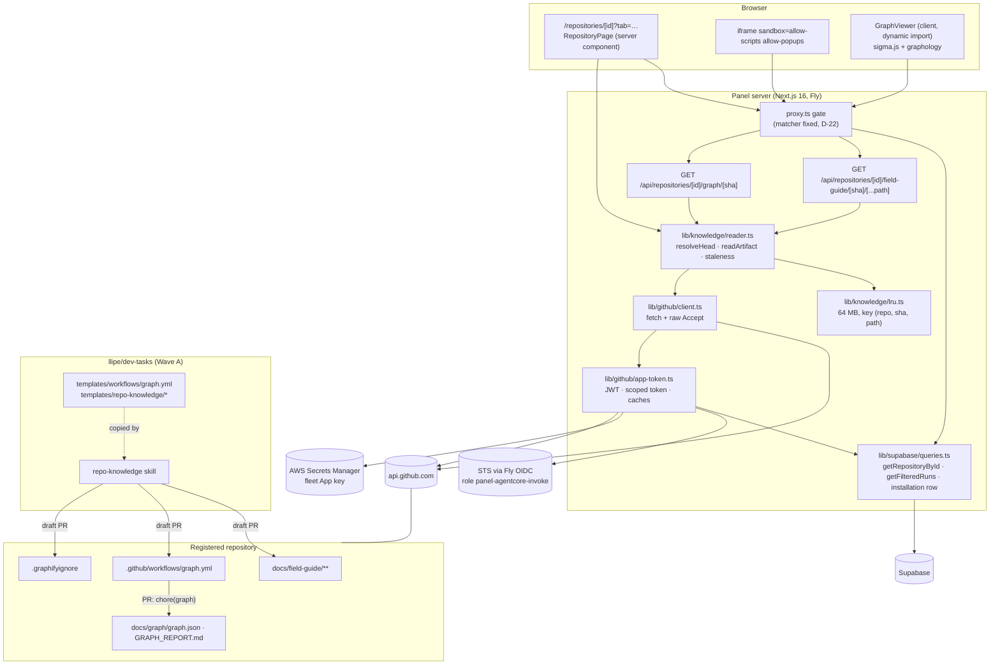
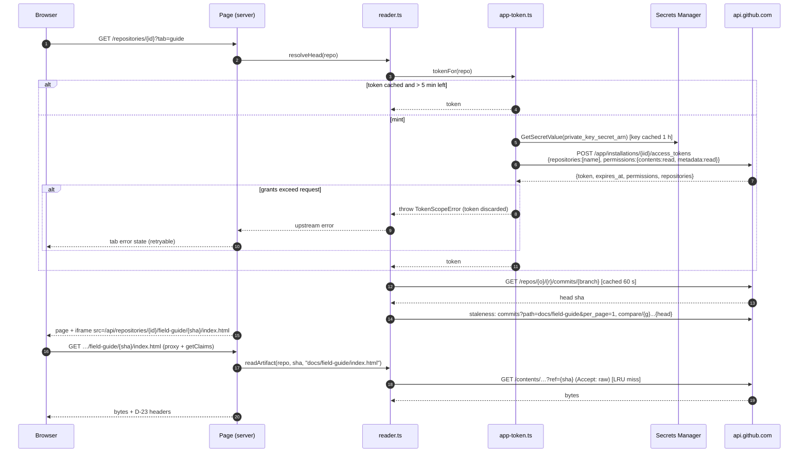
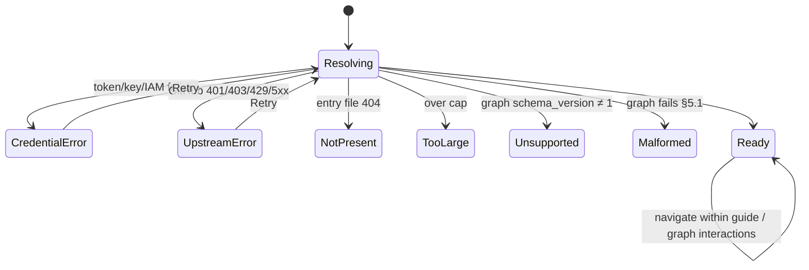

# Specification — Repository Knowledge Views

## Changelog

| Version | Date       | Summary                                                                                                  | Author           |
| ------- | ---------- | -------------------------------------------------------------------------------------------------------- | ---------------- |
| 1.0     | 2026-11-27 | Initial version from the HOW-phase grilling (D-18–D-30, `workstream/decisions-repo-knowledge-views.md`). | product-engineer |

---

## 1. Executive Summary

The panel gains a server-only GitHub read path that mints a read-only installation token scoped to one repository (D-24). It uses that token to read the repository's knowledge artifacts at a pinned commit, through a 64 MB in-process cache (D-25). A `/repositories/[id]` page renders them in three tabs: a sandboxed, CSP-locked field-guide frame (D-22, D-23), a sigma.js/graphology dependency-graph viewer (D-26), and the existing run history filtered to the repository (D-28). `llipe/dev-tasks` ships the `repo-knowledge` skill and the `graph.yml` template that produce those artifacts in any repository (D-27).

## 2. Reference Documents

- PRD: [`docs/requirements/prd-repo-knowledge-views.md`](../docs/requirements/prd-repo-knowledge-views.md) v1.2
- Decision log: [`workstream/decisions-repo-knowledge-views.md`](decisions-repo-knowledge-views.md) (D-01–D-30)
- Research: [`workstream/research-repo-knowledge-views.md`](research-repo-knowledge-views.md)
- Technical guidelines: [`docs/tech.md`](../docs/tech.md) — §3 architecture patterns, §5 auth (ADR-007, ADR-008), §6 security, §9 code organization, §11 testing, §12 code quality (inline route-segment config)
- Design contract: [`/DESIGN.md`](../DESIGN.md)
- Testing contract: [`/TESTING.md`](../TESTING.md)
- Reference field guide: `llipe/riel` `docs/field-guide/` (D-02)

## 3. Affected Repositories

| Repository                    | Role                                 | Scope of Changes                                                                                                                                                                                                                |
| ----------------------------- | ------------------------------------ | ------------------------------------------------------------------------------------------------------------------------------------------------------------------------------------------------------------------------------- |
| `llipe/dev-tasks`             | Toolkit (skills, templates)          | Wave A. `repo-knowledge` skill ×3 platforms; `templates/repo-knowledge/*`; `templates/workflows/graph.yml`; runbook; `bundle-manifest.json`; `technical-writer` definitions ×3; AGENTS.md registry; install-parity tests.         |
| `llipe/dev-tasks-agent-fleet` | Panel (Next.js on Fly) + infra       | Wave B: infra change, `lib/github/*`, `lib/knowledge/*`, field-guide route, page shell, matcher fix, release gate. Wave C: viewers, `/DESIGN.md`. Wave D: adopt `graph.yml`, write own field guide, live check.                 |
| `llipe/riel`                  | Consumer (reference)                 | None. Rendered as the second repository (D-10).                                                                                                                                                                                 |

## 4. System Architecture

The component view below shows the new panel modules (shaded boxes in Waves B–C), the toolkit pieces from Wave A, and the external systems they touch.

**How it fits.** The panel stays a reader: the repository is the source of truth (D-06, BR-1). No Supabase schema changes. The GitHub read path is the panel's first GitHub client (D-13) and is isolated in `lib/github/` with a `server-only` import (D-24).

## 5. Data Model & Database Design

**No new tables, columns, enums, RLS policies or migrations** (PRD §9). This specification therefore carries no entity-relationship diagram. It reads existing rows:

| Read                        | Source                                                      | Used for                                         |
| --------------------------- | ----------------------------------------------------------- | ------------------------------------------------ |
| Repository by id            | `getRepositoryById` (`panel/lib/supabase/queries.ts:81-87`) | Page header, `full_name`, `default_branch`, `archived_at` check (D-28) |
| Installation row            | `github_installations` (`installation_id`, App id, `private_key_secret_arn`; schema `20260902200101_initial_schema.sql:43`) | Token minting (D-24) |
| Runs for repository         | `getFilteredRuns({ repositoryId })` (`queries.ts:425-441`)  | Agent activity tab (D-28)                        |

`repositories.default_branch` exists (`text not null default 'main'`, `20260902200101_initial_schema.sql:61`) and is used as stored. `github_installations.private_key_secret_arn` is nullable (`:43`); a null value is a `CredentialError` (§8.4), never a fallback.

### 5.1 `graph.json` contract consumed by the viewer (D-18)

| Path                         | Type                                   | Required | Use                                                  |
| ---------------------------- | -------------------------------------- | -------- | ---------------------------------------------------- |
| `graph.schema_version`       | integer                                | yes      | Must equal `1`, else unsupported-format state (FR-17) |
| `graph.graphify_version`     | string                                 | no       | Shown in the tab footer                              |
| `nodes[].id`                 | string                                 | yes      | Key                                                  |
| `nodes[].label`              | string                                 | yes      | Search and display                                   |
| `nodes[].file_type`          | `code` \| `rationale` \| `concept` \| other | yes | Filter; colour token; unknown values map to `other` |
| `nodes[].community`          | integer                                | yes      | Community aggregation (FR-19)                        |
| `nodes[].source_file`        | string (repo-relative)                 | yes      | GitHub link                                          |
| `nodes[].source_location`    | string `L<n>`                          | no       | `#L<n>` anchor on the link                           |
| `links[].source` / `.target` | string (node id)                       | yes      | Edge endpoints                                       |
| `links[].relation`           | string                                 | yes      | Filter                                               |
| `links[].confidence`         | `EXTRACTED` \| `INFERRED` \| `AMBIGUOUS` | yes    | Default visibility (FR-18)                           |

All other fields are ignored. Unknown extra fields never fail validation. A missing required field fails with a "malformed graph" state naming the first offending path. Validation uses Ajv (already a panel dependency) with a schema at `panel/lib/schema/graph-v1.schema.json`.

## 6. API Design

Both routes are panel-internal, authenticated, `GET`-only, and declare `dynamic = "force-dynamic"` inline (tech.md §12).

| Route                                                        | Response                                               | Auth                                        |
| ------------------------------------------------------------ | ------------------------------------------------------ | ------------------------------------------- |
| `GET /api/repositories/[id]/field-guide/[sha]/[...path]`     | Raw file, content type from the extension allowlist, D-23 headers | proxy gate + in-route `getClaims()` (D-22) |
| `GET /api/repositories/[id]/graph/[sha]`                     | `{ graph, report: string \| null, sha, committedAt }` JSON, or an error envelope | proxy gate + in-route `getClaims()`         |

The page itself (`/repositories/[id]`) is a server component. It resolves HEAD and staleness on the server and passes `sha` to the frame URL and the viewer.

### 6.1 Validation and status codes (field-guide route)

| Check (in order)                                                               | Failure          |
| ------------------------------------------------------------------------------ | ---------------- |
| Session valid (`getClaims()`)                                                  | 401              |
| `id` is a UUID; repository exists and `archived_at IS NULL`                    | 404              |
| `sha` matches `^[0-9a-f]{40}$`                                                 | 404              |
| Path normalised (decode once, reject `..`, `\`, NUL, absolute, empty segments); resolved path is under `docs/field-guide/` | 404 (no GitHub call made) |
| Extension in the D-23 allowlist                                                | 415              |
| GitHub returns the file at `ref=sha` (a SHA not in the repository yields 404/422 from GitHub) | 404 |
| Size ≤ 5 MB (`Content-Length` or streamed count)                               | 413              |
| GitHub 401/403/429/5xx or credential failure                                   | 502, no detail beyond an error code |

Every response, including 4xx/5xx, carries the D-23 header set. Error bodies are short plain text with a stable code (`FG_NOT_FOUND`, `FG_TYPE`, `FG_TOO_LARGE`, `FG_UPSTREAM`); they never include upstream bodies, tokens, ARNs or installation ids.

### 6.2 Graph route

Same session, id, and SHA checks. It reads `docs/graph/graph.json` (≤ 15 MB, else `GRAPH_TOO_LARGE` with the byte count, D-20) and `docs/graph/GRAPH_REPORT.md` (optional, ≤ 1 MB). It validates per §5.1 and returns `GRAPH_NOT_PRESENT`, `GRAPH_UNSUPPORTED` (with found and supported versions), `GRAPH_MALFORMED`, or `GRAPH_UPSTREAM`. Response `Cache-Control: private, max-age=300`.

### 6.3 Read sequence

The sequence below shows a cold Field guide view, including the token mint and the failure branch for an over-scoped token.

## 7. Authentication & Authorization Design

- **Panel user.** Every authenticated user may view every repository's page (D-15). No new roles.
- **Gate, layer 1 (D-22).** `proxy.ts` matcher: the image-extension negative lookahead is restricted to non-`/api` paths. Target form: a matcher that excludes `_next/static`, `_next/image`, `favicon.ico`, and `(?!api/).*\.(svg|png|jpg|jpeg|gif|webp|ico)$`, so every `/api/**` path is gated. A Layer 1 test evaluates the exported matcher against a path table (`/logo.svg` ungated; `/api/repositories/x/field-guide/<sha>/a.webp` gated; `/api/webhooks/<token>` keeps its existing public treatment).
- **Gate, layer 2 (D-22).** Both new routes call the same `getClaims()` helper the proxy uses, with the same 5 s fail-closed timeout (ADR-008), and return 401 on any failure.
- **GitHub (D-24).** Token minting is server-only. The token is scoped to one repository with `contents: read` and `metadata: read`. It never leaves the server.
- **AWS (D-14, D-30).** The panel role `panel-agentcore-invoke` (`infra/trust-policy.json:9`) gains exactly one statement: `secretsmanager:GetSecretValue` on the fleet App key secret ARN, the value stored in `github_installations.private_key_secret_arn`.

| Actor                    | `/repositories/[id]` | field-guide route | graph route | GitHub write | Secrets Manager |
| ------------------------ | -------------------- | ----------------- | ----------- | ------------ | --------------- |
| Unauthenticated          | redirect to login    | 401               | 401         | —            | —               |
| Authenticated user       | yes                  | yes               | yes         | never        | never (server only) |
| Panel server             | —                    | —                 | —           | never (token cannot) | `GetSecretValue` on one ARN |
| Guide script in frame    | no (opaque origin)   | same-route assets only (`'self'`) | no `connect-src` | — | — |

## 8. Business Logic Implementation

### 8.1 Token minting (`lib/github/app-token.ts`, D-24)

1. Look up the installation row for the repository (`installation_id`, App id, `private_key_secret_arn`).
2. Get the PEM from the 1 h key cache, or `GetSecretValue` through the existing AWS credential module (`panel/lib/aws/credentials.ts`).
3. Sign the JWT with `node:crypto` (`RS256`, `iat = now − 60`, `exp = now + 540`, `iss = appId`).
4. `POST /app/installations/{iid}/access_tokens` with `{"repositories":["<name>"],"permissions":{"contents":"read","metadata":"read"}}`.
5. **Scope check.** `response.permissions` must deep-equal `{contents:"read", metadata:"read"}`, and `response.repositories` must be exactly `[name]`. Otherwise drop the token and throw `TokenScopeError`.
6. Cache under the repository id until `expires_at − 5 min`.

The token never appears in logs, error messages or thrown error text. Errors carry a code only.

### 8.2 Artifact read (`lib/knowledge/reader.ts`, D-25)

- `resolveHead(repo)`: `GET /repos/{o}/{r}/commits/{default_branch}`, cached 60 s per repository.
- `readArtifact(repo, sha, path, capBytes)`: LRU lookup on `(repoId, sha, path)`. On a miss, `GET /repos/{o}/{r}/contents/{path}?ref={sha}` with `Accept: application/vnd.github.raw`, enforce `capBytes` while streaming, and insert when the size is ≤ cap and ≤ 64 MB total. A GitHub 404 is `NotPresent`; 401/403/429/5xx is `Upstream`.
- `staleness(repo, headSha)`: last commit under `docs/field-guide/` (`commits?path=docs/field-guide&sha={headSha}&per_page=1`), then `compare/{guideSha}...{headSha}` → `ahead_by`. Cached per `(repoId, headSha)`.

### 8.3 Staleness rule (D-11)

`warning = ageDays > 30 || commitsBehind > 100`. Boundaries: 30 days and 100 commits are **not** warnings (AC-6). Age is measured from the guide commit's committer date to the request time, in whole days (floor).

### 8.4 Artifact state machine

The tab state is derived per request. The diagram shows every state each tab can render.

`CredentialError` and `UpstreamError` render the same retryable error UI with distinct codes. `NotPresent` names the expected path and links to the `repo-knowledge` instructions (FR-10).

### 8.5 Graph viewer logic (D-08, D-20, D-26)

- Build a graphology `Graph` (undirected, matching `directed: false`) from nodes and links. Drop links whose endpoints are missing and count them in the footer.
- **Default view.** With more than 1,500 nodes, collapse by `community`: one super-node per community, sized by member count, labelled by its highest-degree member; edges aggregated with a weight. Click (or Enter) expands a community in place. With 1,500 nodes or fewer, show the full graph.
- **Layout.** ForceAtlas2 in a web worker with a fixed iteration budget; stop on settle or after 3 s. Positions are cached in memory per `(repoId, sha)` for the session.
- **Filters.** `file_type` and `relation` multi-selects; INFERRED/AMBIGUOUS hidden by default, with a toggle (FR-18).
- **Search.** Case-insensitive prefix and substring match on `label`, first 20 results; selecting one focuses it.
- **Focus.** Highlight the node and its 1-hop neighbourhood and dim the rest. A side panel lists incoming and outgoing relations as text (the accessibility alternative), with a link `https://github.com/{full_name}/blob/{sha}/{source_file}#L{n}`.
- **Report.** `GRAPH_REPORT.md` is rendered as Markdown with raw HTML disabled and links forced to `rel="noopener noreferrer" target="_blank"`. Library choice is open (e.g. `react-markdown` without `rehype-raw`), exact-pinned.

### 8.6 Field guide frame (D-07, D-23)

- `<iframe src="/api/repositories/{id}/field-guide/{sha}/index.html" sandbox="allow-scripts allow-popups" referrerpolicy="no-referrer" title="Field guide for {full_name}">`.
- "Open full screen" is a plain link to the same URL with `target="_blank" rel="noopener noreferrer"`. The CSP `sandbox` directive keeps it sandboxed outside the frame.

## 9. Integration Details

| Integration         | Method                                                         | Failure handling                                                                 | Credential                       |
| ------------------- | -------------------------------------------------------------- | -------------------------------------------------------------------------------- | -------------------------------- |
| GitHub REST         | `fetch` to `api.github.com`, `X-GitHub-Api-Version: 2022-11-28`, 10 s timeout per call | No automatic retry inside a request. The user retries from the error state. 429 surfaces `UPSTREAM_RATE_LIMITED`. | Installation token (D-24)        |
| AWS Secrets Manager | Existing AWS SDK credential chain (Fly OIDC → STS)             | Failure → `CredentialError`. Key cache keeps serving until its 1 h expiry.        | Role `panel-agentcore-invoke`    |
| graphify            | Not called by the panel. Used only by `graph.yml` in CI.       | Workflow fails visibly in Actions. No PR is opened.                              | none (`GRAPHIFY_BACKEND=none`)   |

**`graph.yml` (dev-tasks `templates/workflows/`, D-09, D-12, D-20).**
- **Triggers:** `schedule` weekly, `workflow_dispatch`, and `push` to the default branch with `paths-ignore` for `docs/**` and `**/*.md`.
- **Steps:**
  1. Check out the repository.
  2. `pipx install "graphifyy[sql]==0.9.120"`.
  3. Write `.graphifyignore` from the template if it is absent.
  4. `GRAPHIFY_BACKEND=none GRAPHIFY_QUERY_LOG_DISABLE=1 graphify extract . --code-only --no-viz`.
  5. `graphify cluster-only . --no-viz`.
  6. Copy `graphify-out/graph.json` and `GRAPH_REPORT.md` to `docs/graph/`.
  7. When `git diff --quiet docs/graph` is false, push to the branch `chore/graph-refresh` and open or update one PR titled `chore(graph): refresh dependency graph`.
- **Permissions:** `contents: write`, `pull-requests: write`, used only on the PR branch, never on the default branch.
- **Ignore:** `graphify-out/` is added to `.gitignore`.
- **Runbook:** ships alongside it (FR-31). The runbook names how to raise the pin, how to edit `.graphifyignore`, and what to do with a graph over 15 MB.

**Noise control.** `GRAPH_REPORT.md` carries a generation date, so every run would differ. The workflow compares `graph.json` only and opens a PR only when it changed (AC-11).

## 10. User Interface & Client Behavior

- **Navigation (D-28).**
  - The `RepositoryTable` name cell links to `/repositories/{id}`.
  - The Sidebar Repositories item is active for `/repositories` and `/repositories/*`.
  - The breadcrumb reads `Repositories / {full_name}`.
- **Tabs (D-28).** A shared `components/Tabs.tsx`, extracted from the `CadencePicker` tablist pattern: `role="tablist"`, arrow-key navigation, `aria-selected`.
  - State lives in `?tab=guide|graph|activity` (default `guide`).
  - An unknown value falls back to `guide`.
- **Header strip per artifact tab:**
  - short SHA (linked to the commit)
  - commit date
  - on Field guide: the staleness label (`Updated {n} days ago · {m} commits behind`), with the warning token above the threshold
  - "Open full screen" (Field guide only)
- **Field guide.** The frame fills the content region; its height is the viewport minus the page chrome, and it scrolls internally.
- **Dependency graph.** Toolbar (search, filters, INFERRED toggle, "Expand all" disabled above 1,500), canvas, and a side panel (focused node, or the report when nothing is focused).
  - Keyboard: `/` focuses search; Tab moves through the toolbar and side panel; Enter on a search result focuses that node; Esc clears focus.
- **Agent activity.** `RunHistoryRow` list with `showAgentColumn` on, followed by the placeholder card "Workflow telemetry — not yet collected" with a link to the follow-up PRD once it exists (FR-4).
- **Empty and error states.** One `ArtifactState` component with variants `not-present`, `too-large`, `unsupported`, `malformed`, `error` (with Retry).
- **Responsive (AC-13).** At 390 px: tabs scroll horizontally inside their own container, the graph side panel stacks below the canvas, and the frame takes full width. Nothing scrolls the page sideways.
- **`/DESIGN.md` updates (Wave C, owned by `ux-engineer`):**
  - §5.x repository page layout
  - `Tabs` component
  - `ArtifactState` variants
  - staleness label (normal and warning)
  - graph tokens, dark values only (D-21):
    - `--graph-node-code`, `--graph-node-rationale`, `--graph-node-concept`, `--graph-node-other`
    - `--graph-edge-extracted`, `--graph-edge-inferred` (dashed), `--graph-edge-ambiguous` (dotted)
    - `--graph-focus`, `--graph-dim`

## 11. Performance & Scalability Approach

| Concern                    | Approach                                                                      | Target                                                    |
| -------------------------- | ----------------------------------------------------------------------------- | --------------------------------------------------------- |
| GitHub calls               | HEAD cached 60 s; artifacts immutable per SHA in a 64 MB LRU; tokens cached (D-25) | ≈ 1 call per repository per minute in steady state |
| Large graph transfer       | 15 MB cap; route sets `Content-Encoding` via Next.js compression (gzip ratio ≈ 15:1 measured, D-18) | This repository ≈ 0.33 MB on the wire |
| Rendering                  | WebGL (sigma), community view above 1,500 nodes, worker layout (D-26)         | First interactive frame < 2 s for 5,500 nodes on a laptop |
| Bundle                     | sigma/graphology dynamically imported on the Graph tab only                   | No change to other pages' JS                              |
| Page time                  | Server-side HEAD and staleness in parallel (`Promise.all`)                    | p95 < 1 s cached, < 3 s cold (PRD §14)                    |
| Multiple Fly machines      | Per-process caches. SHA-keyed entries are immutable, HEAD may differ ≤ 60 s between machines (D-25) | Correct without coordination |

## 12. Security Implementation

- **Untrusted HTML.** The iframe sandbox without `allow-same-origin`, plus the CSP `sandbox` directive on every route response, covers both in-frame and full-screen viewing (D-23). `connect-src 'none'` blocks exfiltration via fetch/XHR/WebSocket. `form-action 'none'`, `base-uri 'none'`, and `frame-ancestors 'self'` complete the policy.
- **Content sniffing.** `nosniff` plus the extension allowlist with explicit types. SVG is served as `image/svg+xml` under the same sandboxing CSP.
- **Path traversal.** Normalise before any I/O; deny-by-default; covered by AC-4 tests including `%2e%2e`, `..%2f`, double encoding, and backslashes.
- **Secrets.**
  - The PEM and installation tokens live only in server memory.
  - A log redaction helper drops any `Authorization` header and any field named `token`.
  - A test asserts that no route response, error body or log line contains the fake token string (AC-9).
- **Least privilege.**
  - Token scope: one repository, read-only, checked on every mint (D-24).
  - IAM: one statement on one ARN (D-30).
- **Report rendering.** Markdown without raw HTML (FR-20).
- **CSRF.** Both routes are `GET`-only, have no side effects, and are read-only.
- **PII.** None added. Repository contents may name people (commit authors in the staleness tooltip only).

## 13. Error Handling & Logging

- **User-facing:** tab states per §8.4, each with a stable code shown in small print for support.
- **Server logs:** one structured line per artifact fetch (`repoId`, `sha` short, path class (`guide` or `graph`), outcome code, bytes, cache hit). No token, PEM, ARN, or upstream body. This follows the allowlisted-error-logging rule of ADR-009.
- **Recovery:**
  - Retry re-runs the server fetch.
  - A `TokenScopeError` is logged at `error` level, because it means the App's grants changed.
- **Monitoring:** existing Fly log tailing. No new alerting in this PRD.

## 14. Testing Strategy

Per `/TESTING.md` layers and D-29. Test-first: each behavioural sub-task writes its failing test before the code.

| Layer      | Scope                                                                                                                                                                                                                         |
| ---------- | ----------------------------------------------------------------------------------------------------------------------------------------------------------------------------------------------------------------------------- |
| 1 (unit)   | Path normaliser (table incl. encoded traversal); extension→type map; CSP header builder; schema validator (§5.1 valid, unsupported version, malformed); staleness thresholds (29/30/31 days, 99/100/101 commits); LRU byte accounting and eviction; matcher table (D-22); token-scope checker (exact, broader permissions, extra repository); community collapse; search ranking |
| 2 (component/route) | `app-token.ts` with a fake Secrets Manager client and an injected `fetch` (mint, cache hit, expiry refresh, scope failure discards the token); `reader.ts` (404 → NotPresent, 429/5xx → Upstream, over-cap → TooLarge, cache hit makes no fetch); field-guide route (401 with no session, 404/415/413 cases, headers present on errors); graph route envelopes; `Tabs`, `ArtifactState`, staleness label, `RepositoryTable` link (jsdom) |
| 2.5        | Not applicable: no new database objects (D-29).                                                                                                                                                                               |
| E2E        | Playwright with a local HTTP stub for `api.github.com` serving a fixture repository (riel-shaped guide with `internals.html` and two WebP screens; a 2,000-node `graph.json` to exercise the community view; a 200-node one for the full view). Scenarios: AC-1 to AC-8, AC-13; security-negative: traversal, `parent.document`, `document.cookie`, `fetch('/api/…')` from guide script, direct full-screen URL still sandboxed (CSP `sandbox`), no token string in any response |
| Release gate | Two assertions added (D-30): unauthenticated `…/field-guide/<sha>/index.html` → 401; unauthenticated `…/field-guide/<sha>/a.webp` → 401 |
| dev-tasks  | Wave A: install-parity test covers the three `SKILL.md` copies and the templates; `validate` passes; `actionlint` (or the repo's workflow lint) on `graph.yml`; a dry run of `graph.yml` steps on a fixture repository in CI |

`coverage_gate` follows `/TESTING.md` thresholds for new panel modules. `qa-engineer` records it at the completion gate.

## 15. Deployment & Rollout

The order is set by D-17 and D-30.

1. **Wave A (dev-tasks).** Merge, then release. This repository receives it via `dev-tasks update`.
2. **Wave B infra (before the Wave B deploy).** An `infra-engineer` pass:
   - add the `GetSecretValue` statement;
   - record `infra/changes/<date>-panel-github-contents-read/` (plan, commands, result, rollback, backup);
   - update `infra/agentcore-invoke-policy.json`;
   - add the runbook `docs/runbooks/panel-github-read.md`.

   `infra/environments.yaml:51` has a stale OIDC comment; correct it in the same change (D-19).
3. **Wave B deploy.** Panel release with routes, page shell, matcher fix and gate assertions. **No feature flag** (D-30). If step 2 is missing, the tabs show `CredentialError` and nothing else regresses.
4. **Wave C deploy.** Viewers and `/DESIGN.md`.
5. **Wave D.**
   - The skill installs `graph.yml` into this repository (draft PR); merge it; dispatch the workflow; merge the first `chore(graph)` PR.
   - `technical-writer` writes this repository's field guide (draft PR).
   - Live check: agent-fleet and riel both render (AC-12).

**Rollback.**
- Revert the panel release.
- Remove the IAM statement (its `rollback.sh`).
- The repositories keep their artifacts; nothing in the database to undo.

## 16. Dependencies & Risks

| Risk                                                                 | Likelihood | Impact | Mitigation                                                                                         |
| -------------------------------------------------------------------- | ---------- | ------ | -------------------------------------------------------------------------------------------------- |
| graphify changes its output (`schema_version` ≠ 1, or field renames)  | Medium     | Medium | Version pin in `graph.yml`; schema guard and explicit state (FR-17); raise the pin deliberately via the runbook |
| graphify is young and fast-moving (0.9.x)                            | Medium     | Low    | Only CI depends on it; panel depends only on the JSON contract                                     |
| Panel role can read a write-capable key (accepted, D-14)             | Low        | High   | One-ARN statement; scoped tokens with response check; no logging; release-gate tests                |
| GitHub rate limit under heavy use                                    | Low        | Low    | Caches (D-25); 429 surfaces as retryable                                                           |
| CSP `'unsafe-inline'` permits inline script inside the guide         | Certain    | Low    | Script runs in an opaque origin with no network; it is the guide's own content by design (D-23)    |
| `GRAPH_REPORT.md` churn                                              | High       | Low    | PR only on `graph.json` change (§9)                                                                |
| Stored `default_branch` differs from GitHub's after a rename          | Low        | Low    | HEAD lookup 404 surfaces `UpstreamError`; fixing the row is an operator edit (out of scope)         |
| riel `api.html` broken in panel                                      | Certain    | Low    | Accepted (PRD §12); documented in the field-guide contract                                         |

New dependencies (exact-pinned at implementation, `pnpm audit` clean):
- `sigma`
- `graphology`
- `graphology-layout-forceatlas2`
- a Markdown renderer without raw HTML

No new server dependencies. The panel uses `node:crypto` and `fetch`.

## 17. Open Questions

None.

## 18. Decisions (HOW phase)

| ID   | Decision (short form)                                                                                                  |
| ---- | ---------------------------------------------------------------------------------------------------------------------- |
| D-18 | graphify 0.9.120 code-only output measured: `schema_version` 1, `links`, precomputed `community`, sizes                |
| D-19 | Panel constraints from research: role, no down-scope precedent, matcher image skip, no CSP, dark-only, no GitHub double |
| D-20 | Tests excluded via `.graphifyignore`; `graphifyy[sql]==0.9.120`; 15 MB cap; community view above 1,500 nodes          |
| D-21 | Viewer follows the dark-only panel theme; colours as tokens; PRD v1.2                                                  |
| D-22 | Matcher never skips `/api/**`; routes re-check the session                                                             |
| D-23 | Per-response CSP with `sandbox`, `connect-src 'none'`, CDN allowlist; extension allowlist; security headers            |
| D-24 | Server-only minting; per-repository read-only token; fail closed on broader grants; caches; no Octokit                 |
| D-25 | SHA-pinned route; HEAD 60 s; 64 MB LRU; raw contents API; 5 MB guide-file cap; staleness via commits + compare         |
| D-26 | sigma.js + graphology, dynamic import                                                                                  |
| D-27 | `repo-knowledge` skill structure, assets, procedures, 12-section default, verification                                 |
| D-28 | UI conventions: `?tab=`, `Tabs`, 404 for unknown/archived, row link, sidebar prefix, `getFilteredRuns`                 |
| D-29 | Testing layers and GitHub HTTP stub for E2E                                                                            |
| D-30 | Infra first, no flag, release-gate assertions                                                                          |

WHAT-phase decisions D-01–D-17 are inherited from the PRD.

## Vocabulary

| Term               | Status in glossary | Bounded context | Definition (proposals only) | Forbidden synonyms (proposals only) |
| ------------------ | ------------------ | --------------- | --------------------------- | ----------------------------------- |
| Knowledge artifact | existing           | panel           |                             |                                     |
| Field guide        | existing           | panel           |                             |                                     |
| Dependency graph   | existing           | panel           |                             |                                     |
