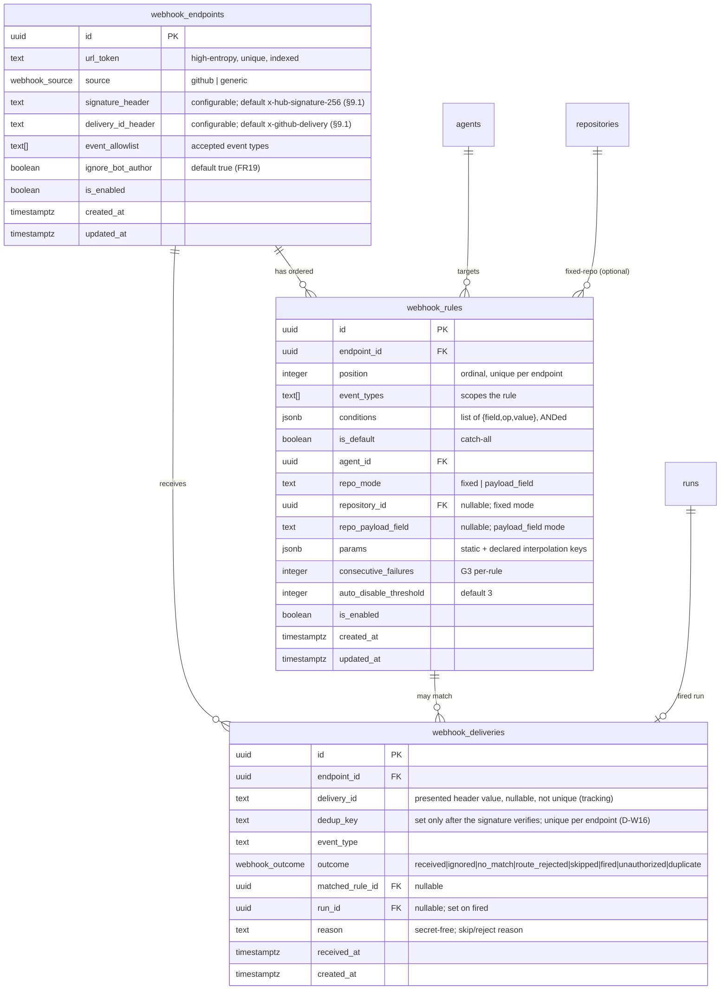
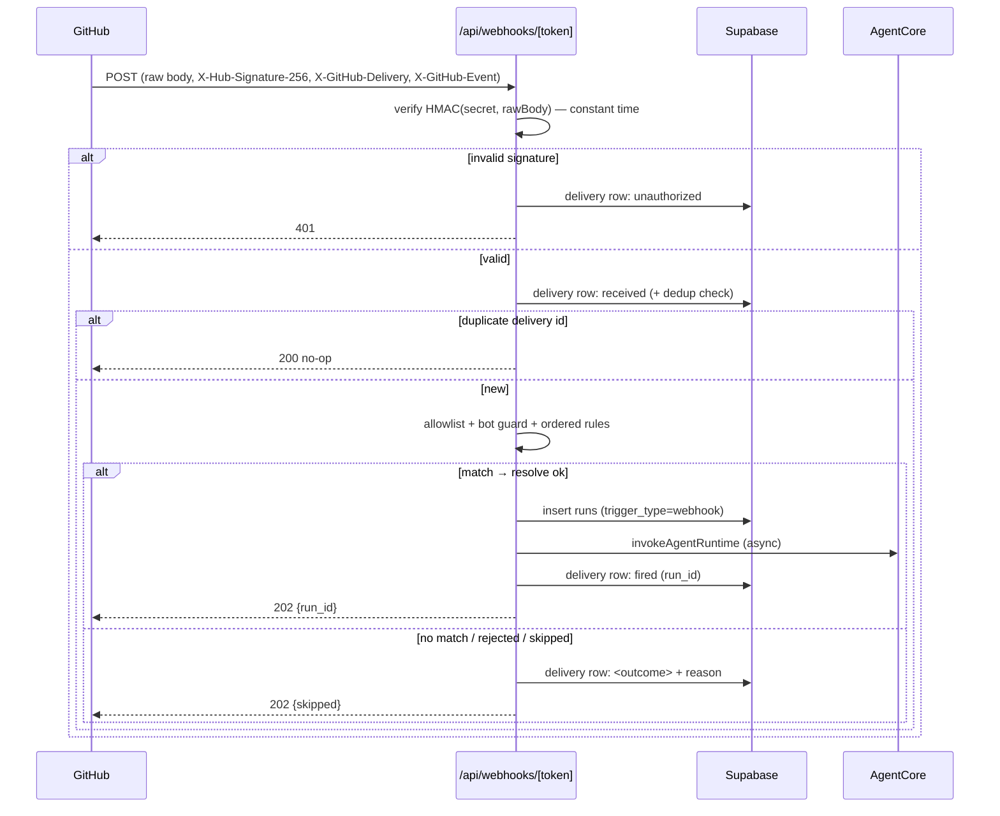
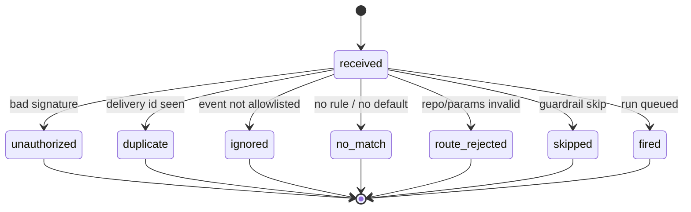

# Specification — Webhook Triggers

## Changelog

| Version | Date       | Summary                                                                 | Author           |
| ------- | ---------- | ----------------------------------------------------------------------- | ---------------- |
| 1.0     | 2026-10-15 | Initial specification for Phase 1 (webhook mechanism) from PRD v0.1.    | product-engineer |
| 1.1     | 2026-10-15 | Resolve OQ-1 (keep declared-key interpolation), OQ-2 (prune policy in v1), OQ-3 (define the generic-sender signature scheme), OQ-4 (G3 per-rule, settled). Add §9.1 signature scheme, delivery retention to data model + rollout. | product-engineer |
| 1.2     | 2026-10-19 | Record B-4 (D-W16): every delivery is recorded, including `unauthorized`, but only verified deliveries claim the dedup key (`dedup_key` column, unique per endpoint). | product-engineer |
| 1.3     | 2026-10-20 | D-W3 corrected during S-168: the body is read as raw bytes, not `request.text()` (UTF-8 decoding replaces invalid bytes and breaks the HMAC). | product-engineer |

---

## 1. Executive Summary

Phase 1 adds a **public, signature-gated inbound webhook endpoint** (`POST /api/webhooks/[token]`)
that verifies an HMAC-SHA256 signature over the raw request body, records every delivery, runs
the payload through a **pure, bounded, operator-configured routing engine**, and invokes the
resolved agent through the **same internal invoke path, guardrails, and notify-sweep the Phase 4
scheduler already uses**. The only new machinery is the front door (verification + routing +
delivery log + a `/webhooks` UI); execution is a factored-out reuse of the existing fire path, so
a webhook-triggered run is a first-class `runs` row that differs only in its trigger descriptor.

## 2. Reference Documents

- PRD: `docs/requirements/prd-webhook-triggers.md` (v0.1) — FR1–FR24, AC1–AC9.
- Decisions: `workstream/decisions-webhook-triggers.md` (D-W1…D-W13).
- Technical Guidelines: `docs/technical-guidelines.md` — invoke path, SD2 server-only boundary,
  auth release gate (ADR-007/008), RLS deny-all posture.
- Reused prior art: `prd-agent-scheduler.md` + its spec/stories (the execution spine, guardrails
  G1–G5, notify-sweep, Vault secret, internal-endpoint auth, `/schedules` + `/notifications` UI).

## 3. Affected Repositories

| Repository | Role | Scope of Changes |
| --- | --- | --- |
| `llipe/dev-tasks-agent-fleet` (`supabase/`) | Database — system of record | New migrations: `webhook_endpoints`, `webhook_rules`, `webhook_deliveries` tables + enums, deny-all RLS, per-endpoint Vault secret helpers, optional `webhook` helper schema. |
| `llipe/dev-tasks-agent-fleet` (`panel/`) | Backend + frontend (Next.js) | New public `POST /api/webhooks/[token]` route; HMAC verification module; pure routing engine; factored `invokeResolvedRun()` core shared with the fire route; `TriggerDescriptor` `webhook` variant; `/webhooks` panel screen, rule editor, delivery log, Server Actions; sidebar nav; release-gate extension. |

No agent packages change in Phase 1 (existing agents are the routing targets). The GitHub App gains
no new scopes in Phase 1 (receive-only); Phases 2–3 add outbound comment/review scopes.

## 4. System Architecture

The inbound event enters a public route, is verified and recorded, routed by a pure engine, and —
on a firing match — handed to the same invoke core the scheduler's `pg_cron` tick uses. (D-W2, D-W6)

```mermaid
flowchart LR
  GH[GitHub webhook] -->|POST signed| EP["/api/webhooks/[token]\n(public, Node runtime)"]
  EP -->|1 raw body| V[verifyHmacSignature\nconstant-time, fail-closed]
  V -->|invalid| R401[401 — no record-as-fired]
  V -->|valid| D[(webhook_deliveries\nrow: received)]
  D --> DEDUP{delivery id\nseen?}
  DEDUP -->|yes| ACK200[200 no-op]
  DEDUP -->|no| ALLOW{event\nallowlisted?}
  ALLOW -->|no| ACK202i[202 ignored\n+ record]
  ALLOW -->|yes| ROUTE[routing engine\nordered rules, first-match]
  ROUTE -->|no match| ACK202n[202 no_match\n+ record]
  ROUTE -->|match| RESOLVE[resolve agent/repo/params\n+ allowlist + schema]
  RESOLVE -->|reject| REJ[route_rejected\n+ record]
  RESOLVE -->|ok| CORE["invokeResolvedRun()\n(shared with fire route)"]
  CORE --> GRD[G1 / G4 / G5 / G3-per-rule]
  GRD -->|skip| SKIP[skipped + reason\n+ record]
  GRD -->|proceed| RUN[(runs row\ntrigger_type=webhook)]
  RUN --> INV[invokeAgentRuntime] --> ACK202f[202 fired + run_id]
  RUN -.terminal.-> SWEEP[notify-sweep] --> NOTIF[(notifications)]
  subgraph Panel UI (authenticated)
    WUI["/webhooks screen\nendpoints + rules + delivery log"]
  end
  WUI -. reads/writes .-> D
```

Key properties, each tracing to the PRD:
- Verification is **before parse / before work** (FR2/FR6); the raw body is read via
  the request stream as raw bytes (`request.arrayBuffer()` with a byte limit, never `request.text()`,
  which would replace invalid UTF-8 and change the signed bytes) and HMAC'd exactly, then parsed only on success (D-W3).
- The route handler returns a **fast 2xx** after verify + record + enqueue; the agent invoke is the
  existing async path, so GitHub never sees a slow handler (FR7, D-W11).
- `invokeResolvedRun()` is the **single** invoke code path, shared with the schedule fire route —
  guardrails and notifications are inherited, not re-implemented (FR16–FR18, D-W6, D-W10).

## 5. Data Model & Database Design

Three new tables follow the scheduler's conventions exactly: `gen_random_uuid()` PKs, FK cascade to
`agents`/`repositories`, `set_updated_at` triggers, deny-all RLS from creation, Vault for the secret
(no plaintext secret column). (D-W4)



Enums (mirroring `schedule_state`/`notification_kind` style):
- `webhook_source as enum ('github', 'generic')`
- `webhook_outcome as enum ('received','unauthorized','duplicate','ignored','no_match','route_rejected','skipped','fired')`

Constraints and indexes:
- `webhook_endpoints.url_token` **unique**, indexed — the lookup key for the inbound route.
- `webhook_rules (endpoint_id, position)` **unique** — ordering is explicit, first-match by `position`.
- `webhook_rules` CHECK: `repo_mode='fixed' ⇒ repository_id not null`; `repo_mode='payload_field' ⇒ repo_payload_field not null`.
- `webhook_deliveries (endpoint_id, dedup_key)` **unique** — the dedup guarantee (FR3). `dedup_key` is set only for deliveries whose signature verified; `unauthorized` rows leave it null, and Postgres treats nulls as distinct, so they never claim a key. A conflicting insert is returned as a `duplicate` 200 no-op (D-W16).
- `idx_webhook_deliveries_delivery_id on (endpoint_id, delivery_id)` (non-unique) — groups every attempt that presented the same delivery id, verified or not, for troubleshooting (D-W16).
- `idx_webhook_deliveries_endpoint_created on (endpoint_id, created_at desc)` — the delivery-log feed (FR23).
- Deny-all RLS on all three; the panel reads server-side with the service-role key (SD2).

**Delivery retention (OQ-2, resolved — prune in v1).** `webhook_deliveries` grows with every GitHub
event, so Phase 1 ships a bounded-retention prune rather than deferring it. A `webhook.prune_deliveries()`
`security definer` function deletes rows older than a configurable horizon (default **30 days**, stored
in a `webhook.config` key `delivery_retention_days`, mirroring `scheduler.config`), registered as a
daily `pg_cron` job alongside the existing scheduler crons. Deletes are capped per run (batched) to
avoid a long lock. A `fired` delivery's `run_id` FK is `on delete set null`, so pruning a delivery never
cascades into `runs`; the run history is the durable record, the delivery log is the recent-ops window.

Migration strategy: additive, idempotent, same timestamped-filename convention as the scheduler
migrations; the signing secret per endpoint is stored in Vault under a derived name
(`webhook_endpoint_<id>`) via a generalized `set_secret`/`read_secret` wrapper (D-W4). No change to
`runs`; `trigger_type='webhook'` already exists.

## 6. API Design

### 6.1 `POST /api/webhooks/[token]` (public, signature-gated)

Route-segment config identical to the fire route: `runtime = "nodejs"`, `dynamic = "force-dynamic"`,
`revalidate = 0`, `fetchCache = "force-no-store"`. Classified **public** by the route policy (D-W2).

Processing order (each step records to `webhook_deliveries` and never logs secrets, FR8):

1. Resolve endpoint by `token`; unknown/disabled token → `404` (no record — an unknown token is not a delivery to us).
2. Read the **raw body as bytes** (stream with a byte limit, then `Uint8Array`; never `request.text()`); over the size cap → `413` (FR4).
3. **Verify HMAC** of raw body against the endpoint's Vault secret, constant-time, fail-closed; invalid/missing → record `unauthorized`, return `401` (FR2/AC2).
4. Compute the dedup key (delivery id header, else body hash) and insert the row with it; if `(endpoint_id, dedup_key)` already exists → record/return `duplicate` `200` no-op (FR3/AC2). Step 3 failures were already recorded with a null `dedup_key`, so a forged request can never block a later genuine delivery with the same id (D-W16).
5. Parse JSON; read event type header; not in `event_allowlist` → record `ignored`, return `202` (FR5/AC3).
6. Apply the **bot-author guard** then **ordered rules** (first-match); no match + no default → record `no_match`, return `202` (FR9/FR15/AC4).
7. **Resolve** `(agent, repository, params)`; allowlist miss or schema-invalid → record `route_rejected`, return `202` (FR12–FR14/AC5).
8. Call `invokeResolvedRun()` → guardrail skip → record `skipped`+reason, `202`; else insert `runs` row + invoke → record `fired`+`run_id`, return `202` with `{ run_id, status: "queued" }` (FR16–FR18/AC1/AC6).

| Response | Meaning |
| --- | --- |
| `202 { run_id }` | fired |
| `202 { skipped, reason }` | ignored / no_match / route_rejected / guardrail-skipped |
| `200 { duplicate: true }` | replayed delivery id |
| `401` | bad/missing signature |
| `404` | unknown endpoint token |
| `413` | body over cap |

All non-`401`/`404`/`413` outcomes return `2xx` so GitHub does not retry (deliberately — a *routing*
decision is not a *delivery* failure).



### 6.2 Panel surfaces (authenticated, Server Actions)

Endpoint CRUD + secret rotate, rule create/reorder/edit/delete, delivery-log read — all server-side
with the service-role key, behind the login gate; no new public read API (FR20–FR23).

## 7. Authentication & Authorization Design

Two distinct boundaries (D-W1, D-W2):

| Surface | Caller | Mechanism |
| --- | --- | --- |
| `POST /api/webhooks/[token]` | GitHub / external sender (untrusted) | Public route; **HMAC-SHA256 signature over raw body** against the per-endpoint Vault secret, constant-time, fail-closed. No session. |
| `/webhooks` + its Server Actions | The operator (human) | Existing panel login gate (ADR-007/008 middleware); server-only data access (SD2). |

The new `verifyHmacSignature(rawBody, header, secret)` module mirrors `internal-secret.ts`: pure,
constant-time (`timingSafeEqual` on equal-length buffers), fail-closed on missing secret/header/
mismatch, never logs secret material, exhaustively unit-testable. It differs from the scheduler
secret in that it is a **keyed hash of the body**, not an equality check, and the secret is
**per-endpoint from Vault**, not one global env value. The **release gate** (`verify-panel-auth.sh`)
gains a CHECK that an unsigned `POST /api/webhooks/<token>` returns `401`, extending the S-160
internal-endpoint assertion to the webhook class (FR24/AC8).

## 8. Business Logic Implementation

### 8.1 Routing engine (pure, bounded) — `lib/domain/webhook-routing.ts` (D-W7)

- `selectField(payload, path)` — JSON-path-lite: dotted keys + `[n]` array index, **max depth N**,
  returns `undefined` past a missing/short path; never throws on hostile shapes.
- `evaluateCondition(payload, { field, op, value })` — ops `equals | not_equals | contains |
  prefix | suffix | in | exists | matches_event`; string operands length-capped; **no regex, no
  code**. `matches_event` compares against the event-type header.
- `evaluateRule(payload, eventType, rule)` — event-type scope AND all conditions ANDed.
- `routeDelivery(payload, eventType, endpoint, rules)` — applies the bot-author guard (D-W12), then
  iterates rules by `position`, returns the first match or the default or `no_match`. Pure over its
  inputs → fully unit-testable, same posture as `checkSchedulerSecret`.

### 8.2 Route resolution

- Agent: `getAgentById`, must be enabled (reuses the fire-route checks).
- Repository: `fixed` → `repository_id`; `payload_field` → `selectField` then
  `getRepositoryByFullName` (NEW query) constrained to enabled, non-archived — miss → `route_rejected`
  (FR13, D-W8).
- Params: static object merged with declared payload-interpolation keys, then `validateParams`
  against `params_schema`; invalid → `route_rejected` (FR12/FR14, D-W9 — see OQ-1).

### 8.3 Shared invoke core — `invokeResolvedRun()` (D-W6)

Factor the fire route's steps 4–9 into one function taking `{ agent, repositoryId, installationId,
repositoryFullName, params, trigger }` and performing: build payload → `buildRunInsert` →
`insertQueuedRun` → `invokeAgentRuntime` → on throw `markRunFailedToStart`. Both the schedule fire
route and the webhook handler call it; guardrails G1/G4/G5 execute inside it (today the fire route
has guardrail hook points — this spec moves them into the shared core so both triggers inherit
them). `TriggerDescriptor` gains the `webhook` variant (D-W5):

```ts
export type TriggerDescriptor =
  | { triggerType: "manual"; triggeredBy: "panel" }
  | { triggerType: "schedule"; triggeredBy: `schedule:${string}` }
  | { triggerType: "webhook"; triggeredBy: `webhook:${string}` }; // <endpoint_id>:<rule_id>
```

### 8.4 Guardrails (D-W10)

G1 overlap, G4 concurrency cap, G5 open-PR backoff apply unchanged (shared core). G3 circuit breaker
is keyed **per rule**: `webhook_rules.consecutive_failures` + `auto_disable_threshold`; crossing the
threshold auto-disables the rule and records a `schedule_auto_paused`-analog notification
(generalized `kind`). G2 catch-up has no meaning for edge-triggered webhooks (documented n/a).

### 8.5 Delivery state (FR23)



## 9. Integration Details

### 9.1 Signature scheme (OQ-3, resolved — defined here)

The mechanism is generic but the **signature shape is fixed in v1** to one well-tested code path; a
non-GitHub (`source='generic'`) sender is supported today as long as it conforms to that shape. What
the operator may configure vs what is fixed:

| Aspect | v1 behavior | Configurable? |
| --- | --- | --- |
| **Algorithm** | HMAC-**SHA256** only (SHA1 and others rejected). | No (fixed). |
| **Value encoding + prefix** | `sha256=<lowercase-hex>` — a literal `sha256=` prefix then the lowercase hex digest, exactly GitHub's format. Base64 and bare-hex are **not** accepted in v1. | No (fixed). |
| **Signature header name** | Default `x-hub-signature-256`; the operator may set another (e.g. `x-signature`) on a `generic` endpoint. Stored in `webhook_endpoints.signature_header`. | **Yes.** |
| **Delivery/idempotency header name** | Default `x-github-delivery`; operator-settable for generic senders. Stored in `webhook_endpoints.delivery_id_header`. | **Yes.** |
| **Dedup key when the delivery header is absent** | Fall back to a SHA-256 hash of the raw body as the dedup key, so dedup still holds for senders that send no delivery id. | Automatic fallback. |

Verification contract (both source types): `verifyHmacSignature(rawBody, presentedHeaderValue, secret)`
recomputes `"sha256=" + hex(HMAC_SHA256(secret, rawBody))` and compares **constant-time** against the
presented value (after a format guard that the presented value starts with `sha256=` and is valid hex of
the expected length). A generic sender integrates by signing HMAC-SHA256 over the exact body bytes and
formatting the header value as `sha256=<hex>`. **Deferred to a fast-follow** (PRD non-goal, recorded):
base64/bare-hex encodings, SHA1/alternate algorithms, and multiple-signature-header negotiation. No
schema change is needed to add them later — only verifier branches gated by an endpoint column.

### 9.2 Other integrations

- **GitHub webhooks:** `X-Hub-Signature-256`, `X-GitHub-Delivery`, `X-GitHub-Event` headers; v1
  allowlist seeds `pull_request`, `issue_comment`, `pull_request_review_comment`, `push` (addable as
  config). No new GitHub App scopes in Phase 1 (receive-only).
- **Supabase Vault:** per-endpoint signing secret; generalized `set_secret`/`read_secret`.
- **AgentCore:** unchanged — reached via the existing `invokeAgentRuntime`.
- **Notify-sweep:** generalized from "scheduled run" to "automated run" so webhook-fired runs emit
  `run_failed` / `pr_opened` / `run_succeeded` identically (FR18) — ties to open issue #302's
  join-vs-left-join decision, which this generalization should resolve consistently.

## 10. User Interface & Client Behavior

New `/webhooks` route group under `(panel)`, sidebar nav item after Schedules (D-W13):
- **Endpoints list** — DESIGN.md table: source, enabled pill, event allowlist, rule count, URL.
- **Endpoint detail / editor** — URL (copyable), **secret shown once** on create/rotate (never
  re-displayed), event allowlist multi-select, `ignore_bot_author` toggle.
- **Rule editor** — ordered rows (drag or up/down to reorder → `position`), event-type select,
  structured condition rows (`field`/`op`/`value`), agent select, repo mode (fixed select vs payload
  field), the **schema-driven params form reused from invoke/schedule**, default-rule toggle; a rule
  whose resolution can't validate is flagged before save (FR22).
- **Delivery log** — newest-first feed (reuses the Notifications-feed presentation): timestamp, event
  type, delivery id, verification result, matched rule / no-match, outcome (fired→run-detail link /
  skipped+reason / rejected+reason / ignored). **Untrusted payload fields render as text only**
  (no HTML), consistent with the `notifications.detail` posture (FR23/AC8).

DESIGN.md impact: add a `/webhooks` screen section and a delivery-row pattern; reuse existing table,
pill, feed, and schema-form tokens/components — no new design primitives expected.

## 11. Performance & Scalability Approach

- The handler does O(rules) pure evaluation + a bounded number of indexed reads, then returns; the
  invoke is async (FR7). The due-tick/digest cron are unaffected.
- `webhook_deliveries` grows with every GitHub event → a retention policy is likely needed (OQ-2).
- The `url_token` and `(endpoint_id, delivery_id)` unique indexes keep lookup + dedup O(log n).

## 12. Security Implementation

- **Verify-before-work**, raw-byte HMAC, constant-time, fail-closed (FR2/FR6, §7).
- **Hostile payload**: bounded path/condition evaluator, no regex/code (R2); repo constrained to the
  allowlist (FR13); params schema-validated (FR14); payload fields rendered as text only (FR23).
- **Replay**: unique `(endpoint_id, dedup_key)`, claimed only by verified deliveries (FR3, D-W16). Every attempt, including `unauthorized`, is still recorded for tracking.
- **DoS**: size cap (413) + fast ack + async invoke + G3/G4 bound run volume (R1/R4).
- **Loop prevention**: bot-author guard shipped in Phase 1 even before any agent posts back (FR19/R3).
- **Secrets**: per-endpoint Vault secret, show-once, never logged; delivery rows carry only
  structured, non-sensitive fields (FR8/AC9).
- **Boundary proof**: release-gate CHECK asserts unsigned → 401 (FR24/AC8).

## 13. Error Handling & Logging

Structured, secret-free log lines modeled on `logFire` (`at: "webhook_delivery"`, endpoint id,
delivery id, event type, outcome, reason, run id). Routing *decisions* are recorded 2xx outcomes, not
errors; only true delivery failures (401/413) and unexpected exceptions log at error. The delivery
row is the durable, operator-facing record (G5).

## 14. Testing Strategy

Test-first, same layer taxonomy as the scheduler:
- **L1 unit:** `verifyHmacSignature` (valid/invalid/missing/length-mismatch/empty-secret); the pure
  routing engine (`selectField` depth/limits, every op, first-match, default, bot-guard, hostile
  shapes); `TriggerDescriptor`/`buildRunInsert` webhook variant; delivery-outcome mapping.
- **L2 component:** `/webhooks` UI (endpoint CRUD, rule editor validation-before-save, secret-once,
  delivery-log rendering with text-only untrusted fields); release-gate parser CHECK for the webhook class.
- **L2.5 integration (real DB):** schema + deny-all RLS; dedup unique constraint; repo-allowlist
  resolution via `getRepositoryByFullName`; `invokeResolvedRun()` producing a `trigger_type='webhook'`
  run; guardrail skips recorded on the delivery; notify-sweep generalization emitting for webhook runs.
- **E2E (Playwright):** operator creates an endpoint + rules; a signed delivery → run (and its link in
  the delivery log); unsigned → 401; replay → no second run; `/webhooks` unauthenticated → `/login`.
- **Security-negative (mandatory category):** forged signature, oversized body, non-allowlisted event,
  payload-named repo outside the allowlist, bot-authored event, interpolation of an undeclared param key.

Coverage target matches the repo gate; `make validate` + L2.5 live run per the scheduler DoD.

## 15. Deployment & Rollout

Integration branch `integration/webhook-triggers`, wave-by-wave: (A) schema + Vault helpers +
`webhook.config` + the `prune_deliveries()` cron → (B) HMAC verify + public route + delivery
recording → (C) routing engine + resolution + guardrail/invoke-core factor → (D) notify
generalization → (E) `/webhooks` UI + delivery log + release-gate CHECK. Test-first, PR per story, stacked, merged bottom-up into the integration branch with
`--no-ff`; a single consolidated PR to `main` (human-merged only). Operator deploy (go-ahead-gated,
per step): push migrations, set each endpoint's Vault secret, register the webhook URL + secret in
GitHub, redeploy the panel, run the extended release gate. Backward compatible — purely additive;
`trigger_type='webhook'` already exists. Rollback = disable the endpoint (`is_enabled=false`) →
deliveries are recorded `ignored`/dropped with no runs; revert migrations if needed (additive, safe).

## 16. Dependencies & Risks

- **Depends on:** the scheduler spine (invoke path, guardrails, notify-sweep, Vault, release gate,
  `/schedules`+`/notifications` UI patterns) — all merged and in production.
- **Risks:** R1–R6 from the PRD. Added technical risk: factoring the fire route into
  `invokeResolvedRun()` touches a live path — mitigated by keeping the fire route's behavior
  byte-for-byte and covering the refactor with the existing scheduler L2.5 tests before adding the
  webhook caller.
- **Coupling:** the notify-sweep generalization intersects open issue #302 (join vs left-join);
  resolve that decision as part of Wave D rather than independently.

## 17. Open Questions

All Phase 1 open questions are resolved (user, 2026-10-15); recorded here for traceability:

- **OQ-1 (params interpolation surface, D-W9) — RESOLVED: keep.** v1 allows payload-field
  interpolation into *declared* param keys, schema-validated before any run. The static-only
  alternative was declined.
- **OQ-2 (delivery-log retention) — RESOLVED: prune in v1.** A daily `webhook.prune_deliveries()`
  `pg_cron` job with a configurable horizon (default 30 days). See §5 Delivery retention.
- **OQ-3 (generic-sender signature scheme) — RESOLVED: defined in §9.1.** Header names configurable;
  signature shape fixed to HMAC-SHA256 `sha256=<hex>`; body-hash dedup fallback; base64/bare-hex/SHA1
  deferred to a fast-follow.
- **OQ-4 (G3 scope) — RESOLVED: per-rule.** The circuit breaker is keyed per `webhook_rules` row
  (`consecutive_failures` + `auto_disable_threshold`), as in §8.4.

No open technical questions remain for Phase 1.

## 18. Decisions (HOW phase)

| ID | Decision (short form) |
| --- | --- |
| D-W1 | HMAC-SHA256-over-raw-body auth module, per-endpoint Vault secret, GitHub `X-Hub-Signature-256` default. |
| D-W2 | `POST /api/webhooks/[token]` public, signature-gated; release gate asserts unsigned → 401. |
| D-W3 | Raw body read as bytes (not `request.text()`), verify-before-parse; Node runtime, no cache. |
| D-W4 | Three tables mirroring scheduler schema conventions; deny-all RLS; Vault secret, no plaintext column. |
| D-W5 | `TriggerDescriptor` gains `webhook` variant; `buildRunInsert` unchanged. |
| D-W6 | Shared `invokeResolvedRun()` core; single invoke path for schedule + webhook. |
| D-W7 | Pure bounded routing engine `lib/domain/webhook-routing.ts`; JSON-path-lite + fixed op set, no regex/code. |
| D-W8 | Payload repo matched via new `getRepositoryByFullName`, allowlist-constrained, never auto-create. |
| D-W9 | Params = static + declared-key interpolation, schema-validated (OQ-1 flags the alternative). |
| D-W10 | G1/G4/G5 shared in the core; G3 keyed per rule; G2 n/a for webhooks. |
| D-W11 | Always-on synchronous delivery recording; fast ack; async invoke. |
| D-W12 | First-class bot-author guard + endpoint `ignore_bot_author` default-on. |
| D-W13 | `/webhooks` UI reuses schema-form, table/pill/feed patterns; new sidebar item. |
| D-W14 | Delivery retention: daily `webhook.prune_deliveries()` cron, configurable horizon (default 30d), batched; `run_id` FK `on delete set null`. (OQ-2) |
| D-W15 | Generic-sender scheme: header names configurable; signature fixed to HMAC-SHA256 `sha256=<hex>`; body-hash dedup fallback; alternates deferred. (OQ-3, §9.1) |
| D-W16 | Dedup claimed only by verified deliveries; every delivery recorded for tracking. (B-4) |

## 19. Vocabulary

| Term | Status in glossary | Bounded context | Definition (proposals only) | Forbidden synonyms (proposals only) |
| --- | --- | --- | --- | --- |
| Webhook endpoint | proposed | Webhook Triggers | A registered inbound target: an unguessable URL token, a source type, a signing secret, an event allowlist, and an ordered set of routing rules. | listener, hook |
| Routing rule | proposed | Webhook Triggers | An ordered, operator-defined match→route row: event types + ANDed conditions resolving to `(agent, repository, params)`. | mapping, binding |
| Condition | proposed | Webhook Triggers | A single `{field, op, value}` predicate over the parsed payload, evaluated by the bounded engine. | filter, matcher |
| Delivery | proposed | Webhook Triggers | A single received inbound event and its recorded lifecycle (received → verified → routed → outcome). | event, request |
| Route resolution | proposed | Webhook Triggers | Turning a matched rule into a concrete `(agent, repository, params)` subject to allowlist + schema validation. | binding, dispatch |
| Self-trigger guard | proposed | Webhook Triggers | The bot-author exclusion that prevents an agent's own GitHub output from re-triggering it. | loop guard, anti-recursion |

Terms were identified during HOW-phase decision capture (D-W4/W7/W8/W12), not by scanning the prose.
The glossary append is `activity-refine`'s write at PRD approval; these proposals carry back to the
PRD's Vocabulary section for approval.
