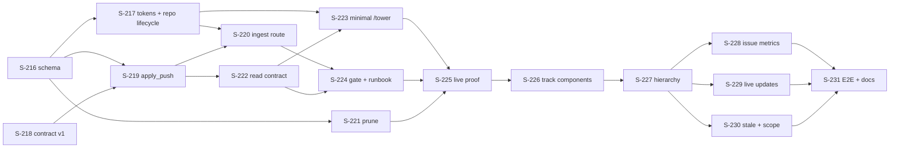

# User Stories — Control Tower (Waves A and B)

## Changelog

| Version | Date       | Summary                                                                                   | Author           |
| ------- | ---------- | ----------------------------------------------------------------------------------------- | ---------------- |
| 1.0     | 2026-11-26 | Initial stories for Waves A and B from spec v1.1 / PRD v1.4. S-216–S-231. | product-engineer |
| 1.1     | 2026-11-26 | Approved by @llipe and published as GitHub issues #487–#502 (see `github-publication-control-tower.md`). No story changed. | @llipe / product-engineer |

Source: `docs/requirements/prd-control-tower.md` (v1.4), `workstream/specification-control-tower.md` (v1.1), `workstream/decisions-control-tower.md` (D-01…D-31), `workstream/research-control-tower.md`.

---

## Legend

- **ID range:** S-216–S-231 (next free after the code-review agent's S-215).
- **Size:** XS (<½ day), S (½–1 day), M (1–2 days), L (2–3 days). Each story fits one PR.
- **Discipline:** test-first. Per-story DoD = `pnpm --filter panel run validate` plus the integration suite where a table, function or route is touched. One PR per story into the wave's integration branch (`integration/control-tower-wave-a`, `integration/control-tower-wave-b`); only the owner merges integration → `main`.
- **Waves:** A — Ingest (S-216–S-225), B — Tower (S-226–S-231). Wave C is not specified yet (D-18).
- **Spec references** are to `specification-control-tower.md` sections (§). **AC-n** are the PRD's acceptance criteria.
- **Vocabulary:** result, evidence, observed time, received time, summary, workflow agent — as the PRD defines them. "Agent" and "run" are never used for dev-tasks work (BR-5).

## Execution plan

Recommended order: S-216 → S-218 → S-217 → S-219 → S-220 → S-221 → S-222 → S-223 → S-224 → S-225, then S-226 → S-227 → S-228 → S-229 → S-230 → S-231.

---

## Wave A — Ingest

### S-216 — Tower schema: `tower_*` tables, `tower.config`, deny-all RLS

**Priority:** Critical **Estimated Size:** M **Dependencies:** none

#### User Story

As the owner, I want the Control Tower's data model in place, so that repositories, tokens, pushes, PRDs, waves, issues and raw tower events have a durable, access-controlled home.

#### Context

Schema only; nothing reads or writes it yet. Spec §5.1, §5.2, §5.4. Independent of the existing `repositories` table (D-19).

#### Acceptance Criteria

- [ ] `tower_repositories`, `tower_tokens`, `tower_change_markers`, `tower_pushes`, `tower_prds`, `tower_waves`, `tower_issues`, `tower_events` exist with the columns, keys and indexes of spec §5.1.
- [ ] `tower_repositories.full_name` is unique and rejects a value that is not lowercase `owner/name`.
- [ ] A second active token for one repository is rejected by the partial unique index; a revoked one plus an active one is allowed.
- [ ] `steps` and `stages` reject a key outside the eight names and a `result` outside the five values; a missing key is allowed.
- [ ] `tower.config` exists with `stale_threshold_hours=24`, `event_retention_days=90`, `push_retention_days=30`, `default_window_days=14`.
- [ ] Every new public table has RLS enabled with no policy and is picked up by `rls-deny-all` without editing that test.
- [ ] No existing table is altered.

#### Business Rules

- No foreign key to `repositories` (D-19). Everything is prefixed `tower` (D-31).

#### Technical Notes

- Follow `supabase/migrations/20261019180000_webhook_schema.sql` and `20261019181000_webhook_vault_config.sql` for conventions (R§3, R§4). Deleting a repository cascades to all its rows.

#### Testing Requirements

- **Unit Tests:** none (schema).
- **Integration Tests:** schema applies on `supabase db reset`; each constraint above has a rejecting and an accepting case; anon is denied on every table.
- **Manual/UI Testing:** none.
- **Edge-Case Matrix:** uppercase and malformed `full_name`; unknown step key; `skipped` with no reason is accepted by the schema (the contract enforces it, S-218); cascade on repository delete.
- **Acceptance-Criteria Mapping:** each AC → one integration case in `tower-schema.test.ts`.
- **Execution Commands:** `supabase db reset`, `pnpm --filter panel run test:integration`.

#### Migration Requirements

- Migration artifact: required (new timestamped SQL files, one per concern).
- Rollback/impact notes: additive; rollback is dropping the new objects. No existing data touched.
- Apply step: local only in this story. The live push is S-225, with explicit owner confirmation.
- Verification after apply: integration suite green on a fresh reset.

#### Implementation Steps

1. Write the integration tests for constraints and deny-all.
2. Write the schema migration and the `tower.config` migration.
3. Regenerate `panel/lib/supabase/types.ts`.

#### Files to Create/Modify

- `supabase/migrations/<ts>_tower_schema.sql`, `<ts>_tower_config.sql`
- `panel/lib/supabase/types.ts`
- `panel/tests/integration/tower-schema.test.ts`

#### Definition of Done Checklist

- [ ] Migrations written and applied locally · [ ] Integration tests green · [ ] `validate` green · [ ] AC → evidence mapped · [ ] PR merged into the integration branch

---

### S-217 — Tower token and repository lifecycle (register, rotate, revoke, remove, threshold)

**Priority:** Critical **Estimated Size:** M **Dependencies:** S-216

#### User Story

As the owner, I want to register a repository and manage its token and stale threshold, so that its CLI can report and a leaked token can be stopped without touching other repositories.

#### Context

Server side only: the token module, the domain save module and the Server Actions. The UI is S-223. Spec §6.3, §7. Covers FR-1 to FR-4 and D-29.

#### Acceptance Criteria

- [ ] `generateTowerToken()` returns `twr_<12 base32>.<43 base64url>` and the SHA-256 hash of the secret; the plain token is returned to the caller once and is not stored.
- [ ] `verifyTowerToken(header)` returns the repository id for a valid active token, and the same negative result for a missing header, a malformed header, an unknown id, a wrong secret and a revoked token.
- [ ] The comparison uses `timingSafeEqual`, and an unknown id still performs one comparison against a dummy hash.
- [ ] `registerTowerRepository` creates the repository, its token and its change marker, and returns the plain token; a duplicate name returns `already_registered`; an invalid name returns `invalid_name`.
- [ ] `rotateTowerToken` revokes the old token and issues a new one atomically; the old one no longer verifies (AC-5).
- [ ] `revokeTowerToken` leaves the repository with no active token; `removeTowerRepository` deletes the repository and everything under it.
- [ ] `setTowerStaleThreshold` accepts 1–720 or null and rejects anything else.
- [ ] No function logs the token or the header.

#### Business Rules

- One active token per repository (D-11). The token grants write for its repository only (FR-4).

#### Technical Notes

- Model on `panel/lib/domain/webhook-endpoint-save.ts` and `panel/app/(panel)/webhooks/actions.ts` (R§2). No Vault (C1). `last_used_at` is written at most once a minute.

#### Testing Requirements

- **Unit Tests:** token format, parse, hash, every negative variant, the dummy-compare path (spy on `timingSafeEqual`).
- **Integration Tests:** register, duplicate, rotate, revoke, remove with cascade, threshold bounds, against real Postgres.
- **Manual/UI Testing:** none (UI is S-223).
- **Edge-Case Matrix:** header with extra whitespace, wrong prefix, two dots, 10 KB header; rotate twice; revoke with no active token.
- **Acceptance-Criteria Mapping:** AC-5 → rotation integration case; each story AC → a named case.
- **Execution Commands:** `pnpm --filter panel run test:unit`, `pnpm --filter panel run test:integration`.

#### Migration Requirements

- Migration artifact: none. Opt-out rationale: uses S-216's tables unchanged.

#### Implementation Steps

1. Unit tests for `token.ts`, then the module.
2. Integration tests for the lifecycle, then `tower-repository-save.ts` and the queries.
3. Server Actions returning typed results.

#### Files to Create/Modify

- `panel/lib/tower/token.ts`, `panel/lib/tower/queries.ts`
- `panel/lib/domain/tower-repository-save.ts`
- `panel/app/(panel)/tower/actions.ts`
- `panel/tests/unit/tower-token.test.ts`, `panel/tests/integration/tower-repository.test.ts`

#### Definition of Done Checklist

- [ ] Code implemented · [ ] Unit and integration tests green, security-negative cases included · [ ] `validate` green · [ ] AC → evidence mapped · [ ] PR merged into the integration branch

---

### S-218 — Ingestion contract version 1: validator, names, fixtures, contract document

**Priority:** Critical **Estimated Size:** M **Dependencies:** none

#### User Story

As the maintainer of the dev-tasks CLI, I want a versioned, documented definition of a push with example payloads, so that I can build a sender against it without reading the panel's code.

#### Context

Pure code and documentation; no database. Spec §6.1, §5.2. This is the artifact the dev-tasks companion PRD cites (D-16).

#### Acceptance Criteria

- [ ] `names.ts` exports the eight issue step names and the eight wave stage names in order.
- [ ] `validatePush(json)` accepts every valid fixture and returns a normalized push; it rejects each invalid fixture with a path and a message that contains no value from the input.
- [ ] It rejects: an unsupported `contract_version` (naming `[1]`), a missing `push_id`, an unknown `kind`, an unknown `event.kind`, an unknown step, stage or result, `skipped` without a reason, an `observed_at` more than 5 minutes ahead of the supplied clock, and any string or array over its cap (spec §12).
- [ ] It accepts and ignores unknown extra fields.
- [ ] It accepts the seven event kinds, including `session_ended` with `usage` and a snapshot with a `lanes` block in both `ok` and `unreadable` states.
- [ ] `docs/reference/tower-ingestion-contract.md` documents the envelope, both kinds, every event kind and every response code, and its examples are the fixture files.
- [ ] At most 20 errors are returned.

#### Business Rules

- The panel knows the names of steps and stages, never the rules that decide them (D-20).

#### Technical Notes

- Use the validation approach the panel already uses for request bodies; add no dependency without need. The clock is a parameter, so tests are deterministic.

#### Testing Requirements

- **Unit Tests:** one case per fixture; table-driven negative cases.
- **Integration Tests:** none.
- **Manual/UI Testing:** read the contract document end to end against the fixtures.
- **Edge-Case Matrix:** empty snapshot (no PRDs, no issues); issue with null `prd_slug` and `wave_key`; cell with no evidence; 1,000-issue snapshot under 1 MiB; non-GitHub pull-request `url` is accepted here and neutralized at render (S-227).
- **Acceptance-Criteria Mapping:** AC-7 → version case; story ACs → fixture cases.
- **Execution Commands:** `pnpm --filter panel run test:unit`.

#### Migration Requirements

- Migration artifact: none. Opt-out rationale: no data-model change.

#### Implementation Steps

1. Write the fixtures (valid and invalid).
2. Write the tests, then `names.ts` and `contract.ts`.
3. Write the contract document from the fixtures.

#### Files to Create/Modify

- `panel/lib/tower/names.ts`, `panel/lib/tower/contract.ts`
- `panel/tests/fixtures/tower/*.json`
- `panel/tests/unit/tower-contract.test.ts`
- `docs/reference/tower-ingestion-contract.md`

#### Definition of Done Checklist

- [ ] Code implemented · [ ] Unit tests green · [ ] Contract document matches fixtures · [ ] `validate` green · [ ] PR merged into the integration branch

---

### S-219 — `tower_apply_push`: merge, deduplicate, place events, summarize

**Priority:** Critical **Estimated Size:** L **Dependencies:** S-216, S-218

#### User Story

As the owner, I want every accepted push merged into one consistent picture, so that two lanes reporting from different branches never overwrite each other and nothing moves backward.

#### Context

The core of the feature: one `security definer` function applying a validated push in one transaction. Spec §8.1, §8.2, §8.3 (database part). Covers FR-8 to FR-12.

#### Acceptance Criteria

- [ ] A push whose `push_id` was already recorded for the repository returns `duplicate` and changes no row (AC-6).
- [ ] For each result cell, a newer `observed_at` replaces the stored cell; an equal or older one does not.
- [ ] Two snapshots from different branches that disagree on a step leave the cell with the newer observation, whichever arrived last.
- [ ] A non-default-branch snapshot never sets `removed_at`. A default-branch snapshot sets `removed_at` only on items previously seen on the default branch and absent from it; an item that reappears has `removed_at` cleared.
- [ ] An event for an unknown issue is stored with `placed = false`, and is applied when a later snapshot contains that issue (AC-8).
- [ ] Rework increments once per distinct key: a gate entering `failed`, an audit observation with `drift_findings > 0`, a `changes_requested` review. Re-sending the same failure does not increment it (AC-13).
- [ ] `block_raised` on the owner then `block_cleared` adds the interval to `waiting_seconds` and sets `waiting_reported`; with no block ever reported, `waiting_reported` stays false.
- [ ] `first_observed_at`, `shipped_at`, `event_count`, `workflow_agents`, `tokens_total` and `models` follow spec §8.3.
- [ ] Each applied push sets the repository's `last_push_received_at` and `last_push_outcome` and increments its change marker by one.
- [ ] The function is executable by `service_role` only, and receives the repository id as an argument, never from the payload.
- [ ] Two pushes for one repository applied concurrently both succeed and leave the same result as applying them in sequence.

#### Business Rules

- Newest observed result wins; a snapshot never erases (D-21). Received time is always the database clock.

#### Technical Notes

- Row-lock `tower_repositories` first. Put the SQL in its own migration. This placement of the merge logic is open question SQ-1 in the spec; if the owner rejects it, this story is re-planned.

#### Testing Requirements

- **Unit Tests:** none (SQL).
- **Integration Tests:** every AC above, against real Postgres, using the S-218 fixtures.
- **Manual/UI Testing:** none.
- **Edge-Case Matrix:** tie on `observed_at`; event before snapshot; snapshot with zero items; issue moved from one wave to another; issue with no PRD; block raised twice; cleared with none open; `passed` then newer `failed`; concurrent pushes.
- **Acceptance-Criteria Mapping:** AC-6, AC-8, AC-13 → named cases; story ACs → one case each in `tower-apply-push.test.ts`.
- **Execution Commands:** `supabase db reset`, `pnpm --filter panel run test:integration`.

#### Migration Requirements

- Migration artifact: required (function).
- Rollback/impact notes: additive; drop the function.
- Apply step: local only; live push in S-225 with owner confirmation.
- Verification after apply: integration suite green.

#### Implementation Steps

1. Write the integration cases from the fixtures.
2. Implement dedup and snapshot upsert with the merge rule.
3. Implement events, placement, summaries and the change marker.
4. Add the concurrency case.

#### Files to Create/Modify

- `supabase/migrations/<ts>_tower_apply_push.sql`
- `panel/lib/tower/queries.ts` (the RPC call)
- `panel/tests/integration/tower-apply-push.test.ts`

#### Definition of Done Checklist

- [ ] Migration written and applied locally · [ ] Integration tests green · [ ] `validate` green · [ ] AC → evidence mapped · [ ] PR merged into the integration branch

---

### S-220 — `POST /api/tower/ingest`: authenticate, cap, validate, apply

**Priority:** Critical **Estimated Size:** M **Dependencies:** S-217, S-219

#### User Story

As the dev-tasks CLI, I want one endpoint that accepts my pushes and tells me precisely why one was refused, so that I can retry what is retryable and report what is not.

#### Context

Wires S-217, S-218 and S-219 into the public route. Spec §6.1 responses, §7, §12, §13. Covers FR-5 to FR-7 and FR-11.

#### Acceptance Criteria

- [ ] A valid push returns 202 `accepted`; the same `push_id` again returns 200 `duplicate` (AC-2, AC-6).
- [ ] A missing header, a malformed header, an unknown token and a revoked token each return 401 with the identical body, and nothing is stored (AC-3).
- [ ] A valid token with another repository's name returns 403 and stores no tower data (AC-4).
- [ ] A body over 1 MiB returns 413 without being buffered whole; invalid JSON or a contract failure returns 422 with `supported_versions` and `errors` (AC-7).
- [ ] The body is not read before the token is verified.
- [ ] Authenticated rejections (403, 413, 422) are recorded in `tower_pushes` with their outcome and set `last_push_outcome` to `rejected`.
- [ ] `/api/tower/ingest` is class `internal` in `route-policy.ts` and passes the login gate; every other `/api/tower/**` path stays class `api`.
- [ ] An unhandled error returns 500 and logs only the error name. The token, the header and the body are never logged.

#### Business Rules

- One fixed 401 for all authentication failures (D-23). No rate limit; 429 is reserved (D-28).

#### Technical Notes

- Shape the pipeline like `panel/lib/webhooks/receive.ts` and reuse the streaming cap pattern of `read-body.ts` (R§1). `runtime = "nodejs"`, `force-dynamic`.

#### Testing Requirements

- **Unit Tests:** route policy classes; the pipeline with injected dependencies for ordering (no body read before auth).
- **Integration Tests:** the HTTP pipeline end to end for 202, 200, each 401, 403, 413, 422.
- **Manual/UI Testing:** `curl` a fixture at the local panel.
- **Edge-Case Matrix:** wrong content type; empty body; exactly 1 MiB; 1 MiB + 1; GET on the route; token valid but repository removed mid-request.
- **Acceptance-Criteria Mapping:** AC-2, AC-3, AC-4, AC-6, AC-7 → `tower-ingest.test.ts` cases.
- **Execution Commands:** `pnpm --filter panel run test:unit`, `pnpm --filter panel run test:integration`.

#### Migration Requirements

- Migration artifact: none. Opt-out rationale: no data-model change.

#### Implementation Steps

1. Tests for policy and pipeline order.
2. `ingest.ts`, then the route handler.
3. Integration cases for every response.

#### Files to Create/Modify

- `panel/lib/tower/ingest.ts`, `panel/app/api/tower/ingest/route.ts`
- `panel/lib/auth/route-policy.ts`
- `panel/tests/unit/tower-ingest.test.ts`, `panel/tests/unit/route-policy.test.ts`, `panel/tests/integration/tower-ingest.test.ts`

#### Definition of Done Checklist

- [ ] Code implemented · [ ] Unit and integration tests green, security-negative cases included · [ ] `validate` green · [ ] AC → evidence mapped · [ ] PR merged into the integration branch

---

### S-221 — Retention: `tower.prune()` and its daily job

**Priority:** Medium **Estimated Size:** S **Dependencies:** S-216

#### User Story

As the owner, I want raw tower events removed 90 days after an issue ships while its summary stays, so that the events table does not grow without limit and old waves remain comparable.

#### Context

Spec §5.3. Covers FR-13 and D-15. A new function, not a copy of the webhook prune: the predicate is ship time (C6).

#### Acceptance Criteria

- [ ] Events of an issue shipped more than `event_retention_days` ago are deleted and its `summary_final_at` is set; its summary columns are unchanged (AC-19).
- [ ] Events of an open issue, and of an issue shipped inside the window, are kept whatever their age.
- [ ] Wave-level events are pruned by their wave's `shipped_at`.
- [ ] `tower_pushes` rows older than `push_retention_days` are deleted.
- [ ] The job `tower-prune` is scheduled daily and running the function twice changes nothing the second time.
- [ ] Changing a `tower.config` value changes the behavior without a migration.

#### Business Rules

- Summaries are never pruned. A summary whose events were pruned is final (FR-13).

#### Technical Notes

- Follow `supabase/migrations/20261019182000_webhook_prune.sql` for the cron wiring only (R§4).

#### Testing Requirements

- **Unit Tests:** none.
- **Integration Tests:** the five behaviors above with rows dated by fixture.
- **Manual/UI Testing:** none.
- **Edge-Case Matrix:** unplaced events of an issue that never appeared (kept); issue shipped exactly at the boundary; missing config key falls back to the default.
- **Acceptance-Criteria Mapping:** AC-19 → `tower-prune.test.ts`.
- **Execution Commands:** `pnpm --filter panel run test:integration`.

#### Migration Requirements

- Migration artifact: required (function and cron schedule).
- Rollback/impact notes: unschedule the job and drop the function; no data is restored by rollback.
- Apply step: live in S-225 with owner confirmation.
- Verification after apply: the job is listed in `cron.job`.

#### Implementation Steps

1. Integration tests. 2. Function. 3. Cron schedule.

#### Files to Create/Modify

- `supabase/migrations/<ts>_tower_prune.sql`
- `panel/tests/integration/tower-prune.test.ts`

#### Definition of Done Checklist

- [ ] Migration written and applied locally · [ ] Integration tests green · [ ] `validate` green · [ ] PR merged into the integration branch

---

### S-222 — Read contract version 1: module, endpoints, document

**Priority:** Critical **Estimated Size:** L **Dependencies:** S-219

#### User Story

As the owner, I want all Control Tower data served through one documented shape, so that the page and any later plugin read the same thing.

#### Context

Spec §6.2 and the read-time rules of §8.3. Covers FR-14 and the computations behind FR-16 to FR-28 and FR-31. No UI.

#### Acceptance Criteria

- [ ] `buildRepositoryTree(rows, now, scope)` and `buildRepositorySummaries(rows, now)` are pure and return the shapes of spec §6.2.
- [ ] Step gaps are the difference between consecutive `passed` or `skipped` cells and are `null` when either is missing or the difference is negative.
- [ ] `in_wave` is false for an issue with no wave; issues with no PRD are returned under `no_prd_issues`.
- [ ] A value that was not reported is `null`: a missing cell, `waiting_seconds` with `waiting_reported` false, `subtasks`, `coverage_gate`, `drift_findings` (AC-14).
- [ ] `stale` is true only with open work and a last push older than the threshold; the threshold is the repository override, else the config default, and `threshold_source` says which (AC-16, AC-17).
- [ ] `scope=recent` returns open items and items shipped inside `default_window_days`, keeping a wave or PRD when any child is kept; `scope=all` returns everything not removed (AC-18).
- [ ] PRD and wave rollups match the counts of their non-removed children; a wave with no audit evidence and a Done ship stage returns exactly those two cells (AC-10).
- [ ] `GET /api/tower/repositories` and `GET /api/tower/repositories/{owner}/{name}` return the module's output; an unregistered name is 404; an unauthenticated request is 401 (AC-23).
- [ ] Reads page in 1,000-row pages; a repository with 2,500 issues returns all of them.
- [ ] `docs/reference/tower-read-contract.md` documents the shapes; one test asserts the module's output and the endpoint's body equal the shared fixture.

#### Business Rules

- Evidence only; never render or return unreported as zero (FR-27). Open durations are sent as anchor timestamps.

#### Technical Notes

- Service-role reads through `panel/lib/supabase/server.ts` (R§3). Token totals are in the rows but not exposed until Wave C.

#### Testing Requirements

- **Unit Tests:** gaps, seven-node rule, staleness matrix, rollups, window, nulls.
- **Integration Tests:** endpoints over rows produced by real pushes; paging beyond 1,000 rows; 401 and 404.
- **Manual/UI Testing:** none.
- **Edge-Case Matrix:** repository that never pushed; PRD with no waves; wave with no issues; all issues shipped; removed items; clock exactly at the threshold.
- **Acceptance-Criteria Mapping:** AC-10, AC-12, AC-14, AC-16, AC-17, AC-18, AC-23 → named cases.
- **Execution Commands:** `pnpm --filter panel run test:unit`, `pnpm --filter panel run test:integration`.

#### Migration Requirements

- Migration artifact: none. Opt-out rationale: read-only.

#### Implementation Steps

1. Read-contract fixture and unit tests. 2. `read.ts`. 3. Paged queries. 4. Route handlers. 5. Document.

#### Files to Create/Modify

- `panel/lib/tower/read.ts`, `panel/lib/tower/queries.ts`
- `panel/app/api/tower/repositories/route.ts`, `panel/app/api/tower/repositories/[owner]/[name]/route.ts`
- `panel/tests/fixtures/tower/read-*.json`, `panel/tests/unit/tower-read.test.ts`, `panel/tests/integration/tower-read.test.ts`
- `docs/reference/tower-read-contract.md`

#### Definition of Done Checklist

- [ ] Code implemented · [ ] Unit and integration tests green · [ ] Contract document matches fixture · [ ] `validate` green · [ ] PR merged into the integration branch

---

### S-223 — Minimal `/tower`: repositories, registration, show-once token, settings

**Priority:** High **Estimated Size:** M **Dependencies:** S-217, S-222

#### User Story

As the owner, I want a Control Tower page where I register a repository, copy its token once and manage it, so that I can connect a repository without a script.

#### Context

The visible part of Wave A (D-30). Spec §10.1, §10.2. Covers FR-1 to FR-3, FR-11, FR-15 (list), FR-32.

#### Acceptance Criteria

- [ ] The sidebar has a "Control Tower" entry leading to `/tower`.
- [ ] The page lists tower repositories with last-reported time, last push outcome, and pushes accepted and rejected in the last day.
- [ ] Registering `owner/name` reveals the token once with the CLI line to paste; closing the dialog and reloading never shows it again (AC-1).
- [ ] A duplicate or invalid name shows the named error and creates nothing.
- [ ] Rotate reveals a new token once after a confirmation; revoke and remove each ask for confirmation, and remove states what is deleted.
- [ ] The stale threshold field shows the value in effect and whether it comes from the default or the repository; clearing it returns to the default.
- [ ] With no repository, and for a repository with no push yet, the page shows the empty state with the next CLI step, and says the hierarchy arrives with the next wave.
- [ ] A logged-out visit to `/tower` redirects to `/login` (AC-23).

#### Business Rules

- The plain token exists only in the response of register and rotate (D-11).

#### Technical Notes

- Reuse `SecretReveal` and the webhook list's structure (R§2, R§6). `/DESIGN.md` tokens and components only; no new component contract in this story.

#### Testing Requirements

- **Unit Tests:** name validation; threshold field logic.
- **Integration Tests:** covered by S-217.
- **Manual/UI Testing:** the full register → reveal → reload flow at `/tower`.
- **Edge-Case Matrix:** name with uppercase or spaces; double submit; rotate while the reveal dialog is open; narrow viewport.
- **Acceptance-Criteria Mapping:** AC-1, AC-23 → `tower-repositories.spec.ts`.
- **Execution Commands:** `pnpm --filter panel run test:unit`, `pnpm --filter panel run test:e2e`.

#### Migration Requirements

- Migration artifact: none. Opt-out rationale: UI only.

#### Implementation Steps

1. E2E for register and reveal-once. 2. Page and list. 3. Dialogs and settings. 4. Sidebar entry.

#### Files to Create/Modify

- `panel/app/(panel)/tower/page.tsx`, `page.module.css`
- `panel/components/tower/RepositoryList.tsx`, `RegisterRepositoryDialog.tsx`, `RepositorySettings.tsx`
- `panel/components/shell/Sidebar.tsx`
- `panel/tests/e2e/tower-repositories.spec.ts`

#### Definition of Done Checklist

- [ ] Code implemented per `/DESIGN.md` · [ ] Unit and E2E tests green · [ ] `validate` green · [ ] AC → evidence mapped · [ ] PR merged into the integration branch

---

### S-224 — Release-gate probes and the Control Tower runbook

**Priority:** High **Estimated Size:** S **Dependencies:** S-220, S-222

#### User Story

As the owner, I want every release to prove that an unauthenticated push and an unauthenticated read are refused, and a runbook for operating the tower, so that the new public surface cannot regress silently.

#### Context

Spec §12 release gate, §15 runbook. Covers AC-3 and AC-23 at the gate (D-26). ADR-007.

#### Acceptance Criteria

- [ ] `scripts/verify-panel-auth.sh` sends a `POST /api/tower/ingest` with no token and requires 401, and a `GET /api/tower/repositories` with no session and requires 401.
- [ ] `evaluateAuthGate` in `panel/scripts/panel-auth-check.mjs` fails the gate when either probe returns anything else, including 404 and 302.
- [ ] The parser's unit tests cover both probes passing, each failing, and both failing; CI runs them.
- [ ] `docs/runbooks/control-tower.md` covers: register a repository, rotate and revoke a token, send a hand-made snapshot and event with `curl`, read the push counters, and what to check when a repository shows stale.
- [ ] `docs/runbooks/` index links the new runbook.

#### Business Rules

- The auth boundary is a release gate (ADR-007). A runbook ships in the same PR as the procedure.

#### Technical Notes

- The probes need no secret, unlike check 6 and `WEBHOOK_PROBE_TOKEN` (R§7). The read probe expects 401 JSON, not the 302 page probes expect (C7).

#### Testing Requirements

- **Unit Tests:** the verdict function with the new inputs.
- **Integration Tests:** none.
- **Manual/UI Testing:** run the script against the local panel.
- **Edge-Case Matrix:** probe timeout; a 5xx from either probe fails the gate.
- **Acceptance-Criteria Mapping:** AC-3, AC-23 → gate unit tests and a local script run.
- **Execution Commands:** `pnpm --filter panel run test:unit`, `scripts/verify-panel-auth.sh`.

#### Migration Requirements

- Migration artifact: none. Opt-out rationale: scripts and documentation only.

#### Implementation Steps

1. Unit tests for the verdict. 2. Parser. 3. Shell probes. 4. Runbook.

#### Files to Create/Modify

- `scripts/verify-panel-auth.sh`, `panel/scripts/panel-auth-check.mjs`
- `panel/tests/unit/panel-auth-check.test.ts`
- `docs/runbooks/control-tower.md`, `docs/runbooks/README.md`

#### Definition of Done Checklist

- [ ] Code implemented · [ ] Unit tests green · [ ] Script run recorded · [ ] Runbook reviewed · [ ] `validate` green · [ ] PR merged into the integration branch

---

### S-225 — Wave A live: migrations pushed, panel deployed, one real push accepted

**Priority:** High **Estimated Size:** S **Dependencies:** S-221, S-223, S-224

#### User Story

As the owner, I want Wave A running on the live panel with one repository registered and one push accepted, so that the dev-tasks CLI has a real endpoint to build against.

#### Context

An `infra-engineer` pass, approval-gated per step (D-30, spec §15). No application code. It closes Wave A and unblocks the dev-tasks `sync` work.

#### Acceptance Criteria

- [ ] Before the push, the hosted project is confirmed to have `pg_cron` and Realtime enabled, and `service_role` able to execute the new functions.
- [ ] The Wave A migrations are applied to the live database after explicit owner confirmation, and `tower-prune` is listed in `cron.job`.
- [ ] The panel is deployed and the release gate passes, including the two new probes.
- [ ] One repository is registered on the live panel; a hand-made snapshot returns 202 and a hand-made event returns 202; a repeat returns 200; a push with a wrong token returns 401.
- [ ] `/tower` shows the repository with its last-reported time and push counts.
- [ ] `docs/technical-guidelines.md` documents the ingest endpoint, the token model and the new tables; `docs/roadmap.md` Wave A row is updated; the change is recorded under `infra/changes/`.

#### Business Rules

- Every live step needs the owner's approval. The agent never merges to `main`.

#### Technical Notes

- Run with `/infra-engineer` and the `supabase-ops` and `fly-ops` skills. Runtime first is not a concern here: the migrations are additive and the old app ignores them.

#### Testing Requirements

- **Unit Tests:** none.
- **Integration Tests:** none new.
- **Manual/UI Testing:** the live `curl` sequence from the runbook; the `/tower` check.
- **Edge-Case Matrix:** migration push fails midway (revert plan recorded before the push).
- **Acceptance-Criteria Mapping:** AC-2, AC-3, AC-6 → recorded live responses.
- **Execution Commands:** `scripts/verify-panel-auth.sh`, the runbook's `curl` lines.

#### Migration Requirements

- Migration artifact: the Wave A migrations, already written.
- Rollback/impact notes: additive; revert the deploy and leave the tables.
- Apply step: requires explicit owner confirmation.
- Verification after apply: listed above.

#### Implementation Steps

1. Pre-checks. 2. Database push. 3. Deploy and gate. 4. Live proof. 5. Documentation and change record.

#### Files to Create/Modify

- `infra/changes/<date>-control-tower-wave-a/`
- `docs/technical-guidelines.md`, `docs/roadmap.md`, `docs/product-context.md`

#### Definition of Done Checklist

- [ ] Live steps approved and recorded · [ ] Gate green · [ ] Live proof recorded · [ ] Docs updated · [ ] Consolidated Wave A PR ready for the owner

---

## Wave B — Tower

### S-226 — DESIGN.md contract and components for the stage/step track

**Priority:** High **Estimated Size:** M **Dependencies:** S-225 (and the `ux-engineer` sketch, recommended)

#### User Story

As the owner, I want each wave and issue drawn as a track of eight positions whose result I can read at a glance, so that a gap or a failure stands out.

#### Context

Design contract first, then the presentational components, with no data wiring. Spec §10.3, §10.4. Supports FR-17, FR-19, FR-21, FR-27.

#### Acceptance Criteria

- [ ] `/DESIGN.md` documents the track (node, connector, the five results plus "not reported", gap label, overflow scroll), the collapsible hierarchy row, the stale treatment and the "not reported" value style, with a changelog row.
- [ ] `ResultTrack` renders eight nodes from a names list and a cell map, or seven when told to merge the last two.
- [ ] Each of `passed`, `failed`, `skipped`, `in_progress`, `pending` and a missing cell renders a distinct icon and text label; no state is distinguishable by color alone.
- [ ] A `skipped` node shows its reason; a connector shows its gap label, or nothing when the gap is `null`.
- [ ] Every node is keyboard-focusable and exposes name, result and observed time to assistive technology.
- [ ] No new color token is added unless `/DESIGN.md` §2.4 cannot express a state, and then it is added there first.

#### Business Rules

- `/DESIGN.md` is the source of truth; it changes in the same PR as the components.

#### Technical Notes

- If `ux-engineer` produced sketches, they are the input; otherwise the reference image's density applies. Stage and step tracks share the component; only the names differ.

#### Testing Requirements

- **Unit Tests:** render each state; seven-node mode; reason and gap label; accessible names.
- **Integration Tests:** none.
- **Manual/UI Testing:** a dev route under `/dev` showing every state, at narrow and wide widths, keyboard only.
- **Edge-Case Matrix:** all eight missing; very long reason; gap of seconds, days, and `null`.
- **Acceptance-Criteria Mapping:** AC-11, AC-12 (rendering half) → component tests.
- **Execution Commands:** `pnpm --filter panel run test:unit`.

#### Migration Requirements

- Migration artifact: none. Opt-out rationale: UI only.

#### Implementation Steps

1. DESIGN.md section. 2. Component tests. 3. `ResultTrack`, `NotReported`, `HierarchyRow`. 4. Dev showcase.

#### Files to Create/Modify

- `DESIGN.md`
- `panel/components/tower/ResultTrack.tsx`, `NotReported.tsx`, `HierarchyRow.tsx` and their CSS modules
- `panel/tests/unit/tower-result-track.test.tsx`

#### Definition of Done Checklist

- [ ] DESIGN.md updated · [ ] Components implemented · [ ] Unit tests green · [ ] `validate` green · [ ] PR merged into the integration branch

---

### S-227 — The hierarchy: repository → PRD → wave → issue with rollups

**Priority:** Critical **Estimated Size:** L **Dependencies:** S-226

#### User Story

As the owner, I want to open a repository and see its PRDs, their waves and their issues with where each stands, so that I know the state of the work without opening GitHub.

#### Context

The page of Wave B, server-rendered from the read contract. Spec §10.3. Covers FR-15 to FR-22 and FR-27.

#### Acceptance Criteria

- [ ] `/tower` renders each repository as a collapsible block with its PRD and issue counts and last-reported time; Wave A's settings remain reachable.
- [ ] A PRD row shows name, status, waves shipped of total, issues shipped of total, a progress bar and last activity (AC-9).
- [ ] A wave row shows the eight-stage track, "n of m issues shipped" on Build, and expands to its issues (AC-9, AC-10).
- [ ] An issue row shows number, title and the eight-step track, or seven when it has no wave (AC-12); Build shows sub-tasks done of total, Fidelity audit shows the drift count, Coverage gate shows its value and reason (AC-11).
- [ ] Issues with no PRD appear in a "No PRD" group after the PRDs.
- [ ] Any `null` in the contract renders as "not reported", never as 0, empty or passed (AC-14).
- [ ] Which rows are expanded is kept in the URL, so a reload keeps the tree open.
- [ ] Titles and other pushed text render as text; a pull-request link is rendered only for an `https://github.com/` URL.
- [ ] The first render calls the read module directly and matches the endpoint's shape.

#### Business Rules

- Nothing on the page can be edited (BR-2). A dev-tasks role is a "workflow agent" in every label (BR-5).

#### Technical Notes

- Server component for the first render; client components only where interaction needs them. A repository block fetches its tree when first expanded if it was collapsed at load.

#### Testing Requirements

- **Unit Tests:** row components from contract fixtures; URL expansion state.
- **Integration Tests:** none new.
- **Manual/UI Testing:** push the fixtures locally and walk the tree at `/tower`.
- **Edge-Case Matrix:** repository with no PRD; PRD with no wave; wave with no issue; 200 issues in one wave; markup in a title.
- **Acceptance-Criteria Mapping:** AC-9, AC-10, AC-11, AC-12, AC-14 → `tower-hierarchy.spec.ts` and component tests.
- **Execution Commands:** `pnpm --filter panel run test:unit`, `pnpm --filter panel run test:e2e`.

#### Migration Requirements

- Migration artifact: none. Opt-out rationale: UI only.

#### Implementation Steps

1. E2E seeded by pushing fixtures. 2. Repository, PRD, wave and issue rows. 3. "No PRD" group. 4. URL state.

#### Files to Create/Modify

- `panel/app/(panel)/tower/page.tsx`
- `panel/components/tower/RepositoryBlock.tsx`, `PrdRow.tsx`, `WaveRow.tsx`, `IssueRow.tsx`
- `panel/tests/unit/tower-rows.test.tsx`, `panel/tests/e2e/tower-hierarchy.spec.ts`

#### Definition of Done Checklist

- [ ] Code implemented per `/DESIGN.md` · [ ] Unit and E2E tests green · [ ] `validate` green · [ ] AC → evidence mapped · [ ] PR merged into the integration branch

---

### S-228 — Times and counts on issue and wave rows

**Priority:** High **Estimated Size:** M **Dependencies:** S-227

#### User Story

As the owner, I want each issue to show how long each step took, how long it has waited on me and how often a gate was repeated, so that I can see where the process loses time.

#### Context

Spec §10.3 right-hand column and §8.3. Covers FR-18, FR-23 to FR-26 and FR-30.

#### Acceptance Criteria

- [ ] Each connector between two steps shows the gap from the contract, formatted (`< 1m`, `16m`, `9h 35m`, `3d 4h`).
- [ ] An issue row shows elapsed, waiting on you, rework, pull requests as links, event count and workflow agents as tags.
- [ ] A wave row shows elapsed, blocked count, the age of its oldest open issue, and its rework and pull-request totals.
- [ ] Elapsed on an open issue, and waiting on an issue currently blocked, advance in the browser without a refetch, at least every 30 seconds.
- [ ] Rework 2 is shown for an issue with one failed gate and one audit with drift (AC-13).
- [ ] Waiting on you reads "not reported" when no block was ever reported, and a duration (which may be `0m`) when one was (AC-14).
- [ ] A shipped issue shows its final elapsed time and does not tick.

#### Business Rules

- No estimates, due dates or velocity (PRD non-goal). Token and model are not shown in this wave.

#### Technical Notes

- One shared ticking clock for the page, not one timer per row. Formatting is a pure function.

#### Testing Requirements

- **Unit Tests:** duration formatting; ticking from an anchor with a fake clock; "not reported" versus zero.
- **Integration Tests:** none new.
- **Manual/UI Testing:** watch an open issue for a minute.
- **Edge-Case Matrix:** gap of 0 seconds; negative gap arrives as `null`; issue blocked now; 30-day elapsed; tab hidden then shown.
- **Acceptance-Criteria Mapping:** AC-13, AC-14 → component tests and `tower-hierarchy.spec.ts`.
- **Execution Commands:** `pnpm --filter panel run test:unit`, `pnpm --filter panel run test:e2e`.

#### Migration Requirements

- Migration artifact: none. Opt-out rationale: UI only.

#### Implementation Steps

1. Formatting and clock tests. 2. `format-duration.ts`, `useTowerClock`. 3. Metrics on issue and wave rows.

#### Files to Create/Modify

- `panel/lib/tower/format-duration.ts`, `panel/components/tower/useTowerClock.ts`, `IssueMetrics.tsx`, `WaveMetrics.tsx`
- `panel/tests/unit/tower-format-duration.test.ts`, `panel/tests/unit/tower-metrics.test.tsx`

#### Definition of Done Checklist

- [ ] Code implemented · [ ] Unit and E2E tests green · [ ] `validate` green · [ ] AC → evidence mapped · [ ] PR merged into the integration branch

---

### S-229 — Live updates: change-marker stream, refetch, polling fallback

**Priority:** High **Estimated Size:** M **Dependencies:** S-227

#### User Story

As the owner, I want the page to change when a push arrives without reloading it, so that I can leave it open while a crew works.

#### Context

Spec §6.2 stream, §9, §10.3 live. Covers FR-29 (D-24).

#### Acceptance Criteria

- [ ] `tower_change_markers` is added to the Realtime publication; no other tower table is.
- [ ] `GET /api/tower/stream` is a `text/event-stream` that emits `changed` with `{ repository, seq }` after an accepted push and a heartbeat every 25 seconds; unauthenticated it returns 401.
- [ ] With `/tower` open, an accepted push for a visible repository changes its block without a reload (AC-15).
- [ ] Several signals inside one second cause one refetch per repository.
- [ ] A refetch failure keeps the last good data and marks the block with an error and its time.
- [ ] When the stream errors, the page shows "live updates paused", polls every 30 seconds, and resumes the stream when it can.
- [ ] The stream carries no tower content, only the repository name and a counter.

#### Business Rules

- The read contract is the only way data reaches the page (D-12, D-27).

#### Technical Notes

- Model on `panel/app/api/runs/[id]/events/stream/route.ts` for the server-side subscription; do not reuse its per-run cursor (C4). Close the subscription when the client disconnects.

#### Testing Requirements

- **Unit Tests:** signal grouping; fallback state machine with a fake `EventSource`.
- **Integration Tests:** an accepted push bumps the marker (already in S-219); stream 401.
- **Manual/UI Testing:** two browser tabs and `curl` pushes.
- **Edge-Case Matrix:** stream drops mid-refetch; push for a collapsed repository; push for a repository registered after page load; 50 pushes in one second.
- **Acceptance-Criteria Mapping:** AC-15 → `tower-live.spec.ts`.
- **Execution Commands:** `pnpm --filter panel run test:unit`, `pnpm --filter panel run test:e2e`.

#### Migration Requirements

- Migration artifact: required (publication change).
- Rollback/impact notes: remove the table from the publication; the page falls back to polling.
- Apply step: live with the Wave B deploy, with owner confirmation.
- Verification after apply: `pg_publication_tables` lists the table.

#### Implementation Steps

1. Unit tests for grouping and fallback. 2. Migration. 3. Stream route. 4. `useTowerLive` and wiring. 5. E2E.

#### Files to Create/Modify

- `supabase/migrations/<ts>_tower_realtime.sql`
- `panel/app/api/tower/stream/route.ts`, `panel/components/tower/useTowerLive.ts`
- `panel/tests/unit/tower-live.test.ts`, `panel/tests/e2e/tower-live.spec.ts`

#### Definition of Done Checklist

- [ ] Migration written and applied locally · [ ] Unit and E2E tests green · [ ] `validate` green · [ ] AC → evidence mapped · [ ] PR merged into the integration branch

---

### S-230 — Stale repositories and the Recent / Everything scope

**Priority:** Medium **Estimated Size:** S **Dependencies:** S-227

#### User Story

As the owner, I want a repository that has gone quiet to be marked stale, and finished work to stay out of my way unless I ask for it, so that I trust what is on screen and it stays readable.

#### Context

Spec §10.3, §8.3. Covers FR-28 and FR-31.

#### Acceptance Criteria

- [ ] A repository the contract marks `stale` shows a "stale" pill and its last-reported time, and its body is dimmed but readable and expandable (AC-16).
- [ ] A repository with no open work is never shown stale (AC-17).
- [ ] The scope control defaults to Recent and offers Everything; the choice is in the URL and survives a reload.
- [ ] With Recent, an issue shipped more than 14 days ago is hidden; with Everything it is shown with its times and counts (AC-18).
- [ ] A live refetch keeps the selected scope.

#### Business Rules

- Staleness is decided by the read contract, not the browser.

#### Technical Notes

- The dimmed treatment must keep text contrast within the accessibility level `/DESIGN.md` states.

#### Testing Requirements

- **Unit Tests:** stale rendering; scope in URL.
- **Integration Tests:** covered by S-222.
- **Manual/UI Testing:** date a fixture's last push 25 hours back.
- **Edge-Case Matrix:** stale and never pushed (empty state wins); stale with Everything; override threshold of 1 hour.
- **Acceptance-Criteria Mapping:** AC-16, AC-17, AC-18 → `tower-stale-scope.spec.ts`.
- **Execution Commands:** `pnpm --filter panel run test:unit`, `pnpm --filter panel run test:e2e`.

#### Migration Requirements

- Migration artifact: none. Opt-out rationale: UI only.

#### Implementation Steps

1. E2E. 2. Stale treatment. 3. Scope control and URL state.

#### Files to Create/Modify

- `panel/components/tower/RepositoryBlock.tsx`, `ScopeToggle.tsx`
- `panel/tests/e2e/tower-stale-scope.spec.ts`

#### Definition of Done Checklist

- [ ] Code implemented per `/DESIGN.md` · [ ] Unit and E2E tests green · [ ] `validate` green · [ ] AC → evidence mapped · [ ] PR merged into the integration branch

---

### S-231 — Wave B close: full E2E pass, documentation, live deploy

**Priority:** High **Estimated Size:** M **Dependencies:** S-228, S-229, S-230

#### User Story

As the owner, I want Wave B verified end to end and live, with the documents current, so that the Control Tower is usable on real work as soon as the CLI can sync.

#### Context

The closing story of the wave: cross-story E2E, documents, and the `infra-engineer` pass for the publication migration and the deploy (spec §14, §15).

#### Acceptance Criteria

- [ ] The E2E suite covers, in one seeded scenario, AC-9 to AC-12, AC-14 to AC-18 and AC-23, and is green in CI.
- [ ] The integration suite reports the measured ingest and tree-read timings against the targets of spec §11.
- [ ] `docs/technical-guidelines.md`, `docs/product-context.md` and `docs/runbooks/control-tower.md` describe the hierarchy page, the stream and the fallback.
- [ ] The publication migration is applied live after owner confirmation, the panel is deployed and the release gate passes.
- [ ] On the live panel, a hand-made snapshot renders as a hierarchy and a following event changes it without a reload.
- [ ] `docs/roadmap.md` Wave B row is updated in the consolidated PR.

#### Business Rules

- Timings are reported, not gated (spec §11).

#### Technical Notes

- Real data needs `dev-tasks tower sync` from the companion PRD. Until it exists the live proof uses the fixtures.

#### Testing Requirements

- **Unit Tests:** none new.
- **Integration Tests:** the timing report on a generated 500-issue fixture.
- **Manual/UI Testing:** the live proof above.
- **Edge-Case Matrix:** deploy before the publication migration (page polls; acceptable); migration before deploy (no effect).
- **Acceptance-Criteria Mapping:** the AC list above → `tower-*.spec.ts`.
- **Execution Commands:** `pnpm --filter panel run validate`, `pnpm --filter panel run test:e2e`, `scripts/verify-panel-auth.sh`.

#### Migration Requirements

- Migration artifact: S-229's publication migration.
- Rollback/impact notes: revert the deploy; the page of Wave A returns.
- Apply step: requires explicit owner confirmation.
- Verification after apply: live proof.

#### Implementation Steps

1. Consolidated E2E scenario. 2. Timing report. 3. Documents. 4. Infra pass. 5. Roadmap row.

#### Files to Create/Modify

- `panel/tests/e2e/tower-*.spec.ts`, `panel/tests/integration/tower-timing.test.ts`
- `docs/technical-guidelines.md`, `docs/product-context.md`, `docs/runbooks/control-tower.md`, `docs/roadmap.md`
- `infra/changes/<date>-control-tower-wave-b/`

#### Definition of Done Checklist

- [ ] E2E green in CI · [ ] Timings reported · [ ] Docs updated · [ ] Live steps approved and recorded · [ ] Consolidated Wave B PR ready for the owner

---

## Coverage Validation

### Summary

- **Total PRD Requirements:** 39 functional requirements, 6 business rules, 23 acceptance criteria
- **In scope for this document (Waves A and B):** 32 functional requirements, 6 business rules, 20 acceptance criteria
- **Total User Stories:** 16
- **Coverage of in-scope requirements:** 100%
- **Status:** Complete for Waves A and B. Wave C (FR-33 to FR-39, AC-20 to AC-22) is deliberately not covered (D-18).

### Requirement Mapping

| PRD Requirement | Story ID(s) | Status |
| --- | --- | --- |
| FR-1 register a tower repository | S-216, S-217, S-223 | ✅ Covered |
| FR-2 token shown once, hash stored | S-217, S-223 | ✅ Covered |
| FR-3 rotate, revoke, remove | S-217, S-223 | ✅ Covered |
| FR-4 token grants one capability | S-217, S-220 | ✅ Covered |
| FR-5 ingest endpoint rejects bad tokens and wrong repository | S-220 | ✅ Covered |
| FR-6 snapshot and tower event | S-218, S-219 | ✅ Covered |
| FR-7 versioned contract | S-218, S-220 | ✅ Covered |
| FR-8 newest observed result wins | S-219 | ✅ Covered |
| FR-9 idempotent, never backward | S-219, S-220 | ✅ Covered |
| FR-10 event for an unknown item is held | S-219 | ✅ Covered |
| FR-11 last push time and outcome | S-219, S-220, S-223 | ✅ Covered |
| FR-12 permanent summary | S-216, S-219 | ✅ Covered |
| FR-13 90-day event prune | S-221 | ✅ Covered |
| FR-14 one read contract | S-222 | ✅ Covered |
| FR-15 repository list and expansion | S-223, S-227 | ✅ Covered |
| FR-16 PRD row | S-222, S-227 | ✅ Covered |
| FR-17 wave stages | S-226, S-227 | ✅ Covered |
| FR-18 wave metrics | S-222, S-228 | ✅ Covered |
| FR-19 issue steps and results | S-226, S-227 | ✅ Covered |
| FR-20 Build, audit and coverage detail | S-227 | ✅ Covered |
| FR-21 Merged and Shipped as one | S-222, S-226, S-227 | ✅ Covered |
| FR-22 "No PRD" group | S-222, S-227 | ✅ Covered |
| FR-23 time between steps | S-222, S-228 | ✅ Covered |
| FR-24 issue metrics | S-228 | ✅ Covered |
| FR-25 rework | S-219, S-228 | ✅ Covered |
| FR-26 waiting on the owner | S-219, S-222, S-228 | ✅ Covered |
| FR-27 "not reported", never zero | S-222, S-226, S-227, S-228 | ✅ Covered |
| FR-28 default window and filter | S-222, S-230 | ✅ Covered |
| FR-29 live without reload | S-229 | ✅ Covered |
| FR-30 ticking elapsed time | S-228 | ✅ Covered |
| FR-31 stale flag | S-217, S-222, S-230 | ✅ Covered |
| FR-32 never-pushed empty state | S-223 | ✅ Covered |
| FR-33 to FR-39 Lanes strip, cost | — | ⏸ Wave C, not specified (D-18). Version 1 accepts and stores the data: S-218, S-219 |
| BR-1 CLI is the only source | S-219, S-220 (no outbound call anywhere) | ✅ Covered |
| BR-2 no manual status | S-227 | ✅ Covered |
| BR-3 stages recorded per stage | S-219, S-226 | ✅ Covered |
| BR-4 GitHub and artifacts are the truth | S-219 (merge corrects on next snapshot) | ✅ Covered |
| BR-5 "workflow agent" naming | S-227, S-228 | ✅ Covered |
| BR-6 panel never calls back | S-220 | ✅ Covered |
| AC-1 | S-223 | ✅ Covered |
| AC-2 to AC-4, AC-7 | S-220 | ✅ Covered |
| AC-5 | S-217 | ✅ Covered |
| AC-6, AC-8, AC-13 | S-219 (AC-6 also S-220, AC-13 also S-228) | ✅ Covered |
| AC-9 to AC-12 | S-222, S-226, S-227 | ✅ Covered |
| AC-14 | S-222, S-227, S-228 | ✅ Covered |
| AC-15 | S-229 | ✅ Covered |
| AC-16 to AC-18 | S-222, S-230 | ✅ Covered |
| AC-19 | S-221 | ✅ Covered |
| AC-20 to AC-22 | — | ⏸ Wave C |
| AC-23 | S-222, S-223, S-224 | ✅ Covered |
| Security (§17): fail closed, no token in logs, text-only rendering, release gate | S-217, S-220, S-224, S-227 | ✅ Covered |

### Gaps

- None for Waves A and B.
- **Deferred, not a gap:** FR-33 to FR-39 and AC-20 to AC-22 need the Wave C specification, which waits on the dev-tasks side (D-18).

### Non-Goals Validation

- [x] Embedding, read tokens, Orca or VS Code plugin — not in any story
- [x] `dev-tasks tower` commands, agent instructions, hooks — not in any story
- [x] Pulling from GitHub or using the GitHub App — not in any story
- [x] Acting on work from the page — not in any story
- [x] Estimates, due dates, velocity — not in any story
- [x] Linking fleet agent runs to tower issues — not in any story
- [x] Notifications for stale repositories or waiting items — not in any story
