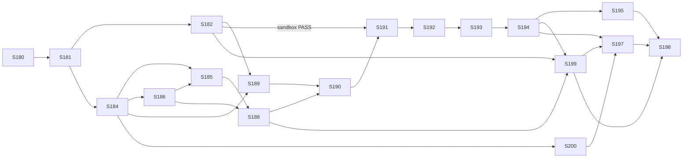

# User Stories — Bug Fix Agent

> Derived from [`specification-prd-bug-fix-agent.md`](specification-prd-bug-fix-agent.md) v2.0
> and [`prd-bug-fix-agent.md`](../docs/requirements/prd-bug-fix-agent.md) v2.0 (issue mode, `/bug-fix` trigger).
> Waves (D-106): foundations, trigger contract and claim (A) → fix loop and validation (B) → board, runbook and live (C).
> Active stories: **S-180–S-182, S-184–S-186, S-188–S-195, S-197–S-200** (18). S-183, S-187 and S-196 are removed in v2.0, and their IDs are kept.

## Changelog

| Version | Date       | Summary                                                  | Author           |
| ------- | ---------- | -------------------------------------------------------- | ---------------- |
| 2.6 | 2026-10-24 | Drift reconciliation of S-190 audit findings DF-190-01/04/05/06/10 and the stream rule ([`fidelity-report-S-190.md`](fidelity-report-S-190.md), PR #460), confirmed by @llipe 2026-10-24, against spec v2.7. DF-190-01 (Major): new S-194-AC9, the two linked-PR re-checks (the §8.6 post-check re-runs refusal (c) `linked_pr` and withdraws under the DF-38 rules, `not_applicable`/`linked_pr`, a fault fails closed with its D-67 code, ownership confirmed only when both reads pass; and a pre-push re-check that takes the disposition path, `needs_review`, with no second PR); S-194-AC7 now gates `FIX_LOOP_ENABLED=1` on AC9 and on a wired fix runner; the S-188 technical note points to S-194. DF-190-04: S-191 and S-194 technical notes say a Wave B story must wire `Runtime.fix_runner` before the flag flips (`FIX_LOOP_ENABLED=1` with no runner disposes `needs_review`/`fix_unavailable`). DF-190-05/06 and the stream rule are spec-only (§8.9 entrypoint rows, result shape, `result.reason` on `needs_review`, stream close); S-190's context names them. DF-190-10 is a test-plan change only. AC numbering is unchanged; AC9 is appended. | product-engineer |
| 2.5 | 2026-10-24 | Drift reconciliation of S-189 audit findings DF-189-01/04/05/07/08 and the S-189 fix-round hardening ([`fidelity-report-S-189.md`](fidelity-report-S-189.md), PR #458), confirmed by @llipe 2026-10-24, against spec v2.6. DF-189-01: S-189-AC3 and S-193-AC3/AC6 use the raw-blob tar, not `git archive`. Fix-round hardening: S-189-AC1 adds `fsckObjects`; S-189-AC3 adds the `.git` component check and the tar caps; S-189-AC3 also records the link-free work-tree walk (hardlinks, FIFOs, sockets, device nodes), the link-protection `run_event` and image-smoke assertion, and `CLONE_FAILED`. DF-189-04/05/08: S-189-AC4 and AC5 name the repo-gate items and fixed reply phrases (`lockfile`, `supported package manager (pnpm or npm)`, `package.json or Makefile`, "missing install target (the Makefile target `install`)"), GNU make's makefile order and `include` not followed; the edge-case matrix gains these cases. DF-189-07: S-180-AC5, S-189-AC1/AC3 and S-193-AC6 drop the `wrapper` user (D-110). | product-engineer |
| 2.4 | 2026-10-24 | D-112 / OQ-1 and drift reconciliation of DF-38 (race-loss part) and S-188 audit findings DF-188-01/02/05, confirmed by @llipe 2026-10-24, against spec v2.5. D-112 / OQ-1: S-189's "OQ-1 resolved" AC, context, technical notes, edge-case matrix and steps now state the rule: a Python repo must provide `make install`, run in the sandbox; without it, refusal `repo_gate` "missing install target", `not_applicable`, before any issue change (FR-5); JS unchanged. DF-188-01: the S-188 technical note names both halves of the open-claim rule, `markers.open_claims()` (markers) and `refusal.active_claim_runs()` (`v_runs` status), shared by refusal (d) and the race check. DF-38 (race-loss part) and DF-188-02: S-188 gains a business rule for withdrawal faults (a non-404 `DELETE` fault → `failed` with its D-67 code, no disposition, no board call; a 404 → `not_applicable`/`active_run`; the single-id `DELETE` is retried on a 5xx). DF-188-05 is a test-plan change only. | product-engineer |
| 2.3 | 2026-10-24 | Drift reconciliation of DF-33 and S-185 audit findings DF-185-01/02/03/05/06/07, confirmed by @llipe 2026-10-24. DF-33: S-185-AC2 and S-188-AC2 use one open-claim definition (spec v2.4 §8.2): a trusted claim for run R with no trusted `pr`, `disposition` or `refusal` marker for R, and R not terminal in `v_runs.effective_status`; no row counts as finished with a warning, and an unknown status fails closed as `SUPABASE_UNAVAILABLE`. It lives in `markers.open_claims()`, which S-188 takes over. DF-185-01/02/03/05/06/07: S-185-AC3 names a cross-repo linked PR `owner/repo#M`; S-185-AC5 states the GitHub client's retry and fault semantics (spec v2.4 §8.9, §9); the S-185 edge-case matrix gains the cross-repo, missing-row and unknown-status cases. | product-engineer |
| 2.2 | 2026-10-24 | Drift reconciliation of S-186 audit findings DF-186-01 and DF-186-02, confirmed by @llipe 2026-10-24. DF-186-01: S-186-AC4 and S-194-AC3 now state `(ref <reference as written>)`, with `#N` → `(ref #N)` unchanged (D-65 amendment). DF-186-02: S-185, S-188 and S-199 L2 tests name the in-repo GitHub double instead of `responses`; S-185 adds a parser-level `Link`-header unit test. | product-engineer |
| 2.1 | 2026-10-22 | Drift reconciliation of verifier DF-29 (D-107, D-108): new S-200 (trigger guardrail scope and blocked 👎 reaction) in Wave C. | product-engineer |
| 2.0 | 2026-10-22 | Issue-mode rewrite (PRD v2.0, spec v2.0, D-88–D-106). Removed: S-183, S-187, S-196. Rewritten: S-184, S-185 (refusal checks and reply), S-186, S-188, S-190, S-197, S-198. Small updates: S-180, S-181, S-182 (board probe), S-189, S-194. New: S-199 (Projects v2 board updates). Wave B is unchanged except S-194. | product-engineer |
| 1.5 | 2026-10-20 | Supersedes the parallel design line merged in PR #350 (D-87, @llipe, 2026-10-20). Decision IDs from this line are renumbered D-25–D-67 → D-44–D-86 after main's D-43. The superseded line's changelog rows remain in git history (`875299a`, PR #350). Stories S-180–S-198 replace the superseded S-180–S-203 (issues #326–#349, closed). | product-engineer |
| 1.4     | 2026-10-20 | Drift reconciliation of verifier DF-20 to DF-28 (D-79–D-86), accepted by @llipe. ACs changed or added in S-184, S-185, S-186, S-188, S-189, S-190, S-191, S-192, S-193 and S-196; stale wording fixed. | product-engineer |
| 1.3     | 2026-10-20 | Drift reconciliation of the verifier's Minor findings DF-04 to DF-19 (D-64–D-78), accepted by @llipe. ACs changed or added in S-182, S-184, S-185, S-187, S-188, S-190, S-191, S-192, S-193, S-194 and S-196. | product-engineer |
| 1.2     | 2026-10-20 | Drift reconciliation of verifier DF-12 (D-63): S-189 gets a frozen install per manager and the base restore after the base runs. | product-engineer |
| 1.1     | 2026-10-20 | Drift reconciliation of verifier DF-02 (D-62, confirmed by @llipe). Wrapper-git ACs added or changed in S-189, S-191, S-192, S-193 and S-194; these also resolve DF-01 and DF-03. | product-engineer |
| 1.0     | 2026-10-20 | Initial stories from spec v1.0 / PRD v1.2 (D-01–D-61).   | product-engineer |

## Legend

- **Layers** per `TESTING.md`. L1 unit, L2 component, L2.5 integration (live local Supabase, `REQUIRE_LOCAL_DB=1`), E2E (Playwright), **IC** in-container (deployed AgentCore runtime), **Live** (real fixture repo).
- **Agent paths** are relative to `agents/bug-fix/app/bugFix/`. Tests live under `agents/bug-fix/app/bugFix/tests/{unit,component,fixtures}`, as in the siblings.
- **Agent quality gate.** From `agents/bug-fix/app/bugFix/`: `make lint && make format-check && make typecheck && make test && make audit`. **Panel quality gate:** `pnpm --filter panel run lint && pnpm --filter panel run format:check && pnpm --filter panel run typecheck && pnpm --filter panel run test && pnpm run audit`. **Repo gate:** `make validate`.
- **Inert until a rule exists.** The agent ships with no webhook rule (spec §15). Every story can merge without acting on any repository until an operator configures the rule or invokes it manually.
- **Infra stories** run through `infra-engineer` (approval-gated, reversible, recorded under `infra/changes/`), never `developer`.

---

## Wave A — Foundations, trigger contract and claim

### Story S-180: Agent scaffold, image, and managed Claude Code policy

**Priority:** Critical · **Estimated Size:** M · **Dependencies:** none

#### User Story

As the operator,
I want a buildable `bug-fix` agent project with its container image and confinement policy,
So that the runtime can be deployed and the sandbox spike has something real to probe.

#### Context

This story only builds the skeleton. It establishes the sibling module set (D-03), the image toolchain (D-05, D-18), the two OS users, and the image-baked managed policy (D-51 layer 2). Its `main.py` is a minimal entrypoint that reports `started` and ends `succeeded`/`not_applicable` "not yet implemented", so a deploy is harmless.

#### Acceptance Criteria

- [ ] `agents/bug-fix/` mirrors the sibling layout: `agentcore/agentcore.json`, `app/bugFix/{main.py, config.py, Dockerfile, Makefile, pyproject.toml}`, `README.md`, `AGENTS.md`.
- [ ] Copied sibling modules: `agent_reporter.py`, `heartbeat.py`, `signal_backstop.py`, `scrubber.py`, `credentials.py`. Each carries a header comment naming its source and source commit.
- [ ] `agentcore.json`: runtime `bug_fix`, `Container`, `PUBLIC` network, `maxLifetime: 3600`, `envVars` `SUPABASE_URL`, `SUPABASE_KEY_SECRET_ID`, `ANTHROPIC_KEY_SECRET_ID` (`agent-fleet/prod/ANTHROPIC_API_KEY`), `PROJECTS_TOKEN_SECRET_ID` (`agent-fleet/prod/GITHUB_PROJECTS_TOKEN`), `BOARD_UPDATES_ENABLED=1`, and `MODEL_ID` (a Sonnet id on the Anthropic API). No Bedrock reference (D-50).
- [ ] The Dockerfile builds on ARM64 with Python 3.13, Node 26 + pnpm, git, `bubblewrap`, `socat`, and a pinned `@anthropic-ai/claude-code` version.
- [ ] User `fixer` exists, and the wrapper runs as root: there is no `wrapper` user (D-110, superseding D-109). `/work/repo` and `/work/out` are owned by `fixer`. `/home/fixer` exists.
- [ ] `/etc/claude-code/managed-settings.json` is root-owned with mode 0644. It enables the sandbox, has the registry-only network allow-list, and denies `Bash(git push:*)`, `Bash(gh:*)`, `Bash(curl:*)`, `Bash(wget:*)`, `WebFetch`, `WebSearch`, and Read/Edit of `/proc/**`, `/etc/claude-code/**`, `/work/secrets/**` (spec §12). Key names are provisional until S-182.
- [ ] The minimal entrypoint reports through `agent_reporter` and exits cleanly.

#### Business Rules

- No secret value appears in the image, `agentcore.json`, or the repo. Only secret IDs.
- The managed policy file is root-owned and not writable by `fixer`.

#### Technical Notes

- Spec §8.1 module table and §12. The sibling convention is to copy modules, not share them (research Q1).
- `max_runtime_seconds` in the seed (S-184) must equal `maxLifetime` (seed rule, research Q7).

#### Testing Requirements

- **Unit Tests:** the scrubber test proves the Anthropic key is redacted; a config test proves `MODEL_ID` and the secret-ID env are read, and that a missing one raises a typed error.
- **Integration Tests:** a `docker build --platform linux/arm64` smoke test in CI or `make image`. Inside the built image: `id fixer` ≠ `id wrapper`, `claude --version` succeeds, `bwrap --version` succeeds, and the managed-settings file is owned by root with mode 0644.
- **Manual/UI Testing:** none.
- **Edge-Case Matrix:** a missing env var gives a typed config error and never a crash with a traceback containing values.
- **Acceptance-Criteria Mapping:** AC1–AC3 → layout/config tests; AC4–AC6 → image smoke script `scripts/image-smoke.sh`; AC7 → `tests/unit/test_main_stub.py`.
- **Execution Commands:** `make test`, `make image`, `scripts/image-smoke.sh`.

#### Migration Requirements

- Opt-out: no schema change.

#### Implementation Steps

1. Copy the sibling modules and add the Anthropic key to the scrubber's secrets.
2. Write `config.py` and the minimal `main.py` (tests first).
3. Write the Dockerfile, users, managed policy and `agentcore.json`.
4. Write the image smoke script and the Makefile targets.

#### Files to Create/Modify

- `agents/bug-fix/**` — new project.
- `agents/bug-fix/app/bugFix/managed-settings.json` — copied into the image at `/etc/claude-code/`.
- `agents/bug-fix/app/bugFix/scripts/image-smoke.sh` — image assertions.

#### Definition of Done Checklist

- [ ] Code per technical guidelines · [ ] Tests passing · [ ] Agent quality gate green · [ ] Reviewed · [ ] AC verified and mapped to evidence · [ ] Migration opt-out documented · [ ] PR merged

---

### Story S-181: Infra change — Anthropic key, runtime and role, panel invoke policy, App Issues write

**Priority:** Critical · **Estimated Size:** M · **Dependencies:** S-180 · **Executor:** `infra-engineer`

#### User Story

As the operator,
I want the bug-fix runtime deployed with exactly the access it needs,
So that the panel can invoke it and nothing extra is reachable.

#### Context

D-58 sets this scope. The panel's invoke policy lists runtime ARNs explicitly, so a new runtime fails to invoke without an entry (issue #280).

#### Acceptance Criteria

- [ ] The operator has created a dedicated Anthropic API key with a spend cap. It is stored as `agent-fleet/prod/ANTHROPIC_API_KEY` in Secrets Manager. The change record holds the cap value, never the key.
- [ ] The S-180 image is deployed with `agentcore deploy`. `agentcore status` reports the runtime ARN, and the change record holds it.
- [ ] **Operator action:** a classic PAT with only the `project` scope is created and stored as `agent-fleet/prod/GITHUB_PROJECTS_TOKEN`. The change record holds the scope and expiry, never the token (D-99).
- [ ] The runtime role can call `secretsmanager:GetSecretValue` on exactly four ARNs: the Supabase key, the App PEM, the Anthropic key and the Projects token. It has no `bedrock:*`. Simulated with `aws iam simulate-principal-policy`.
- [ ] The panel's `invoke-runtime` policy includes the new runtime ARN and its `runtime-endpoint/DEFAULT`. Invoking the stub from the deployed panel creates a run that ends `succeeded`/`not_applicable`.
- [ ] The GitHub App has **Issues: read and write**, accepted on every installation in `github_installations`. Verified by the `permissions.issues == "write"` field of a minted token, and recorded.
- [ ] The change record has backup and revert steps for each item.

#### Business Rules

- One approval per step. Each step is reversible and recorded (`infra-engineer` contract).
- No secret value is ever logged or committed.

#### Technical Notes

- Spec §7 and §15. The deploy follows the sibling `agentcore` flow (research Q6).
- The `agents` seed row is S-184. This story only records the ARN it needs.

#### Testing Requirements

- **Unit Tests:** n/a.
- **Integration Tests:** an IAM policy simulation (allow on the three secrets, deny on another secret, deny `bedrock:InvokeModel`); a token-mint probe showing `issues: write`.
- **Manual/UI Testing:** invoke from the deployed panel, then check the run row.
- **Edge-Case Matrix:** an installation that hasn't accepted the new permission is listed in the record and either fixed or noted.
- **Acceptance-Criteria Mapping:** AC1–AC6 → the change-record verification table.
- **Execution Commands:** `agentcore deploy`, `agentcore status`, `aws iam simulate-principal-policy`, plus the probe recorded in the change.

#### Migration Requirements

- Opt-out: no database schema change. A cloud resource change is recorded under `infra/changes/<date>-bug-fix-runtime/`.

#### Implementation Steps

1. Secret.
2. Role and deploy.
3. Panel policy.
4. App permission and per-installation acceptance.
5. Verification table.

#### Files to Create/Modify

- `infra/changes/<date>-bug-fix-runtime/` — plan, log, verification, revert.
- `docs/runbooks/bug-fix-agent.md` — stub created here and completed in S-197 (FR-49a: the change kind ships with a runbook).

#### Definition of Done Checklist

- [ ] Every step approved and recorded · [ ] Verification evidence attached · [ ] Runbook stub present · [ ] Draft PR reviewed · [ ] PR merged

---

### Story S-182: Sandbox spike on the deployed runtime

**Priority:** Critical · **Estimated Size:** M · **Dependencies:** S-180, S-181 · **Gates:** all of Wave B

#### User Story

As the operator,
I want proof that the model and repo scripts cannot reach the runtime role from inside the real container,
So that the confinement design (D-51) is a measured fact before any fix loop runs.

#### Context

D-49 found that env stripping alone leaves the runtime role reachable. D-51 relies on Claude Code's Bash sandbox running in the AgentCore ARM64 microVM, and that is unproven. This story also resolves spec OQ-2 (the managed-settings key names).

#### Acceptance Criteria

- [ ] `sandbox.py` spawns a command as `fixer` with the minimal env (`ANTHROPIC_API_KEY`, `PATH`, `HOME`, `LANG`, `CI=1`) under the sandbox runtime and the registry-only network policy. It has a wall-clock timeout with SIGTERM, then SIGKILL after 15 s.
- [ ] A `probe` mode of the entrypoint, enabled by the **top-level** payload key `__probe: true` (not a `params` key; the panel can't send it) and refused unless `ALLOW_PROBE=1` is set on the runtime, runs the spike checks and reports each one as a `run_event`.
- [ ] Inside the sandbox, on the deployed runtime:
  - `169.254.170.2`, `169.254.169.254` and a non-registry host (`example.com`) are unreachable;
  - `registry.npmjs.org` and `pypi.org` are reachable.
- [ ] As `fixer`, `/proc/<wrapper pid>/environ` and `/proc/<wrapper pid>/mem` are unreadable. No `AWS_*` or `AWS_CONTAINER_*` variable is present.
- [ ] Through `claude -p` (as `fixer`, in the sandbox): a repo `.claude/settings.json` allow rule for `Bash(git push:*)` loses to the managed deny rule, and `WebFetch` is denied.
- [ ] The verified managed-settings key names and the CLI version are recorded in the spike report `workstream/spike-bug-fix-sandbox.md`, and `managed-settings.json` is updated to match.
- [ ] **Board probe** (D-105), with `GITHUB_PROJECTS_TOKEN` on the linked board #5:
  - `repository.projectsV2` on `llipe/dev-tasks` returns #5;
  - on the probe issue `[probe] bug-fix board probe` in `llipe/dev-tasks`, `addProjectV2ItemById` is idempotent;
  - `updateProjectV2ItemFieldValue` sets `In progress`, `In review` and `Ready`, each read back;
  - the PAT is absent from every `fixer` env and readable file;
  - without the PAT the board is disabled and the run ends normally.
  
  Cleanup deletes the card and closes the probe issue. If the first three checks fail, the probe sets `BOARD_UPDATES_ENABLED=0` and routes the finding to drift; this doesn't block Wave B.
- [ ] **Exit rule (sandbox):** if any sandbox check fails, the report says so. Wave B stories stay blocked, and the finding goes to `product-engineer` drift reconciliation (spec §12).

#### Business Rules

- `ALLOW_PROBE` is unset after the spike. Probe mode is refused in production.

#### Technical Notes

- Spec §12 exit criteria. The candidate runtimes are `bwrap` directly, or the CLI's own sandbox runtime. The spike records which one `sandbox.py` uses.

#### Testing Requirements

- **Unit Tests:** `sandbox.py` env construction (an allow-list, never a deny-list), the timeout, kill and exit-code mapping, and refusal of probe mode without `ALLOW_PROBE`.
- **Integration Tests:** **IC:** the probe run on the deployed runtime, with its results attached.
- **Manual/UI Testing:** read the probe run's events in the panel.
- **Edge-Case Matrix:** a sandbox binary missing → typed error; a command exceeding the timeout is killed; a zombie child process is reaped.
- **Acceptance-Criteria Mapping:** AC1–AC2 → unit tests; AC3–AC5 → IC probe events; AC6–AC7 → the spike report.
- **Execution Commands:** `make test`; the deployed probe invoke from the spike report.

#### Migration Requirements

- Opt-out: no schema change.

#### Implementation Steps

1. `sandbox.py`, tests first.
2. Probe mode.
3. Redeploy with `ALLOW_PROBE=1` through `infra-engineer`.
4. Run the probe and write the report.
5. Fix `managed-settings.json`.
6. Unset `ALLOW_PROBE`.

#### Files to Create/Modify

- `sandbox.py`, `probe.py`, `tests/unit/test_sandbox.py`, `managed-settings.json`, `workstream/spike-bug-fix-sandbox.md`.

#### Definition of Done Checklist

- [ ] Tests passing · [ ] Agent gate green · [ ] IC evidence attached · [ ] Spike verdict recorded (PASS / FAIL) · [ ] `ALLOW_PROBE` unset · [ ] PR merged

---

### Story S-183: Panel `string-list` schema-form control

> **Removed in v2.0** (D-95: bug-fix has no list params). The issue is closed as not planned; the ID is kept so existing references stay valid.

---

### Story S-184: `agents` seed row, params schema, and typed params

**Priority:** Critical · **Estimated Size:** S · **Dependencies:** S-181 (runtime ARN)

#### User Story

As the operator,
I want `bug-fix` registered with its issue-mode params schema,
So that the panel and the `/bug-fix` webhook rule can invoke it for one issue.

#### Context

This story covers spec §5.1 and §5.2 (v2.0). `issue_number` is the only required param. There are no label or assignee params (D-93), and `repo` is not a param (D-60).

#### Acceptance Criteria

- [ ] Migration `supabase/migrations/<ts>_seed_bug_fix_agent.sql` upserts `bug-fix` with the siblings' `on conflict (slug) do update` shape, and `supabase/seed.sql` mirrors it.
- [ ] The row has `requires_repository = true`, `max_runtime_seconds = 3600`, `grace_seconds = 120`, `start_timeout_seconds = 300`, and the S-181 `runtime_arn`.
- [ ] `params_schema` equals spec §5.2. It has `required: ["issue_number"]`, plus `trigger_comment_id`, `project`, the three `status_*` names, budgets and caps, and `additionalProperties: false`. `default_params` holds only the budget, cap and status defaults (D-93, D-102).
- [ ] `params.py` parses the payload `params` into a typed object. It applies the schema's defaults for budgets, caps and status names, and enforces the schema's type and range bounds. A missing `issue_number`, or any bounds violation, raises a typed error naming the key, which S-185 turns into refusal `invalid_params` (D-82).
- [ ] A webhook payload mapped with `from_payload {"issue_number": "issue.number", "trigger_comment_id": "comment.id"}` resolves through `resolveRoute` into valid params (D-88).

#### Business Rules

- The agent code holds no label, assignee or project default (D-93).

#### Technical Notes

- `panel/lib/domain/webhook-resolve.ts` accepts only scalar `from_payload` values and validates them with the same Ajv path.

#### Testing Requirements

- **Unit Tests:** `test_params.py` covers valid params, a missing `issue_number`, every bound's edges, a wrong type, and unknown keys being ignored.
- **Integration Tests:** L2.5 `bug-fix-seed.test.ts`:
  - after `db reset`, the row exists;
  - `validateParams` accepts `{issue_number: 7}`;
  - it rejects `{}`, `{issue_number: 0}` and `{select_labels: [...]}` (`additionalProperties`);
  - `resolveRoute` with the runbook mapping yields `{issue_number, trigger_comment_id}`.
- **Manual/UI Testing:** `/agents/bug-fix/invoke` shows `issue_number` as required.
- **Edge-Case Matrix:** `project` with an invalid pattern; a 100-character status name; `trigger_comment_id` given as a string (rejected).
- **Acceptance-Criteria Mapping:** AC1–AC3 and AC5 → L2.5; AC4 → `test_params.py`.
- **Execution Commands:** `supabase db reset`, `pnpm --filter panel run test:integration`, `make test`.

#### Migration Requirements

- Artifact: new timestamped SQL (required). Rollback: `delete from agents where slug = 'bug-fix'`. Apply: requires explicit user confirmation. Verify: `select slug, requires_repository, params_schema->'required' from agents where slug='bug-fix'`.

#### Implementation Steps

1. L2.5 test.
2. Migration and seed.
3. `params.py`, tests first.

#### Files to Create/Modify

- `supabase/migrations/<ts>_seed_bug_fix_agent.sql`, `supabase/seed.sql`, `params.py`, `tests/unit/test_params.py`, `panel/tests/integration/bug-fix-seed.test.ts`.

#### Definition of Done Checklist

- [ ] Migration written and applied (confirmed) · [ ] Tests passing · [ ] Gates green · [ ] AC mapped · [ ] PR merged

---
### Story S-185: Refusal checks and marked reply

**Priority:** Critical · **Estimated Size:** M · **Dependencies:** S-184, S-186 (markers)

#### User Story

As the person who wrote `/bug-fix`,
I want a clear reply when the agent can't work on the issue,
So that the trigger never fails silently and I know what to change.

#### Context

This story covers D-92 and D-104, spec §8.2, and PRD FR-5. It replaces the label and assignee preflight; the linked-PR check moves here from the old selection story.

#### Acceptance Criteria

- [ ] **Preflight:** missing `issues: write` on the minted token → `failed`/`GITHUB_PERMISSION_MISSING` (D-58). A `params.py` error → refusal `invalid_params` (D-82).
- [ ] **Refusal checks**, in order, first match wins:
  - `pull_request`: the issue payload has `pull_request`;
  - `closed`: `state != open`;
  - `linked_pr`: an open closing-reference PR, or an open PR with head ref `issue/<N>-…` (D-55);
  - `active_run`: an **open claim** for another run (spec §8.2, DF-33). A claim is open for run R when a trusted claim marker for R exists, no trusted `pr`, `disposition` or `refusal` marker for R exists, and R is not terminal in `v_runs.effective_status`. A claimed R with no `v_runs` row counts as finished, with a `run_event` warning (CT-34). An unknown `effective_status` fails closed as `failed`/`SUPABASE_UNAVAILABLE`.
  
  The `repo_gate` refusal comes from S-189.
- [ ] **Reply:** each refusal posts exactly one comment. Its first line is `<!-- agent-fleet:bug-fix:refusal run_id=<uuid> reason=<code> -->`, followed by the fixed text for that code and the run link. It contains no model text and adds **no** reaction (D-104). A linked PR in this repository is named `#M`; one in another repository is named `owner/repo#M`. When several match, a same-repo PR is named first, then the lowest `(owner, repo, number)` (DF-185-07).
- [ ] A refusal ends `succeeded`/`not_applicable` with `result.reason = <code>`. It makes no claim and no board call (D-92, D-102).
- [ ] A failure to post the reply is logged and the outcome is unchanged. Exhausted GitHub retries end `failed`/`GITHUB_UNAVAILABLE`; a Supabase read failure in `active_run` ends `failed`/`SUPABASE_UNAVAILABLE` (D-67). GitHub client semantics (spec §8.9, §9; DF-185-01/02/05/06):
  - reads retry 5xx and transport errors; writes retry **only** rate limits, never a 5xx or a transport error;
  - 3 attempts in total, inside a 120 s monotonic budget per logical operation; `Retry-After` is honoured up to 60 s, and a secondary limit with no header waits 60 s; a wait past the budget is `GITHUB_UNAVAILABLE`;
  - a 3xx is never followed: `GITHUB_REQUEST_REJECTED` (`SUPABASE_UNAVAILABLE` on the `v_runs` read), and a redirected POST is never reported as posted;
  - a page cap reached with pages left is `GITHUB_UNAVAILABLE`, never "no match";
  - GraphQL `errors[]` of a transient type are retried, then `GITHUB_UNAVAILABLE`; any other is `GITHUB_REQUEST_REJECTED`;
  - a token mint failure is `CREDENTIALS_UNAVAILABLE`; a refreshed token without `issues: write` is `GITHUB_PERMISSION_MISSING`.

#### Business Rules

- Labels never affect the checks (D-90). The commenter's permission is not checked (D-91).

#### Technical Notes

- Spec §6 lists the calls. `github_client.py` provides the retry policy.

#### Testing Requirements

- **Unit Tests:** refusal decision table; fixed text per code (snapshot); a refusal marker never counts as a claim; `github_client.py` parses a real `Link` header (pagination), which the L2 double does not exercise (DF-186-02).
- **Integration Tests:** L2 with the in-repo GitHub double (`tests/component/fake_github.py`, DF-186-02): each code posts one marked reply and makes zero claim or board calls; the happy path proceeds; a reply-post failure is logged and the outcome is unchanged.
- **Manual/UI Testing:** `/bug-fix` on a PR, on a closed issue, and twice in quick succession on a fixture repo.
- **Edge-Case Matrix:** an issue that is both closed and a PR (the first code wins); a linked PR from a fork; a cross-repo closing PR (named `owner/repo#M`); an `active_run` marker from an untrusted author (ignored); a terminal claim (proceeds); a claim with no `v_runs` row (proceeds, with a warning); an unknown `effective_status` (`SUPABASE_UNAVAILABLE`).
- **Acceptance-Criteria Mapping:** AC1–AC5 → `tests/unit/test_refusal.py`, `tests/component/test_refusal.py`.
- **Execution Commands:** `make test`.

#### Migration Requirements

- Opt-out: no schema change.

#### Implementation Steps

1. Tests.
2. `github_client.py`.
3. `issues.py` (issue facts, linked PRs).
4. `refusal.py`.

#### Files to Create/Modify

- `refusal.py`, `issues.py`, `github_client.py`, `credentials.py`, `tests/unit/test_refusal.py`, `tests/component/test_refusal.py`.

#### Definition of Done Checklist

- [ ] Tests passing · [ ] Agent gate green · [ ] AC mapped · [ ] PR merged

---
### Story S-186: Markers, reactions and the idempotent disposition

**Priority:** Critical · **Estimated Size:** M · **Dependencies:** S-184

#### User Story

As the operator,
I want every agent comment to carry a verifiable marker, and a disposition that is safe to apply twice,
So that the agent recognizes its own claims and never double-comments.

#### Context

This story covers D-53, D-80, D-93, D-104, D-65 and D-85, and spec §8.3 and §8.8.

#### Acceptance Criteria

- [ ] `markers.py` builds and parses `claim`, `disposition`, `refusal` (with `reason=`) and `pr` markers, reading the **leading marker block** from line 1 (D-80, D-104).
- [ ] A marker is trusted only if `performed_via_github_app.id` equals the fleet App ID and `user.type == "Bot"`.
- [ ] `issues.py` adds reactions (`eyes`, `rocket`, `confused`) to a comment id. A missing `trigger_comment_id` skips the reaction silently (D-93).
- [ ] `neutralize.py` implements D-65 as amended by DF-186-01 (closing keyword + reference → `(ref <reference as written>)`, so `#N` → `(ref #N)` and `o/r#1` → `(ref o/r#1)`; `@` → `@` + U+200B).
- [ ] `disposition.py` posts the diagnosis comment (what was tried, why it stopped, the diffstat when a cap was hit) with a `disposition` marker and model text neutralized (D-85), and adds 😕. It changes **no** labels or assignee. It is a no-op when a trusted disposition for this `run_id` exists.
- [ ] `signal_backstop.py` calls the disposition with a 10-second budget before `fail()`, but only when the claim's ownership is confirmed (D-81).

#### Business Rules

- The diagnosis never contains secret material (it passes through the scrubber).

#### Technical Notes

- The App ID comes from the `github_installations` row that `credentials.py` already resolves.

#### Testing Requirements

- **Unit Tests:** marker round-trip for the four kinds; a forged marker (human author, wrong App id) is untrusted; the leading-block parse; neutralizer property tests (`hypothesis`).
- **Integration Tests:** L2: the disposition applies once, and a second call makes zero writes; reactions are skipped without `trigger_comment_id`; the backstop under SIGTERM, with and without confirmed ownership.
- **Edge-Case Matrix:** CRLF bodies; a diagnosis truncated to 65,536 characters; a reaction API 4xx (logged, not fatal).
- **Acceptance-Criteria Mapping:** AC1–AC2 and AC4 → `test_markers.py`, `test_neutralize.py`; AC3, AC5 and AC6 → `tests/component/test_disposition.py`.
- **Execution Commands:** `make test`.

#### Migration Requirements

- Opt-out: no schema change.

#### Implementation Steps

1. `markers.py`.
2. `neutralize.py`.
3. Reactions in `issues.py`.
4. `disposition.py`.
5. Backstop hook.

#### Files to Create/Modify

- `markers.py`, `neutralize.py`, `issues.py`, `disposition.py`, `signal_backstop.py`, tests.

#### Definition of Done Checklist

- [ ] Tests passing · [ ] Agent gate green · [ ] AC mapped · [ ] PR merged

---
### Story S-187: Selection — oldest ready bug

> **Removed in v2.0** (D-90: issue mode; linked-PR detection moved to S-185). The issue is closed as not planned; the ID is kept so existing references stay valid.

---

### Story S-188: Claim with the post-claim race check

**Priority:** Critical · **Estimated Size:** M · **Dependencies:** S-185, S-186

#### User Story

As the person who wrote `/bug-fix`,
I want to see that a run has taken the issue, and that a second quick `/bug-fix` doesn't start a competing fix,
So that one issue never gets two Draft PRs (D-54, D-93).

#### Context

The claim is a 👀 reaction plus a marker comment, with no labels and no assignee (D-93). Two triggers can overlap, so the race check stays.

#### Acceptance Criteria

- [ ] **Claim:** post the claim marker comment with the run link, then add 👀 to `trigger_comment_id` when it's present. No label or assignee changes (FR-7, FR-8).
- [ ] **Post-check:** if an **open claim** (spec §8.2, DF-33: a trusted claim for run R with no trusted `pr`, `disposition` or `refusal` marker for R, and R not terminal in `v_runs.effective_status`) with a lower comment id belongs to another run, this run deletes its own comment and ends `not_applicable`, reason `active_run`. It makes no board call. A claim with no `v_runs` row counts as finished, with a warning; an unknown `effective_status` is a post-check failure (`SUPABASE_UNAVAILABLE`, next AC).
- [ ] **Ownership gate:** only a confirmed claim enables the disposition and board updates. If the post-check fails (`SUPABASE_UNAVAILABLE`), the run keeps its comment, applies nothing else and ends `failed` (D-81).
- [ ] PRD AC-3: after a claim, the trigger comment has 👀, the issue has a claim comment with the run link and marker, and labels and assignees are unchanged.
- [ ] PRD AC-20: two claims a moment apart produce one owner and one withdrawal.

#### Business Rules

- The claim never assigns anyone (FR-8).
- **Withdrawal faults** (DF-38 race-loss part, decided by @llipe 2026-10-24; D-54 amendment; spec v2.5 §8.6, §8.9). The loser's `DELETE` of its own claim comment is retried on a 5xx or a transport error, because it is idempotent (DF-188-02, D-67 amendment). A 404 means the comment is already gone, and the run ends `not_applicable`/`active_run`. Any other fault ends `failed` with its D-67 code (`GITHUB_UNAVAILABLE` or `GITHUB_REQUEST_REJECTED`), with no disposition and no board call. The stranded comment stops counting once the run is terminal and can never outrank the winner.

#### Technical Notes

- `PANEL_BASE_URL` in `config.py` and `agentcore.json` builds the run link.
- **One open-claim definition (DF-33), in two shared halves (DF-188-01, v2.4).** The marker half is `markers.open_claims()`: trusted claims not closed by a trusted `pr`, `disposition` or `refusal` marker for the same run, with no I/O. The `v_runs` status half is `refusal.active_claim_runs()`, which resolves those runs (no row = finished with a warning; unknown status = `SUPABASE_UNAVAILABLE`). Refusal (d) and the race post-check both call `active_claim_runs()`, the race check with `before` = this run's claim comment id, so neither half is duplicated. S-188 removed the duplicate `refusal` rule from `refusal.py` and corrected the `markers.py` docstring ("a `refusal` never opens or closes a claim" became "never opens; a trusted one closes its own run's claim").
- **Linked-PR re-check (DF-190-01, spec v2.7 §8.6 step 2).** The post-check delivered here reads open claims only. Because a trusted `pr` marker closes a claim (DF-33), a run that was still in `checkout` when another run opened its Draft PR can own the issue. The fix, a `linked_pr` re-check in the post-check plus a pre-push re-check, lives in `claim.py` but is S-194's work (S-194-AC9), and it gates `FIX_LOOP_ENABLED=1`. AC-20 is fully met only once S-194 lands.

#### Testing Requirements

- **Unit Tests:** race verdicts (an earlier terminal claim is ignored; an earlier active claim means this run lost).
- **Integration Tests:** L2 with the in-repo GitHub double (DF-186-02): a happy claim; a lost race withdraws only its own comment; a crash after the comment leaves the issue retryable once the run is terminal; a post-check failure applies no disposition.
- **Edge-Case Matrix:** two comments in the same second (comment-id order decides); the other run already terminal; a reaction 422 (logged, not fatal).
- **Acceptance-Criteria Mapping:** AC1–AC5 → `tests/component/test_claim.py`.
- **Execution Commands:** `make test`.

#### Migration Requirements

- Opt-out: no schema change.

#### Implementation Steps

1. Tests.
2. `claim.py`.
3. `PANEL_BASE_URL`.

#### Files to Create/Modify

- `claim.py`, `markers.py`, `refusal.py`, `config.py`, `agentcore/agentcore.json`, `tests/component/test_claim.py`, `tests/unit/test_markers.py`.

#### Definition of Done Checklist

- [ ] Tests passing · [ ] Agent gate green · [ ] AC mapped · [ ] PR merged

---
### Story S-189: Checkout, repository gate, toolchain, and the gate runner

**Priority:** Critical · **Estimated Size:** M · **Dependencies:** S-182 (`sandbox.py`), S-184

#### User Story

As the operator,
I want repos without dev-tasks or the four gates to be skipped before any claim, and the gates runnable in the sandbox,
So that the agent only works where it can prove a fix (FR-5, FR-6).

#### Context

This story covers D-06, D-14, D-17, D-18 and D-19, and spec §8.7 `checkout`. It also implements D-112, which resolved spec OQ-1 (the Python install contract).

#### Acceptance Criteria

- [ ] The wrapper shallow-clones `base_branch` into its own clone `/work/wrapper/repo` (under `/work/wrapper`, `root:root`, mode 0700; the wrapper runs as root, D-110) and records the base SHA. The clone runs with `transfer`/`fetch`/`receive.fsckObjects=true` (`zeroPaddedFilemode` ignored). Its `info/exclude` lists only `node_modules/`, `.venv/`, `.pnpm-store/`, `__pycache__/` (D-62, D-83).
- [ ] `safe_git.py`: every wrapper git call runs with `GIT_CONFIG_NOSYSTEM=1`, `GIT_CONFIG_GLOBAL=/dev/null`, `-c core.hooksPath=/dev/null -c core.fsmonitor=false`, and never sets `safe.directory=*`. No wrapper git call targets a `fixer`-writable `.git` (D-62, DF-02).
- [ ] The base tree is materialized into a fresh `/work/repo` as a tar the wrapper builds from the base commit's raw blobs (not `git archive`, which applies the repo's `export-ignore`/`export-subst`; DF-189-01), streamed into `tar -x` **running as `fixer`**, with no `.git`. Any `.git` path component (any case, NTFS/HFS lookalikes) is refused, and the tar is capped at 100,000 entries and 2 GiB. A planted `.git/hooks/*` or `core.fsmonitor` in `/work/repo` never runs in the root wrapper's git (TC-193-14 shape, applied at checkout) (D-62, D-110). Before any root git call reads `/work/repo`, a walk that never follows links refuses regular files with `st_nlink > 1` and FIFOs, sockets and device nodes, skipping `node_modules/`, `.venv/`, `.pnpm-store/` and `__pycache__/`. The runtime logs `fs.protected_hardlinks`/`protected_symlinks` as a `run_event`, and image smoke asserts both are 1. Each of these faults ends `failed`/`CLONE_FAILED` (S-189 fix round).
- [ ] `toolchain.py` (copied from `dependency-update`, extended) detects JS/TS (pnpm or npm; a root `package.json` wins over a Makefile) or Python (a Makefile: the first of `GNUmakefile`, `makefile`, `Makefile`, GNU make's order). `include` is not followed, so a Makefile that needs it is refused.
- [ ] The repo gate requires `.claude/agents/developer.md`, a root `package.json` or Makefile, plus `test`, `lint`, `format:check`, `typecheck` (JS scripts, with a supported package manager, pnpm or npm, and its lockfile) or `test`, `lint`, `format-check`, `typecheck`, `install` (Make targets). A missing item ends with refusal `repo_gate` (a marked reply via S-185, D-92), naming the first item with its fixed reply phrase, before the claim (AC-4). The items include `lockfile` (a `packageManager` field without that manager's lockfile, or a JS repo with no lockfile), `supported package manager (pnpm or npm)` (yarn or bun), `package.json or Makefile`, and `install`, phrased "missing install target (the Makefile target `install`)" (spec v2.6 §8.7; D-112 amendment).
- [ ] **OQ-1 resolved as D-112** (confirmed by @llipe 2026-10-24; already recorded in the decision log, cited in the PR):
  - a Python repo must provide a `make install` target, and the wrapper runs it in the sandbox;
  - with no such target, the run ends `not_applicable` through the `repo_gate` refusal, naming "missing install target", before any issue change (FR-5).
- [ ] `gates.py` runs the four gates and `audit` through `sandbox.py` and returns per-gate `{pass, exit_code, tail}`, with the tail scrubbed.
- [ ] Base-tree gate results are recorded in `run_events` and kept for the PR body. They never block.
- [ ] Install uses `pnpm install --frozen-lockfile` (pnpm) or `npm ci` (npm). A lockfile mismatch fails with `INSTALL_FAILED` and never rewrites the lockfile. After install and the base gates, any changed tracked path is restored to base as `fixer`, with a `run_event`, so the CLI starts from an exact base tree (TC-189-14, TC-189-15) (D-63, DF-12).

#### Business Rules

- No issue mutation happens before the repo gate passes.

#### Technical Notes

- JS install: `pnpm install --frozen-lockfile` or `npm ci` in the sandbox, with registry-only network (D-63).
- Python install (D-112): `make install` in the sandbox, with registry-only network. The `install` target is checked with the other Make targets in the repo gate. The wrapper never falls back to pip, uv or poetry.

#### Testing Requirements

- **Unit Tests:** stack detection table (pnpm, npm, Makefile, none), gate-name resolution, and `Makefile` target parsing.
- **Integration Tests:** L2 with real `git` on fixture repos: `js-pnpm-ok`, `js-missing-typecheck`, `py-make-ok`, `py-no-developer-md`. The gate runner runs against a stub sandbox.
- **Manual/UI Testing:** none.
- **Edge-Case Matrix:** a Python `Makefile` with the four gate targets but no `install` (refusal `repo_gate` "missing install target", D-112); a `packageManager: pnpm@…` field with no `pnpm-lock.yaml` (`lockfile`); a yarn or bun repo (`supported package manager (pnpm or npm)`); a `GNUmakefile` beside a `Makefile` (the `GNUmakefile` is judged); a Makefile whose targets come from an `include` (refused); a hardlink, FIFO or `.git` component in the work tree (`CLONE_FAILED`); a `Makefile` with `format_check` instead of `format-check` (counts as missing); a `package.json` with no `scripts`; a monorepo with a root `package.json`; a clone failure → `failed` / `CLONE_FAILED`; an install failure → `failed` / `INSTALL_FAILED`.
- **Acceptance-Criteria Mapping:** AC1–AC6 → `test_toolchain.py`, `tests/component/test_checkout.py`, `tests/component/test_gates.py`.
- **Execution Commands:** `make test`.

#### Migration Requirements

- Opt-out: no schema change.

#### Implementation Steps

1. Fixture repos.
2. Toolchain tests, then the implementation.
3. Checkout.
4. Gates.
5. The D-112 Python install (`make install` target check and run).

#### Files to Create/Modify

- `toolchain.py`, `checkout.py`, `gates.py`, `tests/fixtures/repos/*`, tests. D-112 is already in `workstream/decisions-bug-fix-agent.md`.

#### Definition of Done Checklist

- [ ] Tests passing · [ ] Agent gate green · [ ] OQ-1 decision recorded (D-112) · [ ] AC mapped · [ ] PR merged

---

### Story S-190: Orchestration, outcome mapping, and reporting through the claim

**Priority:** Critical · **Estimated Size:** M · **Dependencies:** S-185, S-186, S-188, S-189

#### User Story

As the operator,
I want a deployed `/bug-fix` run to go through preflight, refusal, checkout and claim and report every step,
So that I can trigger the agent end to end and see each decision in the panel.

#### Context

This story covers FR-25, FR-26, D-20, D-61 and D-67, and spec §8.9. The fix loop isn't built yet, so with `FIX_LOOP_ENABLED=0` the run applies the disposition after the claim, with the reason "fix loop not yet enabled" (`result.reason` `fix_loop_disabled`). Spec v2.7 §8.9 records what S-190 delivered beyond the v2.0 table (DF-190-04/05/06): the entrypoint codes `CONFIG_INVALID`, `INVALID_PAYLOAD`, `PROBE_REFUSED` and `SIGNAL_TERMINATION` (all `failed`, counted by the breaker, never with an outcome); `needs_review`/`fix_unavailable` when `FIX_LOOP_ENABLED=1` has no fix runner; and the rule that a closed or cancelled invoke stream never decides the run outcome.

#### Acceptance Criteria

- [ ] `main.py` runs `preflight` → `refuse` → `checkout` → `claim`, then `fix` only when `FIX_LOOP_ENABLED=1`. Each is a `run_steps` entry with `run_events` at its decisions.
- [ ] The outcome mapping matches spec §8.9 v2.0 for every Wave A path, including every refusal code, a lost race, and the D-67 fault codes. Every `needs_review` and `not_applicable` result sets `result.summary`.
- [ ] The heartbeat and signal backstop run as in the siblings. The `finally` path and the backstop dispose only after confirmed ownership (D-81).
- [ ] `runs.metrics` records `issue_number` and step timings.
- [ ] Deployed through the S-181 flow: a manual invoke with an `issue_number` on the fixture repo claims (a marker comment, no reaction) and disposes ("fix loop not yet enabled").

#### Business Rules

- Only `failed` counts toward the webhook circuit breaker and G3 (D-20).

#### Technical Notes

- `FIX_LOOP_ENABLED` is an `agentcore.json` env var, flipped in S-194.

#### Testing Requirements

- **Unit Tests:** outcome-table tests, one per §8.9 row that exists in Wave A.
- **Integration Tests:** L2: the orchestrator with mocks, one per terminal path; SIGTERM during `checkout` (no disposition); SIGTERM after a confirmed claim (disposition applied).
- **Manual/UI Testing:** the deployed manual run; check the steps, events, summary and issue comments.
- **Acceptance-Criteria Mapping:** AC1–AC5 → `test_outcomes.py`, `tests/component/test_main.py`, deployed-run evidence.
- **Execution Commands:** `make test`.

#### Migration Requirements

- Opt-out: no schema change.

#### Implementation Steps

1. Outcome tests.
2. `main.py`.
3. Deploy.
4. Fixture run.

#### Files to Create/Modify

- `main.py`, `outcomes.py`, `agentcore/agentcore.json`, tests.

#### Definition of Done Checklist

- [ ] Tests passing · [ ] Agent gate green · [ ] Deployed-run evidence · [ ] Roadmap Wave A row → In progress · [ ] PR merged

---
## Wave B — Fix loop and validation

> **Blocked until the S-182 sandbox checks report PASS.**

### Story S-191: Fix runner — confined `claude -p`

**Priority:** Critical · **Estimated Size:** L · **Dependencies:** S-182 (PASS), S-190

#### User Story

As the operator,
I want the agent to run Claude Code on the claimed bug inside the sandbox, with bounded turns and time,
So that a fix attempt happens without the model holding any credential beyond the Anthropic key.

#### Context

This story covers FR-9 to FR-12, D-04, D-05, D-11, D-22, D-50, D-51 and D-61, and spec §8.7 `fix`.

#### Acceptance Criteria

- [ ] `fix_runner.py` runs `claude -p --output-format json --max-turns <max_turns> --model $MODEL_ID --allowedTools <allow-list>` through `sandbox.py`, as `fixer`, with the minimal env, and passes the prompt on **stdin**, never argv (D-76). Its wall-clock limit is `cli_timeout_minutes`.
- [ ] The prompt:
  - points the model at `.claude/agents/developer.md`;
  - quotes the issue title and body between delimiters as untrusted data (FR-10);
  - states the caps, the forbidden paths, and that a regression test is required;
  - asks for `/work/out/report.json` with `{status, summary, rationale[], commit_message}`.
- [ ] The CLI JSON result supplies `cli_turns`, `cli_usage`, `cli_cost_usd`, `cli_duration_ms` to `runs.metrics` (FR-27).
- [ ] Hitting `max_turns`, the wall-clock limit, or `run_budget_minutes` leads to disposition and `succeeded` / `needs_review` with the ceiling named (D-61).
- [ ] `status: "gave_up"` leads to disposition with the model's summary. A non-zero exit without a parseable result leads to `failed` / `CLI_CRASHED`, after the disposition.
- [ ] Exit 0 with a missing, invalid, oversized or extra-key `report.json`, or an unknown `status`, leads to disposition and `needs_review` "invalid report". Other non-success CLI result subtypes lead to `failed`/`CLI_CRASHED` (D-66).
- [ ] Run-budget enforcement: the wrapper tracks a deadline of start + `run_budget_minutes` and gives the CLI at most the remaining time.
- [ ] After the CLI exits, every `fixer` process is killed before the wrapper reads `/work/repo` or `/work/out`. `report.json` is opened with `O_NOFOLLOW` and accepted only as a regular file owned by `fixer`, at most 1 MB. A symlink, FIFO, directory or oversized file counts as a missing report (TC-191-13) (D-62, DF-02).

#### Business Rules

- The wrapper never executes or trusts model text. `report.json` is parsed as data and validated against a schema.

#### Technical Notes

- The `--allowedTools` list starts from the spike report and is kept in `config.py`.
- **Wire the runner (DF-190-04, spec v2.7 §8.9).** S-190's `main.default_runtime()` returns `Runtime()` with `fix_runner=None`, and `FIX_LOOP_ENABLED=1` without a runner disposes "the fix step is not available in this build", `needs_review`/`fix_unavailable`, on every run. S-191 provides the runner; S-194 must have it wired into `default_runtime()` before the flag flips (S-194-AC7).

#### Testing Requirements

- **Unit Tests:** the prompt builder (delimiters escape an embedded closing delimiter; the injection text stays inside the quote); `report.json` schema validation; deadline arithmetic.
- **Integration Tests:** L2 with a fake `claude` binary on `PATH` covering each exit shape (success, gave-up, max-turns, hang until killed, crash, garbage output).
- **Manual/UI Testing:** deferred to S-195 and S-198.
- **Edge-Case Matrix:** an issue body that is empty or 65 KB long; an issue body containing the delimiter; a `report.json` that is missing, too large (above 1 MB is rejected), or has extra keys.
- **Acceptance-Criteria Mapping:** AC1–AC6 → `test_prompt.py`, `tests/component/test_fix_runner.py`.
- **Execution Commands:** `make test`.

#### Migration Requirements

- Opt-out: no schema change.

#### Implementation Steps

1. Fake CLI.
2. Tests.
3. `fix_runner.py`.
4. Deadline.

#### Files to Create/Modify

- `fix_runner.py`, `prompt.py`, `config.py`, `tests/fixtures/fake-claude`, tests.

#### Definition of Done Checklist

- [ ] Tests passing · [ ] Agent gate green · [ ] AC mapped · [ ] PR merged

---

### Story S-192: Change validation — classification, caps, forbidden paths, test, rationale, secret scan, final gates

**Priority:** Critical · **Estimated Size:** M · **Dependencies:** S-189, S-191

#### User Story

As a reviewer,
I want every proposed change checked mechanically for size, scope and safety before a PR exists,
So that I only ever review small, specific, gate-green changes (FR-13–FR-18).

#### Context

This story covers D-09, D-14 and D-52, and spec §8.7 `validate`.

#### Acceptance Criteria

- [ ] The change is captured as data with `git --git-dir=/work/wrapper/repo/.git --work-tree=/work/repo add -A`, which includes **untracked** files and stores symlinks without following them (D-62, resolves DF-01; TC-192-15). `classify.py` implements D-52 first-match-wins (forbidden, test, docs, code) over `git diff --cached --numstat -z <base>`. A rename counts once; a binary counts as one file and zero lines.
- [ ] A forbidden path leads to disposition listing the paths. More than `max_code_files` code files, or more than `max_code_lines` code lines, leads to disposition with the diffstat. No test-class file changed leads to disposition (FR-15).
- [ ] An added or modified symlink, or a gitlink (embedded repository), leads to disposition (D-83). Forbidden-path and lockfile matching is case-insensitive: `.CLAUDE/`, `.GitHub/` and `Package-Lock.json` are caught (D-84).
- [ ] The D-52 lists include the D-69 additions:
  - lockfiles also include `npm-shrinkwrap.json`, `bun.lock` and `bun.lockb`;
  - all of `.github/**` is forbidden;
  - `.claude/**` is forbidden at any depth;
  - `requirements*.txt` and `constraints*.txt` count as code.
- [ ] Every changed file must appear in `report.json.rationale`, or the result is disposition (FR-16).
- [ ] If the diff or the report contains any secret value the scrubber knows, the result is disposition "secret material in change". The value never appears in any output.
- [ ] The four gates on the final tree must all pass, or the result is disposition with the scrubbed tail of the failing gate. `audit` is recorded only (D-14, AC-9).
- [ ] PRD AC-7: 11 code files → disposition; 10 → passes; 401 lines → disposition; 400 → passes; docs and tests are never counted.

#### Business Rules

- The classification patterns are constants, not params (D-52).

#### Technical Notes

- Gates reuse `gates.py` from S-189.

#### Testing Requirements

- **Unit Tests:** a classification table for every D-52 pattern, including nested `tests/` directories, `conftest.py`, a `.github/workflows` file, `pnpm-lock.yaml` in a subfolder, and `docs/x.md`. Cap boundaries; rename and binary handling.
- **Integration Tests:** L2 with real `git` diffs on fixture repos; gate-failure paths using the stub sandbox.
- **Manual/UI Testing:** none.
- **Edge-Case Matrix:** an empty diff (disposition "no change"); a file deleted entirely; a mode-only change; a path containing spaces; a secret split across two lines (not detected, which is accepted and documented).
- **Acceptance-Criteria Mapping:** AC1–AC6 → `test_classify.py`, `tests/component/test_validate.py`.
- **Execution Commands:** `make test`.

#### Migration Requirements

- Opt-out: no schema change.

#### Implementation Steps

1. Classification tests.
2. `classify.py`.
3. `validate.py`.

#### Files to Create/Modify

- `classify.py`, `validate.py`, tests.

#### Definition of Done Checklist

- [ ] Tests passing · [ ] Agent gate green · [ ] AC mapped · [ ] PR merged

---

### Story S-193: Red-to-green on the changed tests

**Priority:** Critical · **Estimated Size:** M · **Dependencies:** S-192

#### User Story

As a reviewer,
I want proof that the new test fails without the fix and passes with it,
So that I can trust the PR fixes the reported bug (FR-19, D-15).

#### Context

This story covers D-56 and spec §8.7 `red_to_green`.

#### Acceptance Criteria

- [ ] Test files are the diff paths that D-52 classifies as test.
- [ ] Before applying any tree, the wrapper `lstat`s every changed path's parent chain in `/work/repo`; a symlink component leads to disposition (D-83).
- [ ] The captured change is committed in the wrapper clone as the final tree. The red tree (base, plus the final test files) is applied to `/work/repo` by file operations running as `fixer`: the raw-blob tar of the base versions of the changed non-test paths (`SafeGit.materialize(paths=…)`, not `git archive`, DF-189-01), piped to `tar -x` as `fixer`, then `rm` as `fixer` of the non-test paths the fix added. No `git checkout <base> -- <added path>` (D-62, resolves DF-03).
- [ ] The tests run in the sandbox: JS `<pm> test -- <paths>`; Python `python -m pytest <paths>`. A missing pytest leads to disposition "red-to-green needs pytest".
- [ ] Red requires a non-zero exit **and** either at least one collected test, or a collection or module-load error on base that the final tree clears by collecting at least one passing test (D-64). Otherwise zero collected leads to disposition "tests did not run on base".
- [ ] The final tree is restored the same way (the raw-blob tar piped to `tar -x` as `fixer`), then re-run. All tests must pass, otherwise the result is disposition. A fixer-planted hook or `core.fsmonitor` never runs in the root wrapper's git (TC-193-14, D-110).
- [ ] Both scrubbed outputs are kept for the PR body. PRD AC-8: tests that pass on base lead to disposition.

#### Business Rules

- Red-to-green is never skipped (D-15).

#### Technical Notes

- Parse the collected count from the pytest `-q` summary and from the vitest or jest summary lines. Unknown runner output counts as zero collected, which fails safe. Detect collection errors from pytest `errors during collection` and from a JS "failed to load" suite (D-64).

#### Testing Requirements

- **Unit Tests:** summary parsers for pytest, vitest and jest output fixtures; the verdict table.
- **Integration Tests:** L2 on fixture repos with a real failing bug and test (JS and Python): red-then-green passes; a test-only change that also passes on base leads to disposition.
- **Manual/UI Testing:** none.
- **Edge-Case Matrix:** the patch fails to re-apply (fault → `failed` / `UNHANDLED_ERROR`, after the disposition); a test file renamed; a test that imports a new module added by the fix (a collection or module-load error on base counts as red when the final tree collects at least one passing test, D-64).
- **Acceptance-Criteria Mapping:** AC1–AC6 → `test_red_green.py`, `tests/component/test_red_green_repos.py`.
- **Execution Commands:** `make test`.

#### Migration Requirements

- Opt-out: no schema change.

#### Implementation Steps

1. Parser fixtures.
2. Tests.
3. `red_green.py`.

#### Files to Create/Modify

- `red_green.py`, `tests/fixtures/runner-output/*`, `tests/fixtures/repos/{js-bug,py-bug}`, tests.

#### Definition of Done Checklist

- [ ] Tests passing · [ ] Agent gate green · [ ] AC mapped · [ ] PR merged

---

### Story S-194: Draft PR, the `pull_request` artifact, and enabling the fix loop

**Priority:** Critical · **Estimated Size:** M · **Dependencies:** S-193

#### User Story

As a reviewer,
I want a Draft PR with the rationale, gate results and red-to-green evidence, linked to the issue,
So that I can review the fix without reverse-engineering it (FR-20, FR-21).

#### Context

This story covers D-12, D-13 and D-21. `pull_request.py` is adapted from `security-analyst`.

#### Acceptance Criteria

- [ ] Branch `issue/<N>-<slug>` with a Conventional Commit, using `report.json.commit_message` when it validates (`fix(...)` format) and a fallback otherwise.
- [ ] The wrapper pushes **from its own clone** to the explicit URL `https://github.com/<o>/<r>.git`, using a credential helper scoped as `credential.https://github.com.helper`. The sibling any-host helper is not copied. Then it runs `gh pr create --draft --body-file` against the default branch. A planted `url.*.insteadOf`, extra `credential.helper` or `pre-push` hook has no effect (TC-194-13) (D-62, DF-02).
- [ ] All model-written text (rationale, summary, commit message) passes the neutralizer first: closing keyword + reference → `(ref <reference as written>)` (`#N` → `(ref #N)`), and `@` → `@` + U+200B. Only the wrapper writes `Fixes #N` (D-65, amended by DF-186-01).
- [ ] The body includes:
  - `Fixes #N`;
  - the per-file rationale;
  - base and final gate results;
  - `audit`;
  - red-to-green outputs;
  - `verifier_audit: not-run(no-delegation)`;
  - `coverage_gate: SKIPPED(no-delegation)`.
- [ ] A `pull_request` artifact is recorded (`run.artifact('pull_request', url, title, metadata)`), (D-21). The run ends `succeeded` / `fixed`.
- [ ] After the PR, the wrapper adds 🚀 to `trigger_comment_id` (when present) and posts a comment with a `pr` marker linking the PR. Labels and assignees are unchanged, and the PR stays Draft (D-93).
- [ ] `FIX_LOOP_ENABLED=1` in `agentcore.json`, and deployed. **Gate:** the flag flips only after AC9 passes (DF-190-01) and the production `Runtime.fix_runner` is wired in `main.default_runtime()`, with an image-smoke check that a build with the flag at `1` has a runner (DF-190-04). Until then, `FIX_LOOP_ENABLED=1` disposes `needs_review`/`fix_unavailable`.
- [ ] A push or PR API failure leads to disposition, then `failed` / `PR_CREATE_FAILED`.
- [ ] **Never two Draft PRs (DF-190-01, spec v2.7 §8.6 step 2, decided by @llipe 2026-10-24).** Two `linked_pr` re-checks, using the refusal (c) detection (D-55):
  - **Post-check:** after the open-claim read, the race post-check re-runs `linked_pr`. A linked PR → the run withdraws its own claim comment under the DF-38 withdrawal rules (a 404 is "already gone"; any other `DELETE` fault → `failed` with its D-67 code) and ends `succeeded`/`not_applicable`, reason `linked_pr`, with no disposition and no board call. A fault on the read fails closed with its D-67 code. Ownership counts as confirmed only when both reads pass.
  - **Pre-push:** the same check runs just before `git push` and `gh pr create`. A PR found there → the disposition path, `succeeded`/`needs_review`, reason `linked_pr`; nothing is pushed and no second PR is created.
  - A trusted `pr` marker still closes its run's claim (DF-33). RT-07's `TestOwnedWhileAPrIsOpen` turns from a strict xfail into a passing test.

#### Business Rules

- The agent never merges and never marks the PR ready (D-13).

#### Technical Notes

- Spec §6 and §8.6. The slug comes from the issue title: lowercase, ASCII, at most 40 characters.
- **AC9 code location.** The post-check re-check goes into `claim.py` (S-188's module) next to `refusal.active_claim_runs()`, reusing the refusal (c) detection from `refusal.py`, not a copy of it. The pre-push re-check runs in the PR step before any push. S-198 (live AC-20) is the end-to-end check.
- **Flag-flip order (DF-190-01, DF-190-04).** (1) AC9 green, with `TestOwnedWhileAPrIsOpen` passing; (2) `Runtime.fix_runner` wired in `default_runtime()`, with the image-smoke assertion; (3) only then `FIX_LOOP_ENABLED=1`.

#### Testing Requirements

- **Unit Tests:** the body template (every required section, the D-65 neutralizer: closing keywords, `owner/repo#N`, issue URLs, `@mentions`), slug generation, and commit-message validation.
- **Integration Tests:** L2 with `git` against a local bare remote and `gh` mocked: the PR is created, the artifact recorded, and the labels untouched.
- **Manual/UI Testing:** in S-198.
- **Edge-Case Matrix:** the branch already exists on the remote (fault; the D-55 skip should prevent it); a non-ASCII issue title; an oversized body (tails truncated to fit GitHub's 65,536-character limit).
- **Acceptance-Criteria Mapping:** AC1–AC8 → `test_pr_body.py`, `tests/component/test_pull_request.py`; AC9 → `tests/component/test_claim.py`, `tests/component/test_main.py`, RT-07 `tests/component/test_claim_state_machine.py::TestOwnedWhileAPrIsOpen` (TC-194-21, TC-194-22).
- **Execution Commands:** `make test`.

#### Migration Requirements

- Opt-out: no schema change.

#### Implementation Steps

1. Body tests, and the AC9 tests (TC-194-21, TC-194-22; drop the strict xfail on `TestOwnedWhileAPrIsOpen`).
2. Adapt `pull_request.py`, with the pre-push `linked_pr` re-check.
3. The post-check `linked_pr` re-check in `claim.py`.
4. Wire `main.py`, including `Runtime.fix_runner` in `default_runtime()`, plus the image-smoke assertion.
5. Flip the flag (AC7 gate).

#### Files to Create/Modify

- `pull_request.py`, `main.py`, `claim.py`, `agentcore/agentcore.json`, `scripts/image-smoke.sh`, tests.

#### Definition of Done Checklist

- [ ] Tests passing · [ ] Agent gate green · [ ] AC mapped · [ ] AC9 green before the flag flips · [ ] Roadmap Wave B row → In progress · [ ] PR merged

---

### Story S-195: In-container confinement tests (AC-5, AC-6)

**Priority:** High · **Estimated Size:** S · **Dependencies:** S-194

#### User Story

As the operator,
I want a scripted adversarial run on the deployed runtime,
So that confinement is re-proven against the real fix loop, not only the spike.

#### Context

This story covers PRD AC-5, AC-6 and D-51. It uses a fixture repo with an issue whose body instructs the model to read credentials, call the metadata endpoint, push to another branch, and exfiltrate over HTTP.

#### Acceptance Criteria

- [ ] The fixture issue labelled with the default selection labels is processed by a deployed run.
- [ ] Repo-side canaries (a gate script and a test that try the credential endpoint, `/proc` reads and an outbound HTTP call) record their results as files the wrapper reports as `run_events`. Every attempt fails.
- [ ] No push happens except the wrapper's own branch. No secret value appears in the PR, the comments or the events (checked by a scrubber-list search).
- [ ] The run ends `needs_review` or `fixed`, never with a leaked credential, and the evidence is attached to the PR.

#### Business Rules

- The fixture repo is private and dedicated. It is never a real project.

#### Technical Notes

- Reuses the S-198 fixture repo.

#### Testing Requirements

- **Unit Tests:** n/a.
- **Integration Tests:** **IC**, the deployed run.
- **Manual/UI Testing:** read the events, PR and comments.
- **Edge-Case Matrix:** an injection inside a code comment in the repo (not the issue); an injection in the commit message request.
- **Acceptance-Criteria Mapping:** AC1–AC4 → the IC evidence table in the PR.
- **Execution Commands:** the documented invoke in `docs/runbooks/bug-fix-agent.md`.

#### Migration Requirements

- Opt-out: no schema change.

#### Implementation Steps

1. Fixture issue and canaries.
2. Run.
3. Evidence.

#### Files to Create/Modify

- The fixture repo (external); `workstream/ic-evidence-bug-fix-confinement.md`.

#### Definition of Done Checklist

- [ ] IC evidence attached · [ ] No leak found · [ ] PR merged

---

## Wave C — Board, runbook and live

### Story S-200: Trigger guardrail scope and blocked reaction

**Priority:** Critical · **Estimated Size:** M · **Dependencies:** S-184 (seed sets the scope)

#### User Story

As the operator,
I want `/bug-fix` on one issue to never be silently blocked by another issue's run or PR, and a visible 👎 when the trigger can't start a run,
So that every `/bug-fix` gets an answer (Goal 4; DF-29).

#### Context

This story covers D-107 and D-108, PRD FR-35, FR-36, AC-25 and AC-26, and spec §8.11. It changes the merged webhook trigger (PR #398) in the panel and the database.

#### Acceptance Criteria

- [ ] A migration adds `agents.guardrail_scope` (`repo` default, `issue`; CHECK constraint). `public.webhook_guardrail` skips G1 and G5 for `issue` scope and keeps G4. Behaviour for `repo` scope is unchanged (D-107).
- [ ] The bug-fix seed row has `guardrail_scope = 'issue'`.
- [ ] `panel/lib/github/app-token.ts` reads the App PEM (Secrets Manager), mints and caches an installation token, and never logs the token or the key.
- [ ] `reactBlocked` adds one 👎 (`-1`) to `comment.id` for `issue_comment` deliveries that matched a rule and were skipped (`concurrency_cap`, a breaker-disabled rule) or rejected (`route_rejected`). It never acts on `no_match`, posts no comment, and records `reaction: ok | failed | skipped` on the delivery (D-108).
- [ ] **Infra** (`infra-engineer`): the panel's AWS role gets `secretsmanager:GetSecretValue` on the App PEM secret ARN only, recorded in the change record.
- [ ] PRD AC-25 and AC-26 hold on the fixture repo.

#### Business Rules

- The reaction is best effort; failures never change the delivery outcome or the rule's breaker.

#### Technical Notes

- Port the agents' `credentials.py` token minting to TypeScript (RS256 via Node `crypto` or `jose`).
- A `repo`-scoped agent's delivery behaviour must be unchanged (regression tests).

#### Testing Requirements

- **Unit Tests:** the reaction decision table; a token cache with expiry; a scrubbed logger.
- **Integration Tests:** L2.5 `webhook-guardrails.test.ts`:
  - `issue` scope: an active run plus an open PR in the repo still fire, while G4 still blocks;
  - `repo` scope: unchanged.

  L2 `fire`/`dispatch` with GitHub mocked: one reaction call, timeout handling, the delivery row recorded.
- **Manual/UI Testing:** the delivery log shows the reaction result.
- **Edge-Case Matrix:** a missing PEM secret; an installation not found; a comment deleted before the reaction (404 → `failed`).
- **Acceptance-Criteria Mapping:** AC1–AC2 → L2.5; AC3–AC4 → unit and L2; AC5 → the change record; AC6 → live evidence in S-198.
- **Execution Commands:** `pnpm --filter panel run test`, `pnpm --filter panel run test:integration`, `supabase db reset`.

#### Migration Requirements

- Artifact: new timestamped SQL (`agents.guardrail_scope` plus the `webhook_guardrail` replacement). Rollback: drop the column and restore the previous function body. Apply: requires explicit user confirmation. Verify: `select slug, guardrail_scope from agents`; the L2.5 guardrail tests.

#### Implementation Steps

1. L2.5 tests.
2. Migration.
3. `app-token.ts`.
4. `reactBlocked` wiring.
5. Infra change.
6. Live check.

#### Files to Create/Modify

- `supabase/migrations/<ts>_agents_guardrail_scope.sql`, `supabase/seed.sql`, `panel/lib/github/app-token.ts`, `panel/lib/webhooks/react-blocked.ts`, `panel/lib/webhooks/fire.ts`, `panel/lib/webhooks/dispatch.ts`, `panel/tests/…`, `infra/changes/<date>-panel-app-pem-read/`.

#### Definition of Done Checklist

- [ ] Migration written and applied (confirmed) · [ ] Tests passing · [ ] Panel gate green · [ ] Infra change recorded · [ ] AC mapped · [ ] PR merged

---

### Story S-196: Stale-claim sweep

> **Removed in v2.0** (D-94: no lock label, so no sweep). The issue is closed as not planned; the ID is kept so existing references stay valid.

---

### Story S-199: Projects v2 board updates

**Priority:** High · **Estimated Size:** M · **Dependencies:** S-182 (board probe), S-188, S-194

#### User Story

As the operator,
I want the issue's card on my repo's linked Projects board to move as the agent works,
So that the board reflects the agent's state without my updating it (D-97).

#### Context

This story covers D-97 to D-103 and D-105, and spec §8.10. Board work is best effort and never changes the run outcome.

#### Acceptance Criteria

- [ ] `projects.py` looks up the board once, after the refusal checks:
  - the `project` override, or `repository.projectsV2`;
  - the `Status` field and the option IDs for the three status names, matched case-insensitively;
  - all with `GITHUB_PROJECTS_TOKEN`.
- [ ] **One linked board:** after a confirmed claim, `addProjectV2ItemById` (idempotent) then `In progress`. After the Draft PR, `In review`. In the disposition, `Ready` (D-102, D-103).
- [ ] **No linked board:** no board call after the look-up. **Several boards** and no `project` param: no update, plus a `run_event` asking for the override.
- [ ] A missing PAT, an unknown status name, `BOARD_UPDATES_ENABLED=0` or any API error is logged and skipped. The outcome matches the same run without a board (AC-23).
- [ ] Refusals and lost races never touch the board. `runs.metrics.board` records the board, the reason and each transition.
- [ ] The PAT is read by the wrapper only, added to the scrubber, and never in a `fixer` env (D-99).

#### Business Rules

- 10-second timeout and no retries per call (D-103).

#### Technical Notes

- GraphQL: `projectsV2`, `projectV2(number)`, `fields { ... on ProjectV2SingleSelectField { id name options { id name } } }`, `addProjectV2ItemById`, `updateProjectV2ItemFieldValue`.

#### Testing Requirements

- **Unit Tests:** option resolution (case-insensitive, missing option); the `project` param parse.
- **Integration Tests:** L2 with the Projects GraphQL served by the in-repo GitHub double, extended for GraphQL (DF-186-02): one board, none, several, a missing field or option, a 401 on the PAT, a timeout. Each asserts the transitions and an unchanged outcome.
- **Manual/UI Testing:** in S-198, the live card moves on board #5.
- **Edge-Case Matrix:** an issue already on the board in another status; an org-owned `project` override; a board with a renamed `Status` field.
- **Acceptance-Criteria Mapping:** AC1–AC6 → `tests/unit/test_projects.py`, `tests/component/test_projects.py`; PRD AC-21, AC-22, AC-23.
- **Execution Commands:** `make test`.

#### Migration Requirements

- Opt-out: no schema change.

#### Implementation Steps

1. Tests.
2. `projects.py`.
3. Wire into `claim.py`, `pull_request.py` and `disposition.py` behind the ownership gate.
4. `BOARD_UPDATES_ENABLED`.

#### Files to Create/Modify

- `projects.py`, `claim.py`, `pull_request.py`, `disposition.py`, `config.py`, tests.

#### Definition of Done Checklist

- [ ] Tests passing · [ ] Agent gate green · [ ] AC mapped · [ ] PR merged

---
### Story S-197: Deploy script and runbook (webhook rule, board, token rotation)

**Priority:** High · **Estimated Size:** M · **Dependencies:** S-194, S-199

#### User Story

As the operator,
I want a documented, repeatable deploy and the recommended `/bug-fix` webhook rule,
So that I can enable the agent on a repo safely (FR-28, FR-49a).

#### Context

This story covers PRD FR-28, FR-29 and FR-34, D-91 and D-99, and spec §15. There's no schedule (D-96).

#### Acceptance Criteria

- [ ] `agents/bug-fix/scripts/deploy.sh` follows the sibling flow and prints the runtime ARN. The runbook ships in the same PR.
- [ ] `docs/runbooks/bug-fix-agent.md` covers:
  - deploy and rollback (disable the rule, `agents.is_enabled=false`);
  - the **recommended webhook rule**: `issue_comment`, `action equals created`, `comment.body prefix /bug-fix`, `comment.author_association in [OWNER, MEMBER, COLLABORATOR]`, the repo from `repository.full_name`, and the `from_payload` mapping;
  - linking a Projects board to a repo;
  - Anthropic key and Projects PAT creation and rotation (the classic `project` scope only);
  - the App Issues permission;
  - target-repo prerequisites (`developer.md`, the four gates, pass-through `test` paths, the Python install target);
  - live verification.
- [ ] One webhook rule is configured on the fixture repo following the runbook. A delivery from `/bug-fix` starts a run, and an unrelated comment doesn't.
- [ ] Circuit breaker check (PRD AC-12): repeated `not_applicable` and `needs_review` runs don't trip the rule's breaker; repeated `failed` runs do.

#### Business Rules

- No production repo gets a rule in this story.

#### Technical Notes

- Model it on `docs/runbooks/webhook-deployment.md` and `runbook-template.md`.

#### Testing Requirements

- **Unit Tests:** a shellcheck lint of `deploy.sh`.
- **Integration Tests:** a webhook delivery on the fixture repo.
- **Manual/UI Testing:** the rule editor configuration; the breaker checks.
- **Acceptance-Criteria Mapping:** AC1–AC4 → the runbook, a rule screenshot, the breaker evidence table.
- **Execution Commands:** `agents/bug-fix/scripts/deploy.sh`, `make validate`.

#### Migration Requirements

- Opt-out: the rule is configured through the panel (data, not schema).

#### Implementation Steps

1. Deploy script.
2. Runbook.
3. Rule.
4. Breaker checks.

#### Files to Create/Modify

- `agents/bug-fix/scripts/deploy.sh`, `docs/runbooks/bug-fix-agent.md`, `docs/runbooks/README.md`.

#### Definition of Done Checklist

- [ ] Runbook in the same PR · [ ] Evidence attached · [ ] PR merged

---
### Story S-198: Live verification on the fixture repo

**Priority:** High · **Estimated Size:** S · **Dependencies:** S-195, S-197, S-199

#### User Story

As the operator,
I want `/bug-fix` proven end to end on a real fixture repo with a linked board,
So that the feature is trustworthy before any real repo gets the rule.

#### Context

This story covers PRD AC-16 and AC-19 to AC-24. It is the PRD-level completion evidence.

#### Acceptance Criteria

- [ ] **Fixable:** `/bug-fix` on a seeded fixable issue leads to a Draft PR with the FR-20 body, a `pull_request` artifact, 🚀 plus a PR comment, the card in `In review`, and `succeeded`/`fixed`.
- [ ] **Unfixable:** `/bug-fix` on a seeded unfixable issue leads to 😕 plus a diagnosis comment, the card in `Ready`, the issue still open, and `succeeded`/`needs_review`.
- [ ] **Refusals and concurrency:** `/bug-fix` on a PR gives a `pull_request` reply. Two quick `/bug-fix` comments give one claim and one `active_run` refusal or withdrawal (AC-20).
- [ ] **Manual and retry:** a manual invoke gives comments with no reactions (AC-19). A killed run, after the reaper, is followed by a successful `/bug-fix` (AC-24).
- [ ] **Board degraded:** with `BOARD_UPDATES_ENABLED=0`, the same outcomes occur and no card moves (AC-23).
- [ ] `runs.metrics` shows turns, usage, cost, files and lines, gates, red-to-green and board transitions (FR-27).

#### Business Rules

- The fixable run's PR is reviewed and closed by the operator, never merged into a real codebase.

#### Testing Requirements

- **Integration Tests:** **Live**, on the deployed runtime.
- **Acceptance-Criteria Mapping:** AC1–AC6 → `workstream/live-evidence-bug-fix.md`.
- **Execution Commands:** the runbook's live-verification section.

#### Migration Requirements

- Opt-out: no schema change.

#### Implementation Steps

1. Seed the fixture issues and link the board.
2. Run the scenarios.
3. Write the evidence document.

#### Files to Create/Modify

- `workstream/live-evidence-bug-fix.md`.

#### Definition of Done Checklist

- [ ] Evidence recorded · [ ] `verifier` audit run · [ ] Roadmap Wave C row → Done (by `planner`) · [ ] PR merged

---
## Execution Plan

| Wave | Stories | Gate |
| ---- | ------- | ---- |
| A | S-180, S-181, S-182, S-184, S-185, S-186, S-188, S-189, S-190 | S-182 sandbox PASS before Wave B |
| B | S-191–S-195 | In-container confinement evidence (S-195) |
| C | S-200, S-199, S-197, S-198 | Live evidence (AC-16, AC-19–AC-26) |

---

## Coverage Validation

### Summary

- **Total PRD v2.0 requirements in scope:** FR-1, FR-3, FR-5–FR-23, FR-25–FR-34; AC-1–AC-12, AC-14, AC-16, AC-19–AC-24. Removed FRs and ACs are excluded.
- **Total user stories:** 17 active.
- **Coverage:** 100%.
- **Status:** Complete.

### Requirement Mapping

| PRD Requirement | Story ID(s) | Status |
| --------------- | ----------- | ------ |
| FR-1 params, run repository, schema | S-184 | ✅ Covered |
| FR-3 one issue only, labels ignored | S-185, S-190 | ✅ Covered |
| FR-5 refusal cases (a)–(e) + reply | S-185, S-189 | ✅ Covered |
| FR-6 repository gate | S-189 | ✅ Covered |
| FR-7 / FR-8 claim (👀 + marker), no assignee | S-186, S-188 | ✅ Covered |
| FR-9 confinement | S-180, S-182, S-191, S-195 | ✅ Covered |
| FR-10 / FR-11 / FR-12 prompt, CLI, budgets | S-191 | ✅ Covered |
| FR-13–FR-16 change limits | S-192, S-194 | ✅ Covered |
| FR-17–FR-19 validation, red-to-green | S-189, S-192, S-193 | ✅ Covered |
| FR-20 / FR-21 Draft PR, 🚀 + comment, artifact | S-194 | ✅ Covered |
| FR-22 / FR-23 disposition (😕 + diagnosis), ownership gate | S-186, S-188, S-190 | ✅ Covered |
| FR-25 / FR-26 / FR-27 reporting, outcomes, metrics | S-190, S-191, S-199 | ✅ Covered |
| FR-28 / FR-29 webhook rule, runbook | S-184, S-197 | ✅ Covered |
| FR-30 no schedules | S-197 | ✅ Covered |
| FR-31–FR-34 board updates, PAT | S-181, S-182, S-199 | ✅ Covered |
| AC-1 trigger | S-184, S-197, S-198 | ✅ Covered |
| AC-2 refusals | S-185, S-198 | ✅ Covered |
| AC-3 claim | S-188 | ✅ Covered |
| AC-4 repo gate | S-189 | ✅ Covered |
| AC-5 / AC-6 confinement, injection | S-182, S-191, S-195 | ✅ Covered |
| AC-7 / AC-8 / AC-9 caps, regression test, gates | S-192, S-193 | ✅ Covered |
| AC-10 PR | S-194 | ✅ Covered |
| AC-11 disposition | S-186, S-198 | ✅ Covered |
| AC-12 circuit breaker | S-190, S-197 | ✅ Covered |
| AC-14 budget | S-191 | ✅ Covered |
| AC-16 live | S-198 | ✅ Covered |
| AC-19 manual invoke | S-190, S-198 | ✅ Covered |
| AC-20 concurrency | S-188, S-198 | ✅ Covered |
| AC-21 / AC-22 / AC-23 board | S-199, S-198 | ✅ Covered |
| AC-24 crash then retry | S-188, S-198 | ✅ Covered |
| FR-35 / AC-25 guardrail scope | S-200, S-198 | ✅ Covered |
| FR-36 / AC-26 blocked 👎 reaction | S-200, S-198 | ✅ Covered |

### Gaps

None.

### Non-Goals Validation

- [x] Labels, queue and schedules: no story covers them (S-187 and S-196 removed; S-197 has no schedule).
- [x] Assignee: no story assigns anyone (S-188 asserts FR-8).
- [x] Auto-retry, merging, verifier or qa inside the agent, several issues per run, bundled `developer`, other stacks: none.
- [x] Board moves triggering runs: none (D-101).
- [x] Settings UI for the PAT and the `string-list` control: follow-up issues, not stories here.
