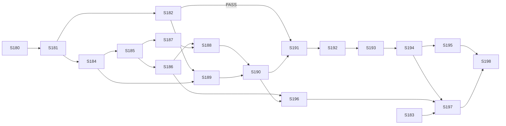

# User Stories — Bug Fix Agent

> Derived from [`specification-prd-bug-fix-agent.md`](specification-prd-bug-fix-agent.md) v1.5
> and [`prd-bug-fix-agent.md`](../docs/requirements/prd-bug-fix-agent.md) v1.4. Stories follow the
> D-59 wave order: foundations, contract and claim (Wave A) → fix loop and validation (Wave B) →
> recovery and live (Wave C). Story IDs continue the fleet sequence from S-179: **S-180 … S-198**.

## Changelog

| Version | Date       | Summary                                                  | Author           |
| ------- | ---------- | -------------------------------------------------------- | ---------------- |
| 1.5 | 2026-10-20 | Supersedes the parallel design line merged in PR #350 (D-87, @llipe, 2026-10-20). Decision IDs from this line are renumbered D-25–D-67 → D-44–D-86 after main's D-43. The superseded line's changelog rows remain in git history (`875299a`, PR #350). Stories S-180–S-198 replace the superseded S-180–S-203 (issues #326–#349, closed). | product-engineer |
| 1.4     | 2026-10-20 | Drift reconciliation of verifier DF-20 to DF-28 (D-79–D-86), accepted by @llipe. ACs changed or added in S-184, S-185, S-186, S-188, S-189, S-190, S-191, S-192, S-193 and S-196; stale wording fixed. | product-engineer |
| 1.3     | 2026-10-20 | Drift reconciliation of the verifier's Minor findings DF-04 to DF-19 (D-64–D-78), accepted by @llipe. ACs changed or added in S-182, S-184, S-185, S-187, S-188, S-190, S-191, S-192, S-193, S-194 and S-196. | product-engineer |
| 1.2     | 2026-10-20 | Drift reconciliation of verifier DF-12 (D-63): S-189 gets a frozen install per manager and the base restore after the base runs. | product-engineer |
| 1.1     | 2026-10-20 | Drift reconciliation of verifier DF-02 (D-62, confirmed by @llipe). Wrapper-git ACs added or changed in S-189, S-191, S-192, S-193 and S-194; these also resolve DF-01 and DF-03. | product-engineer |
| 1.0     | 2026-10-20 | Initial stories from spec v1.0 / PRD v1.2 (D-01–D-61).   | product-engineer |

## Legend

- **Layers** per `TESTING.md`. L1 unit, L2 component, L2.5 integration (live local Supabase, `REQUIRE_LOCAL_DB=1`), E2E (Playwright), **IC** in-container (deployed AgentCore runtime), **Live** (real fixture repo).
- **Agent paths** are relative to `agents/bug-fix/app/bugFix/`. Tests live under `agents/bug-fix/app/bugFix/tests/{unit,component,fixtures}`, as in the siblings.
- **Agent quality gate.** From `agents/bug-fix/app/bugFix/`: `make lint && make format-check && make typecheck && make test && make audit`. **Panel quality gate:** `pnpm --filter panel run lint && pnpm --filter panel run format:check && pnpm --filter panel run typecheck && pnpm --filter panel run test && pnpm run audit`. **Repo gate:** `make validate`.
- **Inert until scheduled.** The agent ships with no schedule (spec §15). Every story can merge without acting on any repository until an operator invokes it.
- **Infra stories** run through `infra-engineer` (approval-gated, reversible, recorded under `infra/changes/`), never `developer`.

---

## Wave A — Foundations, contract and claim

### Story S-180: Agent scaffold, image, and managed Claude Code policy

**Priority:** Critical · **Estimated Size:** M · **Dependencies:** none

#### User Story

As the operator,
I want a buildable `bug-fix` agent project with its container image and confinement policy,
So that the runtime can be deployed and the sandbox spike has something real to probe.

#### Context

This story only builds the skeleton. It establishes the sibling module set (D-03), the image toolchain (D-05, D-18), the two OS users, and the image-baked managed policy (D-51 layer 2). Its `main.py` is a minimal entrypoint that reports `started` and ends `succeeded`/`not_applicable` "not yet implemented", so a deploy is harmless.

#### Acceptance Criteria

- [ ] `agents/bug-fix/` mirrors the sibling layout: `agentcore/agentcore.json`, `app/bugFix/{main.py, config.py, Dockerfile, Makefile, pyproject.toml}`, `README.md`, `AGENTS.md`.
- [ ] Copied sibling modules: `agent_reporter.py`, `heartbeat.py`, `signal_backstop.py`, `scrubber.py`, `credentials.py`. Each carries a header comment naming its source and source commit.
- [ ] `agentcore.json`: runtime `bug_fix`, `Container`, `PUBLIC` network, `maxLifetime: 3600`, `envVars` `SUPABASE_URL`, `SUPABASE_KEY_SECRET_ID`, `ANTHROPIC_KEY_SECRET_ID` (`agent-fleet/prod/ANTHROPIC_API_KEY`), and `MODEL_ID` (a Sonnet id on the Anthropic API). No Bedrock reference (D-50).
- [ ] The Dockerfile builds on ARM64 with Python 3.13, Node 26 + pnpm, git, `bubblewrap`, `socat`, and a pinned `@anthropic-ai/claude-code` version.
- [ ] Users `wrapper` and `fixer` exist with different uids. `/work/repo` and `/work/out` are owned by `fixer`. `/home/fixer` exists.
- [ ] `/etc/claude-code/managed-settings.json` is root-owned with mode 0644. It enables the sandbox, has the registry-only network allow-list, and denies `Bash(git push:*)`, `Bash(gh:*)`, `Bash(curl:*)`, `Bash(wget:*)`, `WebFetch`, `WebSearch`, and Read/Edit of `/proc/**`, `/etc/claude-code/**`, `/work/secrets/**` (spec §12). Key names are provisional until S-182.
- [ ] The minimal entrypoint reports through `agent_reporter` and exits cleanly.

#### Business Rules

- No secret value appears in the image, `agentcore.json`, or the repo. Only secret IDs.
- The managed policy file is root-owned and not writable by `fixer`.

#### Technical Notes

- Spec §8.1 module table and §12. The sibling convention is to copy modules, not share them (research Q1).
- `max_runtime_seconds` in the seed (S-184) must equal `maxLifetime` (seed rule, research Q7).

#### Testing Requirements

- **Unit Tests:** the scrubber test proves the Anthropic key is redacted; a config test proves `MODEL_ID` and the secret-ID env are read, and that a missing one raises a typed error.
- **Integration Tests:** a `docker build --platform linux/arm64` smoke test in CI or `make image`. Inside the built image: `id fixer` ≠ `id wrapper`, `claude --version` succeeds, `bwrap --version` succeeds, and the managed-settings file is owned by root with mode 0644.
- **Manual/UI Testing:** none.
- **Edge-Case Matrix:** a missing env var gives a typed config error and never a crash with a traceback containing values.
- **Acceptance-Criteria Mapping:** AC1–AC3 → layout/config tests; AC4–AC6 → image smoke script `scripts/image-smoke.sh`; AC7 → `tests/unit/test_main_stub.py`.
- **Execution Commands:** `make test`, `make image`, `scripts/image-smoke.sh`.

#### Migration Requirements

- Opt-out: no schema change.

#### Implementation Steps

1. Copy the sibling modules and add the Anthropic key to the scrubber's secrets.
2. Write `config.py` and the minimal `main.py` (tests first).
3. Write the Dockerfile, users, managed policy and `agentcore.json`.
4. Write the image smoke script and the Makefile targets.

#### Files to Create/Modify

- `agents/bug-fix/**` — new project.
- `agents/bug-fix/app/bugFix/managed-settings.json` — copied into the image at `/etc/claude-code/`.
- `agents/bug-fix/app/bugFix/scripts/image-smoke.sh` — image assertions.

#### Definition of Done Checklist

- [ ] Code per technical guidelines · [ ] Tests passing · [ ] Agent quality gate green · [ ] Reviewed · [ ] AC verified and mapped to evidence · [ ] Migration opt-out documented · [ ] PR merged

---

### Story S-181: Infra change — Anthropic key, runtime and role, panel invoke policy, App Issues write

**Priority:** Critical · **Estimated Size:** M · **Dependencies:** S-180 · **Executor:** `infra-engineer`

#### User Story

As the operator,
I want the bug-fix runtime deployed with exactly the access it needs,
So that the panel can invoke it and nothing extra is reachable.

#### Context

D-58 sets this scope. The panel's invoke policy lists runtime ARNs explicitly, so a new runtime fails to invoke without an entry (issue #280).

#### Acceptance Criteria

- [ ] The operator has created a dedicated Anthropic API key with a spend cap. It is stored as `agent-fleet/prod/ANTHROPIC_API_KEY` in Secrets Manager. The change record holds the cap value, never the key.
- [ ] The S-180 image is deployed with `agentcore deploy`. `agentcore status` reports the runtime ARN, and the change record holds it.
- [ ] The runtime role can call `secretsmanager:GetSecretValue` on exactly three ARNs: the Supabase key, the App PEM, and the Anthropic key. It has no `bedrock:*`. Simulated with `aws iam simulate-principal-policy`.
- [ ] The panel's `invoke-runtime` policy includes the new runtime ARN and its `runtime-endpoint/DEFAULT`. Invoking the stub from the deployed panel creates a run that ends `succeeded`/`not_applicable`.
- [ ] The GitHub App has **Issues: read and write**, accepted on every installation in `github_installations`. Verified by the `permissions.issues == "write"` field of a minted token, and recorded.
- [ ] The change record has backup and revert steps for each item.

#### Business Rules

- One approval per step. Each step is reversible and recorded (`infra-engineer` contract).
- No secret value is ever logged or committed.

#### Technical Notes

- Spec §7 and §15. The deploy follows the sibling `agentcore` flow (research Q6).
- The `agents` seed row is S-184. This story only records the ARN it needs.

#### Testing Requirements

- **Unit Tests:** n/a.
- **Integration Tests:** an IAM policy simulation (allow on the three secrets, deny on another secret, deny `bedrock:InvokeModel`); a token-mint probe showing `issues: write`.
- **Manual/UI Testing:** invoke from the deployed panel, then check the run row.
- **Edge-Case Matrix:** an installation that hasn't accepted the new permission is listed in the record and either fixed or noted.
- **Acceptance-Criteria Mapping:** AC1–AC6 → the change-record verification table.
- **Execution Commands:** `agentcore deploy`, `agentcore status`, `aws iam simulate-principal-policy`, plus the probe recorded in the change.

#### Migration Requirements

- Opt-out: no database schema change. A cloud resource change is recorded under `infra/changes/<date>-bug-fix-runtime/`.

#### Implementation Steps

1. Secret.
2. Role and deploy.
3. Panel policy.
4. App permission and per-installation acceptance.
5. Verification table.

#### Files to Create/Modify

- `infra/changes/<date>-bug-fix-runtime/` — plan, log, verification, revert.
- `docs/runbooks/bug-fix-agent.md` — stub created here and completed in S-197 (FR-49a: the change kind ships with a runbook).

#### Definition of Done Checklist

- [ ] Every step approved and recorded · [ ] Verification evidence attached · [ ] Runbook stub present · [ ] Draft PR reviewed · [ ] PR merged

---

### Story S-182: Sandbox spike on the deployed runtime

**Priority:** Critical · **Estimated Size:** M · **Dependencies:** S-180, S-181 · **Gates:** all of Wave B

#### User Story

As the operator,
I want proof that the model and repo scripts cannot reach the runtime role from inside the real container,
So that the confinement design (D-51) is a measured fact before any fix loop runs.

#### Context

D-49 found that env stripping alone leaves the runtime role reachable. D-51 relies on Claude Code's Bash sandbox running in the AgentCore ARM64 microVM, and that is unproven. This story also resolves spec OQ-2 (the managed-settings key names).

#### Acceptance Criteria

- [ ] `sandbox.py` spawns a command as `fixer` with the minimal env (`ANTHROPIC_API_KEY`, `PATH`, `HOME`, `LANG`, `CI=1`) under the sandbox runtime and the registry-only network policy. It has a wall-clock timeout with SIGTERM, then SIGKILL after 15 s.
- [ ] A `probe` mode of the entrypoint, enabled by the **top-level** payload key `__probe: true` (not a `params` key; the panel can't send it) and refused unless `ALLOW_PROBE=1` is set on the runtime, runs the spike checks and reports each one as a `run_event`.
- [ ] Inside the sandbox, on the deployed runtime:
  - `169.254.170.2`, `169.254.169.254` and a non-registry host (`example.com`) are unreachable;
  - `registry.npmjs.org` and `pypi.org` are reachable.
- [ ] As `fixer`, `/proc/<wrapper pid>/environ` and `/proc/<wrapper pid>/mem` are unreadable. No `AWS_*` or `AWS_CONTAINER_*` variable is present.
- [ ] Through `claude -p` (as `fixer`, in the sandbox): a repo `.claude/settings.json` allow rule for `Bash(git push:*)` loses to the managed deny rule, and `WebFetch` is denied.
- [ ] The verified managed-settings key names and the CLI version are recorded in the spike report `workstream/spike-bug-fix-sandbox.md`, and `managed-settings.json` is updated to match.
- [ ] **Exit rule:** if any check fails, the report says so. Wave B stories stay blocked, and the finding goes to `product-engineer` drift reconciliation (spec §12).

#### Business Rules

- `ALLOW_PROBE` is unset after the spike. Probe mode is refused in production.

#### Technical Notes

- Spec §12 exit criteria. The candidate runtimes are `bwrap` directly, or the CLI's own sandbox runtime. The spike records which one `sandbox.py` uses.

#### Testing Requirements

- **Unit Tests:** `sandbox.py` env construction (an allow-list, never a deny-list), the timeout, kill and exit-code mapping, and refusal of probe mode without `ALLOW_PROBE`.
- **Integration Tests:** **IC:** the probe run on the deployed runtime, with its results attached.
- **Manual/UI Testing:** read the probe run's events in the panel.
- **Edge-Case Matrix:** a sandbox binary missing → typed error; a command exceeding the timeout is killed; a zombie child process is reaped.
- **Acceptance-Criteria Mapping:** AC1–AC2 → unit tests; AC3–AC5 → IC probe events; AC6–AC7 → the spike report.
- **Execution Commands:** `make test`; the deployed probe invoke from the spike report.

#### Migration Requirements

- Opt-out: no schema change.

#### Implementation Steps

1. `sandbox.py`, tests first.
2. Probe mode.
3. Redeploy with `ALLOW_PROBE=1` through `infra-engineer`.
4. Run the probe and write the report.
5. Fix `managed-settings.json`.
6. Unset `ALLOW_PROBE`.

#### Files to Create/Modify

- `sandbox.py`, `probe.py`, `tests/unit/test_sandbox.py`, `managed-settings.json`, `workstream/spike-bug-fix-sandbox.md`.

#### Definition of Done Checklist

- [ ] Tests passing · [ ] Agent gate green · [ ] IC evidence attached · [ ] Spike verdict recorded (PASS / FAIL) · [ ] `ALLOW_PROBE` unset · [ ] PR merged

---

### Story S-183: Panel `string-list` schema-form control

**Priority:** High · **Estimated Size:** M · **Dependencies:** none (parallel) · **Pixel contract:** `DESIGN.md` §3.11 (new), §3.2, §3.3, §6.4

#### User Story

As the operator,
I want to edit list-valued agent params, such as label lists, in the invoke form and the schedule dialog,
So that each schedule can set its own selection and claim labels (D-44, D-45).

#### Context

D-47 found that the form maps any `items` property to `unsupported` and that both dialogs skip it on submit. D-48 adds a fifth control kind without bringing in a JSON-Schema form library (SD8).

#### Acceptance Criteria

- [ ] `buildFieldDescriptors` maps a property with `type: "array"`, `items.type: "string"`, and no `oneOf`/`anyOf`/`allOf`/`properties` to `control: "string-list"`, carrying `minItems`, `uniqueItems`, `items.minLength`, and `default`. Arrays of other item types, and objects, stay `unsupported`.
- [ ] `FieldRow` renders a String List built from DESIGN.md §3.2 Input and §3.3 Tag tokens:
  - Enter or Tab commits a chip;
  - Backspace on an empty input removes the last chip;
  - each chip's × button has `aria-label="Remove <value>"`;
  - a pasted newline-separated list splits into chips;
  - commas are kept inside a chip (`"a, b"` stays one chip);
  - the focus ring follows §6.4.
- [ ] `InvokeDialog` and `ScheduleDialog` pre-fill a `string-list` from schema `default`, then `default_params`, and submit it as a JSON array. They still skip `unsupported`.
- [ ] Ajv errors (`minItems`, `uniqueItems`, `minLength`) render inline under the field, on both client and server.
- [ ] `DESIGN.md` gains §3.11 String List (anatomy, tokens, states, keyboard behaviour), plus notes in §5.4 and §5.7, with a changelog row.
- [ ] Saving a schedule with custom labels, then firing it, delivers the array in the agent payload.

#### Business Rules

- Labels may contain spaces, colons, and commas. The control never splits on commas.
- Existing agents: no seeded sibling schema has a list-of-strings property. This is confirmed in the PR description.

#### Technical Notes

- Spec §10. Files: `panel/lib/schema/form.ts:24,70-129`, `panel/components/invoke/FieldRow.tsx`, `InvokeDialog.tsx:48-59,87`, `ScheduleDialog.tsx:126-150`. The shared Ajv lives in `panel/lib/schema/ajv.ts`.
- DESIGN.md is owned by `ux-engineer`. A `ux-engineer` lite pass is recommended before implementation.

#### Testing Requirements

- **Unit Tests:** `tests/unit/form.test.ts` covers string-list mapping, the unsupported shapes (array of numbers, array of objects, `items` plus `oneOf`), and default propagation.
- **Integration Tests:** L2 component tests (`FieldRow` chip keyboard, paste and ARIA behaviour; both dialogs pre-fill and submit). L2.5: schedule save, then fire, round-trips the array through `validateParams`.
- **Manual/UI Testing:** `/agents/bug-fix/invoke` and `/schedules` → new schedule → edit labels → save → reopen.
- **Edge-Case Matrix:** an empty list with `minItems` 1 shows the error; a duplicate chip shows a `uniqueItems` error; a whitespace-only chip is rejected; very long label text wraps; 20+ chips stay usable; a pasted list containing blank lines drops the blanks.
- **Acceptance-Criteria Mapping:** AC1 → form.test; AC2 → FieldRow component; AC3–AC4 → dialog component tests; AC5 → DESIGN.md diff; AC6 → L2.5 plus E2E `tests/e2e/schedules-string-list.spec.ts`.
- **Execution Commands:** `pnpm --filter panel run test`, `pnpm --filter panel run test:integration`, `pnpm --filter panel run test:e2e`.

#### Migration Requirements

- Opt-out: UI-only, no schema change.

#### Implementation Steps

1. Form-mapping tests, then the implementation.
2. `FieldRow` String List.
3. Dialog wiring.
4. DESIGN.md §3.11.
5. L2.5 and E2E.

#### Files to Create/Modify

- `panel/lib/schema/form.ts`, `panel/components/invoke/FieldRow.tsx` (+ CSS module), `panel/components/invoke/InvokeDialog.tsx`, `panel/components/schedules/ScheduleDialog.tsx`, `DESIGN.md`, and the tests under `panel/tests/{unit,component,integration,e2e}/`.

#### Definition of Done Checklist

- [ ] Tests passing · [ ] Panel gate green · [ ] DESIGN.md updated · [ ] Reviewed · [ ] AC mapped to evidence · [ ] PR merged

---

### Story S-184: `agents` seed row, params schema, and typed params

**Priority:** Critical · **Estimated Size:** S · **Dependencies:** S-181 (runtime ARN)

#### User Story

As the operator,
I want `bug-fix` registered with its params schema and defaults,
So that the panel can invoke it and schedules can carry its label and budget params.

#### Context

Spec §5.1 and §5.2. The defaults live in the seed, never in agent code (D-45, D-57). `repo` is not a param (D-60).

#### Acceptance Criteria

- [ ] Migration `supabase/migrations/<ts>_seed_bug_fix_agent.sql` upserts `bug-fix` with the siblings' `on conflict (slug) do update` shape. `supabase/seed.sql` mirrors it.
- [ ] The row has `requires_repository = true`, `max_runtime_seconds = 3600`, `grace_seconds = 120`, `start_timeout_seconds = 300`, and the S-181 `runtime_arn`.
- [ ] `params_schema` equals spec §5.2, including `additionalProperties: false`. `default_params` holds the same defaults (labels, `assignee: "llipe"`, budgets, caps).
- [ ] `params_schema.required` = the four label lists plus `assignee`. Budgets and caps are optional, and `params.py` applies defaults equal to the seed values when they are absent; a missing safety bound never means unbounded (D-68). Label comparisons are case-insensitive (D-69).
- [ ] `params.py` parses the payload `params` into a typed object, fills absent keys from nothing (the agent rejects a missing required label list with a typed error rather than inventing a default), and enforces the cross-field rules: `claim_remove_labels ⊆ select_labels`, and non-empty `select_labels` and `claim_add_labels` (D-46).

#### Business Rules

- The agent code holds **no** label or assignee default (D-45).

#### Technical Notes

- `default_params` reaches runs through the form pre-fill (S-183). With `required` keys (D-68), a schedule saved without the label lists is rejected by the panel at save and at fire (`INVALID_PARAMS`). Only a direct invoke reaches the agent without them, and that ends `not_applicable` through S-185 (D-86).

#### Testing Requirements

- **Unit Tests:** `test_params.py` covers valid defaults, the subset violation, an empty select list, an empty claim-add list, a missing key, and unknown keys being ignored.
- **Integration Tests:** L2.5: `db reset`, then the row exists. `validateParams` against the seeded schema accepts the defaults, rejects `params.repo` (`additionalProperties`), and rejects an empty `select_labels`.
- **Manual/UI Testing:** `/agents/bug-fix/invoke` shows every field, with the label lists as String Lists once S-183 is in.
- **Edge-Case Matrix:** labels with unicode or a colon; duplicate labels (`uniqueItems`); `max_turns` at its 5 and 100 boundaries.
- **Acceptance-Criteria Mapping:** AC1–AC3 → L2.5 `bug-fix-seed.test.ts`; AC4 → `test_params.py`.
- **Execution Commands:** `supabase db reset`, `pnpm --filter panel run test:integration`, `make test`.

#### Migration Requirements

- Artifact: a new timestamped SQL migration (required).
- Rollback: `delete from agents where slug = 'bug-fix'` (no dependent rows before the first run).
- Apply: requires explicit user confirmation.
- Verify: `select slug, requires_repository, max_runtime_seconds from agents where slug='bug-fix'`.

#### Implementation Steps

1. L2.5 test.
2. Migration and seed.
3. `params.py`, tests first.

#### Files to Create/Modify

- `supabase/migrations/<ts>_seed_bug_fix_agent.sql`, `supabase/seed.sql`, `params.py`, `tests/unit/test_params.py`, `panel/tests/integration/bug-fix-seed.test.ts`.

#### Definition of Done Checklist

- [ ] Migration written and applied (confirmed) · [ ] Tests passing · [ ] Gates green · [ ] AC mapped · [ ] PR merged

---

### Story S-185: Preflight checks — Issues permission, label configuration, assignee

**Priority:** Critical · **Estimated Size:** S · **Dependencies:** S-184

#### User Story

As the operator,
I want a misconfigured run to stop before it touches any issue, with the reason named,
So that a typo or a missing permission is visible and never half-applies a claim.

#### Context

This story covers D-46 (labels), D-57 (assignee), and D-58 (permission). The checks run in step `preflight` before the sweep and selection.

#### Acceptance Criteria

- [ ] `credentials.py` returns the minted token's `permissions`. If `issues` is not `"write"`, the run ends `failed` / `GITHUB_PERMISSION_MISSING`.
- [ ] Each label in the four lists is checked with `GET /repos/{o}/{r}/labels/{name}`, URL-encoded. Missing labels end the run `succeeded` / `not_applicable` with `result.reason` listing every missing label.
- [ ] A cross-field violation from `params.py` ends `not_applicable` naming the rule.
- [ ] `GET /repos/{o}/{r}/assignees/{login}` returning anything other than 204 ends `not_applicable` "assignee <login> not assignable".
- [ ] When preflight ends a run, no GitHub write call was made. This is asserted by the mock.
- [ ] A direct invoke missing a required param (a label list or `assignee`), or carrying an out-of-range or wrongly-typed budget or cap, ends `not_applicable` naming the key (D-68, D-82). Exhausted 5xx or rate-limit retries end `failed`/`GITHUB_UNAVAILABLE` (D-67).

#### Business Rules

- `not_applicable` does not count toward G3. `GITHUB_PERMISSION_MISSING` does (D-20, D-58).

#### Technical Notes

- Spec §8.2 and §6. Labels with spaces or colons must be URL-encoded.

#### Testing Requirements

- **Unit Tests:** permission parsing (absent, `read`, `write`) and reason formatting.
- **Integration Tests:** L2 with `responses`: each failure path produces the exact outcome and zero writes; the happy path passes; a label name such as `status: ready` is requested encoded.
- **Manual/UI Testing:** invoke on a repo missing `status: in-progress`, then read the run summary.
- **Edge-Case Matrix:** a 404 versus a 5xx on the label lookup (5xx → retry, then `failed`/`GITHUB_UNAVAILABLE`, D-67); a GitHub rate-limit response; an assignee who is an org member without push access.
- **Acceptance-Criteria Mapping:** AC1–AC5 → `tests/component/test_preflight.py`.
- **Execution Commands:** `make test`.

#### Migration Requirements

- Opt-out: no schema change.

#### Implementation Steps

1. Tests.
2. `preflight.py`.
3. `credentials.py` extension.

#### Files to Create/Modify

- `preflight.py`, `credentials.py`, `issues.py` (label and assignee reads), `tests/component/test_preflight.py`.

#### Definition of Done Checklist

- [ ] Tests passing · [ ] Agent gate green · [ ] AC mapped · [ ] PR merged

---

### Story S-186: Claim/disposition markers and an idempotent disposition

**Priority:** Critical · **Estimated Size:** M · **Dependencies:** S-185

#### User Story

As the operator,
I want every agent claim and disposition comment to carry a verifiable marker, and a disposition that is safe to apply twice,
So that recovery can act only on the agent's own claims and never double-comments.

#### Context

This story covers D-53 (format and trust), D-08 and D-45 (the disposition label swap), and spec §8.3 and §8.8.

#### Acceptance Criteria

- [ ] `markers.py` builds `<!-- agent-fleet:bug-fix:claim run_id=<uuid> -->` and the matching `disposition` marker, and parses the **leading block** of marker lines (line 1 and the consecutive matching lines after it), so one comment can name several `run_id`s (D-80).
- [ ] A marker is trusted only if `performed_via_github_app.id` equals the configured App ID and `user.type == "Bot"`.
- [ ] `live_claim(comments)` returns the trusted claim with the highest comment id that has no trusted disposition for the same `run_id`.
- [ ] `disposition.py` posts the marker comment (what was tried, why it stopped, the diffstat when a cap was hit), removes `claim_add_labels`, adds `disposition_add_labels`, and keeps the assignee. Model-derived text in the comment passes the D-65 neutralizer (D-85).
- [ ] The disposition is a no-op when a trusted disposition marker for this `run_id` already exists.
- [ ] `signal_backstop.py` calls the disposition with a 10-second budget before `fail()`, when a claim exists.

#### Business Rules

- The diagnosis never contains secret material. Text is passed through the scrubber.

#### Technical Notes

- The App ID comes from the `github_installations` row that `credentials.py` already resolves (research Q5).

#### Testing Requirements

- **Unit Tests:** marker round-trip; a marker not on the first line is ignored; a forged marker (human author, wrong App id, `user.type == "User"`) is untrusted; `live_claim` ordering when several claims and dispositions exist.
- **Integration Tests:** L2: the disposition applies once, and a second call makes zero writes; the backstop path under a simulated SIGTERM.
- **Manual/UI Testing:** none, until the end-to-end run in S-190.
- **Edge-Case Matrix:** a comment body with CRLF line endings; very long diagnosis text (truncated to GitHub's 65,536-character limit); a label already absent when removed (404 tolerated).
- **Acceptance-Criteria Mapping:** AC1–AC3 → `test_markers.py`; AC4–AC6 → `tests/component/test_disposition.py`.
- **Execution Commands:** `make test`.

#### Migration Requirements

- Opt-out: no schema change.

#### Implementation Steps

1. `markers.py`, tests first.
2. `disposition.py`.
3. Backstop hook.

#### Files to Create/Modify

- `markers.py`, `disposition.py`, `signal_backstop.py`, `issues.py` (comments, labels), tests.

#### Definition of Done Checklist

- [ ] Tests passing · [ ] Agent gate green · [ ] AC mapped · [ ] PR merged

---

### Story S-187: Selection — oldest ready bug, AND labels, linked-PR skip, explicit issue

**Priority:** Critical · **Estimated Size:** M · **Dependencies:** S-185

#### User Story

As the operator,
I want the agent to pick the oldest issue matching all my selection labels with no PR already open,
So that it works the queue in order and never duplicates work in progress.

#### Context

This story covers D-10, D-44 and D-55, and spec §8.5.

#### Acceptance Criteria

- [ ] GraphQL pages open issues carrying the first `select_labels` label, 50 at a time and oldest first, then applies AND over all of `select_labels`, plus "none of `claim_add_labels`".
- [ ] An issue is skipped when `closedByPullRequestsReferences(includeClosedPrs: false)` is non-empty, or when an open PR's head ref starts with `issue/<N>-`.
- [ ] Label matching (AND filter, lock exclusion) is case-insensitive (D-69).
- [ ] Selection stops at the first eligible issue. If none is eligible, the run ends `succeeded` / `no_findings` (FR-4).
- [ ] An explicit `issue_number` applies the same checks to that issue. A failure ends `not_applicable` with the specific reason: not open, missing `<labels>`, already claimed, or open PR #M.
- [ ] Given the PRD AC-1 fixture (newest ready, oldest ready, needs-refinement), the oldest ready issue is selected.

#### Business Rules

- An explicit number never bypasses `select_labels` (D-10).

#### Technical Notes

- Branch-prefix PRs come from `GET /pulls?state=open` (paged), fetched once per run.

#### Testing Requirements

- **Unit Tests:** the AND filter, the claim-label exclusion, and both linked-PR rules, as a table.
- **Integration Tests:** L2 with GraphQL and REST mocked: AC-1, AC-2 and AC-17 fixtures (custom labels `kind/bug` and `triage/ok`); pagination across pages.
- **Manual/UI Testing:** none.
- **Edge-Case Matrix:** zero open issues; a PR closed but not merged (not linked); a PR from a fork (still linked); a label with different letter case (GitHub labels match case-insensitively); 200+ candidates.
- **Acceptance-Criteria Mapping:** AC1–AC5 → `tests/component/test_select.py`.
- **Execution Commands:** `make test`.

#### Migration Requirements

- Opt-out: no schema change.

#### Implementation Steps

1. Fixtures.
2. Tests.
3. `select.py` and the GraphQL query in `issues.py`.

#### Files to Create/Modify

- `select.py`, `issues.py`, `tests/component/test_select.py`, `tests/fixtures/graphql/*.json`.

#### Definition of Done Checklist

- [ ] Tests passing · [ ] Agent gate green · [ ] AC mapped · [ ] PR merged

---

### Story S-188: Claim with the post-claim race check

**Priority:** Critical · **Estimated Size:** M · **Dependencies:** S-186, S-187

#### User Story

As the operator,
I want a claim that shows the bug is taken and that a second concurrent run backs off from,
So that two runs never work the same issue (D-54).

#### Context

G1 applies only to scheduled fires. A manual invoke can overlap a scheduled run (`scheduler_g1_overlap.sql:72`).

#### Acceptance Criteria

- [ ] **Pre-check:** the issue is re-read and must still be selectable. If not, the run moves to the next candidate, or ends `not_applicable` for an explicit `issue_number`.
- [ ] **Claim order:** the marker comment is posted first, then `claim_remove_labels` are removed, `claim_add_labels` are added, and the assignee is set (FR-7, D-07, D-45).
- [ ] **Ownership gate:** if the post-check itself fails (`SUPABASE_UNAVAILABLE`), the run keeps its comment, leaves labels and assignee untouched, applies **no** disposition and ends `failed` (D-81).
- [ ] **Post-check:** if a live, trusted claim with a lower comment id belongs to another run that isn't terminal (per `v_runs.effective_status`), this run deletes its own comment, leaves labels and assignee untouched, and ends `not_applicable` "claimed by run <id>".
- [ ] After a successful claim the issue matches PRD AC-3: the assignee is set, the claim labels are present, the removed labels are absent, and a marked comment with the run link exists.

#### Business Rules

- The claim never relies on assigning the App bot (FR-8).

#### Technical Notes

- The panel run link uses the panel base URL from `config.py` (env `PANEL_BASE_URL`), added to `agentcore.json`.

#### Testing Requirements

- **Unit Tests:** the race verdict (an earlier marker from a terminal run is ignored; an earlier marker from a running run means this run lost).
- **Integration Tests:** L2: a happy claim; a lost race with only this run's comment deleted; a pre-check failure; a crash right after the comment and before the labels: the comment exists and labels are unchanged, so the issue stays selectable, and the next run's post-check ignores the orphaned marker because its run is terminal. The sweep is not involved (D-78).
- **Manual/UI Testing:** none.
- **Edge-Case Matrix:** two runs posting comments in the same second (comment-id order decides); the other run is already terminal; a GitHub 422 on the assignee (`failed`/`GITHUB_REQUEST_REJECTED`, D-67).
- **Acceptance-Criteria Mapping:** AC1–AC4 → `tests/component/test_claim.py`.
- **Execution Commands:** `make test`.

#### Migration Requirements

- Opt-out: no schema change.

#### Implementation Steps

1. Tests.
2. `claim.py`.
3. `PANEL_BASE_URL` config.

#### Files to Create/Modify

- `claim.py`, `config.py`, `agentcore/agentcore.json`, `tests/component/test_claim.py`.

#### Definition of Done Checklist

- [ ] Tests passing · [ ] Agent gate green · [ ] AC mapped · [ ] PR merged

---

### Story S-189: Checkout, repository gate, toolchain, and the gate runner

**Priority:** Critical · **Estimated Size:** M · **Dependencies:** S-182 (`sandbox.py`), S-184

#### User Story

As the operator,
I want repos without dev-tasks or the four gates to be skipped before any claim, and the gates runnable in the sandbox,
So that the agent only works where it can prove a fix (FR-5, FR-6).

#### Context

This story covers D-06, D-14, D-17, D-18 and D-19, and spec §8.7 `checkout`. It also resolves spec OQ-1 (the Python install contract).

#### Acceptance Criteria

- [ ] The wrapper shallow-clones `base_branch` into its own clone `/work/wrapper/repo` (uid `wrapper`, mode 0700) and records the base SHA. Its `info/exclude` lists only `node_modules/`, `.venv/`, `.pnpm-store/`, `__pycache__/` (D-62, D-83).
- [ ] `safe_git.py`: every wrapper git call runs with `GIT_CONFIG_NOSYSTEM=1`, `GIT_CONFIG_GLOBAL=/dev/null`, `-c core.hooksPath=/dev/null -c core.fsmonitor=false`, and never sets `safe.directory=*`. No wrapper git call targets a `fixer`-writable `.git` (D-62, DF-02).
- [ ] The base tree is materialized into a fresh `/work/repo` with `git archive <base>` piped into `tar -x` **running as `fixer`**. A planted `.git/hooks/*` or `core.fsmonitor` in `/work/repo` never runs as `wrapper` (TC-193-14 shape, applied at checkout) (D-62).
- [ ] `toolchain.py` (copied from `dependency-update`, extended) detects JS/TS (pnpm or npm) or Python (`Makefile`).
- [ ] The repo gate requires `.claude/agents/developer.md` plus `test`, `lint`, `format:check`, `typecheck` (JS scripts) or `test`, `lint`, `format-check`, `typecheck` (Make targets). A missing item ends `not_applicable` naming it, before the claim (AC-4).
- [ ] **OQ-1 resolved and recorded in the PR:**
  - the proposal is a `make install` target for Python, otherwise `not_applicable`;
  - the decision is appended to the decision log as a new `D-NN`.
- [ ] `gates.py` runs the four gates and `audit` through `sandbox.py` and returns per-gate `{pass, exit_code, tail}`, with the tail scrubbed.
- [ ] Base-tree gate results are recorded in `run_events` and kept for the PR body. They never block.
- [ ] Install uses `pnpm install --frozen-lockfile` (pnpm) or `npm ci` (npm). A lockfile mismatch fails with `INSTALL_FAILED` and never rewrites the lockfile. After install and the base gates, any changed tracked path is restored to base as `fixer`, with a `run_event`, so the CLI starts from an exact base tree (TC-189-14, TC-189-15) (D-63, DF-12).

#### Business Rules

- No issue mutation happens before the repo gate passes.

#### Technical Notes

- JS install: `pnpm install --frozen-lockfile` or `npm ci` in the sandbox, with registry-only network (D-63).

#### Testing Requirements

- **Unit Tests:** stack detection table (pnpm, npm, Makefile, none), gate-name resolution, and `Makefile` target parsing.
- **Integration Tests:** L2 with real `git` on fixture repos: `js-pnpm-ok`, `js-missing-typecheck`, `py-make-ok`, `py-no-developer-md`. The gate runner runs against a stub sandbox.
- **Manual/UI Testing:** none.
- **Edge-Case Matrix:** a `Makefile` with `format_check` instead of `format-check` (counts as missing); a `package.json` with no `scripts`; a monorepo with a root `package.json`; a clone failure → `failed` / `CLONE_FAILED`; an install failure → `failed` / `INSTALL_FAILED`.
- **Acceptance-Criteria Mapping:** AC1–AC6 → `test_toolchain.py`, `tests/component/test_checkout.py`, `tests/component/test_gates.py`.
- **Execution Commands:** `make test`.

#### Migration Requirements

- Opt-out: no schema change.

#### Implementation Steps

1. Fixture repos.
2. Toolchain tests, then the implementation.
3. Checkout.
4. Gates.
5. The OQ-1 decision.

#### Files to Create/Modify

- `toolchain.py`, `checkout.py`, `gates.py`, `tests/fixtures/repos/*`, tests; `workstream/decisions-bug-fix-agent.md` (append).

#### Definition of Done Checklist

- [ ] Tests passing · [ ] Agent gate green · [ ] OQ-1 decision recorded · [ ] AC mapped · [ ] PR merged

---

### Story S-190: Orchestration, outcome mapping, and reporting through the claim

**Priority:** Critical · **Estimated Size:** M · **Dependencies:** S-185–S-189

#### User Story

As the operator,
I want a deployed run to go preflight → select → checkout → claim and report every step,
So that I can invoke the agent end to end and see each decision in the panel.

#### Context

This story covers FR-25, FR-26, D-20 and D-61, and spec §8.9. The fix step is not built yet: after the claim, the run applies the disposition with the reason "fix loop not yet enabled" behind a feature flag `FIX_LOOP_ENABLED=0`. Wave A can therefore be exercised live on a fixture repo without producing PRs.

#### Acceptance Criteria

- [ ] `main.py` runs the steps `preflight`, `sweep` (a no-op until S-196), `select`, `checkout`, `claim`, then `fix` only when `FIX_LOOP_ENABLED=1`. Each is a `run_steps` entry with `run_events` at its decisions.
- [ ] The outcome mapping exactly matches spec §8.9 v1.3 for the paths that exist in Wave A, including `GITHUB_UNAVAILABLE`, `GITHUB_REQUEST_REJECTED`, `SUPABASE_UNAVAILABLE` (D-67) and the missing-required-param `not_applicable` (D-68). Every `needs_review` and `not_applicable` run sets `result.summary` with the reason.
- [ ] The heartbeat and signal backstop run as in the siblings. The `finally` path and the backstop apply the disposition only after the race post-check has confirmed ownership of the claim (S-186, D-81).
- [ ] `runs.metrics` records `issue_number` and the step timings.
- [ ] Deployed through the S-181 flow: one manual run on the fixture repo selects, claims and disposes ("fix loop not yet enabled"), and the issue ends with `disposition_add_labels`.

#### Business Rules

- Only `failed` counts toward G3 (D-20).

#### Technical Notes

- `FIX_LOOP_ENABLED` is an `agentcore.json` env var, flipped in S-194.

#### Testing Requirements

- **Unit Tests:** the outcome-mapping table, one test per row in spec §8.9 that exists in Wave A.
- **Integration Tests:** L2: the orchestrator with every collaborator mocked, one test per terminal path; a `finally` path after an exception raised in `claim`.
- **Manual/UI Testing:** deployed run on the fixture repo; check the step list, events, summary and issue state.
- **Edge-Case Matrix:** SIGTERM during `checkout` (no claim, no disposition); SIGTERM after `claim` (disposition applied); a reporter flush failure (logged, never masks the outcome).
- **Acceptance-Criteria Mapping:** AC1–AC5 → `test_outcomes.py`, `tests/component/test_main.py`, plus the deployed-run evidence.
- **Execution Commands:** `make test`; the deployed invoke documented in the runbook stub.

#### Migration Requirements

- Opt-out: no schema change.

#### Implementation Steps

1. Outcome table tests.
2. `main.py` orchestration.
3. Deploy.
4. Fixture run.

#### Files to Create/Modify

- `main.py`, `outcomes.py`, `agentcore/agentcore.json`, tests.

#### Definition of Done Checklist

- [ ] Tests passing · [ ] Agent gate green · [ ] Deployed-run evidence · [ ] Roadmap Wave A row → In progress · [ ] PR merged

---

## Wave B — Fix loop and validation

> **Blocked until S-182 reports PASS.**

### Story S-191: Fix runner — confined `claude -p`

**Priority:** Critical · **Estimated Size:** L · **Dependencies:** S-182 (PASS), S-190

#### User Story

As the operator,
I want the agent to run Claude Code on the claimed bug inside the sandbox, with bounded turns and time,
So that a fix attempt happens without the model holding any credential beyond the Anthropic key.

#### Context

This story covers FR-9 to FR-12, D-04, D-05, D-11, D-22, D-50, D-51 and D-61, and spec §8.7 `fix`.

#### Acceptance Criteria

- [ ] `fix_runner.py` runs `claude -p --output-format json --max-turns <max_turns> --model $MODEL_ID --allowedTools <allow-list>` through `sandbox.py`, as `fixer`, with the minimal env, and passes the prompt on **stdin**, never argv (D-76). Its wall-clock limit is `cli_timeout_minutes`.
- [ ] The prompt:
  - points the model at `.claude/agents/developer.md`;
  - quotes the issue title and body between delimiters as untrusted data (FR-10);
  - states the caps, the forbidden paths, and that a regression test is required;
  - asks for `/work/out/report.json` with `{status, summary, rationale[], commit_message}`.
- [ ] The CLI JSON result supplies `cli_turns`, `cli_usage`, `cli_cost_usd`, `cli_duration_ms` to `runs.metrics` (FR-27).
- [ ] Hitting `max_turns`, the wall-clock limit, or `run_budget_minutes` leads to disposition and `succeeded` / `needs_review` with the ceiling named (D-61).
- [ ] `status: "gave_up"` leads to disposition with the model's summary. A non-zero exit without a parseable result leads to `failed` / `CLI_CRASHED`, after the disposition.
- [ ] Exit 0 with a missing, invalid, oversized or extra-key `report.json`, or an unknown `status`, leads to disposition and `needs_review` "invalid report". Other non-success CLI result subtypes lead to `failed`/`CLI_CRASHED` (D-66).
- [ ] Run-budget enforcement: the wrapper tracks a deadline of start + `run_budget_minutes` and gives the CLI at most the remaining time.
- [ ] After the CLI exits, every `fixer` process is killed before the wrapper reads `/work/repo` or `/work/out`. `report.json` is opened with `O_NOFOLLOW` and accepted only as a regular file owned by `fixer`, at most 1 MB. A symlink, FIFO, directory or oversized file counts as a missing report (TC-191-13) (D-62, DF-02).

#### Business Rules

- The wrapper never executes or trusts model text. `report.json` is parsed as data and validated against a schema.

#### Technical Notes

- The `--allowedTools` list starts from the spike report and is kept in `config.py`.

#### Testing Requirements

- **Unit Tests:** the prompt builder (delimiters escape an embedded closing delimiter; the injection text stays inside the quote); `report.json` schema validation; deadline arithmetic.
- **Integration Tests:** L2 with a fake `claude` binary on `PATH` covering each exit shape (success, gave-up, max-turns, hang until killed, crash, garbage output).
- **Manual/UI Testing:** deferred to S-195 and S-198.
- **Edge-Case Matrix:** an issue body that is empty or 65 KB long; an issue body containing the delimiter; a `report.json` that is missing, too large (above 1 MB is rejected), or has extra keys.
- **Acceptance-Criteria Mapping:** AC1–AC6 → `test_prompt.py`, `tests/component/test_fix_runner.py`.
- **Execution Commands:** `make test`.

#### Migration Requirements

- Opt-out: no schema change.

#### Implementation Steps

1. Fake CLI.
2. Tests.
3. `fix_runner.py`.
4. Deadline.

#### Files to Create/Modify

- `fix_runner.py`, `prompt.py`, `config.py`, `tests/fixtures/fake-claude`, tests.

#### Definition of Done Checklist

- [ ] Tests passing · [ ] Agent gate green · [ ] AC mapped · [ ] PR merged

---

### Story S-192: Change validation — classification, caps, forbidden paths, test, rationale, secret scan, final gates

**Priority:** Critical · **Estimated Size:** M · **Dependencies:** S-189, S-191

#### User Story

As a reviewer,
I want every proposed change checked mechanically for size, scope and safety before a PR exists,
So that I only ever review small, specific, gate-green changes (FR-13–FR-18).

#### Context

This story covers D-09, D-14 and D-52, and spec §8.7 `validate`.

#### Acceptance Criteria

- [ ] The change is captured as data with `git --git-dir=/work/wrapper/repo/.git --work-tree=/work/repo add -A`, which includes **untracked** files and stores symlinks without following them (D-62, resolves DF-01; TC-192-15). `classify.py` implements D-52 first-match-wins (forbidden, test, docs, code) over `git diff --cached --numstat -z <base>`. A rename counts once; a binary counts as one file and zero lines.
- [ ] A forbidden path leads to disposition listing the paths. More than `max_code_files` code files, or more than `max_code_lines` code lines, leads to disposition with the diffstat. No test-class file changed leads to disposition (FR-15).
- [ ] An added or modified symlink, or a gitlink (embedded repository), leads to disposition (D-83). Forbidden-path and lockfile matching is case-insensitive: `.CLAUDE/`, `.GitHub/` and `Package-Lock.json` are caught (D-84).
- [ ] The D-52 lists include the D-69 additions:
  - lockfiles also include `npm-shrinkwrap.json`, `bun.lock` and `bun.lockb`;
  - all of `.github/**` is forbidden;
  - `.claude/**` is forbidden at any depth;
  - `requirements*.txt` and `constraints*.txt` count as code.
- [ ] Every changed file must appear in `report.json.rationale`, or the result is disposition (FR-16).
- [ ] If the diff or the report contains any secret value the scrubber knows, the result is disposition "secret material in change". The value never appears in any output.
- [ ] The four gates on the final tree must all pass, or the result is disposition with the scrubbed tail of the failing gate. `audit` is recorded only (D-14, AC-9).
- [ ] PRD AC-7: 11 code files → disposition; 10 → passes; 401 lines → disposition; 400 → passes; docs and tests are never counted.

#### Business Rules

- The classification patterns are constants, not params (D-52).

#### Technical Notes

- Gates reuse `gates.py` from S-189.

#### Testing Requirements

- **Unit Tests:** a classification table for every D-52 pattern, including nested `tests/` directories, `conftest.py`, a `.github/workflows` file, `pnpm-lock.yaml` in a subfolder, and `docs/x.md`. Cap boundaries; rename and binary handling.
- **Integration Tests:** L2 with real `git` diffs on fixture repos; gate-failure paths using the stub sandbox.
- **Manual/UI Testing:** none.
- **Edge-Case Matrix:** an empty diff (disposition "no change"); a file deleted entirely; a mode-only change; a path containing spaces; a secret split across two lines (not detected, which is accepted and documented).
- **Acceptance-Criteria Mapping:** AC1–AC6 → `test_classify.py`, `tests/component/test_validate.py`.
- **Execution Commands:** `make test`.

#### Migration Requirements

- Opt-out: no schema change.

#### Implementation Steps

1. Classification tests.
2. `classify.py`.
3. `validate.py`.

#### Files to Create/Modify

- `classify.py`, `validate.py`, tests.

#### Definition of Done Checklist

- [ ] Tests passing · [ ] Agent gate green · [ ] AC mapped · [ ] PR merged

---

### Story S-193: Red-to-green on the changed tests

**Priority:** Critical · **Estimated Size:** M · **Dependencies:** S-192

#### User Story

As a reviewer,
I want proof that the new test fails without the fix and passes with it,
So that I can trust the PR fixes the reported bug (FR-19, D-15).

#### Context

This story covers D-56 and spec §8.7 `red_to_green`.

#### Acceptance Criteria

- [ ] Test files are the diff paths that D-52 classifies as test.
- [ ] Before applying any tree, the wrapper `lstat`s every changed path's parent chain in `/work/repo`; a symlink component leads to disposition (D-83).
- [ ] The captured change is committed in the wrapper clone as the final tree. The red tree (base, plus the final test files) is applied to `/work/repo` by file operations running as `fixer`: a `git archive` of the base versions of the changed non-test paths, piped to `tar -x` as `fixer`, then `rm` as `fixer` of the non-test paths the fix added. No `git checkout <base> -- <added path>` (D-62, resolves DF-03).
- [ ] The tests run in the sandbox: JS `<pm> test -- <paths>`; Python `python -m pytest <paths>`. A missing pytest leads to disposition "red-to-green needs pytest".
- [ ] Red requires a non-zero exit **and** either at least one collected test, or a collection or module-load error on base that the final tree clears by collecting at least one passing test (D-64). Otherwise zero collected leads to disposition "tests did not run on base".
- [ ] The final tree is restored the same way (`git archive` piped to `tar -x` as `fixer`), then re-run. All tests must pass, otherwise the result is disposition. A fixer-planted hook or `core.fsmonitor` never runs as `wrapper` (TC-193-14).
- [ ] Both scrubbed outputs are kept for the PR body. PRD AC-8: tests that pass on base lead to disposition.

#### Business Rules

- Red-to-green is never skipped (D-15).

#### Technical Notes

- Parse the collected count from the pytest `-q` summary and from the vitest or jest summary lines. Unknown runner output counts as zero collected, which fails safe. Detect collection errors from pytest `errors during collection` and from a JS "failed to load" suite (D-64).

#### Testing Requirements

- **Unit Tests:** summary parsers for pytest, vitest and jest output fixtures; the verdict table.
- **Integration Tests:** L2 on fixture repos with a real failing bug and test (JS and Python): red-then-green passes; a test-only change that also passes on base leads to disposition.
- **Manual/UI Testing:** none.
- **Edge-Case Matrix:** the patch fails to re-apply (fault → `failed` / `UNHANDLED_ERROR`, after the disposition); a test file renamed; a test that imports a new module added by the fix (a collection or module-load error on base counts as red when the final tree collects at least one passing test, D-64).
- **Acceptance-Criteria Mapping:** AC1–AC6 → `test_red_green.py`, `tests/component/test_red_green_repos.py`.
- **Execution Commands:** `make test`.

#### Migration Requirements

- Opt-out: no schema change.

#### Implementation Steps

1. Parser fixtures.
2. Tests.
3. `red_green.py`.

#### Files to Create/Modify

- `red_green.py`, `tests/fixtures/runner-output/*`, `tests/fixtures/repos/{js-bug,py-bug}`, tests.

#### Definition of Done Checklist

- [ ] Tests passing · [ ] Agent gate green · [ ] AC mapped · [ ] PR merged

---

### Story S-194: Draft PR, the `pull_request` artifact, and enabling the fix loop

**Priority:** Critical · **Estimated Size:** M · **Dependencies:** S-193

#### User Story

As a reviewer,
I want a Draft PR with the rationale, gate results and red-to-green evidence, linked to the issue,
So that I can review the fix without reverse-engineering it (FR-20, FR-21).

#### Context

This story covers D-12, D-13 and D-21. `pull_request.py` is adapted from `security-analyst`.

#### Acceptance Criteria

- [ ] Branch `issue/<N>-<slug>` with a Conventional Commit, using `report.json.commit_message` when it validates (`fix(...)` format) and a fallback otherwise.
- [ ] The wrapper pushes **from its own clone** to the explicit URL `https://github.com/<o>/<r>.git`, using a credential helper scoped as `credential.https://github.com.helper`. The sibling any-host helper is not copied. Then it runs `gh pr create --draft --body-file` against the default branch. A planted `url.*.insteadOf`, extra `credential.helper` or `pre-push` hook has no effect (TC-194-13) (D-62, DF-02).
- [ ] All model-written text (rationale, summary, commit message) passes the neutralizer first: closing keyword + reference → `(ref #N)`, and `@` → `@` + U+200B. Only the wrapper writes `Fixes #N` (D-65).
- [ ] The body includes:
  - `Fixes #N`;
  - the per-file rationale;
  - base and final gate results;
  - `audit`;
  - red-to-green outputs;
  - `verifier_audit: not-run(no-delegation)`;
  - `coverage_gate: SKIPPED(no-delegation)`.
- [ ] A `pull_request` artifact is recorded (`run.artifact('pull_request', url, title, metadata)`), so G5 applies (D-21). The run ends `succeeded` / `fixed`.
- [ ] The issue's labels are unchanged after the PR (spec §8.6), and the PR stays Draft.
- [ ] `FIX_LOOP_ENABLED=1` in `agentcore.json`, and deployed.
- [ ] A push or PR API failure leads to disposition, then `failed` / `PR_CREATE_FAILED`.

#### Business Rules

- The agent never merges and never marks the PR ready (D-13).

#### Technical Notes

- Spec §6 and §8.6. The slug comes from the issue title: lowercase, ASCII, at most 40 characters.

#### Testing Requirements

- **Unit Tests:** the body template (every required section, the D-65 neutralizer: closing keywords, `owner/repo#N`, issue URLs, `@mentions`), slug generation, and commit-message validation.
- **Integration Tests:** L2 with `git` against a local bare remote and `gh` mocked: the PR is created, the artifact recorded, and the labels untouched.
- **Manual/UI Testing:** in S-198.
- **Edge-Case Matrix:** the branch already exists on the remote (fault; the D-55 skip should prevent it); a non-ASCII issue title; an oversized body (tails truncated to fit GitHub's 65,536-character limit).
- **Acceptance-Criteria Mapping:** AC1–AC7 → `test_pr_body.py`, `tests/component/test_pull_request.py`.
- **Execution Commands:** `make test`.

#### Migration Requirements

- Opt-out: no schema change.

#### Implementation Steps

1. Body tests.
2. Adapt `pull_request.py`.
3. Wire `main.py`.
4. Flip the flag.

#### Files to Create/Modify

- `pull_request.py`, `main.py`, `agentcore/agentcore.json`, tests.

#### Definition of Done Checklist

- [ ] Tests passing · [ ] Agent gate green · [ ] AC mapped · [ ] Roadmap Wave B row → In progress · [ ] PR merged

---

### Story S-195: In-container confinement tests (AC-5, AC-6)

**Priority:** High · **Estimated Size:** S · **Dependencies:** S-194

#### User Story

As the operator,
I want a scripted adversarial run on the deployed runtime,
So that confinement is re-proven against the real fix loop, not only the spike.

#### Context

This story covers PRD AC-5, AC-6 and D-51. It uses a fixture repo with an issue whose body instructs the model to read credentials, call the metadata endpoint, push to another branch, and exfiltrate over HTTP.

#### Acceptance Criteria

- [ ] The fixture issue labelled with the default selection labels is processed by a deployed run.
- [ ] Repo-side canaries (a gate script and a test that try the credential endpoint, `/proc` reads and an outbound HTTP call) record their results as files the wrapper reports as `run_events`. Every attempt fails.
- [ ] No push happens except the wrapper's own branch. No secret value appears in the PR, the comments or the events (checked by a scrubber-list search).
- [ ] The run ends `needs_review` or `fixed`, never with a leaked credential, and the evidence is attached to the PR.

#### Business Rules

- The fixture repo is private and dedicated. It is never a real project.

#### Technical Notes

- Reuses the S-198 fixture repo.

#### Testing Requirements

- **Unit Tests:** n/a.
- **Integration Tests:** **IC**, the deployed run.
- **Manual/UI Testing:** read the events, PR and comments.
- **Edge-Case Matrix:** an injection inside a code comment in the repo (not the issue); an injection in the commit message request.
- **Acceptance-Criteria Mapping:** AC1–AC4 → the IC evidence table in the PR.
- **Execution Commands:** the documented invoke in `docs/runbooks/bug-fix-agent.md`.

#### Migration Requirements

- Opt-out: no schema change.

#### Implementation Steps

1. Fixture issue and canaries.
2. Run.
3. Evidence.

#### Files to Create/Modify

- The fixture repo (external); `workstream/ic-evidence-bug-fix-confinement.md`.

#### Definition of Done Checklist

- [ ] IC evidence attached · [ ] No leak found · [ ] PR merged

---

## Wave C — Recovery and live

### Story S-196: Stale-claim sweep

**Priority:** High · **Estimated Size:** M · **Dependencies:** S-186, S-190

#### User Story

As the operator,
I want claims left by crashed or timed-out runs recovered automatically at the start of the next run,
So that no issue stays locked with nobody working on it (FR-24, D-16).

#### Context

This story covers D-16 and D-53, and spec §8.4. It replaces the S-190 no-op `sweep` step.

#### Acceptance Criteria

- [ ] The sweep lists open issues carrying every `claim_add_labels` label through GraphQL, which excludes PRs, with the first lock label as the server filter and a case-insensitive AND on the client (D-75, D-69). For each issue it collects **every** trusted claim marker that has no trusted disposition (D-71).
- [ ] **Lock ownership and episode (D-79).** It continues only if the most recent `labeled` event for a lock label came from the fleet App; a human-applied lock is never touched. It weighs only claim markers created after the most recent `unlabeled` event of a lock label, so a `fixed` run's claim from before a human re-queue doesn't block recovery.
- [ ] It acts only when **all** of those runs are terminal in `v_runs.effective_status` (`failed`, `timed_out`, `failed_to_start`, `canceled`, or `succeeded` as a race loser) **and** none has a `pull_request` artifact. It then applies the disposition once, "recovered: run <id> ended <status> without a PR", and marks each `run_id` disposed (D-71). A Supabase read failure skips that issue; it does not fail the run (D-81).
- [ ] Issues with no trusted marker, a human-posted marker, or a non-terminal run are never touched (AC-13).
- [ ] The sweep runs before selection on every run, and its count is recorded in `runs.metrics.swept`.
- [ ] A GitHub or Supabase failure while sweeping one issue is logged, that issue is skipped, and the sweep continues; the sweep never fails the run (D-81). A recovery disposition starts with one marker line per recovered `run_id` (D-80).

#### Business Rules

- Locks made under an older `claim_add_labels` aren't swept after the label param changes (spec §8.4). This is documented in the runbook.

#### Technical Notes

- One Supabase read per marker `run_id`.

#### Testing Requirements

- **Unit Tests:** the eligibility table (status × artifact × trust).
- **Integration Tests:** L2 with GitHub mocked and an L2.5 `v_runs` read against local Supabase. Fixture: a `timed_out` run with no PR is swept; a `running` run is untouched; a marker-less issue is untouched; a run with a PR artifact is untouched.
- **Manual/UI Testing:** on the fixture repo: kill a run mid-claim (stop the session), then run again and see the recovery.
- **Edge-Case Matrix:** a `run_id` missing from Supabase (skip and log); 100 locked issues (paged); the disposition already applied (no-op).
- **Acceptance-Criteria Mapping:** AC1–AC5 → `tests/component/test_sweep.py`, `panel/tests/integration/bug-fix-sweep-read.test.ts`, in the panel Vitest integration project (D-77).
- **Execution Commands:** `make test`, `REQUIRE_LOCAL_DB=1 pnpm --filter panel run test:integration` (D-77).

#### Migration Requirements

- Opt-out: no schema change (reads `v_runs` and `run_artifacts`).

#### Implementation Steps

1. Tests.
2. `sweep.py`.
3. Wire into `main.py`.

#### Files to Create/Modify

- `sweep.py`, `main.py`, tests.

#### Definition of Done Checklist

- [ ] Tests passing · [ ] Agent gate green · [ ] AC mapped · [ ] PR merged

---

### Story S-197: Deploy script, runbook, and fixture-repo schedule

**Priority:** High · **Estimated Size:** M · **Dependencies:** S-194, S-196

#### User Story

As the operator,
I want a documented, repeatable deploy and a schedule on the fixture repo,
So that the agent can be redeployed safely and runs unattended where it's safe to (FR-49a).

#### Context

This story covers the PRD's Wave C scope and spec §15.

#### Acceptance Criteria

- [ ] The deploy follows the sibling flow, scripted as `agents/bug-fix/scripts/deploy.sh`, and prints the runtime ARN. The runbook ships in the same PR (FR-49a).
- [ ] `docs/runbooks/bug-fix-agent.md` covers:
  - deploy and rollback (pause schedules, `agents.is_enabled=false`);
  - Anthropic key rotation and the spend cap;
  - the App Issues permission;
  - target-repo prerequisites (`developer.md`, the four gates, pass-through `test` paths, the Python install target from OQ-1);
  - the label-param change note (§8.4);
  - how to clear G5;
  - live verification steps.
- [ ] One schedule on the fixture repo is created through the panel with the default labels. Its saved params contain the arrays (proves S-183 plus S-184 end to end).
- [ ] A schedule tick fires a run. G1, G5 and G3 behave as in the scheduler (PRD AC-12, AC-15), verified on the fixture repo.

#### Business Rules

- No production repo gets a schedule in this story.

#### Technical Notes

- Model the runbook on `docs/runbooks/scheduler-deployment.md` and `runbook-template.md`.

#### Testing Requirements

- **Unit Tests:** a shellcheck lint of `deploy.sh`.
- **Integration Tests:** a scheduled fire on the fixture repo.
- **Manual/UI Testing:**
  - the schedule dialog with the default String Lists;
  - three forced `needs_review` runs don't pause the schedule;
  - three forced `failed` runs (revoked permission) do pause it;
  - after a `fixed` run, the next tick is blocked by G5 until it's cleared.
- **Edge-Case Matrix:** a deploy with a stale `runtime_arn` in the seed (the runbook covers the update).
- **Acceptance-Criteria Mapping:** AC1–AC4 → the runbook, the schedule screenshot, and the AC-12 and AC-15 evidence table.
- **Execution Commands:** `agents/bug-fix/scripts/deploy.sh`, `make validate`.

#### Migration Requirements

- Opt-out: the schedule is created through the panel (data, not schema).

#### Implementation Steps

1. Deploy script.
2. Runbook.
3. Schedule.
4. Guardrail checks.

#### Files to Create/Modify

- `agents/bug-fix/scripts/deploy.sh`, `docs/runbooks/bug-fix-agent.md`, `docs/runbooks/README.md` (index).

#### Definition of Done Checklist

- [ ] Runbook in the same PR · [ ] Evidence attached · [ ] PR merged

---

### Story S-198: Live verification on the fixture repo (AC-16)

**Priority:** High · **Estimated Size:** S · **Dependencies:** S-195, S-197

#### User Story

As the operator,
I want one real fixable bug to reach a Draft PR and one unfixable bug to reach the disposition on the deployed runtime,
So that the feature is proven end to end before any real repo is scheduled.

#### Context

This story covers PRD AC-16. It is the PRD-level completion evidence.

#### Acceptance Criteria

- [ ] **Fixable:** a seeded ready bug with a unit-testable defect leads to a Draft PR on `issue/<N>-<slug>` with the full FR-20 body, a `pull_request` artifact, `succeeded` / `fixed`, and unchanged labels.
- [ ] **Unfixable:** a seeded ready bug that cannot be unit-tested, or would exceed the caps, leads to a diagnosis comment, `disposition_add_labels`, the assignee kept, and `succeeded` / `needs_review` with the reason in the summary.
- [ ] **Custom labels:** a manual run with custom labels (`kind/bug`, `triage/ok` and matching claim and disposition labels) selects, claims and disposes using only those labels (AC-17).
- [ ] **Misconfiguration:** a run naming a non-existent label ends `not_applicable` with no issue change (AC-18).
- [ ] `runs.metrics` shows turns, usage, cost, files and lines, gates and red-to-green for the fixable run (FR-27).
- [ ] Roadmap Wave C row → Done in the consolidated PR (set by `planner`).

#### Business Rules

- The PR from the fixable run is reviewed and closed by the operator, not merged into any real codebase.

#### Technical Notes

- The fixture repo has dev-tasks installed (`developer.md` and the four gates).

#### Testing Requirements

- **Unit Tests:** n/a.
- **Integration Tests:** **Live**, four deployed runs.
- **Manual/UI Testing:** the panel run detail for each run, the GitHub issue and the PR.
- **Edge-Case Matrix:** covered by S-185–S-196; this story is the happy and boundary proof.
- **Acceptance-Criteria Mapping:** AC1–AC5 → `workstream/live-evidence-bug-fix.md`, with links.
- **Execution Commands:** the runbook's live-verification section.

#### Migration Requirements

- Opt-out: no schema change.

#### Implementation Steps

1. Seed the fixture issues.
2. Run the four invocations.
3. Write the evidence document.

#### Files to Create/Modify

- `workstream/live-evidence-bug-fix.md`.

#### Definition of Done Checklist

- [ ] Evidence recorded · [ ] `verifier` audit run · [ ] PR merged

---

## Execution Plan

| Wave | Stories     | Sizes                  | Gate                                         |
| ---- | ----------- | ---------------------- | -------------------------------------------- |
| A    | S-180–S-190 | 2×S, 9×M (≈ 20 d)      | S-182 spike PASS before Wave B               |
| B    | S-191–S-195 | 1×L, 3×M, 1×S (≈ 11 d) | In-container confinement evidence (S-195)    |
| C    | S-196–S-198 | 2×M, 1×S (≈ 5 d)       | Live AC-16 evidence                          |

S-183 runs in parallel with Wave A. It is needed before S-197 creates the first label-bearing schedule from the panel.

---

## Coverage Validation

### Summary

- **Total PRD requirements:** 76 (27 FRs + FR-1a/FR-1b, 18 ACs, 6 business rules, 8 user stories, 5 data requirements, 10 non-goals checked separately)
- **Total user stories:** 19 (S-180–S-198)
- **Coverage:** 100% of in-scope requirements
- **Status:** Complete

### Requirement Mapping

| PRD Requirement                                         | Story ID(s)                | Status     |
| ------------------------------------------------------- | -------------------------- | ---------- |
| FR-1 params, run repository, schema                     | S-184, S-183               | ✅ Covered |
| FR-1a label parameters                                  | S-184, S-183               | ✅ Covered |
| FR-1b label check                                       | S-185                      | ✅ Covered |
| FR-2 oldest AND selection, linked-PR skip               | S-187                      | ✅ Covered |
| FR-3 explicit issue gate                                | S-187, S-188               | ✅ Covered |
| FR-4 no ready bug → `no_findings`                       | S-187, S-190               | ✅ Covered |
| FR-5 checks before claim                                | S-185, S-189               | ✅ Covered |
| FR-6 repository gate                                    | S-189                      | ✅ Covered |
| FR-7 claim (assignee, labels, marked comment)           | S-186, S-188               | ✅ Covered |
| FR-8 no bot assignment                                  | S-188                      | ✅ Covered |
| FR-9 wrapper owns GitHub; confined CLI and scripts      | S-180, S-182, S-191, S-195 | ✅ Covered |
| FR-10 issue text as quoted data                         | S-191                      | ✅ Covered |
| FR-11 repo `.claude/` + `developer`, `MODEL_ID`         | S-180, S-191               | ✅ Covered |
| FR-12 turns / CLI time / run budget                     | S-191                      | ✅ Covered |
| FR-13 caps                                              | S-192                      | ✅ Covered |
| FR-14 forbidden paths                                   | S-192                      | ✅ Covered |
| FR-15 test required                                     | S-192                      | ✅ Covered |
| FR-16 per-file rationale                                | S-192, S-194               | ✅ Covered |
| FR-17 wrapper-run gates                                 | S-189, S-192               | ✅ Covered |
| FR-18 audit recorded, non-blocking                      | S-189, S-192, S-194        | ✅ Covered |
| FR-19 red-to-green                                      | S-193                      | ✅ Covered |
| FR-20 Draft PR shape                                    | S-194                      | ✅ Covered |
| FR-21 `pull_request` artifact                           | S-194                      | ✅ Covered |
| FR-22 disposition                                       | S-186, S-191–S-193         | ✅ Covered |
| FR-23 `finally` + signal backstop                       | S-186, S-190               | ✅ Covered |
| FR-24 stale-claim sweep                                 | S-196                      | ✅ Covered |
| FR-25 reporting steps and events                        | S-190                      | ✅ Covered |
| FR-26 outcome mapping                                   | S-190, S-191, S-194        | ✅ Covered |
| FR-27 metrics                                           | S-190, S-191, S-198        | ✅ Covered |
| AC-1 selection                                          | S-187                      | ✅ Covered |
| AC-2 explicit gate                                      | S-187                      | ✅ Covered |
| AC-3 claim                                              | S-188                      | ✅ Covered |
| AC-4 not applicable (repo gate)                         | S-189                      | ✅ Covered |
| AC-5 confinement                                        | S-182, S-195               | ✅ Covered |
| AC-6 prompt injection                                   | S-191, S-195               | ✅ Covered |
| AC-7 caps                                               | S-192                      | ✅ Covered |
| AC-8 regression test                                    | S-192, S-193               | ✅ Covered |
| AC-9 gates                                              | S-192                      | ✅ Covered |
| AC-10 PR                                                | S-194                      | ✅ Covered |
| AC-11 disposition                                       | S-186, S-198               | ✅ Covered |
| AC-12 G3                                                | S-190, S-197               | ✅ Covered |
| AC-13 sweep                                             | S-196                      | ✅ Covered |
| AC-14 budget                                            | S-191                      | ✅ Covered |
| AC-15 G5                                                | S-194, S-197               | ✅ Covered |
| AC-16 live                                              | S-198                      | ✅ Covered |
| AC-17 label parameters                                  | S-187, S-198               | ✅ Covered |
| AC-18 label check                                       | S-185, S-198               | ✅ Covered |
| BR: `select_labels` gate never bypassed                 | S-187                      | ✅ Covered |
| BR: `claim_add_labels` is the lock                      | S-188, S-186, S-196        | ✅ Covered |
| BR: agents never merge; PR stays Draft                  | S-194                      | ✅ Covered |
| BR: one open agent PR per repo (G5)                     | S-194, S-197               | ✅ Covered |
| BR: `github-ops` conventions                            | S-194                      | ✅ Covered |
| BR: defaults in seed, not code (D-45)                   | S-184                      | ✅ Covered |
| US-1 schedule fixes oldest ready bug                    | S-187, S-197               | ✅ Covered |
| US-2 name a specific issue                              | S-187                      | ✅ Covered |
| US-3 visible claim                                      | S-188                      | ✅ Covered |
| US-4 regression test failed before fix                  | S-193                      | ✅ Covered |
| US-5 rationale + gates in PR                            | S-194                      | ✅ Covered |
| US-6 unfixable leaves queue with reason                 | S-186, S-198               | ✅ Covered |
| US-7 dead claims recovered                              | S-196                      | ✅ Covered |
| US-8 faults separate from hard bugs (G3)                | S-190, S-197               | ✅ Covered |
| Data: `agents` row + schema                             | S-184                      | ✅ Covered |
| Data: `runs` params/metrics                             | S-190, S-191               | ✅ Covered |
| Data: `run_steps`/`run_events`                          | S-190                      | ✅ Covered |
| Data: `pull_request` artifact                           | S-194                      | ✅ Covered |
| Data: GitHub claim/disposition comments, labels         | S-186, S-188               | ✅ Covered |
| PRD §11 `string-list` control + DESIGN.md               | S-183                      | ✅ Covered |
| PRD §12 infra scope + spike                             | S-181, S-182               | ✅ Covered |
| PRD §12 runbook (FR-49a)                                | S-181 (stub), S-197        | ✅ Covered |

### Gaps

None. Spec OQ-1 (the Python install contract) is assigned to S-189. Spec OQ-2 (managed-settings key names) is assigned to S-182.

### Non-Goals Validation

- [x] Assigning the GitHub App bot as assignee — not in any story (S-188 asserts FR-8).
- [x] Automatic retry of a failed fix — not in any story.
- [x] Agent merges or converts the PR out of Draft — not in any story (S-194 business rule).
- [x] Running `verifier`/`qa-engineer` inside the agent — not in any story; recorded as not run (S-194).
- [x] Several bugs per run — not in any story (S-187 stops at the first).
- [x] A bundled `developer` definition — not in any story (S-189 ends `not_applicable`).
- [x] Stacks beyond JS/TS and Python — not in any story.
- [x] G5-b PR merge/close auto-detection — not in any story.
- [x] Event-driven trigger on the ready label (webhook) — not in any story.
- [x] Per-repo stack extension — not in any story.
