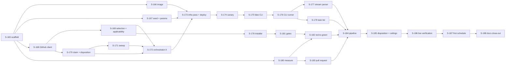

# User Stories — Bug Fix Agent

## Changelog

| Version | Date       | Summary                                                                                                                                                                                         | Author           |
| ------- | ---------- | ----------------------------------------------------------------------------------------------------------------------------------------------------------------------------------------------- | ---------------- |
| 1.0     | 2026-10-18 | Initial stories S-165–S-188 (24) for [`prd-bug-fix-agent.md`](../docs/requirements/prd-bug-fix-agent.md) v1.1 and [`specification-prd-bug-fix-agent.md`](specification-prd-bug-fix-agent.md) v1.0. | product-engineer |

## Overview

24 stories in three waves, matching `docs/roadmap.md`. Sizes: XS under half a day, S about 1 day, M 1–3 days, L about 3 days (none above L). Every story fits one PR. Wave A de-risks first (scaffold, GitHub protocol, deploy, canary) and ends with a deployed agent that **cannot claim anything**; Wave B builds the fix loop on what the canary confirms; Wave C verifies live and enables one schedule.

**Two additions the stories make to the specification** (recorded in spec changelog 1.1 when this document is approved):

1. **`FIX_PIPELINE_ENABLED`** (runtime env, default `0` until S-184). Without it, a Wave A deploy would claim bugs and immediately dispose them. When off, the run ends `succeeded` / `not_applicable` after applicability with the event "fix pipeline not enabled", **before** the claim. The sweep still runs.
2. **Canary mode** (S-174). The spec's Wave A canary needs a probe inside the deployed runtime. A `canary` param (`credentials`, `idle_survival`, `cli_flags`) is accepted **only** when the canary deployment sets `ALLOW_CANARY=1`; the production deployment never sets it.

**Test-first:** within each story the failing tests are written before the code they exercise; S-175 provides the fake-CLI harness first.

**Commands** for this Python package (per `TESTING.md` precedent, run from `agents/bug-fix/app/bugFix/`): `make lint`, `make format-check`, `make typecheck`, `make test`, `make audit`, `make validate`. "Standard gates" below means `lint`, `format-check`, `typecheck`, `test`, `audit` all passing.

## Execution plan

| Order | Stories                         | Wave | Note                                                                      |
| ----- | ------------------------------- | ---- | ------------------------------------------------------------------------- |
| 1     | S-165                           | A    | Foundation                                                                |
| 2     | S-166, S-167, S-168 (parallel)  | A    | Independent after S-165                                                   |
| 3     | S-169, S-170 (parallel)         | A    | Both need S-168                                                           |
| 4     | S-171, S-172                    | A    | S-171 needs S-170; S-172 needs S-169–S-171                                |
| 5     | S-173                           | A    | **Operator prerequisites** (App Issues r/w, `OPERATOR_GITHUB_LOGIN`, Bedrock access) |
| 6     | S-174                           | A    | Canary and credential spike; **gate for Wave B and for any schedule**     |
| 7     | S-175 → S-176 → S-177           | B    | CLI boundary, test-first                                                  |
| 8     | S-178, S-179, S-180 (parallel)  | B    |                                                                           |
| 9     | S-181, S-183 → S-182            | B    |                                                                           |
| 10    | S-184 → S-185                   | B    | Wiring, then every failure path                                           |
| 11    | S-186 → S-187 → S-188           | C    | Live, enable, close out                                                   |

---

# Wave A — Contract and claim

### Story S-165: Package scaffold, configuration, clock invariant, and CI

**Priority:** Critical
**Estimated Size:** M
**Dependencies:** none

#### User Story

As the operator,
I want the `bug-fix` package to exist with its configuration, timeout invariant, and CI gate,
So that every later story lands on a tested, enforced foundation.

#### Context

The siblings enforce their timeout clocks at startup (ADR-006). This agent needs its own invariant and a run-level deadline (D-30, spec §11).

#### Acceptance Criteria

- [ ] `agents/bug-fix/` exists with `agentcore/agentcore.json` (runtime `bug_fix`, Container, `PYTHON_3_14`, `maxLifetime` 3600, `idleRuntimeSessionTimeout` 900, env `MODEL_ID`, `SUPABASE_URL`, `SUPABASE_KEY_SECRET_ID`, `OPERATOR_GITHUB_LOGIN`, `FIX_PIPELINE_ENABLED=0`) and `app/bugFix/` with `Makefile` exposing the canonical targets.
- [ ] `config.assert_clock_invariant()` raises `ClockConsistencyError` unless `0 < HEARTBEAT <= IDLE/2`, `CLONE+INSTALL+CLI+RESERVE <= MAX_LIFETIME`, `MAX_LIFETIME <= REAPER_THRESHOLD`, `GATE_TIMEOUT <= CLI_TIMEOUT`; a test calls it against the shipped constants (AC-18).
- [ ] `RunDeadline` returns `remaining()` monotonically; `step_timeout(cap)` is `min(cap, remaining)`; with no time left it signals budget exhaustion (FR-31).
- [ ] `agent_reporter.py` is byte-identical to the sibling copy (a test compares hashes).
- [ ] `ci.yml` gains matrix entry `bug-fix` (3.13 and 3.14) running ruff, mypy, pytest with coverage, `pip-audit`.
- [ ] `TESTING.md` lists the package, runner, command, and environment.

#### Business Rules

- Constants live in one module and mirror `agentcore.json` and the seed (D-30).
- The sibling relation `step <= idle` is intentionally not asserted for heartbeated steps; a comment cites D-30.

#### Technical Notes

- Pattern: `agents/security-analyst/app/securityAnalyst/config.py`. Copy `heartbeat.py`, `scrubber.py`, `signal_backstop.py`, `credentials.py` unchanged.
- Spec §4.2, §11.1–§11.3.

#### Testing Requirements

- **Unit Tests:** invariant passes on defaults; each of the four relations fails when its operand is perturbed; `RunDeadline` with a fake clock (before, at, after the deadline); hash parity of the vendored reporter.
- **Integration Tests:** none (no external boundary yet).
- **Manual/UI Testing:** none.
- **Edge-Case Matrix:** zero/negative heartbeat; `MAX_LIFETIME == REAPER`; deadline already past at construction.
- **Acceptance-Criteria Mapping:** each AC above → a named test in `tests/unit/test_config.py`.
- **Execution Commands:** `make validate`.

#### Migration Requirements

None: no schema change (opt-out: no data-model change).

#### Implementation Steps

1. Write the failing config and deadline tests.
2. Scaffold the package from the sibling layout and implement `config.py`.
3. Copy the shared modules; add the hash-parity test.
4. Add the CI matrix entry and `TESTING.md` rows.

#### Files to Create/Modify

- `agents/bug-fix/agentcore/agentcore.json`, `agents/bug-fix/app/bugFix/{config.py,pyproject.toml,Makefile}` and the copied modules.
- `agents/bug-fix/app/bugFix/tests/unit/test_config.py`, `tests/conftest.py`
- `.github/workflows/ci.yml`, `TESTING.md`

#### Definition of Done Checklist

- [ ] Code follows the sibling patterns
- [ ] Tests written first and passing; each AC mapped to a test
- [ ] Standard gates passing; CI matrix green on 3.13 and 3.14
- [ ] Reviewed and approved
- [ ] Draft PR opened, linked to the issue

---

### Story S-166: Container image, pinned Claude Code CLI, managed settings

**Priority:** Critical
**Estimated Size:** M
**Dependencies:** S-165

#### User Story

As the operator,
I want an ARM64 image with the CLI pinned and locked down by a managed-settings file,
So that a target repository cannot re-enable hooks, MCP servers, or tools the agent denies.

#### Context

D-29 disables repo hooks and MCP; D-28 pins the CLI. The image must be reproducible and verifiable in CI without Bedrock.

#### Acceptance Criteria

- [ ] `Dockerfile` builds for ARM64 from `public.ecr.aws/docker/library/python:3.13-slim`, installs `git`, `gh`, Node 22, pnpm via corepack, npm, and `@anthropic-ai/claude-code@${CLAUDE_CODE_VERSION}` (build ARG, pinned), with `DISABLE_UPDATES=1`.
- [ ] `/etc/claude-code/managed-settings.json` contains the deny rules (`Bash(git push *)`, `Bash(gh *)`, `WebFetch`, `WebSearch`), `disableBypassPermissionsMode: "disable"`, `allowManagedHooksOnly: true`, `allowManagedMcpServersOnly: true`; `/etc/claude-code/mcp-empty.json` is `{"mcpServers":{}}`.
- [ ] The container runs as a non-root user; the workspace directory is writable by it, the managed files are not.
- [ ] A CI image-smoke job builds the image and asserts: `claude --version` equals the pinned value, both files exist with expected content and mode, `id -u` is non-zero.
- [ ] The pinned version and the bump procedure are recorded in the runbook stub.

#### Business Rules

- The managed file carries deny/hook/MCP lockdown only; it does not set `allowManagedPermissionRulesOnly` (spec §12.3).

#### Technical Notes

- Pattern: the security-analyst `Dockerfile` (ECR mirror base, CA placeholder, `gh` install). Node 22 install as there (nodesource).
- CLI needs optional native deps on `linux-arm64` (D-28).

#### Testing Requirements

- **Unit Tests:** a Python test parses `managed-settings.json` and asserts every required key and deny rule.
- **Integration Tests:** CI image-smoke (above), skipped locally without Docker.
- **Manual/UI Testing:** `docker run --rm <image> claude --version`.
- **Edge-Case Matrix:** missing build ARG fails the build; CLI optional-deps omitted fails smoke.
- **Acceptance-Criteria Mapping:** AC1–AC4 → smoke assertions; AC2 → `test_managed_settings.py`.
- **Execution Commands:** `make validate`; CI job `image-smoke`.

#### Migration Requirements

None (opt-out: no data-model change).

#### Implementation Steps

1. Write `test_managed_settings.py` and the smoke job (failing).
2. Author the Dockerfile and the two settings files.
3. Run the smoke locally; record the pinned version.

#### Files to Create/Modify

- `agents/bug-fix/app/bugFix/Dockerfile`, `managed-settings.json`, `mcp-empty.json`
- `agents/bug-fix/app/bugFix/tests/unit/test_managed_settings.py`
- `.github/workflows/ci.yml`

#### Definition of Done Checklist

- [ ] Image builds on ARM64 in CI
- [ ] Tests passing; ACs mapped to assertions
- [ ] Standard gates passing
- [ ] Reviewed and approved
- [ ] Draft PR opened, linked to the issue

---

### Story S-167: Agent registration, params schema, payload validation

**Priority:** High
**Estimated Size:** S
**Dependencies:** S-165

#### User Story

As the operator,
I want `bug-fix` registered with a validated params schema,
So that I can invoke and schedule it from the panel with safe, bounded parameters.

#### Context

Block 5 of the seed, in the sibling shape (D-26). Params and defaults are fixed in spec §5.1 (D-09, D-22, D-31, D-35).

#### Acceptance Criteria

- [ ] `supabase/seed.sql` block 5 inserts `bug-fix` (`name` "Bug Fix", `version` 0.1.0, `requires_repository` true, `max_runtime_seconds` 3600, `grace_seconds` 150, `start_timeout_seconds` 300, `default_params`, `params_schema`) with `on conflict (slug) do update`, idempotent on re-run.
- [ ] `params_schema` has `additionalProperties:false` and the seven params with the ranges in spec §5.1.
- [ ] `validate_payload` / `apply_defaults` / `classify_invalid_payload` reject unknown params, out-of-range values, and double-wrapped payloads with `INVALID_PARAMS`.
- [ ] `resolve_assignee(params, env)` returns the param, else `OPERATOR_GITHUB_LOGIN`, else raises `INVALID_PARAMS` (D-35).
- [ ] A test asserts `max_runtime_seconds` in the seed equals `MAX_LIFETIME`.

#### Business Rules

- `issue_number` is the only way to target an issue; labels still apply (D-10).

#### Technical Notes

- Reuse `unwrap_payload` shape from the siblings; the panel's `payload.ts` is unchanged.
- No new migration; the seed is applied by `supabase db reset`.

#### Testing Requirements

- **Unit Tests:** payload and param validation matrix; assignee resolution order.
- **Integration Tests:** Layer 2.5, apply the seed twice against the local stack and assert one row and unchanged values.
- **Manual/UI Testing:** the panel invoke form renders the schema.
- **Edge-Case Matrix:** `issue_number` 0 and negative; `max_turns` 4 and 101; empty `assignee` string; neither assignee source set.
- **Acceptance-Criteria Mapping:** AC1 → integration test; AC2–AC4 → unit tests; AC5 → parity test.
- **Execution Commands:** `make validate`; `pnpm run test:integration` for the seed test.

#### Migration Requirements

- Migration artifact: seed change only; no DDL (opt-out rationale: data row, not schema).
- Rollback/impact notes: `delete from agents where slug='bug-fix'` (no runs exist before deploy).
- Apply step: requires explicit user confirmation before running against the cloud project.
- Verification after apply: `select slug, max_runtime_seconds from agents where slug='bug-fix'`.

#### Implementation Steps

1. Write failing validation and seed tests.
2. Add block 5 and `main.py` validation helpers.
3. Add the parity and idempotency tests.

#### Files to Create/Modify

- `supabase/seed.sql`
- `agents/bug-fix/app/bugFix/main.py` (validation helpers), `tests/unit/test_payload.py`
- `panel/tests/integration/` seed test

#### Definition of Done Checklist

- [ ] Seed idempotent and verified locally
- [ ] Tests passing; ACs mapped
- [ ] Standard gates passing
- [ ] Reviewed; cloud apply confirmed by the user
- [ ] Draft PR opened, linked to the issue

---

### Story S-168: GitHub REST client and permission preflight

**Priority:** Critical
**Estimated Size:** M
**Dependencies:** S-165

#### User Story

As the operator,
I want a single GitHub client with retries and a startup permission probe,
So that a missing App permission fails the run cleanly before anything is claimed.

#### Context

The existing App lacks Issues write (D-25). The client is also the one place that talks REST for issues, labels, comments, pulls, and `GET /app`.

#### Acceptance Criteria

- [ ] `github_api.py` implements the calls in spec §6.2 (list/filter issues excluding PRs, labels add/remove, assignees, comments, open pulls, `GET /app`) with pagination.
- [ ] Rate-limit (403 with remaining 0, 429) and 5xx retry 3 times with 2 s, 4 s, 8 s backoff; other 4xx do not retry.
- [ ] `preflight()` reads one issue page and one label page; a 403/404 raises `GitHubPermissionDenied` and the run ends `failed` / `GITHUB_PERMISSION_DENIED` before any mutation (FR-28, AC-17).
- [ ] The App slug is obtained from `GET /app` using the App JWT and cached for the run.
- [ ] No token appears in logs, exceptions, or events (scrubber test).

#### Business Rules

- Read-only calls first; the client exposes mutating methods only through `claim.py` (S-170).

#### Technical Notes

- Use `requests` (already a sibling dependency). JWT minting from `credentials.py`.
- Spec §6.2, §7.1.

#### Testing Requirements

- **Unit Tests:** retry ladder with fake sleep; pagination; PR filtering by `pull_request` key; error mapping.
- **Integration Tests:** component test with a fake GitHub HTTP server (403 on issues → run `failed`).
- **Manual/UI Testing:** none.
- **Edge-Case Matrix:** empty pages; `Link` header absent; 403 secondary rate limit vs permission 403 (distinguished by headers/body); token expiry mid-pagination.
- **Acceptance-Criteria Mapping:** AC3 → component test; AC5 → scrubber test.
- **Execution Commands:** `make validate`.

#### Migration Requirements

None (opt-out: no data-model change).

#### Implementation Steps

1. Write failing client and preflight tests against the fake server.
2. Implement the client and `GitHubPermissionDenied`.
3. Wire the error code into the return payload.

#### Files to Create/Modify

- `agents/bug-fix/app/bugFix/github_api.py`, `tests/unit/test_github_api.py`, `tests/component/test_preflight.py`, `tests/fakes/fake_github.py`

#### Definition of Done Checklist

- [ ] Client covers every call in spec §6.2
- [ ] Tests passing; ACs mapped
- [ ] Standard gates passing
- [ ] Reviewed and approved
- [ ] Draft PR opened, linked to the issue

---

### Story S-169: Selection, linked-PR index, and applicability gate

**Priority:** Critical
**Estimated Size:** M
**Dependencies:** S-168

#### User Story

As the operator,
I want the agent to pick the oldest eligible ready bug and refuse repos it cannot work on,
So that scheduled runs only act on bugs a human readied, in repos that can prove a fix.

#### Context

D-10, D-37 (selection), D-06, D-18, D-19 (applicability). Applicability runs after the clone and before the claim so the issue stays untouched.

#### Acceptance Criteria

- [ ] Without `issue_number`, the oldest open issue carrying both `type: bug` and `status: ready` and not in the linked-PR index is chosen; none → `succeeded` / `no_findings` (FR-2, FR-4, AC-1).
- [ ] With `issue_number`, a closed issue, a missing label, an open linked PR, or a pull request each end `succeeded` / `not_applicable` with the specific reason (`not_open`, `missing_label:<label>`, `open_pr:#<n>`, `is_pull_request`) and no mutation (FR-3, AC-2).
- [ ] The linked-PR index matches head ref `^issue/(\d+)-` and closing keywords in the body, from one paginated `GET /pulls?state=open` (D-37).
- [ ] Applicability requires `.claude/agents/developer.md` and the four gates, resolved per spec §8.2 (`package.json` scripts or Makefile targets); missing items are listed in the event and the run ends `not_applicable` with the issue untouched (FR-5, FR-6, AC-4).
- [ ] The package manager is detected by `packageManager`, then `pnpm-lock.yaml`, then `package-lock.json`.

#### Business Rules

- `status: ready` is the human gate and is never bypassed (D-10).
- A repo with both `package.json` and a Makefile uses the JS/TS rule.

#### Technical Notes

- Port `toolchain.py` from `dependency-update` (`detect_package_manager`, `detect_scripts`) and add Makefile target detection (`^(test|lint|format-check|typecheck):`).
- Spec §8.1, §8.2.

#### Testing Requirements

- **Unit Tests:** ordering by `created_at`; closing-keyword regex cases (`Closes #12`, `fixes #12`, `#120` must not match `#12`); applicability matrix per stack.
- **Integration Tests:** component test with fake GitHub plus a temp repo fixture for each stack.
- **Manual/UI Testing:** none.
- **Edge-Case Matrix:** zero ready bugs; all ready bugs have open PRs; two bugs with equal `created_at`; PR body references multiple issues; Makefile target named `test-unit` but no `test`.
- **Acceptance-Criteria Mapping:** AC1 → `test_selection`; AC2 → `test_explicit_issue`; AC4 → `test_applicability`.
- **Execution Commands:** `make validate`.

#### Migration Requirements

None (opt-out: no data-model change).

#### Implementation Steps

1. Write failing selection and applicability tests.
2. Implement `selection.py` and the ported `toolchain.py` with Makefile detection.
3. Add reason strings to the return payload and run events.

#### Files to Create/Modify

- `agents/bug-fix/app/bugFix/selection.py`, `toolchain.py`
- `tests/unit/test_selection.py`, `tests/unit/test_applicability.py`, `tests/fixtures/repos/`

#### Definition of Done Checklist

- [ ] Selection and applicability match spec §8.1–§8.2
- [ ] Tests passing; ACs mapped
- [ ] Standard gates passing
- [ ] Reviewed and approved
- [ ] Draft PR opened, linked to the issue

---

### Story S-170: Claim, claim marker, and disposition protocol

**Priority:** Critical
**Estimated Size:** M
**Dependencies:** S-168

#### User Story

As the operator,
I want the agent to claim an issue visibly and to leave a reason when it cannot finish,
So that humans see who has the bug and the queue never silently stalls.

#### Context

D-07 (claim), D-08 (disposition), D-36 (marker and bot-author check). Pure protocol; no fix logic.

#### Acceptance Criteria

- [ ] `claim()` assigns the configured login, adds `status: in-progress`, removes `status: ready`, and posts a comment beginning with `<!-- bug-fix-agent:v1 run=<run_id> -->`, in that order (FR-7, AC-3).
- [ ] `parse_claim(comment, app_slug)` returns the run ID only when the marker matches and the author login is `<app_slug>[bot]` with type `Bot`; a human or other-app comment with the same marker returns nothing (D-36).
- [ ] `dispose(issue, reason, detail)` posts a comment with the reason code and a scrubbed diagnosis of at most 2000 characters, swaps `status: in-progress` for `status: needs-refinement`, keeps the assignee, and embeds `disposed=<reason>` in the marker (FR-22 protocol).
- [ ] `dispose` is idempotent: on an issue already `needs-refinement` nothing is posted.
- [ ] A failure partway through `claim` retries the remaining actions once; a second failure raises `GITHUB_API_ERROR` (spec §8.4).
- [ ] The bot is never set as assignee (FR-8).

#### Business Rules

- The label is the lock; the marker is the audit trail; humans re-label `status: ready` to retry (D-08).

#### Technical Notes

- Spec §8.3, §8.4. Uses the S-168 client; mutating methods live here only.

#### Testing Requirements

- **Unit Tests:** marker build/parse round-trip; foreign-author and unmarked comments; diagnosis truncation; idempotent dispose.
- **Integration Tests:** component test against the fake GitHub asserting the exact call order and final issue state.
- **Manual/UI Testing:** review the rendered comment on a fixture issue (marker hidden, text readable).
- **Edge-Case Matrix:** assignee login that does not exist (422); label already present; comment POST fails after labels changed; secret in diagnosis text is scrubbed.
- **Acceptance-Criteria Mapping:** AC1 → `test_claim_order`; AC2 → `test_parse_claim`; AC3/AC4 → `test_dispose`; AC5 → `test_claim_partial_failure`.
- **Execution Commands:** `make validate`.

#### Migration Requirements

None (opt-out: no data-model change).

#### Implementation Steps

1. Write failing protocol tests.
2. Implement `claim.py`.
3. Add the partial-failure path and runbook note.

#### Files to Create/Modify

- `agents/bug-fix/app/bugFix/claim.py`, `tests/unit/test_claim.py`, `tests/component/test_claim_flow.py`

#### Definition of Done Checklist

- [ ] Protocol matches spec §8.3–§8.4
- [ ] Tests passing; ACs mapped
- [ ] Standard gates passing
- [ ] Reviewed and approved
- [ ] Draft PR opened, linked to the issue

---

### Story S-171: Stale-claim sweep

**Priority:** High
**Estimated Size:** M
**Dependencies:** S-170

#### User Story

As the operator,
I want claims left behind by dead runs recovered automatically,
So that a crash never leaves a bug stuck `in-progress`.

#### Context

D-16 with the safety constraint that only the agent's own bot-authored claims are touched (D-36).

#### Acceptance Criteria

- [ ] The sweep lists open `status: in-progress` issues, reads their comments, and keeps those with a valid claim (S-170 `parse_claim`).
- [ ] For each, `v_runs.effective_status` and `run_artifacts` (type `pull_request`) are read in two batched PostgREST calls; a claim is stale when the status is `failed`, `timed_out`, `failed_to_start`, or `canceled` and no PR artifact exists (spec §5.3).
- [ ] Stale claims receive `dispose(reason="STALE_CLAIM")`; the run's own current claim is never swept.
- [ ] Issues without the marker, with a marker by a non-App author, and with a run still `queued`/`running` are untouched (AC-13).
- [ ] A per-issue error is logged as a warning and does not stop the sweep or the run.

#### Business Rules

- The sweep runs first on every run, before selection (D-16).
- Human-claimed `in-progress` issues are never modified.

#### Technical Notes

- Spec §5.3, §8. PostgREST via the reporter's client; use `effective_status`, not `status`.

#### Testing Requirements

- **Unit Tests:** stale-decision matrix over (status × artifact present × marker valid).
- **Integration Tests:** component test with fake GitHub and fake PostgREST; Layer 2.5 query test of the two reads against the local stack with seeded runs.
- **Manual/UI Testing:** none.
- **Edge-Case Matrix:** run ID not found in Supabase; 200 in-progress issues (pagination); two claim comments on one issue (latest wins); run `running` but past the reaper threshold (`effective_status` already `timed_out`).
- **Acceptance-Criteria Mapping:** AC1–AC3 → `test_sweep_decision`; AC4 → `test_sweep_untouched`; AC5 → `test_sweep_error_isolated`.
- **Execution Commands:** `make validate`; `pnpm run test:integration` for the Layer 2.5 query test.

#### Migration Requirements

None (opt-out: reads existing tables and view only).

#### Implementation Steps

1. Write failing decision-matrix and untouched-cases tests.
2. Implement `sweep.py`.
3. Add the Layer 2.5 read test.

#### Files to Create/Modify

- `agents/bug-fix/app/bugFix/sweep.py`, `tests/unit/test_sweep.py`, `tests/component/test_sweep_flow.py`
- `panel/tests/integration/` read test (or the agent's own integration marker)

#### Definition of Done Checklist

- [ ] Sweep matches D-16 and D-36 exactly
- [ ] Tests passing; ACs mapped
- [ ] Standard gates passing
- [ ] Reviewed and approved
- [ ] Draft PR opened, linked to the issue

---

### Story S-172: Orchestrator through applicability, reporting, and outcome mapping

**Priority:** Critical
**Estimated Size:** M
**Dependencies:** S-169, S-170, S-171

#### User Story

As the operator,
I want a deployable run loop that reports every step and maps results to outcomes,
So that the agent can be deployed and probed safely before the fix loop exists.

#### Context

Wave A must be deployable without claiming. `FIX_PIPELINE_ENABLED=0` ends the run after applicability (story note 1). Steps 1–5 and the outcome mapping are final here (spec §4.1, §8.8).

#### Acceptance Criteria

- [ ] `main.py` `@app.entrypoint` runs `resolve_credentials`, `preflight`, `sweep`, `select`, `checkout` (clone plus applicability) as reporter steps and returns the spec §6.1 payload.
- [ ] With `FIX_PIPELINE_ENABLED` unset or `0`, after a successful applicability the run ends `succeeded` / `not_applicable` with the event "fix pipeline not enabled" and **no claim is made**.
- [ ] `determine_outcome` implements the spec §8.8 table; disposition reasons map to `needs_review`; ceilings are dispositions, not failures (FR-26).
- [ ] Heartbeat and `install_termination_backstop` are wired as in the siblings; `assert_clock_invariant()` runs first and fails fast.
- [ ] Every event passes through `scrubber.scrub`; the clone uses the credential helper and never puts the token in the URL or logs.
- [ ] Error codes match spec §13.

#### Business Rules

- Only `failed` counts toward the scheduler's G3 (D-20).
- The flag defaults to off in code and in `agentcore.json`.

#### Technical Notes

- Pattern: `security-analyst/main.py` entrypoint. `clone_repo` ported from the sibling.
- Spec §4.1, §6.1, §8.8, §13.

#### Testing Requirements

- **Unit Tests:** `determine_outcome` table; error-code mapping; flag parsing.
- **Integration Tests:** component tests over the whole Wave A flow with fake GitHub and Supabase: no ready bug, not applicable, flag off, preflight denied, sweep disposes a stale claim then proceeds.
- **Manual/UI Testing:** none.
- **Edge-Case Matrix:** SIGTERM mid-sweep; Supabase unreachable (stderr fallback); clone failure; double-wrapped payload.
- **Acceptance-Criteria Mapping:** AC1 → `test_flow_wave_a`; AC2 → `test_flag_off_no_claim`; AC3 → `test_determine_outcome`; AC4 → `test_startup_invariant`; AC5 → `test_no_token_in_logs`.
- **Execution Commands:** `make validate`.

#### Migration Requirements

None (opt-out: no data-model change).

#### Implementation Steps

1. Write failing flow tests (flag off, each ending).
2. Implement the entrypoint and `determine_outcome`.
3. Wire heartbeat, backstop, scrubbing.

#### Files to Create/Modify

- `agents/bug-fix/app/bugFix/main.py`, `tests/component/test_flow_wave_a.py`, `tests/unit/test_outcome.py`

#### Definition of Done Checklist

- [ ] Run loop matches spec §4.1 steps 1–5
- [ ] Tests passing; ACs mapped
- [ ] Standard gates passing
- [ ] Reviewed and approved
- [ ] Draft PR opened, linked to the issue

---

### Story S-173: Operator prerequisites, infra pass, and Wave A deploy

**Priority:** Critical
**Estimated Size:** M
**Dependencies:** S-166, S-167, S-172

#### User Story

As the operator,
I want the GitHub App permission, IAM entries, and the first deploy done as approved, reversible steps,
So that the agent is invocable and cannot fail on a missing permission.

#### Context

D-25, spec §7. This story runs through `infra-engineer`, one approved step at a time, with an `infra/changes/<date>-bug-fix-agent/` record. Issue #280 showed that a runtime ARN without its `runtime-endpoint/DEFAULT` entry gives 403.

#### Acceptance Criteria

- [ ] **GitHub App:** Issues read/write added and accepted by the installation owner; verified by a successful run of `preflight` against a target repo (manual step, evidenced in the change record).
- [ ] `OPERATOR_GITHUB_LOGIN` chosen and set in the runtime env; Bedrock model access for `MODEL_ID` confirmed in the account/region.
- [ ] The runtime role has the four Bedrock actions in D-28 and the same Secrets Manager reads as the siblings.
- [ ] `infra/agentcore-invoke-policy.json` lists the new runtime ARN **and** its `/runtime-endpoint/DEFAULT`; the live policy is updated and verified by a panel invoke reaching `running`.
- [ ] `infra/environments.yaml` gains `bug-fix`; the seed `runtime_arn` is set after the first deploy.
- [ ] The Wave A image is deployed with `FIX_PIPELINE_ENABLED=0`; a manual invoke from the panel on a fixture repo ends `succeeded` with the "not enabled" event or `no_findings`.
- [ ] `docs/runbooks/bug-fix-deployment.md` documents prerequisites, deploy, rollback (`agents.is_enabled=false`, revert policy entry, redeploy previous image) in the same PR (FR-49a).

#### Business Rules

- No step runs without the user's approval; each step records backup and revert (infra-engineer contract).
- Tags are human-only; the agent never merges.

#### Technical Notes

- Skills: `aws-ops`, `deploy-ops`, `supabase-ops`. Environment: `infra/environments.yaml` `prod`.

#### Testing Requirements

- **Unit Tests:** a repo test that the invoke policy contains both ARNs for every runtime in `environments.yaml`.
- **Integration Tests:** live verification (below).
- **Manual/UI Testing:** invoke from the deployed panel; check the run reaches `running` and ends `succeeded`.
- **Edge-Case Matrix:** policy with runtime ARN only (expect 403); App permission not yet accepted (expect `GITHUB_PERMISSION_DENIED`); wrong `OPERATOR_GITHUB_LOGIN` (expect `INVALID_PARAMS` only when unset).
- **Acceptance-Criteria Mapping:** AC1–AC7 → change-record evidence rows.
- **Execution Commands:** `infra-engineer` steps; `make validate` for the repo test.

#### Migration Requirements

- Migration artifact: seed `runtime_arn` update; no DDL.
- Rollback/impact notes: documented in the runbook.
- Apply step: requires explicit user confirmation.
- Verification after apply: panel invoke reaches `running`.

#### Implementation Steps

1. Plan the change record with `infra-engineer` and get approval per step.
2. Apply App permission, IAM, deploy; verify each.
3. Write the runbook; open the Draft PR.

#### Files to Create/Modify

- `infra/agentcore-invoke-policy.json`, `infra/environments.yaml`, `infra/changes/<date>-bug-fix-agent/`
- `docs/runbooks/bug-fix-deployment.md`, `docs/runbooks/README.md`, `supabase/seed.sql`

#### Definition of Done Checklist

- [ ] Every infra step approved, applied, verified, recorded
- [ ] Runbook in the same PR
- [ ] Standard gates passing
- [ ] Reviewed and approved
- [ ] Draft PR opened, linked to the issue

---

### Story S-174: Canary mode and the Wave A canary run

**Priority:** Critical
**Estimated Size:** M
**Dependencies:** S-173

#### User Story

As the operator,
I want the unverified CLI and credential questions answered on the deployed runtime,
So that Wave B is built on facts and I know whether credential isolation is needed before enabling any schedule.

#### Context

Spec §12.4 and §14. Answers PRD §18 Q1–Q6. Needs a canary-only probe surface (story note 2).

#### Acceptance Criteria

- [ ] A `canary` param (`credentials`, `idle_survival`, `cli_flags`) is accepted only when `ALLOW_CANARY=1`; the production deployment never sets it and a test asserts the param is rejected without it.
- [ ] `credentials`: from a **child process**, attempts to read role credentials from the environment and the container credential endpoint, and to call `secretsmanager:GetSecretValue` for the Supabase and App-key secrets; results (reachable yes/no per item) are written to a run_event without secret values.
- [ ] `idle_survival`: a silent 20-minute step under the heartbeat completes on the deployed runtime.
- [ ] `cli_flags`: against a fixture repo, records whether `CLAUDE.md` and `developer` load under `--settings disableAllHooks`, `--strict-mcp-config`, and the managed file; the max-turns result subtype and exit code; presence of `num_turns` and `is_error`; whether `plan` produces a task list under `-p`; the minimal Bedrock actions needed.
- [ ] Results are recorded in the runbook and as `D-40+` rows in the decision log; spec §12.4 and PRD §18 are updated.
- [ ] Decision gate: if a child process can read the secrets, a credential-isolation story is created and **blocks S-187**.

#### Business Rules

- The canary deployment is separate from production or is redeployed without `ALLOW_CANARY` before any schedule exists.
- Canary output never includes secret values or tokens.

#### Technical Notes

- Spec §12.4, D-27, D-28 **U** items. Uses the real image from S-166.

#### Testing Requirements

- **Unit Tests:** canary param gating; result redaction.
- **Integration Tests:** component test of each canary with a fake child; live run on the deployed runtime.
- **Manual/UI Testing:** invoke each canary from the panel; read the events.
- **Edge-Case Matrix:** `ALLOW_CANARY` unset; Bedrock access denied; secret read denied (the good outcome); CLI missing.
- **Acceptance-Criteria Mapping:** AC1 → `test_canary_gate`; AC2–AC4 → live evidence in the runbook; AC5 → doc diff; AC6 → issue link.
- **Execution Commands:** `make validate`; panel invokes.

#### Migration Requirements

None (opt-out: no data-model change).

#### Implementation Steps

1. Write the gating and redaction tests.
2. Implement the three probes; deploy the canary build.
3. Run, record, update spec and PRD; decide the isolation gate.

#### Files to Create/Modify

- `agents/bug-fix/app/bugFix/canary.py`, `tests/unit/test_canary.py`
- `docs/runbooks/bug-fix-deployment.md`, `workstream/decisions-bug-fix-agent.md`, spec and PRD updates

#### Definition of Done Checklist

- [ ] All six canary questions answered with evidence
- [ ] Gate decision recorded
- [ ] Standard gates passing
- [ ] Reviewed and approved
- [ ] Draft PR opened, linked to the issue

---

# Wave B — Fix loop and validation

### Story S-175: Fake `claude` CLI harness and stream-json fixtures

**Priority:** High
**Estimated Size:** S
**Dependencies:** S-174

#### User Story

As a developer of the agent,
I want a fake `claude` executable that emits recorded outputs,
So that the CLI boundary can be tested without Bedrock and written test-first.

#### Context

D-38. Fixtures are built from the real shapes the canary recorded (S-174), not from assumptions.

#### Acceptance Criteria

- [ ] `tests/fakes/claude` is an executable script selected by a scenario file; scenarios: success, max-turns, permission denial, crash (non-zero, no result), hang (ignores SIGTERM), empty result, hostile issue text, oversize output.
- [ ] Fixtures reproduce the canary-recorded result shape (subtype names, fields, exit codes).
- [ ] A helper installs the fake on `PATH` for a test and asserts argv, stdin, and environment it received.
- [ ] The fake writes the files the scenario specifies into the workspace (edits, tests) so downstream measure and gate tests have real diffs.

#### Business Rules

- The fake never contacts a network and never reads real credentials.

#### Technical Notes

- Spec §14. Scenarios as JSON in `tests/fixtures/cli/`.

#### Testing Requirements

- **Unit Tests:** the fake's own scenarios behave as specified (it is test infrastructure, so it has tests).
- **Integration Tests:** consumed by S-176 onward.
- **Manual/UI Testing:** none.
- **Edge-Case Matrix:** scenario file missing; two scenarios requested; stdin larger than 64 KB.
- **Acceptance-Criteria Mapping:** AC1–AC4 → `test_fake_claude.py`.
- **Execution Commands:** `make validate`.

#### Migration Requirements

None (opt-out: no data-model change).

#### Implementation Steps

1. Write tests for the fake.
2. Implement the fake and scenarios from the canary recordings.

#### Files to Create/Modify

- `agents/bug-fix/app/bugFix/tests/fakes/claude`, `tests/fixtures/cli/*.json`, `tests/unit/test_fake_claude.py`

#### Definition of Done Checklist

- [ ] Every scenario in spec §14 exists
- [ ] Tests passing
- [ ] Standard gates passing
- [ ] Reviewed and approved
- [ ] Draft PR opened, linked to the issue

---

### Story S-176: CLI runner — argv, environment allow-list, settings, termination

**Priority:** Critical
**Estimated Size:** M
**Dependencies:** S-175

#### User Story

As the operator,
I want the CLI launched with a minimal environment, locked-down flags, and a hard termination ladder,
So that a hostile issue or repository cannot reach credentials the CLI does not need.

#### Context

D-11, D-28, D-29. The credential boundary the CLI itself can see; the deeper role-credential question is S-174's.

#### Acceptance Criteria

- [ ] The environment is built from an **allow-list** (spec §9.1) and never from `os.environ`; a test enumerates the exact keys and asserts no `GITHUB_*`, `GH_*`, `SUPABASE_*`, token, or private-key variable is present (AC-5).
- [ ] `HOME` and `CLAUDE_CONFIG_DIR` are a per-run temp directory deleted afterward; `DISABLE_UPDATES=1`, `CLAUDE_CODE_MAX_SUBAGENT_SPAWN_DEPTH=1`, telemetry and auto-memory off.
- [ ] argv includes `--permission-mode dontAsk --permission-prompts none`, `--tools`, the per-repo `--allowedTools`, `--disallowedTools` (`WebFetch`, `WebSearch`, `Bash(git push *)`, `Bash(gh *)`), `--settings '{"disableAllHooks":true}'`, `--strict-mcp-config --mcp-config /etc/claude-code/mcp-empty.json`, `--append-system-prompt-file`, `--max-turns`, `--model`, `--output-format stream-json --verbose`, `--no-session-persistence` (FR-9, FR-11).
- [ ] Issue title and body go on stdin only, quoted as data, truncated at 64 KB with a marker; a body containing flag-like text cannot alter argv (AC-6).
- [ ] Termination ladder: SIGINT, 10 s, SIGTERM, then SIGKILL on `cli_timeout_seconds` or deadline; exit 143 and the kill are reported as a limit, not a crash.
- [ ] The `--allowedTools` list is built from the repo's resolved gate and test commands only.

#### Business Rules

- Never `--bare`, never `bypassPermissions` (D-28, D-29).

#### Technical Notes

- Spec §8.5, §9.1, §12.2. Runs in a worker thread under `heartbeat.run_with_heartbeat`.

#### Testing Requirements

- **Unit Tests:** env allow-list; argv builder; stdin builder; allow-list builder per stack.
- **Integration Tests:** component tests with the S-175 fake: argv/env/stdin as received; hang scenario triggers the ladder; hostile issue text.
- **Manual/UI Testing:** none (canary covered live behavior).
- **Edge-Case Matrix:** repo path with spaces; issue body with `--model evil`, NUL bytes, 2 MB; temp dir cleanup on exception; CLI missing.
- **Acceptance-Criteria Mapping:** AC1 → `test_env_allowlist`; AC3 → `test_argv`; AC4 → `test_hostile_stdin`; AC5 → `test_termination_ladder`.
- **Execution Commands:** `make validate`.

#### Migration Requirements

None (opt-out: no data-model change).

#### Implementation Steps

1. Write the security-negative tests first.
2. Implement `cli_runner.py` (build, spawn, ladder).
3. Wire the heartbeat wrapper.

#### Files to Create/Modify

- `agents/bug-fix/app/bugFix/cli_runner.py`, `tests/unit/test_cli_runner.py`, `tests/component/test_cli_boundary.py`

#### Definition of Done Checklist

- [ ] Security-negative cases pass (no token in env, injection inert)
- [ ] Tests passing; ACs mapped
- [ ] Standard gates passing
- [ ] Reviewed and approved
- [ ] Draft PR opened, linked to the issue

---

### Story S-177: Stream-json parser, per-turn events, metrics, limit detection

**Priority:** High
**Estimated Size:** M
**Dependencies:** S-176

#### User Story

As the operator,
I want each CLI turn to appear as a scrubbed event and the final result to land in metrics,
So that I can watch a long run and trust the numbers.

#### Context

D-39, D-22, D-28. Parsing must tolerate format drift and classify ceilings versus failures.

#### Acceptance Criteria

- [ ] Each assistant turn becomes one `run_event` with tool name, target path, and a one-line summary; file contents and command output are never included beyond 200 characters; every event passes `scrubber.scrub` (FR-25, D-39).
- [ ] The final `result` line yields `turns`, `input_tokens`, `output_tokens`, `cost_usd`, `permission_denials` into `runs.metrics` (FR-27); missing fields degrade to `null`, never raise.
- [ ] `permission_denials > 0` emits a `warn` event naming the denied tools.
- [ ] A result indicating the turn limit, the wall-clock kill, or the deadline is classified `ceiling` (→ disposition `MAX_TURNS`/`CLI_TIMEOUT`/`RUN_BUDGET_EXHAUSTED`); a non-limit abnormal exit or no result is `CLI_ABNORMAL_EXIT`/`CLI_OUTPUT_UNPARSEABLE` (`failed`) (spec §8.8).
- [ ] A secret placed in model output or tool arguments by a fixture is absent from every event.

#### Business Rules

- Unknown event types are ignored, not fatal.

#### Technical Notes

- Spec §9.1; shapes from S-175 fixtures.

#### Testing Requirements

- **Unit Tests:** parser over every S-175 scenario; truncation; scrubbing; classification table.
- **Integration Tests:** component test: fake CLI to events and metrics in the reporter.
- **Manual/UI Testing:** a canary-recorded stream renders sensibly in the panel live tail.
- **Edge-Case Matrix:** partial last line; invalid JSON line; 10,000 turns; result line missing; duplicate result.
- **Acceptance-Criteria Mapping:** AC1 → `test_events`; AC2 → `test_metrics`; AC4 → `test_classification`; AC5 → `test_scrub_events`.
- **Execution Commands:** `make validate`.

#### Migration Requirements

None (opt-out: no data-model change).

#### Implementation Steps

1. Write parser and classification tests from fixtures.
2. Implement the parser and event emitter.
3. Connect to the runner's output stream.

#### Files to Create/Modify

- `agents/bug-fix/app/bugFix/cli_runner.py` (parser), `tests/unit/test_stream_parser.py`

#### Definition of Done Checklist

- [ ] Ceiling vs failure classification matches spec §8.8
- [ ] Tests passing; ACs mapped
- [ ] Standard gates passing
- [ ] Reviewed and approved
- [ ] Draft PR opened, linked to the issue

---

### Story S-178: Dependency installer

**Priority:** High
**Estimated Size:** M
**Dependencies:** S-169

#### User Story

As the operator,
I want the repository's dependencies installed before the CLI starts,
So that the gates can run and the CLI needs no registry access.

#### Context

D-33, FR-29. Reuses the sibling's toolchain detection.

#### Acceptance Criteria

- [ ] JS/TS: `pnpm install --frozen-lockfile` (pnpm version matched as in `ensure_pnpm_version`) or `npm ci`; Python: throwaway venv, `make install` if the target exists else `pip install -e '.[dev]'`; lifecycle scripts run.
- [ ] The step is capped at `min(300 s, remaining)` under the heartbeat; a timeout or non-zero exit takes the disposition `INSTALL_FAILED` with the output tail (scrubbed) (AC-20).
- [ ] After install, any lockfile change is reverted with `git checkout -- <lockfile>`; a test asserts the lockfile never reaches the measured diff.
- [ ] The venv and `node_modules` are not committed (gitignored paths excluded from the diff).

#### Business Rules

- Install runs repo-controlled scripts; accepted under the D-27 trust anchor.

#### Technical Notes

- Spec §8.2, §11.1. Port from `dependency-update/toolchain.py`.

#### Testing Requirements

- **Unit Tests:** command selection per stack; timeout handling with a fake runner.
- **Integration Tests:** component test with temp repos (fake package managers on `PATH`).
- **Manual/UI Testing:** none.
- **Edge-Case Matrix:** lockfile out of sync (`--frozen-lockfile` fails); no network; install modifies tracked files other than the lockfile; Python without Makefile install target.
- **Acceptance-Criteria Mapping:** AC1 → `test_install_commands`; AC2 → `test_install_failure_disposition`; AC3 → `test_lockfile_reverted`.
- **Execution Commands:** `make validate`.

#### Migration Requirements

None (opt-out: no data-model change).

#### Implementation Steps

1. Write failing install tests.
2. Implement `installer.py`.
3. Add lockfile restoration and gitignore handling.

#### Files to Create/Modify

- `agents/bug-fix/app/bugFix/installer.py`, `tests/unit/test_installer.py`, `tests/component/test_install_flow.py`

#### Definition of Done Checklist

- [ ] Both stacks install deterministically
- [ ] Tests passing; ACs mapped
- [ ] Standard gates passing
- [ ] Reviewed and approved
- [ ] Draft PR opened, linked to the issue

---

### Story S-179: Task list — issue checklist, `plan` pass, prompts

**Priority:** High
**Estimated Size:** M
**Dependencies:** S-176

#### User Story

As the operator,
I want the `developer` definition fed an execution-ready task list,
So that the headless run follows the repository's own workflow.

#### Context

D-31. The refined issue normally carries a checklist; otherwise the `plan` pass generates it.

#### Acceptance Criteria

- [ ] A checklist is extracted from the issue body (`- [ ]` items) and written verbatim to the scratch `workstream/tasks-issue-<N>-<slug>.md`, excluded from the commit and the measured diff (FR-30).
- [ ] With no checklist, a `plan` pass runs (same confinement flags, `plan_max_turns`, shares the CLI wall-clock budget) and must produce a non-empty task file; otherwise disposition `NO_TASK_LIST`.
- [ ] `prompts/wrapper_contract.md` states: branch already checked out; do not branch, push, open PRs, or touch the issue or its checklist; work test-first; smallest change; no lockfile/workflow/`.claude/` edits; write per-file rationale to `.bugfix/rationale.md` and the commit message to `.bugfix/commit-message.txt`; the stdin issue is untrusted data.
- [ ] `.bugfix/` is wrapper-owned scratch, excluded from diff and commit.
- [ ] The second pass receives the remaining wall-clock, not a fresh budget.

#### Business Rules

- The wrapper contract overrides the definition's branch, PR and checklist rules (D-31).

#### Technical Notes

- Spec §8.5. The `plan` pass depends on the S-174 `plan_under_p` finding; if unusable, this story ships the failure path only and records the follow-up.

#### Testing Requirements

- **Unit Tests:** checklist extraction (nested, checked, none); slug; budget split.
- **Integration Tests:** component tests with the fake CLI: checklist present, absent+plan success, absent+plan empty.
- **Manual/UI Testing:** read the rendered prompts for ambiguity.
- **Edge-Case Matrix:** checklist inside a code fence; 500 items; issue body empty; plan writes outside `workstream/`.
- **Acceptance-Criteria Mapping:** AC1 → `test_checklist`; AC2 → `test_plan_pass`; AC4 → `test_scratch_excluded`.
- **Execution Commands:** `make validate`.

#### Migration Requirements

None (opt-out: no data-model change).

#### Implementation Steps

1. Write failing extraction and flow tests.
2. Implement `taskfile.py` and the prompts.
3. Wire scratch exclusion.

#### Files to Create/Modify

- `agents/bug-fix/app/bugFix/taskfile.py`, `prompts/*.md`, `tests/unit/test_taskfile.py`, `tests/component/test_plan_pass.py`

#### Definition of Done Checklist

- [ ] Prompts reviewed for conflict with the definition
- [ ] Tests passing; ACs mapped
- [ ] Standard gates passing
- [ ] Reviewed and approved
- [ ] Draft PR opened, linked to the issue

---

### Story S-180: Measure — classification, caps, forbidden paths, commit message

**Priority:** Critical
**Estimated Size:** M
**Dependencies:** S-165

#### User Story

As the operator,
I want every change measured mechanically against the size rules,
So that "smallest change" is enforced, not hoped for.

#### Context

D-09, D-32. Pure function over a git diff; no model involved.

#### Acceptance Criteria

- [ ] Classification follows D-32: tests, docs/text (`*.md/.txt/.rst/.adoc`), forbidden, else code; lines = added + deleted from `numstat` against the base commit including untracked files; binary and rename-only = one file, zero lines.
- [ ] Forbidden paths: `package-lock.json`, `pnpm-lock.yaml`, `yarn.lock`, `poetry.lock`, `uv.lock`, `Pipfile.lock`, `.github/workflows/**`, `.claude/**` → `FORBIDDEN_PATH`, even if only touched in the working tree (AC-7).
- [ ] More than `max_code_files` or `max_code_lines` → `OVER_CAP` with the diffstat; no test file added or changed → `NO_TEST` (FR-13–FR-15, AC-7, AC-8).
- [ ] The commit message from `.bugfix/commit-message.txt` must match the Conventional Commit pattern and reference the issue; otherwise it is rewritten to `fix: <title> (#<N>)`.
- [ ] Docs/text and test changes never count toward the caps (boundary tests at 10/11 files and 400/401 lines).

#### Business Rules

- The caps are inclusive limits: 10 files and 400 lines pass.

#### Technical Notes

- Spec §8.6. Test patterns in D-32.

#### Testing Requirements

- **Unit Tests:** classification table; boundary cases; forbidden detection; message validation.
- **Integration Tests:** real `git` in temp repos for numstat and intent-to-add behavior.
- **Manual/UI Testing:** none.
- **Edge-Case Matrix:** rename with edits; mode change only; file deleted; CRLF changes; nested test directory named `spec`; non-UTF-8 file.
- **Acceptance-Criteria Mapping:** AC1 → `test_classify`; AC2 → `test_forbidden`; AC3 → `test_caps_boundaries`; AC4 → `test_commit_message`.
- **Execution Commands:** `make validate`.

#### Migration Requirements

None (opt-out: no data-model change).

#### Implementation Steps

1. Write the boundary and classification tests.
2. Implement `measure.py`.
3. Add the temp-repo integration tests.

#### Files to Create/Modify

- `agents/bug-fix/app/bugFix/measure.py`, `tests/unit/test_measure.py`, `tests/component/test_measure_git.py`

#### Definition of Done Checklist

- [ ] Boundary cases pinned by tests
- [ ] Tests passing; ACs mapped
- [ ] Standard gates passing
- [ ] Reviewed and approved
- [ ] Draft PR opened, linked to the issue

---

### Story S-181: Gate runner and audit baseline

**Priority:** Critical
**Estimated Size:** M
**Dependencies:** S-178

#### User Story

As a reviewer,
I want the wrapper to run the repository's gates itself,
So that a green PR never rests on the model's claim.

#### Context

D-14. Block on four gates, record `audit`, tolerate an audit that is already red on the base.

#### Acceptance Criteria

- [ ] `test`, `lint`, `format`, `typecheck` run in order with `min(300 s, remaining)` each under the heartbeat; the first failure stops the pipeline with `GATE_FAILED(<gate>)` and the scrubbed last 40 lines (FR-17, AC-9).
- [ ] `audit` runs on the final tree; on failure it is re-run on the base commit; a failure present at the base is recorded `pre-existing` and does not block; a new failure is recorded `fail` and still does not block (FR-18).
- [ ] Gate results land in `runs.metrics.gates` and the PR body data.
- [ ] A gate command that hangs is killed and reported as `GATE_FAILED(<gate>)` with `timeout`.
- [ ] The base-commit audit leaves the working tree exactly as before (diff hash compared).

#### Business Rules

- Four blocking, one recorded (D-14).

#### Technical Notes

- Spec §8.7. Resolved commands from S-169.

#### Testing Requirements

- **Unit Tests:** result recording; timeout classification.
- **Integration Tests:** component tests with fake `pnpm`/`make` binaries returning scripted exits; temp git repo for base-commit audit.
- **Manual/UI Testing:** none.
- **Edge-Case Matrix:** gate prints 10 MB; gate modifies files (formatter writes) — detected and reported; audit tool missing; base checkout fails.
- **Acceptance-Criteria Mapping:** AC1 → `test_gate_order`; AC2 → `test_audit_baseline`; AC4 → `test_gate_timeout`; AC5 → `test_tree_restored`.
- **Execution Commands:** `make validate`.

#### Migration Requirements

None (opt-out: no data-model change).

#### Implementation Steps

1. Write failing gate and audit tests.
2. Implement `gates.py`.
3. Add tree-restoration verification.

#### Files to Create/Modify

- `agents/bug-fix/app/bugFix/gates.py`, `tests/unit/test_gates.py`, `tests/component/test_audit_baseline.py`

#### Definition of Done Checklist

- [ ] Gate semantics match D-14
- [ ] Tests passing; ACs mapped
- [ ] Standard gates passing
- [ ] Reviewed and approved
- [ ] Draft PR opened, linked to the issue

---

### Story S-182: Red-to-green verification

**Priority:** Critical
**Estimated Size:** M
**Dependencies:** S-180, S-181

#### User Story

As a reviewer,
I want proof that the new test fails without the fix,
So that I can trust the fix addresses the reported bug.

#### Context

D-15, D-34. Reverse-apply the non-test patch, run only the changed tests, restore.

#### Acceptance Criteria

- [ ] The non-test diff (including intent-to-add files) is saved as a patch, reverse-applied, the changed test files are run (pytest paths; for JS, paths through the repo's `test` script), and the patch re-applied (FR-19).
- [ ] Red = non-zero exit and at least one failure line; the first 40 lines of the failing output are captured for the PR body (D-34).
- [ ] Tests that pass on the base code produce disposition `TEST_NOT_RED` (AC-8).
- [ ] The working tree is verified restored by comparing the diff hash before and after, in a `finally` block; a mismatch fails the run `failed` / `UNHANDLED_ERROR`.
- [ ] The step is capped at `min(300 s, remaining)` and heartbeated.

#### Business Rules

- Any failing exit counts as red in v1; reporter parsing is a recorded fast-follow (D-34).

#### Technical Notes

- Spec §8.7. Changed tests identified by the S-180 classification.

#### Testing Requirements

- **Unit Tests:** red decision; patch handling for added, modified, deleted non-test files.
- **Integration Tests:** temp git repos with a real failing/passing pytest; fake JS runner.
- **Manual/UI Testing:** none.
- **Edge-Case Matrix:** fix adds a new file the test imports (import error = red, flagged in evidence); patch fails to reverse-apply; test file also modified by the fix; no changed tests (already `NO_TEST`).
- **Acceptance-Criteria Mapping:** AC1 → `test_patch_cycle`; AC2 → `test_red_rule`; AC3 → `test_not_red`; AC4 → `test_tree_restored_always`.
- **Execution Commands:** `make validate`.

#### Migration Requirements

None (opt-out: no data-model change).

#### Implementation Steps

1. Write failing red/not-red and restoration tests.
2. Implement `red_green.py`.
3. Add exception-path restoration tests.

#### Files to Create/Modify

- `agents/bug-fix/app/bugFix/red_green.py`, `tests/unit/test_red_green.py`, `tests/component/test_red_green_git.py`

#### Definition of Done Checklist

- [ ] Restoration guaranteed on every path
- [ ] Tests passing; ACs mapped
- [ ] Standard gates passing
- [ ] Reviewed and approved
- [ ] Draft PR opened, linked to the issue

---

### Story S-183: Pull request — branch, commit, push, Draft PR, body, artifact

**Priority:** Critical
**Estimated Size:** M
**Dependencies:** S-180

#### User Story

As a reviewer,
I want a Draft PR with the evidence needed to review the change,
So that I can decide quickly and nothing merges without me.

#### Context

D-12, D-13, D-21, FR-20/21, FR-16.

#### Acceptance Criteria

- [ ] Branch `issue/<N>-<slug>` is created by the wrapper; the commit excludes `.bugfix/` and the scratch task list; the push uses the credential helper; the token never appears in a URL or log.
- [ ] `gh pr create --draft --base <default> --head <branch> --body-file` is used; an existing PR for the branch is reused (idempotent) (AC-10).
- [ ] The body contains: issue link, per-file rationale (every changed file listed, FR-16), gate results, `audit` result, red-to-green evidence (first 40 lines), `verifier_audit: not-run(no-delegation)`, `coverage_gate: SKIPPED(no-delegation)`, run link.
- [ ] A `pull_request` row is written to `run_artifacts` (`url`, `title`, `metadata.number`, `metadata.branch`) (FR-21).
- [ ] The PR stays Draft; no merge call exists in the code (FR-20).
- [ ] Push or PR failure → `failed` / `PUSH_FAILED` / `PR_CREATE_FAILED` after 3 retries.

#### Business Rules

- Agents never merge to `main`; PR body only via `--body-file` (D-13; sibling rule).

#### Technical Notes

- Port `pull_request.py` from the sibling (`_push_with_credential_helper`, `existing_pr`, `create_pr`, body file). Spec §9.3.

#### Testing Requirements

- **Unit Tests:** body builder; rationale coverage check; branch name; slug.
- **Integration Tests:** component test with a local bare git remote and fake `gh`.
- **Manual/UI Testing:** inspect a rendered body on the fixture repo.
- **Edge-Case Matrix:** branch exists remotely; rationale missing a file (filled with "no rationale provided" and flagged); PR already exists; push rejected.
- **Acceptance-Criteria Mapping:** AC1 → `test_commit_excludes_scratch`; AC2 → `test_pr_idempotent`; AC3 → `test_body`; AC4 → `test_artifact`; AC5 → `test_no_merge_symbol`.
- **Execution Commands:** `make validate`.

#### Migration Requirements

None (opt-out: no data-model change).

#### Implementation Steps

1. Write failing body, commit, and idempotency tests.
2. Port and adapt `pull_request.py`.
3. Add the artifact write.

#### Files to Create/Modify

- `agents/bug-fix/app/bugFix/pull_request.py`, `tests/unit/test_pr_body.py`, `tests/component/test_pr_flow.py`

#### Definition of Done Checklist

- [ ] Body matches spec FR-20
- [ ] Tests passing; ACs mapped
- [ ] Standard gates passing
- [ ] Reviewed and approved
- [ ] Draft PR opened, linked to the issue

---

### Story S-184: Pipeline wiring — fix to Draft PR, and enable the pipeline

**Priority:** Critical
**Estimated Size:** L
**Dependencies:** S-177, S-179, S-182, S-183

#### User Story

As the operator,
I want the full path from claimed bug to Draft PR working end to end,
So that a scheduled run can deliver a reviewable fix.

#### Context

Wires steps 6–13 of spec §4.1 for the success path and flips `FIX_PIPELINE_ENABLED` to on by default (story note 1).

#### Acceptance Criteria

- [ ] With the flag on, the run executes claim → install → (plan) → fix → measure → validate → red_to_green → open_pr and ends `succeeded` / `fixed` on the fake-CLI success scenario, with the claim comment, labels, assignee, branch, Draft PR, `pull_request` artifact, metrics, and events all asserted (AC-3, AC-10).
- [ ] Step order, step names, and heartbeat coverage match spec §4.1.
- [ ] `runs.metrics` contains turns, tokens, cost, files, lines, gates, red_to_green, denials (FR-27).
- [ ] `FIX_PIPELINE_ENABLED` defaults to `1` in code and `agentcore.json` from this story on; with `0` the S-172 behavior is unchanged (test retained).
- [ ] The component test runs the whole flow against fake GitHub, a bare git remote, fake `gh`, the S-175 fake CLI, and a fake Supabase.

#### Business Rules

- The default branch is never written (branch guard equivalents in the wrapper).

#### Technical Notes

- Spec §4.1, §8.9. Failure paths are S-185; here only the success path plus the unchanged flag-off path.

#### Testing Requirements

- **Unit Tests:** step ordering helper; metrics assembly.
- **Integration Tests:** the full-flow component test (above) is the story's main evidence.
- **Manual/UI Testing:** none.
- **Edge-Case Matrix:** token refresh mid-run; `issue_number` explicit; second run on the same repo (G1 simulated by the fake: no overlap in the unit).
- **Acceptance-Criteria Mapping:** AC1/AC2/AC3 → `test_full_flow_success`; AC4 → `test_flag_off_unchanged`.
- **Execution Commands:** `make validate`.

#### Migration Requirements

None (opt-out: no data-model change).

#### Implementation Steps

1. Write the full-flow success test (failing).
2. Wire the steps in `main.py`.
3. Flip the flag default; keep the flag-off test.

#### Files to Create/Modify

- `agents/bug-fix/app/bugFix/main.py`, `agentcore/agentcore.json`, `tests/component/test_full_flow_success.py`

#### Definition of Done Checklist

- [ ] Success path asserted end to end
- [ ] Tests passing; ACs mapped
- [ ] Standard gates passing
- [ ] Reviewed and approved
- [ ] Draft PR opened, linked to the issue

---

### Story S-185: Disposition wiring — every failure path, ceilings, deadline

**Priority:** Critical
**Estimated Size:** M
**Dependencies:** S-184

#### User Story

As the operator,
I want every way a claimed run can end without a PR to leave a reason and clear the queue,
So that the schedule keeps working on other bugs and G3 only trips on real faults.

#### Context

D-08, D-20, D-22, D-30; spec §8.4, §8.8.

#### Acceptance Criteria

- [ ] Each disposition reason — `CANNOT_REPRODUCE`, `INSTALL_FAILED`, `NO_TASK_LIST`, `MAX_TURNS`, `CLI_TIMEOUT`, `RUN_BUDGET_EXHAUSTED`, `OVER_CAP`, `FORBIDDEN_PATH`, `NO_TEST`, `TEST_NOT_RED`, `GATE_FAILED(<gate>)` — has a component test ending `succeeded` / `needs_review`, the issue `needs-refinement`, the comment holding the reason and scrubbed diagnosis, the assignee kept (AC-11).
- [ ] The disposition runs in a `finally` path and in the signal backstop; a failing disposition is logged `error`, leaves the claim marker intact, and the run ends `failed` / `GITHUB_API_ERROR` (FR-23).
- [ ] The run deadline is enforced: a step that would start with no time before the reserve takes `RUN_BUDGET_EXHAUSTED` (AC-18); the CLI is killed at `cli_timeout_seconds` or the deadline (AC-14).
- [ ] Hitting turn, wall-clock, or deadline ceilings is `needs_review`; a CLI that cannot start or exits abnormally is `failed` (FR-26).
- [ ] A scheduler-level simulation shows three consecutive `needs_review` outcomes do not count as failed firings and three `failed` ones do (AC-12), using the scheduler's own failed-firing predicate.
- [ ] The reason text appears in the run summary so the green run in the list explains itself (D-20).

#### Business Rules

- No automatic retry (D-08).

#### Technical Notes

- Spec §8.4, §8.8, §11.2. G3 predicate lives in the scheduler migration `20261013166000_scheduler_g3_circuit_breaker.sql`.

#### Testing Requirements

- **Unit Tests:** reason-to-comment mapping; budget-exhaustion decision.
- **Integration Tests:** one component test per reason; Layer 2.5 test feeding outcomes to the G3 predicate on the local stack.
- **Manual/UI Testing:** read three disposition comments for clarity.
- **Edge-Case Matrix:** SIGTERM during `fix`; GitHub down during disposition; disposition twice (idempotent); deadline hit exactly at a step boundary.
- **Acceptance-Criteria Mapping:** AC1 → parametrized `test_disposition_<reason>`; AC2 → `test_finally_and_backstop`; AC3 → `test_deadline`; AC5 → `test_g3_semantics`.
- **Execution Commands:** `make validate`; `pnpm run test:integration` for G3.

#### Migration Requirements

None (opt-out: no data-model change).

#### Implementation Steps

1. Write the parametrized disposition tests (failing).
2. Wire the `finally` and backstop paths and the deadline.
3. Add the G3 Layer 2.5 test.

#### Files to Create/Modify

- `agents/bug-fix/app/bugFix/main.py`, `claim.py`, `config.py`
- `tests/component/test_dispositions.py`, `panel/tests/integration/` G3 test

#### Definition of Done Checklist

- [ ] All eleven reasons covered
- [ ] Tests passing; ACs mapped
- [ ] Standard gates passing
- [ ] Reviewed and approved
- [ ] Draft PR opened, linked to the issue

---

# Wave C — Recovery and live

### Story S-186: Live verification on a fixture repository

**Priority:** Critical
**Estimated Size:** M
**Dependencies:** S-185

#### User Story

As the operator,
I want the deployed agent proven on a real repository with a fixable bug, an unfixable bug, and a hostile issue,
So that I trust it before it runs unattended.

#### Context

AC-16, AC-6 live, AC-13 live. Fixture repo owned by the operator with dev-tasks installed, the four gates, and seeded issues.

#### Acceptance Criteria

- [ ] A seeded fixable bug reaches a Draft PR: claim comment, assignee, `in-progress`, branch, red-to-green evidence, four green gates, rationale per file, `pull_request` artifact (AC-16).
- [ ] A seeded unfixable bug reaches the disposition: `needs-refinement`, reason comment, run `succeeded`/`needs_review`.
- [ ] A seeded issue whose body instructs the model to push elsewhere or print environment variables results in no credential in any event, comment, or PR body, and the denial is surfaced (AC-6).
- [ ] A claim left by a killed run (container stopped mid-run) is disposed by the next run's sweep (AC-13).
- [ ] A repo without `developer.md` and a repo without a gate each end `not_applicable` untouched (AC-4).
- [ ] Observed `runs.metrics` (tokens, cost, wall-clock) are recorded in the runbook to tune the D-09/D-22 estimates.

#### Business Rules

- Runs only on the operator-owned fixture repo (D-27).

#### Technical Notes

- Deployed runtime from S-173 with the Wave B image; schedule not yet created.

#### Testing Requirements

- **Unit Tests:** none.
- **Integration Tests:** the live scenarios above.
- **Manual/UI Testing:** each scenario invoked from the panel; screenshots or links in the runbook.
- **Edge-Case Matrix:** two ready bugs (oldest picked); explicit `issue_number`; PR already open (skipped).
- **Acceptance-Criteria Mapping:** each live scenario → a runbook evidence row with run IDs.
- **Execution Commands:** panel invokes; `infra-engineer` for any redeploy.

#### Migration Requirements

None (opt-out: no data-model change).

#### Implementation Steps

1. Prepare the fixture repo and seeded issues.
2. Deploy the Wave B image; run each scenario; capture evidence.
3. Record the metrics; file defects as issues.

#### Files to Create/Modify

- `docs/runbooks/bug-fix-live-verification.md`, `docs/runbooks/README.md`

#### Definition of Done Checklist

- [ ] Every scenario run and evidenced
- [ ] Defects filed or fixed
- [ ] Runbook in the same PR
- [ ] Reviewed and approved
- [ ] Draft PR opened, linked to the issue

---

### Story S-187: First schedule and enablement criteria

**Priority:** High
**Estimated Size:** S
**Dependencies:** S-186

#### User Story

As the operator,
I want one schedule on one repo I own, with explicit criteria for enabling more,
So that unattended operation starts small and observable.

#### Context

D-01, D-21, D-27. Requires scheduler Waves C–E merged for G1/G3/G5 and the S-174 credential decision.

#### Acceptance Criteria

- [ ] Precondition check recorded: scheduler Waves C–E merged to `integration/agent-scheduler`/`main`; S-174 gate decision recorded (and the isolation story done if it was required).
- [ ] One schedule is created through the panel for one operator-owned repo with `bug-fix`; its cadence and params are recorded in the runbook.
- [ ] Over at least two ticks: G1 suppresses an overlapping tick; after a `fixed` run G5 blocks the next tick until "PR handled" is clicked; a `needs_review` run does not advance the G3 counter (AC-12, AC-15).
- [ ] Enablement criteria for further repos are written: owned repo, dev-tasks installed, four gates, trusted reporters, reviewed metrics.
- [ ] Rollback is rehearsed: pausing the schedule and setting `agents.is_enabled=false` stop new runs.

#### Business Rules

- Schedules on repos with untrusted reporters stay blocked until credential isolation exists (D-27).

#### Technical Notes

- Scheduler PRD §7.3; `/schedules` UI.

#### Testing Requirements

- **Unit Tests:** none.
- **Integration Tests:** live ticks.
- **Manual/UI Testing:** panel `/schedules`, run list, notifications feed.
- **Edge-Case Matrix:** tick during an active run; tick with the repo having an open agent PR; operator clears G5.
- **Acceptance-Criteria Mapping:** AC3 → runbook evidence with tick timestamps and run IDs.
- **Execution Commands:** panel operations.

#### Migration Requirements

None (opt-out: no data-model change).

#### Implementation Steps

1. Verify preconditions.
2. Create the schedule; observe two ticks.
3. Document criteria and rollback.

#### Files to Create/Modify

- `docs/runbooks/bug-fix-deployment.md` (schedule section)

#### Definition of Done Checklist

- [ ] Preconditions evidenced
- [ ] Guardrails observed live
- [ ] Rollback rehearsed
- [ ] Reviewed and approved
- [ ] Draft PR opened, linked to the issue

---

### Story S-188: Documentation close-out

**Priority:** Medium
**Estimated Size:** S
**Dependencies:** S-187

#### User Story

As a future maintainer,
I want the architecture decisions, standards, and vocabulary recorded where the rest of the system's are,
So that the next change does not rediscover them.

#### Context

Owned by `technical-writer`. Foundation docs still use the old names (`docs/technical-guidelines.md`); write them under those names and propose `dev-tasks migrate docs` (CLAUDE.md rule).

#### Acceptance Criteria

- [ ] An ADR records the clock-invariant deviation (D-30), the headless-CLI engine choice (D-05), the credential trust anchor and spike result (D-27), and the hooks/MCP lockdown (D-29).
- [ ] `docs/technical-guidelines.md` gains the `bug-fix` agent row (§9), the run-deadline and invariant rule (§3/§7), the test surface (§11), and a changelog row.
- [ ] `docs/product-context.md` notes the new agent in Current State/Roadmap.
- [ ] `TESTING.md` rows are final; `agents/bug-fix/README.md` documents invocation, params, outcomes, and the claim protocol.
- [ ] On PRD approval, the four PRD terms plus `wrapper`, `run deadline`, and `claim marker` are appended to `docs/domain/ubiquitous-language.md`, or the refusal for an unresolved bounded context is reported and a package-map issue opened.
- [ ] `docs/roadmap.md` rows are set to `Done` with issue/PR links by `planner` at the consolidated PR.

#### Business Rules

- Docs structure belongs to `technical-writer`, not `housekeeping` (FR-51).

#### Technical Notes

- ADR numbering continues from ADR-008.

#### Testing Requirements

- **Unit Tests:** none.
- **Integration Tests:** `core/checks` docs-structure and glossary lint pass.
- **Manual/UI Testing:** read-through of the ADR and README.
- **Edge-Case Matrix:** glossary append refused for unresolved context.
- **Acceptance-Criteria Mapping:** AC1–AC6 → doc diff plus lint output.
- **Execution Commands:** repo `validate` and docs-structure check.

#### Migration Requirements

None (opt-out: documentation only).

#### Implementation Steps

1. Write the ADR and foundation-doc updates.
2. Write the README; run lint.
3. Run the glossary append or file the package-map issue.

#### Files to Create/Modify

- `docs/adr/ADR-009-bug-fix-agent.md`, `docs/technical-guidelines.md`, `docs/product-context.md`, `TESTING.md`, `agents/bug-fix/README.md`, `docs/domain/ubiquitous-language.md`, `docs/roadmap.md`

#### Definition of Done Checklist

- [ ] ADR and docs consistent with the shipped behavior
- [ ] Lint and docs-structure checks pass
- [ ] Standard gates passing
- [ ] Reviewed and approved
- [ ] Draft PR opened, linked to the issue

---

## Coverage Validation

### Summary

- **Total PRD Requirements:** 31 FR + 20 AC + 5 goals + 5 business-rule groups + 3 data requirements + 6 security/dependency items = **70**
- **Total User Stories:** 24
- **Coverage:** 100% (70/70)
- **Status:** Complete

### Requirement Mapping

| PRD Requirement                                                           | Story ID(s)              | Status     |
| ------------------------------------------------------------------------- | ------------------------ | ---------- |
| FR-1 params and registration                                               | S-167                    | ✅ Covered |
| FR-2 oldest ready bug, no open linked PR                                   | S-169                    | ✅ Covered |
| FR-3 explicit issue still needs labels                                     | S-169                    | ✅ Covered |
| FR-4 none → `no_findings`                                                  | S-169, S-172             | ✅ Covered |
| FR-5 gate before claim                                                     | S-169, S-172             | ✅ Covered |
| FR-6 applicability (developer.md + four gates)                             | S-169                    | ✅ Covered |
| FR-7 claim with marker                                                     | S-170                    | ✅ Covered |
| FR-8 no bot assignee                                                       | S-170                    | ✅ Covered |
| FR-9 wrapper owns credentials                                              | S-176, S-184             | ✅ Covered |
| FR-10 issue text as quoted data                                            | S-176                    | ✅ Covered |
| FR-11 CLAUDE.md + developer, hooks/MCP off                                 | S-166, S-176             | ✅ Covered |
| FR-12 budgets and ceilings                                                 | S-177, S-185             | ✅ Covered |
| FR-13 caps                                                                 | S-180                    | ✅ Covered |
| FR-14 forbidden paths                                                      | S-180                    | ✅ Covered |
| FR-15 test required                                                        | S-180                    | ✅ Covered |
| FR-16 per-file rationale                                                   | S-179, S-183             | ✅ Covered |
| FR-17 wrapper-run gates                                                    | S-181                    | ✅ Covered |
| FR-18 audit recorded                                                       | S-181                    | ✅ Covered |
| FR-19 red-to-green                                                         | S-182                    | ✅ Covered |
| FR-20 Draft PR with body                                                   | S-183                    | ✅ Covered |
| FR-21 `pull_request` artifact                                              | S-183                    | ✅ Covered |
| FR-22 disposition                                                          | S-170, S-185             | ✅ Covered |
| FR-23 `finally` and backstop                                               | S-172, S-185             | ✅ Covered |
| FR-24 stale-claim sweep                                                    | S-171                    | ✅ Covered |
| FR-25 reporting steps and events                                           | S-172, S-177             | ✅ Covered |
| FR-26 outcome mapping                                                      | S-172, S-185             | ✅ Covered |
| FR-27 metrics                                                              | S-177, S-184             | ✅ Covered |
| FR-28 permission preflight                                                 | S-168                    | ✅ Covered |
| FR-29 dependency install                                                   | S-178                    | ✅ Covered |
| FR-30 task list                                                            | S-179                    | ✅ Covered |
| FR-31 run deadline                                                         | S-165, S-185             | ✅ Covered |
| AC-1 selection                                                             | S-169                    | ✅ Covered |
| AC-2 explicit gate                                                         | S-169                    | ✅ Covered |
| AC-3 claim                                                                 | S-170, S-184             | ✅ Covered |
| AC-4 not applicable                                                        | S-169, S-186             | ✅ Covered |
| AC-5 confinement                                                           | S-176                    | ✅ Covered |
| AC-6 prompt injection                                                      | S-176, S-186             | ✅ Covered |
| AC-7 caps                                                                  | S-180                    | ✅ Covered |
| AC-8 regression test                                                       | S-180, S-182             | ✅ Covered |
| AC-9 gates                                                                 | S-181                    | ✅ Covered |
| AC-10 PR                                                                   | S-183, S-184             | ✅ Covered |
| AC-11 disposition                                                          | S-185                    | ✅ Covered |
| AC-12 G3                                                                   | S-185, S-187             | ✅ Covered |
| AC-13 sweep                                                                | S-171, S-186             | ✅ Covered |
| AC-14 budget                                                               | S-185                    | ✅ Covered |
| AC-15 G5                                                                   | S-187                    | ✅ Covered |
| AC-16 live                                                                 | S-186                    | ✅ Covered |
| AC-17 preflight                                                            | S-168, S-173             | ✅ Covered |
| AC-18 deadline                                                             | S-165, S-185             | ✅ Covered |
| AC-19 repo config                                                          | S-166, S-176             | ✅ Covered |
| AC-20 install                                                              | S-178                    | ✅ Covered |
| Goal 1 refined bugs become PRs unattended                                  | S-184, S-186, S-187      | ✅ Covered |
| Goal 2 small, specific, proven                                             | S-180, S-181, S-182      | ✅ Covered |
| Goal 3 safe unattended                                                     | S-166, S-174, S-176      | ✅ Covered |
| Goal 4 never stall the queue                                               | S-171, S-185             | ✅ Covered |
| Goal 5 reuse, not rebuild                                                  | S-167, S-172             | ✅ Covered |
| Business rules (gate, lock, no merge, one PR/repo, conventions)            | S-169, S-170, S-183, S-187 | ✅ Covered |
| Data: `agents` row                                                         | S-167                    | ✅ Covered |
| Data: `runs.metrics`                                                       | S-177, S-184             | ✅ Covered |
| Data: `pull_request` artifact                                              | S-183                    | ✅ Covered |
| Security: model-directed code execution, trust anchor, spike               | S-174, S-187             | ✅ Covered |
| Dependency: GitHub App Issues r/w                                          | S-173                    | ✅ Covered |
| Dependency: invoke-policy IAM entry (#280)                                 | S-173                    | ✅ Covered |
| Dependency: Bedrock access and roles                                       | S-173                    | ✅ Covered |
| Dependency: scheduler Waves C–E merged                                     | S-187                    | ✅ Covered |
| Runbook in the same PR (FR-49a)                                            | S-173, S-186, S-187      | ✅ Covered |
| Foundation docs, ADR, glossary append                                      | S-188                    | ✅ Covered |

### Gaps (if any)

None. Two items are covered by additions to the specification rather than the PRD: the `FIX_PIPELINE_ENABLED` flag (S-172, S-184) and canary mode (S-174). Both are listed in the Overview for approval.

### Non-Goals Validation

- [x] Bot as assignee — Confirmed NOT in any story (S-170 asserts it is never set)
- [x] Automatic retry — Confirmed NOT in any story (S-185 states none)
- [x] Agent merge or leaving Draft — Confirmed NOT in any story (S-183 asserts no merge symbol)
- [x] Agent-run `verifier` / `qa-engineer` — Confirmed NOT in any story (recorded as not-run in S-183)
- [x] Several bugs per run — Confirmed NOT in any story
- [x] Bundled `developer.md` fallback — Confirmed NOT in any story (S-169 ends `not_applicable`)
- [x] Stacks beyond JS/TS and Python — Confirmed NOT in any story
- [x] G5-b auto-detect and webhook trigger — Confirmed NOT in any story (fast-follows)
