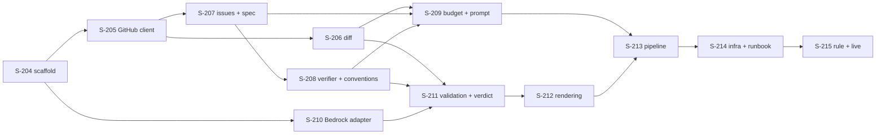

# User Stories — Code Review Agent

## Changelog

| Version | Date       | Summary                                                                                                                                                                                                                                                                                                                         | Author           |
| ------- | ---------- | ------------------------------------------------------------------------------------------------------------------------------------------------------------------------------------------------------------------------------------------------------------------------------------------------------------------------------- | ---------------- |
| 1.0     | 2026-10-22 | Initial stories from spec v1.0 / PRD v1.1. S-204–S-215 across Wave A (base agent) and Wave B (live).                                                                                                                                                                                                                            | product-engineer |
| 1.1     | 2026-10-22 | Published as GitHub issues #406–#417; see `github-publication-prd-code-review-agent.md`.                                                                                                                                                                                                                                        | product-engineer |
| 1.2     | 2026-10-22 | Spec v1.1 write-back (D-36–D-38, verifier DF-02–DF-04): S-208 candidate shape; S-209 priority fill, budget invariant, per-candidate nonce blocks; S-212 verifier rows from wrapper data and five-stage size guarantee; S-213 failure comment after `COMMENT_POST_FAILED`. Story titles aligned with the shortened issue titles. | product-engineer |

Source: `docs/requirements/prd-code-review-agent.md` (v1.1), `workstream/specification-prd-code-review-agent.md` (v1.0), `workstream/decisions-code-review-agent.md` (D-01–D-35).

---

## Legend

- **ID range:** S-204–S-215 (next free after `bug-fix`'s S-180–S-203).
- **Size:** XS (< ½ day), S (½–1 day), M (1–2 days), L (2–3 days). Each story fits one PR.
- **Discipline:** test-first; one PR per story into `integration/code-review-agent`, merged bottom-up with `--no-ff`; one consolidated PR to `main`, human-merged. Per-story DoD includes `make -C agents/code-review/app/codeReview validate` and the root `make validate`.
- **Package path:** `agents/code-review/app/codeReview/` (abbreviated `pkg/` below). Tests under `pkg/tests/unit/` (L1) and `pkg/tests/integration/` (L2).
- **Waves map to spec §15:** A = base agent (S-204–S-213), B = live (S-214–S-215).
- **Shared fixtures:** `pkg/tests/fixtures/` holds recorded GitHub responses and a fake Bedrock client, introduced in S-205 and S-210 and reused by later stories.

---

## Wave A — Base agent

### Story S-204: Agent scaffold, params, and agents seed

**Priority:** Critical
**Estimated Size:** M
**Dependencies:** none

#### User Story

As the operator,
I want a registered `code-review` agent whose params are validated the same way by the panel and the runtime,
So that later stories plug into a package that already starts, reports, and rejects bad input.

#### Context

Every other story builds on this package. It mirrors `security-analyst` (D-20, D-21) and registers the agent so the panel invoke form and webhook rule validation work from day one.

#### Acceptance Criteria

- [ ] `pkg/` exists with copies of `agent_reporter.py`, `credentials.py`, `heartbeat.py`, `signal_backstop.py`, `scrubber.py`, and `config.py` from `security-analyst`, plus `main.py` with an `invoke` entrypoint (D-20).
- [ ] `pyproject.toml` pins `bedrock-agentcore`, `boto3`, `requests`, `PyJWT`, `cryptography` at the sibling versions; no `strands-agents` (D-07, D-20).
- [ ] `main.unwrap_payload` and `validate_payload` accept `run_id`, `repository_org`, `repository_name`, `params`; `apply_defaults` applies spec §5.1 defaults; a missing or invalid `pr_number`, an out-of-range limit, or an unknown `reasoning_effort` ends `failed`/`INVALID_PARAMS` before any GitHub call (spec §6.1, PRD FR-1).
- [ ] `config.assert_clock_invariant()` runs at startup with `run_timeout_seconds` ≤ 900 ≤ 1800 (D-32).
- [ ] `supabase/seed.sql` and a data migration insert the `code-review` row with the spec §5.1 `params_schema` and `default_params`, using `on conflict (slug) do update` (spec §5.1).
- [ ] The CI matrix in `.github/workflows/ci.yml` and the root `Makefile` include the new package; `make validate` runs it.
- [ ] `invoke` with valid params starts the run, opens a `load_pr` step, and ends `failed`/`INTERNAL_ERROR` with "not implemented" (placeholder replaced in S-213).

#### Business Rules

- The schema in the seed and the runtime validation agree; the runtime re-validates as defense in depth.
- `run_timeout_seconds` never exceeds 900.

#### Technical Notes

- Copy, don't import, sibling modules (D-20). Keep `SUPABASE_URL`, `SUPABASE_KEY_SECRET_ID`, `MODEL_ID`, `PANEL_BASE_URL`, `PRICE_INPUT_PER_MTOK`, `PRICE_OUTPUT_PER_MTOK` in `config.py`.
- The CI change is a matrix line, not a new procedure; FR-49a's runbook requirement is met by S-214's runbook. Record that judgment in the PR body.
- Python 3.13 locally, 3.14 runtime, as the siblings (`docs/technical-guidelines.md`).

#### Testing Requirements

- **Unit Tests:** `test_payload.py` (unwrap single and double `prompt` wrapper; every invalid param; defaults), `test_config.py` (clock invariant pass and fail).
- **Integration Tests:** `test_invoke_skeleton.py` with a reporter sink: invalid params → `INVALID_PARAMS`, no GitHub call.
- **Manual/UI Testing:** `supabase db reset` locally; the panel invoke form for `code-review` renders the six params with defaults.
- **Edge-Case Matrix:** `pr_number` 0, negative, string; `max_context_tokens` below/above bounds; extra unknown param; `params` absent.
- **Acceptance-Criteria Mapping:** AC-3 → `test_payload.py::test_invalid_*`; AC-4 → `test_config.py`; AC-5 → manual `db reset` + form check.
- **Execution Commands:** `make -C agents/code-review/app/codeReview validate`; `make validate`.

#### Migration Requirements (When Data Model Changes)

- Migration artifact: `supabase/migrations/<ts>_seed_code_review_agent.sql` (data only, the `agents` row).
- Rollback/impact notes: `delete from agents where slug = 'code-review'` when no `runs` reference it; otherwise `update agents set is_enabled = false`.
- Apply step: local `supabase db reset`; prod apply only with explicit user confirmation (Wave B).
- Verification after apply: `select slug, params_schema from agents where slug = 'code-review'` returns the spec §5.1 schema.

#### Implementation Steps

1. Write payload and config tests.
2. Copy sibling modules; create `config.py`, `main.py`, `pyproject.toml`, `Makefile`, `Dockerfile` (no scanner toolchains).
3. Implement `unwrap_payload`, `validate_payload`, `apply_defaults`, skeleton `invoke`.
4. Add the seed row and migration; wire CI matrix and root `Makefile`.

#### Files to Create/Modify

- `agents/code-review/app/codeReview/{main.py,config.py,pyproject.toml,Makefile,Dockerfile,.dockerignore}` — package
- `agents/code-review/app/codeReview/{agent_reporter,credentials,heartbeat,signal_backstop,scrubber}.py` — sibling copies
- `agents/code-review/app/codeReview/tests/unit/{test_payload,test_config}.py`, `tests/integration/test_invoke_skeleton.py`
- `supabase/seed.sql`, `supabase/migrations/<ts>_seed_code_review_agent.sql`
- `.github/workflows/ci.yml`, `Makefile`

#### Definition of Done Checklist

- [ ] Code implemented per technical guidelines
- [ ] Unit/integration/manual/edge-case tests written and passing
- [ ] Quality gates passing (`lint`, `format-check`, `typecheck`, `test`, `audit`)
- [ ] Code reviewed and approved
- [ ] Acceptance criteria verified
- [ ] Acceptance criteria explicitly mapped to test evidence
- [ ] Migration lifecycle complete (local; prod in Wave B)
- [ ] Pull Request created and merged

---

### Story S-205: GitHub client with a write allowlist

**Priority:** Critical
**Estimated Size:** M
**Dependencies:** S-204

#### User Story

As the operator,
I want every GitHub call to go through one client that can only read and post one comment on the invoked PR,
So that no bug or prompt injection can make the agent approve, merge, push, or comment elsewhere.

#### Context

The agent's only write is one comment (PRD FR-27, AC-10). Enforcing that in the client makes it testable in one place (spec §6.2, §12).

#### Acceptance Criteria

- [ ] `github_client.GitHubClient(token, org, repo, pr_number)` exposes `get_pull`, `list_pull_files` (paged, ≤ 30 pages), `compare`, `get_content_raw(path, ref)` (404 → `None`), `list_dir(path, ref)`, `get_issue`, `post_pr_comment(body)` (spec §6.2).
- [ ] Every request is checked against an allowlist of method + path templates before it is sent; anything else raises `ForbiddenCall`; `post_pr_comment` refuses any issue number other than `pr_number` (AC-10).
- [ ] GETs retry twice on 5xx, connection errors, and secondary rate limits (honoring `retry-after`, max 30 s); the POST never retries (spec §9).
- [ ] 401/403 → `GitHubPermissionDenied`; other failures after retries → `GitHubApiError`; both carry no token text (spec §13).
- [ ] Path segments are URL-encoded; paths are never used on the local filesystem (spec §12).

#### Business Rules

- The agent never approves, requests changes, merges, pushes, labels, or comments anywhere but the invoked PR (PRD FR-27).

#### Technical Notes

- `requests.Session` with `Accept: application/vnd.github+json` and `X-GitHub-Api-Version`; raw media type for contents.
- Recorded fixtures (`tests/fixtures/github/`) are introduced here and reused by S-206–S-213.

#### Testing Requirements

- **Unit Tests:** `test_github_client.py`: each allowed call; every disallowed verb (`PUT`, `PATCH`, `DELETE`, `POST` to `/pulls/*/reviews`, `/merge`, `/labels`, another issue's comments) raises before transport; retry counts; `retry-after` honored; 404 contents → `None`; error mapping; token absent from exception text.
- **Integration Tests:** none (no network in CI).
- **Manual/UI Testing:** none.
- **Edge-Case Matrix:** paging stops at 30 pages; file path with spaces, `#`, `..`; 403 with secondary rate-limit header vs. permission 403.
- **Acceptance-Criteria Mapping:** AC-2 → `test_forbidden_*`; AC-3 → `test_retry_*`; AC-4 → `test_error_mapping_*`.
- **Execution Commands:** `make -C agents/code-review/app/codeReview test`.

#### Implementation Steps

1. Write allowlist and retry tests against a stub transport.
2. Implement the client and errors.
3. Record fixtures for a sample PR.

#### Files to Create/Modify

- `pkg/github_client.py` — client, allowlist, errors
- `pkg/tests/unit/test_github_client.py`, `pkg/tests/fixtures/github/*`

#### Definition of Done Checklist

- [ ] Code implemented per technical guidelines
- [ ] Unit/integration/manual/edge-case tests written and passing
- [ ] Quality gates passing (`lint`, `format-check`, `typecheck`, `test`, `audit`)
- [ ] Code reviewed and approved
- [ ] Acceptance criteria verified
- [ ] Acceptance criteria explicitly mapped to test evidence
- [ ] Migration lifecycle complete (N/A — no data model change)
- [ ] Pull Request created and merged

---

### Story S-206: Expanded diff and size check

**Priority:** Critical
**Estimated Size:** M
**Dependencies:** S-205

#### User Story

As a PR author,
I want the reviewer to see each change with 50 lines around it and the whole touched file when it fits,
So that its findings are based on how the change fits the surrounding code, not a 3-line patch.

#### Context

GitHub patches carry 3 lines of context, so the diff is built locally from the merge-base and head blobs (D-26). Classification also enforces the review budget and keeps excluded files out of the prompt (PRD FR-5, FR-6, FR-10).

#### Acceptance Criteria

- [ ] `classify(files)` marks lockfiles, generated paths, binaries, and `workstream/{tasks,planner-state,decisions,research}-*.md` as listed by name only; everything else is reviewed (spec §8.2).
- [ ] Changed lines = Σ additions + deletions over reviewed files; over `max_diff_lines` returns `OverBudget(lines, files)` without fetching any content (PRD FR-6, AC-5).
- [ ] `expanded_diff` fetches merge-base (via `compare`) and head blobs and emits `difflib.unified_diff(n=50)` per reviewed file, handling `added`, `removed`, `renamed` (via `previous_filename`), and `modified` (D-26).
- [ ] Head contents of reviewed, non-removed files are returned for the full-file block; content is decoded UTF-8 with `errors="replace"`.
- [ ] Changed head line ranges (from a 0-context diff) are returned per file for S-211's location check.

#### Business Rules

- No partial review: over budget means no model call (D-11).
- Excluded workstream files never contribute content (FR-10).

#### Technical Notes

- Contents fetched with a thread pool of 8 (spec §11).
- Binary: no `patch` in the files response or a NUL byte in the first 8 KB.

#### Testing Requirements

- **Unit Tests:** `test_classify.py` (each pattern, near-misses like `lockfile.md`), `test_diff.py` (each status, ±50 context, rename, empty file, no trailing newline, CRLF), `test_changed_ranges.py`.
- **Integration Tests:** `test_context_diff.py` against recorded fixtures for a 3-file PR.
- **Manual/UI Testing:** none.
- **Edge-Case Matrix:** exactly `max_diff_lines` (reviewed) vs. +1 (budget); a PR touching only lockfiles (0 reviewed lines → still reviewed, empty diff); invalid UTF-8; 300+ files.
- **Acceptance-Criteria Mapping:** AC-1 → `test_classify.py`; AC-2 → `test_budget_*`; AC-3 → `test_diff.py`; AC-5 → `test_changed_ranges.py`.
- **Execution Commands:** `make -C agents/code-review/app/codeReview test`.

#### Implementation Steps

1. Write classification, budget, and diff tests.
2. Implement `context/diff.py`.
3. Add the integration test on fixtures.

#### Files to Create/Modify

- `pkg/context/diff.py` — classification, budget check, expanded diff, changed ranges
- `pkg/tests/unit/{test_classify,test_diff,test_changed_ranges}.py`, `pkg/tests/integration/test_context_diff.py`

#### Definition of Done Checklist

- [ ] Code implemented per technical guidelines
- [ ] Unit/integration/manual/edge-case tests written and passing
- [ ] Quality gates passing (`lint`, `format-check`, `typecheck`, `test`, `audit`)
- [ ] Code reviewed and approved
- [ ] Acceptance criteria verified
- [ ] Acceptance criteria explicitly mapped to test evidence
- [ ] Migration lifecycle complete (N/A)
- [ ] Pull Request created and merged

---

### Story S-207: Linked issues and spec resolution

**Priority:** High
**Estimated Size:** M
**Dependencies:** S-205

#### User Story

As the operator,
I want the reviewer to read the issue and spec a PR implements, without the developer's task list,
So that it judges whether the code does what was intended, from an independent position.

#### Context

Intent comes from issues and the spec (D-04); the developer's plan is excluded (FR-10, D-23). Story PRs into `integration/*` have no GitHub closing link, so links come from the PR body and branch (D-22).

#### Acceptance Criteria

- [ ] Issues are found by the spec §8.3 step 2 regex in the PR body (same repo only) and `^issue/(\d+)-` on the head ref; deduped; first 5 kept; PRs among them skipped (D-22).
- [ ] Each issue body is cut at the first `## Task Checklist` heading (any level 1–6), inclusive to the end (D-23).
- [ ] Each issue is capped at 8,000 estimated tokens with a truncation marker.
- [ ] Spec resolution per issue: explicit `workstream/specification-*.md` path → `[PRD-<name>]` title → `prd:<name>` label, mapped to `workstream/specification-prd-<name>.md` at `head_sha`; 404 falls through; none → `spec = None` (D-24, AC-6).
- [ ] Over 30% of `max_context_tokens`, the spec is trimmed to the heading outline + sections cited as `Spec §<n>` + sections naming a linked story ID or reviewed path, then truncated (D-24).
- [ ] A 403 on `GET issue` skips that issue and records `issues_unavailable=True` (spec §13).

#### Business Rules

- Issues and spec are references of intent, not truth (PRD FR-7).

#### Technical Notes

- Use issue #315 (title, body with "Spec §8.1" and `## Task Checklist`) and `workstream/specification-prd-webhook-triggers.md` as fixtures.
- Regex and mapping constants live in `context/conventions.py` (spec §16 R3).

#### Testing Requirements

- **Unit Tests:** `test_issue_links.py` (`closes #1`, `Fixes: #2`, `resolved #3`, `owner/repo#4` ignored, branch `issue/5-x`, dedupe, cap 5), `test_checklist_strip.py`, `test_spec_resolve.py`, `test_spec_trim.py`.
- **Integration Tests:** `test_context_issues_spec.py` on #315 fixtures: prompt input includes the issue without its checklist and spec §8.1.
- **Manual/UI Testing:** none.
- **Edge-Case Matrix:** no linked issue; issue that is a PR; 6 linked issues; spec 404 then label hit; `Spec §8` vs `§8.1` matching; `## task checklist` lowercase (not stripped — headings are case-sensitive in the dev-tasks template; record in test).
- **Acceptance-Criteria Mapping:** AC-1 → `test_issue_links.py`; AC-2 → `test_checklist_strip.py`; AC-4 → `test_spec_resolve.py`; AC-5 → `test_spec_trim.py`; AC-6 → `test_issue_403_*`.
- **Execution Commands:** `make -C agents/code-review/app/codeReview test`.

#### Implementation Steps

1. Write the tests with #315-shaped fixtures.
2. Implement `context/issues.py` and `context/spec.py`.

#### Files to Create/Modify

- `pkg/context/{issues,spec,conventions}.py`
- `pkg/tests/unit/{test_issue_links,test_checklist_strip,test_spec_resolve,test_spec_trim}.py`, `pkg/tests/integration/test_context_issues_spec.py`

#### Definition of Done Checklist

- [ ] Code implemented per technical guidelines
- [ ] Unit/integration/manual/edge-case tests written and passing
- [ ] Quality gates passing (`lint`, `format-check`, `typecheck`, `test`, `audit`)
- [ ] Code reviewed and approved
- [ ] Acceptance criteria verified
- [ ] Acceptance criteria explicitly mapped to test evidence
- [ ] Migration lifecycle complete (N/A)
- [ ] Pull Request created and merged

---

### Story S-208: Verifier drift candidates and conventions

**Priority:** High
**Estimated Size:** S
**Dependencies:** S-207

#### User Story

As the operator,
I want the reviewer to pick up the verifier's critical, unintended drift without re-auditing fidelity,
So that the two agents complement each other instead of repeating findings.

#### Context

D-25 names the report files; D-33 has the wrapper select candidates deterministically. Conventions (PRD FR-11) are assembled here too, as both read repository files at `head_sha`.

#### Acceptance Criteria

- [ ] For each linked issue, `fidelity-report-S-<id>.md` (story ID from `Story (S-\d+)` in the title) and `fidelity-report-issue-<N>.md` are read at `head_sha`; `*-rollup.md` is ignored (D-25).
- [ ] The drift section is the first heading matching `^#{2,3}\s+(Drift|Drift catalog)\b`; absent → report state `not_parseable` (D-33).
- [ ] Each table row in that section containing both `Critical` and `Unintended` as whole words becomes a candidate `V<k>` holding the report path, the row index, and the row text verbatim (≤ 300 estimated tokens); numbering is global across reports (D-33, D-38).
- [ ] The whole drift section (≤ 4,000 tokens per report) is returned as context alongside the candidate list.
- [ ] Conventions: head `AGENTS.md`, else `CLAUDE.md`, plus title and `Status` line of each `docs/adr/*.md` (≤ 50), capped at 10% of `max_context_tokens` (PRD FR-11).
- [ ] No report → state `none` (PRD FR-17).

#### Business Rules

- The reviewer never audits AC coverage (PRD FR-14).

#### Technical Notes

- Fixtures: real `workstream/fidelity-report-S-170.md` (no candidates: `Type | Impact` columns), a synthetic report with one `Critical`+`Unintended` and one `Major`+`Unintended` row (AC-7), and one with no drift heading.

#### Testing Requirements

- **Unit Tests:** `test_verifier_candidates.py` (the three fixtures; `Critical` in one cell and `Unintended` in another of the same row; `Non-critical`; multiple reports), `test_conventions.py`.
- **Integration Tests:** included in S-213's end-to-end AC-7 test.
- **Manual/UI Testing:** none.
- **Edge-Case Matrix:** report present but empty; drift section with no table; two linked issues sharing a story ID; 60 ADRs.
- **Acceptance-Criteria Mapping:** AC-1 → `test_report_lookup_*`; AC-2/AC-3 → `test_verifier_candidates.py`; AC-5 → `test_conventions.py`; AC-6 → `test_no_report`.
- **Execution Commands:** `make -C agents/code-review/app/codeReview test`.

#### Implementation Steps

1. Write tests with the three report fixtures.
2. Implement `context/verifier.py` and `context/repo_conventions.py`.

#### Files to Create/Modify

- `pkg/context/{verifier,repo_conventions}.py`
- `pkg/tests/unit/{test_verifier_candidates,test_conventions}.py`, `pkg/tests/fixtures/reports/*`

#### Definition of Done Checklist

- [ ] Code implemented per technical guidelines
- [ ] Unit/integration/manual/edge-case tests written and passing
- [ ] Quality gates passing (`lint`, `format-check`, `typecheck`, `test`, `audit`)
- [ ] Code reviewed and approved
- [ ] Acceptance criteria verified
- [ ] Acceptance criteria explicitly mapped to test evidence
- [ ] Migration lifecycle complete (N/A)
- [ ] Pull Request created and merged

---

### Story S-209: Budget fit, rubric v1, and prompt builder

**Priority:** Critical
**Estimated Size:** M
**Dependencies:** S-206, S-207, S-208

#### User Story

As a PR author,
I want the reviewer to get a bounded prompt with a clear rubric and untrusted content fenced off,
So that reviews stay within scope and cannot be steered by text inside the PR.

#### Context

The rubric and system prompt encode the scope (PRD FR-14, FR-15, FR-20, FR-21), the blocking contract, and D-33's instruction. Nonce markers implement FR-13. The budget fit implements D-27 and spec §8.4.

#### Acceptance Criteria

- [ ] `estimate(text) = ceil(len(text) / 3.5)` (D-27).
- [ ] Spec §8.4 priority fill: instructions and diff are mandatory (`OverBudget` when they exceed `max_context_tokens`, PRD FR-6); optional blocks a–g each get `min(cap, remaining)`, are truncated at a line boundary or omitted, and are named in the context data; full files are added smallest first (D-37).
- [ ] Invariant: `estimate(prompt) ≤ max_context_tokens` for every input, asserted before the Converse call; a violation raises `INTERNAL_ERROR`. Candidates dropped for budget are reported to S-211 as not shown to the model (D-37).
- [ ] `rubric.md` v1 defines categories `correctness`, `edge_case`, `maintainability`, `intent`; the consequence rule; the out-of-scope list; the verifier boundary (PRD FR-14, FR-15, FR-20, FR-21).
- [ ] The system prompt includes the rubric, the blocking contract, the PR-description-is-a-claim rule (PRD FR-12), the D-33 confirmation instruction, ranking, and the untrusted-data rule.
- [ ] Each untrusted block is wrapped in `<<<UNTRUSTED <kind> <nonce>>>` … `<<<END <nonce>>>` with a per-run 16-hex nonce; content containing `<<<END` cannot close a block (PRD FR-13).
- [ ] Each candidate's row text is in its own `<<<UNTRUSTED verifier-candidate V<k> <nonce>>>` block; outside the markers only IDs, report paths, and row indexes appear, never row text (D-38).
- [ ] A prompt sink captures the final prompt for tests.

#### Business Rules

- The PR description is the author's claim (PRD FR-12).
- Fidelity is the verifier's job (PRD FR-14).

#### Technical Notes

- `rubric.md` and `prompt.py` share `RUBRIC_VERSION = "1"`.
- Nonce from `secrets.token_hex(8)`; tests inject a fixed nonce.

#### Testing Requirements

- **Unit Tests:** `test_estimate.py`, `test_budget_fit.py` (priority order, `min(cap, remaining)`, truncation and omission named, smallest-first files, diff-over-budget, invariant over random inputs at `max_context_tokens` 20,000), `test_prompt.py` (all blocks present, nonce wrapping, forged `<<<END` inside content stays inside, candidate IDs outside and row text inside per-candidate blocks, rubric version).
- **Integration Tests:** prompt-capture assertions for AC-4, AC-6, AC-8 run in S-213.
- **Manual/UI Testing:** read one rendered prompt for a fixture PR in the PR description.
- **Edge-Case Matrix:** no issues, no spec, no reports; every block at cap; one huge file and many small ones.
- **Acceptance-Criteria Mapping:** AC-1 → `test_estimate.py`; AC-2/AC-3 → `test_budget_fit.py`; AC-4/AC-5 → `test_prompt.py::test_rubric_*`; AC-6 → `test_prompt.py::test_nonce_*`; AC-7 → `test_prompt.py::test_candidate_blocks_*`; AC-8 → `test_prompt.py::test_sink`.
- **Execution Commands:** `make -C agents/code-review/app/codeReview test`.

#### Implementation Steps

1. Write the budget and prompt tests.
2. Write `rubric.md`; implement `budget.py` and `prompt.py`.

#### Files to Create/Modify

- `pkg/{budget,prompt}.py`, `pkg/rubric.md`
- `pkg/tests/unit/{test_estimate,test_budget_fit,test_prompt}.py`

#### Definition of Done Checklist

- [ ] Code implemented per technical guidelines
- [ ] Unit/integration/manual/edge-case tests written and passing
- [ ] Quality gates passing (`lint`, `format-check`, `typecheck`, `test`, `audit`)
- [ ] Code reviewed and approved
- [ ] Acceptance criteria verified
- [ ] Acceptance criteria explicitly mapped to test evidence
- [ ] Migration lifecycle complete (N/A)
- [ ] Pull Request created and merged

---

### Story S-210: Bedrock adapter, forced schema, fallbacks

**Priority:** Critical
**Estimated Size:** M
**Dependencies:** S-204

#### User Story

As the operator,
I want one model call that returns schema-valid findings, and falls back cleanly when the model rejects an option,
So that reviews work on Sol today and on the fallback model with only a config change.

#### Context

Implements D-34, D-35, PRD FR-18, FR-19, and the context-length retry (spec §16 R4). The output schema (spec §6.3) is the contract for S-211.

#### Acceptance Criteria

- [ ] First call forces `submit_review` via `toolConfig` + `toolChoice`; the result is the `toolUse.input` (D-34).
- [ ] A `ValidationException` naming `toolChoice`/`toolConfig` retries without them, with the schema in the system prompt and "one JSON object only" (D-34).
- [ ] A `ValidationException` naming the reasoning field retries once without it and reports `reasoning_effort_applied=false`; the field is omitted for non-OpenAI model IDs (D-35, spec §9).
- [ ] A context-length `ValidationException` retries once without the full-file block (spec §16 R4).
- [ ] Output failing JSON parse or schema gets one repair call with the validator error; a second failure raises `ModelOutputInvalid` (PRD FR-18).
- [ ] At most 5 Converse calls per run; usage (input/output tokens), `bedrock_ms`, `output_mode`, `repair_calls`, and cost (when price env vars are set) are returned (PRD FR-31).
- [ ] `AccessDeniedException` → `BedrockAccessDenied`; throttling/5xx after botocore's 3 attempts → `BedrockError`.

#### Business Rules

- No tools execute; the forced tool is an output contract only (D-07).

#### Technical Notes

- `jsonschema` is not a sibling dependency; validate with a small hand-written validator for the spec §6.3 schema, or add `jsonschema` pinned (decide in the PR; prefer no new dependency).
- The reasoning field name is one constant, confirmed in S-215.
- A fake `converse` lives in `tests/fixtures/bedrock.py` for S-213.

#### Testing Requirements

- **Unit Tests:** `test_bedrock_adapter.py`: happy path forced; toolChoice rejected → fallback → valid; fallback invalid → repair → valid; repair invalid → `ModelOutputInvalid`; reasoning rejected → retry; context-length → retry without files; call count never > 5; access denied; throttling; cost null without prices.
- **Integration Tests:** via S-213.
- **Manual/UI Testing:** S-215 live.
- **Edge-Case Matrix:** empty `findings`; 41 findings (schema maxItems); unknown category; `line_end < line_start` (passes schema, handled in S-211); response with text and no toolUse block.
- **Acceptance-Criteria Mapping:** AC-1 → `test_forced_*`; AC-2 → `test_fallback_*`; AC-3 → `test_reasoning_*`; AC-4 → `test_context_length_*`; AC-5 → `test_repair_*`; AC-6 → `test_call_budget`, `test_usage_*`; AC-7 → `test_errors_*`.
- **Execution Commands:** `make -C agents/code-review/app/codeReview test`.

#### Implementation Steps

1. Build the fake `converse` and write the tests.
2. Implement `bedrock_adapter.py` and `findings_schema.py`.

#### Files to Create/Modify

- `pkg/{bedrock_adapter,findings_schema}.py`
- `pkg/tests/unit/test_bedrock_adapter.py`, `pkg/tests/fixtures/bedrock.py`

#### Definition of Done Checklist

- [ ] Code implemented per technical guidelines
- [ ] Unit/integration/manual/edge-case tests written and passing
- [ ] Quality gates passing (`lint`, `format-check`, `typecheck`, `test`, `audit`)
- [ ] Code reviewed and approved
- [ ] Acceptance criteria verified
- [ ] Acceptance criteria explicitly mapped to test evidence
- [ ] Migration lifecycle complete (N/A)
- [ ] Pull Request created and merged

---

### Story S-211: Findings validation and verdict

**Priority:** Critical
**Estimated Size:** S
**Dependencies:** S-206, S-208, S-210

#### User Story

As a PR author,
I want a blocking finding to exist only when it points at changed code and says how it fails,
So that I spend time only on findings I can reproduce or rebut.

#### Context

The wrapper enforces the contract instead of trusting the model (D-08, PRD FR-23) and computes the verdict, including D-33's confirmation rule (spec §8.6, §8.7).

#### Acceptance Criteria

- [ ] A finding on a non-reviewed file is dropped.
- [ ] A `blocking` finding not intersecting a changed head range ±3 lines → `suggestion`, `downgraded: "outside_diff"`.
- [ ] A `blocking` finding with blank `failure_scenario` → `suggestion`, `downgraded: "no_scenario"`.
- [ ] Blank `consequence` → dropped, `reason: "no_consequence"`.
- [ ] Suggestions sorted by `rank`, capped at `max_suggestions`; blocking never capped; IDs `B1…`, `S1…` (PRD FR-23).
- [ ] Verdict `blocking` when ≥ 1 blocking finding or ≥ 1 counted candidate; a candidate counts when `confirmed` or omitted by the model ("not checked by the model"); else `clear` (D-15, D-33, spec §8.7).
- [ ] Counts of downgrades, drops, and cap hits are returned for metrics (PRD FR-31).

#### Business Rules

- No scenario, no block (PRD §8).
- The model can filter stale drift out, never ignore it (spec §8.7).

#### Technical Notes

- Normalize `file` (strip `./`, backticks, leading `/`) before matching.
- `line_end < line_start` → swap.

#### Testing Requirements

- **Unit Tests:** `test_validate.py` (each path above; ±3 boundary; swap), `test_verdict.py` (confirmed, not_reproduced, omitted, mixed, none).
- **Integration Tests:** S-213 AC-7 and AC-9 end to end.
- **Manual/UI Testing:** none.
- **Edge-Case Matrix:** zero findings; all downgraded; `max_suggestions = 0`; unknown candidate ID from the model (ignored).
- **Acceptance-Criteria Mapping:** AC-1–AC-5 → `test_validate.py`; AC-6 → `test_verdict.py`; AC-7 → `test_counts`.
- **Execution Commands:** `make -C agents/code-review/app/codeReview test`.

#### Implementation Steps

1. Write the tests.
2. Implement `validate.py`.

#### Files to Create/Modify

- `pkg/validate.py`
- `pkg/tests/unit/{test_validate,test_verdict}.py`

#### Definition of Done Checklist

- [ ] Code implemented per technical guidelines
- [ ] Unit/integration/manual/edge-case tests written and passing
- [ ] Quality gates passing (`lint`, `format-check`, `typecheck`, `test`, `audit`)
- [ ] Code reviewed and approved
- [ ] Acceptance criteria verified
- [ ] Acceptance criteria explicitly mapped to test evidence
- [ ] Migration lifecycle complete (N/A)
- [ ] Pull Request created and merged

---

### Story S-212: Review, budget, and failure comments

**Priority:** High
**Estimated Size:** S
**Dependencies:** S-211

#### User Story

As a PR author,
I want one readable comment with the verdict first, blocking findings next, and suggestions folded away,
So that I see what I must fix in seconds.

#### Context

Implements the layout in PRD FR-24 and spec §8.8, the size limit (D-28), the run link (D-29), and the budget and failure messages (PRD FR-6, FR-26).

#### Acceptance Criteria

- [ ] `render_review` produces the spec §8.8 layout: hidden marker, verdict header with short SHA, Blocking, Verifier, collapsed Suggestions, Context line, footer with out-of-scope list, model, rubric version, run link (PRD FR-24, FR-21).
- [ ] Verifier section: counted candidates with status and reason, `not_reproduced` listed with reason, a count of other drift; "no verifier report" or "report not parseable" when applicable. Row text comes from the wrapper's parsed candidates, never from model output, and is neutralized like all other text (PRD FR-16, FR-17, D-38).
- [ ] Context line names issues, spec (or "no spec found", "(trimmed)"), dropped full files, files listed by name only, "issues unavailable (permission)" when set.
- [ ] Mentions neutralized (`@` + zero-width space), HTML escaped, backticks stripped from paths (spec §8.8).
- [ ] Output ≤ 60,000 chars for every input, measured after escaping: stages (1) drop suggestions from the end, (2) scenarios to 500 and consequences to 200 chars, (3) verifier rows and reasons to 300 chars, (4) blocking findings beyond what fits as one-line entries, (5) hard cut at a line boundary; any stage adds the truncation note; the verdict header is never cut (D-28, D-36).
- [ ] `render_budget` and `render_failure(error_code)` produce the spec §8.8 messages with the run link `PANEL_BASE_URL/runs/<run_id>` (D-29).

#### Business Rules

- The comment cannot ping users or inject HTML.

#### Technical Notes

- Snapshot tests for the three renderers; snapshots reviewed in the PR.

#### Testing Requirements

- **Unit Tests:** `test_render.py`: clear and blocking layouts; empty sections omitted; verifier states; mention and HTML neutralization; each of the five size stages; worst case at schema maxima with escape-heavy text (all `<`) stays ≤ 60,000 chars; verifier rows taken from wrapper data even when the model's `reason` quotes other text; budget and failure messages.
- **Integration Tests:** S-213.
- **Manual/UI Testing:** paste a rendered snapshot into a GitHub comment preview on a scratch PR and check the layout.
- **Edge-Case Matrix:** 0 findings; 40 findings with 1,500-char scenarios; a title containing `
`; `@everyone` in a scenario.
- **Acceptance-Criteria Mapping:** AC-1 → `test_layout_*`; AC-2 → `test_verifier_*`; AC-3 → `test_context_line_*`; AC-4 → `test_neutralize_*`; AC-5 → `test_truncate_*`; AC-6 → `test_budget_msg`, `test_failure_msg`.
- **Execution Commands:** `make -C agents/code-review/app/codeReview test`.

#### Implementation Steps

1. Write snapshot and truncation tests.
2. Implement `render.py`.

#### Files to Create/Modify

- `pkg/render.py`
- `pkg/tests/unit/test_render.py`, `pkg/tests/unit/__snapshots__/*`

#### Definition of Done Checklist

- [ ] Code implemented per technical guidelines
- [ ] Unit/integration/manual/edge-case tests written and passing
- [ ] Quality gates passing (`lint`, `format-check`, `typecheck`, `test`, `audit`)
- [ ] Code reviewed and approved
- [ ] Acceptance criteria verified
- [ ] Acceptance criteria explicitly mapped to test evidence
- [ ] Migration lifecycle complete (N/A)
- [ ] Pull Request created and merged

---

### Story S-213: Pipeline wiring, outcomes, and failure path

**Priority:** Critical
**Estimated Size:** L
**Dependencies:** S-205, S-206, S-207, S-208, S-209, S-210, S-211, S-212

#### User Story

As the operator,
I want `/review` to run the whole pipeline and always leave either a review, a budget note, or a failure note on the PR,
So that a review request never goes silent and every run is recorded in the panel.

#### Context

Replaces S-204's placeholder with the spec §8.1 pipeline, outcomes (PRD FR-29), artifact (FR-30), metrics (FR-31), steps (FR-28), the deadline and heartbeat (D-32), and the `finally` failure comment (D-13). Carries the end-to-end Layer 2 tests.

#### Acceptance Criteria

- [ ] Steps `load_pr`, `context`, `review`, `validate`, `post` are reported with run_events per spec §13 (PRD FR-28).
- [ ] Closed, merged, or non-PR → `succeeded`/`not_applicable`, no comment; draft PRs are reviewed; CI status is never read (PRD FR-3, FR-4).
- [ ] The head SHA is captured at `load_pr` and used for every later read (PRD FR-3).
- [ ] Over budget → budget comment, `succeeded`/`not_applicable`, no Converse call (AC-5).
- [ ] Verdict `clear` → `no_findings`; `blocking` → `needs_review` (PRD FR-29).
- [ ] One `audit_report` artifact with spec §5.2 metadata, scrubbed; `runs.metrics` per spec §5.3 (PRD FR-30, FR-31).
- [ ] Each error in spec §13 ends `failed` with its code; the `finally` path posts the failure comment where the table says so, including one short failure comment after `COMMENT_POST_FAILED` unless the POST failed with 401/403; a failed failure-comment is logged and does not change the outcome (PRD FR-26, AC-11, D-36).
- [ ] A run-level deadline `start + run_timeout_seconds − 60 s` bounds each step; reaching it → `RUN_TIMEOUT`; heartbeat wraps the fetch and Converse steps (D-32).
- [ ] Each `/review` posts a new comment; earlier comments are never edited (PRD FR-25).
- [ ] Prompt capture shows: ±50 context and full files (AC-4); #315 issue without checklist and its spec (AC-6); no excluded-file content (AC-8); injection text inside nonce markers (AC-13 static).

#### Business Rules

- One comment per `/review`, for the head SHA at run start.
- The token and Supabase key are registered with the scrubber before any log line.

#### Technical Notes

- Dependency-inject the GitHub client, Bedrock client, clock, and prompt sink into a `Pipeline` class; `invoke` builds the real ones.
- Reuse sibling `heartbeat.run_with_heartbeat` and `signal_backstop`.

#### Testing Requirements

- **Unit Tests:** `test_outcomes.py` (verdict → outcome mapping; error → code → comment-or-not table), `test_deadline.py`.
- **Integration Tests:** `test_pipeline_e2e.py` on recorded fixtures + fake Bedrock: clear review; blocking review; AC-7 verifier (Critical+Unintended confirmed → blocking; Major not listed); AC-9 downgrade/drop; budget; closed PR; draft PR reviewed; issue 403 note; Bedrock error → failure comment; `COMMENT_POST_FAILED` → one short failure comment, and none after a 401/403; artifact and metrics shape; prompt-capture assertions.
- **Manual/UI Testing:** run the agent locally (`agentcore dev` or `python main.py` with a fixture payload) against a scratch PR in a test repo, using a personal token, before Wave B.
- **Edge-Case Matrix:** deadline hit during Converse; SIGTERM during `post`; PR closed between invoke and `load_pr`; PR with only lockfile changes; force-push after `load_pr` (review stays on captured SHA).
- **Acceptance-Criteria Mapping:** AC-1 → `test_steps`; AC-2 → `test_closed_pr`, `test_draft_pr`, `test_no_ci_read`; AC-3 → `test_sha_pinned`; AC-4 → `test_budget_path`; AC-5 → `test_outcomes.py`; AC-6 → `test_artifact_metrics`; AC-7 → `test_errors_*`; AC-8 → `test_deadline.py`; AC-9 → `test_new_comment_each_run`; AC-10 → `test_prompt_capture_*`.
- **Execution Commands:** `make -C agents/code-review/app/codeReview validate`; `make validate`.

#### Implementation Steps

1. Write the end-to-end tests on fixtures.
2. Implement `pipeline.py`; replace the placeholder in `main.invoke`.
3. Run locally against a scratch PR.

#### Files to Create/Modify

- `pkg/{pipeline,main}.py`
- `pkg/tests/unit/{test_outcomes,test_deadline}.py`, `pkg/tests/integration/test_pipeline_e2e.py`

#### Definition of Done Checklist

- [ ] Code implemented per technical guidelines
- [ ] Unit/integration/manual/edge-case tests written and passing
- [ ] Quality gates passing (`lint`, `format-check`, `typecheck`, `test`, `audit`)
- [ ] Code reviewed and approved
- [ ] Acceptance criteria verified
- [ ] Acceptance criteria explicitly mapped to test evidence
- [ ] Migration lifecycle complete (N/A)
- [ ] Pull Request created and merged

---

## Wave B — Live

### Story S-214: Runtime infrastructure, IAM, and runbook

**Priority:** Critical
**Estimated Size:** M
**Dependencies:** S-213 (deploys the finished image); the CDK project can start after S-204

#### User Story

As the operator,
I want the agent deployed on AgentCore with exactly the permissions it needs,
So that it can be invoked from the panel and webhook without broad access.

#### Context

An `infra-engineer` pass (spec §15, PRD §12). The runbook ships in this PR (FR-49a).

#### Acceptance Criteria

- [ ] `agents/code-review/agentcore/` (agentcore.json + CDK) defines runtime `code_review`: Container, ARM64, `PUBLIC` network, `idleRuntimeSessionTimeout` 900, `maxLifetime` 1800, env vars per spec §9.
- [ ] The runtime role allows `bedrock:InvokeModel` only on the Sol model and its inference profile (and DeepSeek V4 Pro, commented out until needed), and Secrets Manager read on the App PEM and Supabase key; no other actions (spec §7.2).
- [ ] Bedrock model access for Sol is enabled in `us-east-1` (or the inference profile's Regions); `MODEL_ID` set to the confirmed ID.
- [ ] The panel `invoke-runtime` policy lists the new runtime ARN and `runtime-endpoint/DEFAULT` (issue #280 pattern).
- [ ] The GitHub App has Issues read on the installation (confirmed, or the `bug-fix` Wave A change applied).
- [ ] The seed migration is applied to prod with explicit confirmation; `agents.runtime_arn` set.
- [ ] `docs/runbooks/code-review-deployment.md` covers deploy, model access, IAM, rotation, rollback (disable rule → disable agent → redeploy previous image), and a verification log table; `docs/runbooks/README.md` indexes it.
- [ ] A panel manual invoke with a scratch PR number produces a comment.

#### Business Rules

- Least privilege: no wildcard Bedrock model ARN.
- Prod migration apply requires explicit user confirmation.

#### Technical Notes

- Follow `infra-engineer`: one approved, recorded step at a time; change record under `infra/changes/<date>-code-review-runtime/`.
- Mirror `agents/security-analyst/agentcore/` structure.

#### Testing Requirements

- **Unit Tests:** CDK snapshot/assertion test: role policy has exactly the expected actions and ARNs.
- **Integration Tests:** none.
- **Manual/UI Testing:** panel invoke on a scratch PR; run detail shows steps and the artifact.
- **Edge-Case Matrix:** model access not enabled → `BEDROCK_ACCESS_DENIED` with failure comment (verify once, then enable); Issues read missing → review with the permission note.
- **Acceptance-Criteria Mapping:** AC-1/AC-2 → CDK test; AC-3–AC-6 → change record; AC-7 → runbook review; AC-8 → run ID in the verification log.
- **Execution Commands:** `pnpm --dir agents/code-review/agentcore/cdk test`; `agentcore deploy`; `make validate`.

#### Migration Requirements (When Data Model Changes)

- Migration artifact: from S-204.
- Rollback/impact notes: as S-204.
- Apply step: prod apply with explicit user confirmation.
- Verification after apply: the `agents` row exists with `runtime_arn` set.

#### Implementation Steps

1. Write the CDK assertion test.
2. Create the AgentCore project and CDK stack; plan and apply through `infra-engineer`.
3. Enable model access; update the panel invoke policy; confirm the App grant.
4. Apply the seed migration; set `runtime_arn`.
5. Write the runbook; invoke once from the panel.

#### Files to Create/Modify

- `agents/code-review/agentcore/{agentcore.json,cdk/**}`
- `docs/runbooks/code-review-deployment.md`, `docs/runbooks/README.md`
- `infra/` invoke policy document, `infra/changes/<date>-code-review-runtime/`

#### Definition of Done Checklist

- [ ] Code implemented per technical guidelines
- [ ] Unit/integration/manual/edge-case tests written and passing
- [ ] Quality gates passing (`lint`, `format-check`, `typecheck`, `test`, `audit`)
- [ ] Code reviewed and approved
- [ ] Acceptance criteria verified
- [ ] Acceptance criteria explicitly mapped to test evidence
- [ ] Migration lifecycle complete
- [ ] Pull Request created and merged

---

### Story S-215: `/review` rule and live verification

**Priority:** Critical
**Estimated Size:** M
**Dependencies:** S-214

#### User Story

As the operator,
I want to comment `/review` on a PR and get a review back, verified on real PRs,
So that I can start using the agent knowing it works and where its limits are.

#### Context

Configures the trigger (spec §7.1), runs the live acceptance criteria (PRD AC-1–AC-3, AC-12, AC-13), and resolves spec §17's three open questions.

#### Acceptance Criteria

- [ ] The rule in spec §7.1 exists on the GitHub endpoint, above any broader `issue_comment` rule, enabled.
- [ ] Live: `/review` from the owner on an open fixture PR → run fired with `pr_number` → one comment (PRD AC-1).
- [ ] Live: `/review` from a non-collaborator account and on a plain issue → `no_match` in the delivery log, no run (PRD AC-2).
- [ ] Live: the agent's own comment does not trigger a run (PRD AC-3).
- [ ] Live: a fixture PR with a seeded bug → a blocking finding naming it; a clean fixture PR → `clear` (PRD AC-12).
- [ ] Live: a fixture PR with injection text plus a seeded bug still yields the bug (PRD AC-13).
- [ ] 5-PR smoke on historical PRs with known bugs: results (bug caught or not, blocking count, cost, latency) recorded in the runbook's verification log with the model ID. If most known bugs are missed, stop and reopen D-17 before announcing (PRD §12).
- [ ] Spec §17 resolved and written back: model ID, whether forced `toolChoice` works, the reasoning field name, per-token prices (spec changelog bump).
- [ ] Close-out: roadmap rows updated, `agents/code-review/README.md` written, root `README.md` agent list updated, PRD Vocabulary terms proposed for glossary append per `activity-refine`.

#### Business Rules

- Only OWNER, MEMBER, and COLLABORATOR can trigger (D-02).
- The agent is not announced for use until the smoke passes.

#### Technical Notes

- Fixture PRs live in a test repository registered in `/repositories`.
- Historical bug PRs: pick fleet PRs later fixed by `fix:` PRs (e.g. from #90, #97, #98 history); review them at their original head SHA by running the agent manually on reopened copies or a mirror branch.

#### Testing Requirements

- **Unit Tests:** none.
- **Integration Tests:** none.
- **Manual/UI Testing:** the live checks above, each with run ID and comment link in the verification log.
- **Edge-Case Matrix:** `/Review` (no trigger, case-sensitive); `/reviewer` (triggers, accepted); two `/review`s in one repo within a minute (second `skipped` overlap).
- **Acceptance-Criteria Mapping:** AC-1–AC-7 → verification log rows; AC-8 → spec changelog entry; AC-9 → close-out commits.
- **Execution Commands:** none beyond `make validate` for the docs changes.

#### Implementation Steps

1. Create the rule; test with the delivery log.
2. Run the live checks and the smoke; record results.
3. Write back spec §17; update roadmap, READMEs.

#### Files to Create/Modify

- `docs/runbooks/code-review-deployment.md` — verification log
- `workstream/specification-prd-code-review-agent.md` — §17 write-back
- `agents/code-review/README.md`, `README.md`, `docs/roadmap.md`

#### Definition of Done Checklist

- [ ] Code implemented per technical guidelines
- [ ] Unit/integration/manual/edge-case tests written and passing
- [ ] Quality gates passing (`lint`, `format-check`, `typecheck`, `test`, `audit`)
- [ ] Code reviewed and approved
- [ ] Acceptance criteria verified
- [ ] Acceptance criteria explicitly mapped to test evidence
- [ ] Migration lifecycle complete (N/A)
- [ ] Pull Request created and merged

---

## Execution Plan

Dependency order for the planner: S-204 → S-205 → {S-206, S-207, S-210} → S-208 → {S-209, S-211} → S-212 → S-213 → S-214 → S-215. S-206, S-207, and S-210 can run in parallel; S-214's CDK work can start after S-204 but deploys after S-213.

Estimated total: 12 stories, roughly 13–18 days of focused work.

---

## Coverage Validation

### Summary

- **Total PRD Requirements:** 58 (31 FR, 13 AC, 5 business rules, 4 data requirements, 5 user stories)
- **Total User Stories:** 12
- **Coverage:** 100%
- **Status:** Complete

### Requirement Mapping

| PRD Requirement                                        | Story ID(s)                | Status     |
| ------------------------------------------------------ | -------------------------- | ---------- |
| FR-1 params                                            | S-204                      | ✅ Covered |
| FR-2 panel and webhook invocation                      | S-204, S-214, S-215        | ✅ Covered |
| FR-3 head SHA, closed/merged/not a PR, drafts reviewed | S-213                      | ✅ Covered |
| FR-4 no CI check                                       | S-213                      | ✅ Covered |
| FR-5 expanded diff                                     | S-206, S-209               | ✅ Covered |
| FR-6 size budget                                       | S-206, S-209, S-212, S-213 | ✅ Covered |
| FR-7 linked issues (+ checklist strip, D-23)           | S-207                      | ✅ Covered |
| FR-8 spec resolution and trimming                      | S-207                      | ✅ Covered |
| FR-9 fidelity report                                   | S-208                      | ✅ Covered |
| FR-10 excluded context                                 | S-206, S-207, S-213        | ✅ Covered |
| FR-11 conventions                                      | S-208                      | ✅ Covered |
| FR-12 PR description is a claim                        | S-209                      | ✅ Covered |
| FR-13 untrusted delimiters                             | S-209, S-213               | ✅ Covered |
| FR-14 no fidelity audit                                | S-209                      | ✅ Covered |
| FR-15 issues and spec for intent                       | S-209                      | ✅ Covered |
| FR-16 verifier section, D-33 confirmation              | S-208, S-211, S-212        | ✅ Covered |
| FR-17 no-report note                                   | S-208, S-212               | ✅ Covered |
| FR-18 one Converse call, forced schema, repair         | S-210                      | ✅ Covered |
| FR-19 `MODEL_ID` default and fallback                  | S-210, S-214, S-215        | ✅ Covered |
| FR-20 rubric v1                                        | S-209                      | ✅ Covered |
| FR-21 out-of-scope statement                           | S-209, S-212               | ✅ Covered |
| FR-22 finding fields                                   | S-210                      | ✅ Covered |
| FR-23 wrapper enforcement                              | S-211                      | ✅ Covered |
| FR-24 comment layout                                   | S-212, S-213               | ✅ Covered |
| FR-25 new comment per `/review`                        | S-213                      | ✅ Covered |
| FR-26 failure comment                                  | S-212, S-213               | ✅ Covered |
| FR-27 never approve/merge/push                         | S-205                      | ✅ Covered |
| FR-28 steps and run_events                             | S-213                      | ✅ Covered |
| FR-29 outcomes                                         | S-213                      | ✅ Covered |
| FR-30 `audit_report` artifact                          | S-213                      | ✅ Covered |
| FR-31 metrics                                          | S-210, S-211, S-213        | ✅ Covered |
| AC-1 trigger                                           | S-215 (live), S-213 (sim)  | ✅ Covered |
| AC-2 authorization                                     | S-215                      | ✅ Covered |
| AC-3 no loop                                           | S-215                      | ✅ Covered |
| AC-4 expanded diff                                     | S-206, S-213               | ✅ Covered |
| AC-5 budget                                            | S-206, S-213               | ✅ Covered |
| AC-6 issues and spec                                   | S-207, S-213               | ✅ Covered |
| AC-7 verifier boundary                                 | S-208, S-211, S-213        | ✅ Covered |
| AC-8 excluded context                                  | S-206, S-213               | ✅ Covered |
| AC-9 blocking contract                                 | S-211, S-213               | ✅ Covered |
| AC-10 never approve                                    | S-205                      | ✅ Covered |
| AC-11 failure comment                                  | S-213                      | ✅ Covered |
| AC-12 live + 5-PR smoke                                | S-215                      | ✅ Covered |
| AC-13 prompt injection                                 | S-209, S-213, S-215        | ✅ Covered |
| BR: never approve, request changes, merge, push        | S-205                      | ✅ Covered |
| BR: blocking needs location + scenario                 | S-211                      | ✅ Covered |
| BR: fidelity belongs to `verifier`                     | S-208, S-209               | ✅ Covered |
| BR: one comment per `/review`                          | S-213                      | ✅ Covered |
| BR: only write-access users trigger                    | S-215                      | ✅ Covered |
| Data: `agents` row                                     | S-204, S-214               | ✅ Covered |
| Data: `runs` metrics                                   | S-213                      | ✅ Covered |
| Data: `audit_report` artifact                          | S-213                      | ✅ Covered |
| Data: `webhook_rules` row                              | S-215                      | ✅ Covered |
| US-1 `/review` returns a comment                       | S-213, S-215               | ✅ Covered |
| US-2 blocking names file, line, scenario               | S-211, S-212               | ✅ Covered |
| US-3 suggestions separated                             | S-212                      | ✅ Covered |
| US-4 builds on verifier, no repeats                    | S-208, S-209, S-212        | ✅ Covered |
| US-5 failed/skipped review says so                     | S-212, S-213               | ✅ Covered |

### Gaps

None. Spec-only items are also covered: security (scrubber S-213, IAM S-214, allowlist S-205), runbook FR-49a (S-214), spec §17 write-back (S-215).

### Non-Goals Validation

- [x] Running tests, linters, scanners, or PR code — not in any story
- [x] Approving PRs or replacing human review — S-205 forbids it
- [x] A GitHub Action — not in any story
- [x] A dev-tasks subagent — not in any story
- [x] Changes to the webhook mechanism — S-215 only configures a rule
- [x] Later phases L1–L7 (findings table, agentic tools, eval harness, re-review, check run and modes, automatic trigger, inline comments) — not in any story
