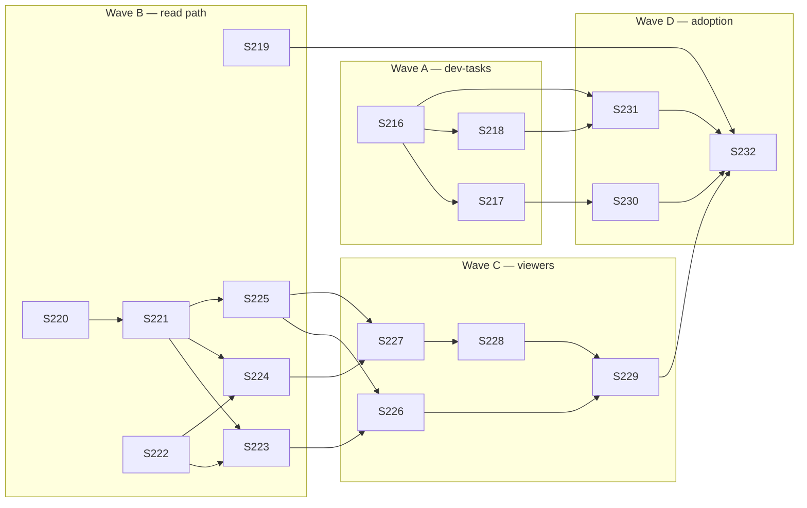

# User Stories — Repository Knowledge Views

## Changelog

| Version | Date       | Summary                                                                                          | Author           |
| ------- | ---------- | ------------------------------------------------------------------------------------------------ | ---------------- |
| 1.0     | 2026-11-28 | Initial stories from spec v1.0 / PRD v1.2. S-216–S-232 across Waves A–D.                          | product-engineer |

Source: `docs/requirements/prd-repo-knowledge-views.md` (v1.2), `workstream/specification-prd-repo-knowledge-views.md` (v1.0), `workstream/decisions-repo-knowledge-views.md` (D-01–D-30).

---

## Legend

- **ID range:** S-216–S-232 (next free after `code-review`'s S-204–S-215).
- **Size:** XS (< ½ day), S (½–1 day), M (1–2 days), L (2–3 days). Each story fits one PR.
- **Repository per story:** Wave A stories ship in `llipe/dev-tasks`; Waves B–D ship in `llipe/dev-tasks-agent-fleet`.
- **Discipline:** test-first; one PR per story into the wave's integration branch (`integration/repo-knowledge-wave-<x>`); one consolidated PR per repository to `main`, human-merged. DoD includes the repository's `pnpm run validate`.
- **Abbreviations:** `pkg/` = `panel/`; `spec §N` = specification section; `FR-N`/`AC-N` = PRD v1.2.
- **Waves (D-17):** A ∥ B; C after B; D after A and C.

---

## Wave A — Contract, skill and template (`llipe/dev-tasks`)

### Story S-216: Field-guide contract, starter kit and `repo-knowledge` skill (field-guide procedures)

**Priority:** Critical
**Estimated Size:** M
**Dependencies:** none

#### User Story

As `technical-writer`,
I want a written field-guide contract, a starter kit and a skill with create/refresh procedures,
So that every field guide I write renders in the panel without special cases.

#### Context

This is the foundation of D-10 and D-27. The contract generalises riel's page rules and adds the panel constraints (no `fetch`, no files outside `docs/field-guide/`, D-23).

#### Acceptance Criteria

- [ ] `.claude/skills/repo-knowledge/SKILL.md`, `.github/skills/repo-knowledge/SKILL.md` and `.kiro/skills/repo-knowledge/SKILL.md` exist with identical procedure content (platform frontmatter may differ) (FR-22).
- [ ] The skill states the field-guide contract: required `docs/field-guide/index.html`; optional pages and assets under `docs/field-guide/`; `README.md` with section-to-source map, update prompt and "Last revision" stamp; page rules (self-contained, allowed CDNs pinned to exact versions, Google Fonts only, theme tokens, 390 px safe, no download or print buttons, English only); **no `fetch`/XHR**; **no reference outside `docs/field-guide/`** (FR-23, D-23).
- [ ] `templates/repo-knowledge/field-guide-README.md` and `field-guide-update-prompt.md` exist and carry the 12-section default set with sources (D-27) (FR-24).
- [ ] Procedures "Create a field guide" and "Refresh a field guide (full or targeted)" each end in a draft PR, never a direct push (FR-25).
- [ ] Each procedure has a mandatory pre-PR verification step: local serve + Playwright, no console errors, no sideways scroll at 390 px, no `fetch`/XHR, no out-of-folder reference (D-27).
- [ ] `bundle-manifest.json` lists the skill and the two templates. `validate` and the install-parity test pass (AC-10).

#### Business Rules

- The field guide is derived. Its sources win (BR-1).
- Nothing reaches the default branch without a PR (BR-4).

#### Technical Notes

- Model the structure on an existing three-platform skill (e.g. `activity-refine`).
- The 12-section set is in spec §10 / D-27.
- riel's README is the reference for the update prompt (D-02).

#### Testing Requirements

- **Unit Tests:** install-parity covers the three `SKILL.md` copies and the templates.
- **Integration Tests:** `dev-tasks install` into a temp repository places the skill on all three platforms.
- **Manual/UI Testing:** read-through of the skill against riel's README.
- **Edge-Case Matrix:** consumer with no `docs/` folder; consumer with an existing `docs/field-guide/` (refresh, not overwrite).
- **Acceptance-Criteria Mapping:** AC1, AC6 → install-parity test; AC2–AC5 → skill content review checklist.
- **Execution Commands:** `pnpm run validate`.

#### Implementation Steps

1. Write the install-parity test expectations first.
2. Author the contract and procedures in `.claude/skills/repo-knowledge/SKILL.md`.
3. Mirror it to `.github/` and `.kiro/`.
4. Add the templates and the manifest entries.

#### Files to Create/Modify

- `.claude/skills/repo-knowledge/SKILL.md`, `.github/skills/repo-knowledge/SKILL.md`, `.kiro/skills/repo-knowledge/SKILL.md`
- `templates/repo-knowledge/field-guide-README.md`, `templates/repo-knowledge/field-guide-update-prompt.md`
- `bundle-manifest.json`
- `test/integration/install-parity.test.ts`

#### Definition of Done Checklist

- [ ] Code implemented per technical guidelines
- [ ] Tests written and passing
- [ ] Quality gates passing (`lint`, `format:check`, `typecheck`, `test`, `audit`)
- [ ] Code reviewed and approved
- [ ] Acceptance criteria verified and mapped to test evidence
- [ ] Migration lifecycle: not applicable (no data model)
- [ ] Pull Request created and merged

---

### Story S-217: `graph.yml` workflow template, `.graphifyignore` default and graph runbook

**Priority:** Critical
**Estimated Size:** M
**Dependencies:** S-216 (skill file exists to add the procedure)

#### User Story

As a repository maintainer,
I want a ready workflow that regenerates the dependency graph and proposes it by PR,
So that my repository's graph stays current with no LLM, no secret and no direct pushes.

#### Context

Implements D-09, D-12, D-18, D-20 and spec §9.

#### Acceptance Criteria

- [ ] `templates/workflows/graph.yml` installs `graphifyy[sql]==0.9.120` and runs `graphify extract . --code-only --no-viz` then `graphify cluster-only . --no-viz` with `GRAPHIFY_BACKEND=none` and `GRAPHIFY_QUERY_LOG_DISABLE=1` (FR-28).
- [ ] It writes `docs/graph/graph.json` and `docs/graph/GRAPH_REPORT.md`, and writes `.graphifyignore` from `templates/repo-knowledge/graphifyignore` only when absent (D-20).
- [ ] It opens or updates exactly one PR titled `chore(graph): refresh dependency graph` from branch `chore/graph-refresh`, only when `graph.json` changed. It never pushes to the default branch (FR-29, AC-11).
- [ ] Triggers: weekly `schedule`, `workflow_dispatch`, `push` to the default branch with `paths-ignore: ['docs/**', '**/*.md']` (FR-30).
- [ ] `docs/runbooks/graph-workflow.md` in dev-tasks covers: raising the pin, editing `.graphifyignore`, a graph over 15 MB, and a failed run. It ships in this PR (FR-31, FR-49a).
- [ ] The `repo-knowledge` skill gains the procedure "Install the graph workflow" (copy `graph.yml` + `.graphifyignore`, add `graphify-out/` to `.gitignore`, add a consumer runbook, open a draft PR) (FR-25).
- [ ] Manifest lists the workflow and the ignore template. Workflow lint passes.

#### Business Rules

- BR-4: PR only, never a default-branch push.
- No LLM and no secret (D-09).

#### Technical Notes

- The default ignore list (D-18 measurement): `**/tests/**`, `**/test/**`, `**/__tests__/**`, `**/*.test.ts`, `**/*.test.tsx`, `**/*.spec.ts`, `**/test_*.py`, `**/fixtures/**`.
- Compare only `graph.json` for the change check (spec §9 noise control).
- Workflow permissions: `contents: write`, `pull-requests: write`.

#### Testing Requirements

- **Unit Tests:** template parses as YAML; manifest entries present.
- **Integration Tests:** CI job runs the workflow's script steps against a small fixture repository and asserts `docs/graph/graph.json` exists with `graph.schema_version == 1`. A second run with no code change produces no diff in `graph.json`.
- **Manual/UI Testing:** `workflow_dispatch` on a scratch repository opens one PR. A second dispatch with no change opens none.
- **Edge-Case Matrix:** existing `.graphifyignore` preserved; existing open `chore/graph-refresh` PR updated, not duplicated; repository with zero code files; SQL files present.
- **Acceptance-Criteria Mapping:** AC1–AC3 → fixture CI job; AC4 → YAML assertion; AC5–AC7 → review checklist + lint.
- **Execution Commands:** `pnpm run validate`.

#### Implementation Steps

1. Write the fixture CI job first.
2. Author `graph.yml` and the ignore template.
3. Write the runbook.
4. Add the skill procedure and the manifest entries.

#### Files to Create/Modify

- `templates/workflows/graph.yml`, `templates/repo-knowledge/graphifyignore`
- `docs/runbooks/graph-workflow.md`
- `.claude|.github|.kiro/skills/repo-knowledge/SKILL.md` (procedure)
- `bundle-manifest.json`, `test/fixtures/graph-repo/**`, CI workflow for the fixture job

#### Definition of Done Checklist

- [ ] Code implemented per technical guidelines
- [ ] Tests written and passing
- [ ] Quality gates passing
- [ ] Runbook shipped in the same PR
- [ ] Acceptance criteria verified and mapped to test evidence
- [ ] Migration lifecycle: not applicable
- [ ] Pull Request created and merged

---

### Story S-218: `technical-writer` owns field guides; registry updates

**Priority:** High
**Estimated Size:** S
**Dependencies:** S-216

#### User Story

As a dev-tasks user,
I want `technical-writer` to own field-guide creation and refresh, and the registries to list the skill,
So that I know which agent to ask and every platform agrees.

#### Acceptance Criteria

- [ ] `technical-writer` definitions on `.claude/agents/`, `.github/agents/` and `.kiro/agents/` name field-guide creation and refresh as a responsibility and reference `repo-knowledge` (FR-26).
- [ ] `AGENTS.md` (and `AGENTS.md.template`) list `repo-knowledge` with consumer `technical-writer`. `CLAUDE.md` (and template) mention it in the skills list (FR-22).
- [ ] dev-tasks `CHANGELOG.md` has an entry.
- [ ] `validate` passes, including any registry-consistency check.

#### Technical Notes

- Change the template files and the repository's own copies together.

#### Testing Requirements

- **Unit Tests:** registry-consistency check (if present) passes; install-parity for agent files.
- **Manual/UI Testing:** read-through on all three platforms.
- **Acceptance-Criteria Mapping:** AC1–AC4 → `validate` + review checklist.
- **Execution Commands:** `pnpm run validate`.

#### Files to Create/Modify

- `.claude/agents/technical-writer.md`, `.github/agents/technical-writer.agent.md`, `.kiro/agents/technical-writer.md`
- `AGENTS.md`, `AGENTS.md.template`, `CLAUDE.md`, `CLAUDE.md.template`, `CHANGELOG.md`

#### Definition of Done Checklist

- [ ] Implemented; tests passing; quality gates passing; reviewed; ACs mapped; PR merged

---

## Wave B — Read path (`llipe/dev-tasks-agent-fleet`)

### Story S-219: Infra — panel role may read the fleet App key

**Priority:** Critical
**Estimated Size:** S
**Dependencies:** none (runs before S-220's deploy)

#### User Story

As the operator,
I want the panel role to read exactly the fleet App key, through a recorded and reversible change,
So that the panel can mint read-only tokens without any broader AWS access.

#### Context

D-14 and D-30. Executed by `/infra-engineer`, one approved step at a time.

#### Acceptance Criteria

- [ ] Role `panel-agentcore-invoke` gains one statement: `secretsmanager:GetSecretValue` on the ARN stored in `github_installations.private_key_secret_arn`. No wildcard resource, no other action (FR-7).
- [ ] `infra/changes/<date>-panel-github-contents-read/` holds `plan.md`, `commands.sh`, `result.md`, `rollback.sh`, `backup/` (structure of `20261014-fly-oidc-issuer-trust`).
- [ ] `infra/agentcore-invoke-policy.json` matches the live policy. The stale OIDC comment at `infra/environments.yaml:51` is corrected to the trust subject in `infra/trust-policy.json:9`.
- [ ] `docs/runbooks/panel-github-read.md` covers verify, rotate-key effect (1 h cache), and rollback. It ships in this PR (FR-49a).
- [ ] An IAM policy simulation shows `GetSecretValue` allowed on the ARN and denied on any other secret.

#### Business Rules

- BR-2: read-only intent. The grant is the minimum.

#### Technical Notes

- Use the `aws-ops` skill. Back up the current inline policy before the change.

#### Testing Requirements

- **Integration Tests:** `aws iam simulate-principal-policy` for allow/deny pairs, recorded in `backup/`.
- **Manual/UI Testing:** none until S-220 deploys.
- **Edge-Case Matrix:** wrong ARN, so the panel later shows `CredentialError` (covered in S-220).
- **Acceptance-Criteria Mapping:** AC1, AC5 → simulation output; AC2–AC4 → review checklist.

#### Migration Requirements

- Not a data migration. Rollback is `rollback.sh` (remove the statement). Apply requires explicit user approval per step.

#### Files to Create/Modify

- `infra/changes/<date>-panel-github-contents-read/**`, `infra/agentcore-invoke-policy.json`, `infra/environments.yaml`, `docs/runbooks/panel-github-read.md`, `docs/runbooks/README.md`

#### Definition of Done Checklist

- [ ] Change applied with approval; result recorded; rollback tested in simulation; runbook shipped; PR merged

---

### Story S-220: Server-only token minting (`lib/github/app-token.ts`)

**Priority:** Critical
**Estimated Size:** M
**Dependencies:** none for code; S-219 to run against real AWS

#### User Story

As the panel,
I want to mint a read-only installation token scoped to one repository, and refuse anything broader,
So that a bug in the panel can at most read one repository.

#### Acceptance Criteria

- [ ] `tokenFor(repository)` reads the installation row (installation id, `app_id`, `private_key_secret_arn`). A null ARN throws `CredentialError` (spec §5, D-24).
- [ ] The JWT is RS256 via `node:crypto`, with `iat = now−60`, `exp = now+540`, `iss = app_id`.
- [ ] The token request body is exactly `{"repositories":["<name>"],"permissions":{"contents":"read","metadata":"read"}}` (FR-7).
- [ ] A response whose `permissions` or `repositories` differ from the request is discarded and throws `TokenScopeError` (D-24).
- [ ] The token cache is per repository until `expires_at − 5 min`. The PEM cache lasts 1 h.
- [ ] The module imports `server-only`. No token or PEM appears in any thrown message or log line (FR-8, AC-9).

#### Business Rules

- BR-2: no code path requests write permissions.

#### Technical Notes

- Reuse `panel/lib/aws/credentials.ts` for the Secrets Manager client. Use plain `fetch` with an injectable fetcher for tests (D-29).
- Errors carry codes only (ADR-009).

#### Testing Requirements

- **Unit Tests:** JWT claims; scope checker (exact; broader permission; extra repository; missing field).
- **Integration Tests (L2):** fake Secrets Manager + injected fetch: mint; cache hit (no second POST); refresh after expiry window; null ARN; scope failure discards the token; the token string is absent from the error and from captured logs.
- **Edge-Case Matrix:** clock skew at the expiry boundary; concurrent first calls (a single in-flight mint per repository).
- **Acceptance-Criteria Mapping:** AC1–AC6 → `app-token.test.ts` cases T-220-01…T-220-10.
- **Execution Commands:** `pnpm run test:unit`, `pnpm run validate`.

#### Files to Create/Modify

- `panel/lib/github/app-token.ts`, `panel/lib/github/errors.ts`, `panel/lib/github/app-token.test.ts`, `panel/lib/supabase/queries.ts` (installation-row read)

#### Definition of Done Checklist

- [ ] Implemented; L1/L2 tests passing; quality gates passing; reviewed; ACs mapped; PR merged

---

### Story S-221: GitHub client, artifact reader, LRU cache and staleness

**Priority:** Critical
**Estimated Size:** M
**Dependencies:** S-220

#### User Story

As the panel,
I want to read any artifact at a pinned commit through a bounded cache, and compute guide staleness,
So that views are fast, consistent within a commit, and cheap on the GitHub API.

#### Acceptance Criteria

- [ ] `resolveHead(repo)` uses `GET /repos/{o}/{r}/commits/{default_branch}` (the stored column) and caches it 60 s (D-25).
- [ ] `readArtifact(repo, sha, path, capBytes)` uses `contents?ref=sha` with `Accept: application/vnd.github.raw`. 404 → `NotPresent`; 401/403/429/5xx → `Upstream`; over cap → `TooLarge` (counted while streaming) (FR-6, FR-10).
- [ ] LRU is keyed `(repoId, sha, path)`, 64 MB total, no TTL. Over-cap bodies are never inserted (FR-9).
- [ ] `staleness(repo, headSha)` returns `{guideSha, committedAt, ageDays, commitsBehind, warning}`, with `warning = ageDays > 30 || commitsBehind > 100`, cached per `(repoId, headSha)` (FR-15, D-11).
- [ ] Every GitHub call has a 10 s timeout and sends `X-GitHub-Api-Version: 2022-11-28`.
- [ ] One structured log line per fetch, with no token or upstream body (spec §13).

#### Testing Requirements

- **Unit Tests:** LRU byte accounting and eviction order; staleness boundaries 29/30/31 days and 99/100/101 commits (AC-6).
- **Integration Tests (L2):** injected fetch: 404/429/500 mapping; cache hit issues no fetch; HEAD cache expiry; streaming cap abort.
- **Edge-Case Matrix:** empty file; file exactly at cap; guide folder never committed (`commits?path` empty → `NotPresent`); compare with `ahead_by = 0`.
- **Acceptance-Criteria Mapping:** AC1–AC6 → `reader.test.ts`, `lru.test.ts`, `staleness.test.ts`.
- **Execution Commands:** `pnpm run test:unit`.

#### Files to Create/Modify

- `panel/lib/github/client.ts`, `panel/lib/knowledge/{reader,lru,staleness}.ts` and tests

#### Definition of Done Checklist

- [ ] Implemented; tests passing; quality gates passing; reviewed; ACs mapped; PR merged

---

### Story S-222: Gate every `/api/**` path; release-gate assertions

**Priority:** Critical
**Estimated Size:** S
**Dependencies:** none

#### User Story

As the operator,
I want no `/api` path to bypass authentication because of its file extension,
So that field-guide images and every future API asset stay behind login.

#### Acceptance Criteria

- [ ] The `proxy.ts` matcher keeps skipping image extensions outside `/api/` and never skips them under `/api/` (D-22).
- [ ] A Layer 1 test evaluates the exported matcher on a path table: `/logo.svg` skipped; `/api/repositories/x/field-guide/<sha>/a.webp` gated; existing public webhook route behaviour unchanged.
- [ ] The release gate asserts 401 for unauthenticated `GET /api/repositories/<id>/field-guide/<sha>/index.html` and `…/a.webp` (D-30). The assertions are added now and pass once S-223 lands. Until then they are marked pending with a pointer to S-223.

#### Testing Requirements

- **Unit Tests:** matcher table (≥ 10 rows).
- **Integration Tests:** release-gate script dry run against a local server.
- **Edge-Case Matrix:** uppercase extensions; query strings; trailing slash; `/api` without a trailing segment.
- **Acceptance-Criteria Mapping:** AC1–AC2 → `proxy.matcher.test.ts`; AC3 → release-gate script.
- **Execution Commands:** `pnpm run test:unit`.

#### Files to Create/Modify

- `panel/proxy.ts`, `panel/proxy.matcher.test.ts`, release-gate script (path per `docs/runbooks/panel-deployment.md`)

#### Definition of Done Checklist

- [ ] Implemented; tests passing; quality gates passing; reviewed; ACs mapped; PR merged

---

### Story S-223: Field-guide route with sandboxing CSP

**Priority:** Critical
**Estimated Size:** M
**Dependencies:** S-221, S-222

#### User Story

As a panel user,
I want a repository's field-guide files served at a pinned commit, sandboxed and locked down,
So that I can read the guide while its scripts can't touch the panel.

#### Acceptance Criteria

- [ ] `GET /api/repositories/[id]/field-guide/[sha]/[...path]` runs the spec §6.1 checks in order: session → 401; bad or archived id → 404; bad SHA → 404; traversal → 404 with no GitHub call; extension not allowlisted → 415; GitHub 404 → 404; > 5 MB → 413; upstream or credential → 502 (FR-11).
- [ ] Every response, including errors, carries the D-23 header set exactly: CSP with `sandbox allow-scripts allow-popups`, `default-src 'none'`, the script/style/font/img sources, `connect-src 'none'`, `base-uri 'none'`, `form-action 'none'`, `frame-ancestors 'self'`; `nosniff`; `no-referrer`; `CORP same-origin`; `Cache-Control: private, max-age=300` (FR-12).
- [ ] Content type comes from the D-23 extension map.
- [ ] Error bodies are stable codes only (`FG_*`). No upstream body, token, ARN or installation id.
- [ ] Route-segment config is declared inline (`dynamic = "force-dynamic"`).

#### Business Rules

- BR-3: repository script is untrusted.

#### Testing Requirements

- **Unit Tests:** path normaliser table (`..`, `%2e%2e`, `..%2f`, double-encoded, `\`, NUL, absolute, empty segments); CSP builder snapshot; extension map.
- **Integration Tests (L2):** route with fake reader and session: every status in AC1; headers on 200 and on each error; traversal makes no reader call.
- **Edge-Case Matrix:** `index.html` at the root vs nested pages; uppercase extensions; file exactly 5 MB.
- **Acceptance-Criteria Mapping:** AC1 → T-223-01…12; AC2 → T-223-13 (all statuses); AC3–AC5 → T-223-14…16.
- **Execution Commands:** `pnpm run test:unit`.

#### Files to Create/Modify

- `panel/app/api/repositories/[id]/field-guide/[sha]/[...path]/route.ts`
- `panel/lib/knowledge/{path,csp,content-type}.ts` and tests

#### Definition of Done Checklist

- [ ] Implemented; tests passing; quality gates passing; reviewed; ACs mapped; PR merged

---

### Story S-224: Graph route and `graph.json` v1 validation

**Priority:** High
**Estimated Size:** S
**Dependencies:** S-221, S-222

#### User Story

As the graph viewer,
I want one endpoint that returns a validated graph and its report, or a precise reason it can't,
So that the client never parses an unsupported or malformed graph.

#### Acceptance Criteria

- [ ] `GET /api/repositories/[id]/graph/[sha]` runs the same session, id and SHA checks as S-223 (spec §6.2).
- [ ] It reads `docs/graph/graph.json` (≤ 15 MB, else `GRAPH_TOO_LARGE` with the byte count) and the optional `GRAPH_REPORT.md` (≤ 1 MB) (D-20).
- [ ] It validates against `panel/lib/schema/graph-v1.schema.json` (spec §5.1). `schema_version ≠ 1` → `GRAPH_UNSUPPORTED {found, supported}`; a missing required field → `GRAPH_MALFORMED {path}` (FR-17, AC-8).
- [ ] Success returns `{graph, report, sha, committedAt}`. Unknown extra fields are accepted.
- [ ] Compression is enabled. `Cache-Control: private, max-age=300`.

#### Testing Requirements

- **Unit Tests:** schema against the D-18 sample (valid), version 2 (unsupported), node without `community` (malformed), extra fields (valid).
- **Integration Tests (L2):** route envelopes for each state.
- **Edge-Case Matrix:** empty `nodes`; links to missing nodes (valid; the viewer drops them); report absent.
- **Acceptance-Criteria Mapping:** AC1–AC5 → `graph-route.test.ts`, `graph-schema.test.ts`.
- **Execution Commands:** `pnpm run test:unit`.

#### Files to Create/Modify

- `panel/app/api/repositories/[id]/graph/[sha]/route.ts`, `panel/lib/schema/graph-v1.schema.json`, `panel/lib/knowledge/graph.ts`, tests, `panel/tests/fixtures/graph/*.json`

#### Definition of Done Checklist

- [ ] Implemented; tests passing; quality gates passing; reviewed; ACs mapped; PR merged

---

### Story S-225: Repository page shell, tabs and Agent activity

**Priority:** Critical
**Estimated Size:** M
**Dependencies:** S-221 (HEAD and staleness on the server)

#### User Story

As the operator,
I want a page per repository with Field guide, Dependency graph and Agent activity tabs,
So that a repository's guide, map and runs sit in one place.

#### Acceptance Criteria

- [ ] `RepositoryTable` name cell links to `/repositories/{id}`. The Sidebar Repositories item is active on `/repositories/*` (FR-1, D-28).
- [ ] `/repositories/[id]`: non-UUID, unknown or archived id → `notFound()` (D-28).
- [ ] A shared `components/Tabs.tsx` (tablist pattern from `CadencePicker`, arrow keys, `aria-selected`). State in `?tab=guide|graph|activity`, default `guide`; unknown values fall back to `guide` (FR-2).
- [ ] Agent activity lists that repository's runs via `getFilteredRuns({repositoryId})` with `RunHistoryRow` and `showAgentColumn` (FR-3, AC-1).
- [ ] A "Workflow telemetry — not yet collected" placeholder card (FR-4).
- [ ] An `ArtifactState` component with variants `not-present` (names the expected path, links the skill instructions), `too-large`, `unsupported`, `malformed`, `error` (Retry) (FR-10).
- [ ] The Field guide and Graph tabs render a placeholder `ArtifactState` until S-226/S-227 replace it.
- [ ] Breadcrumb `Repositories / {full_name}`. Inline route-segment config (`force-dynamic`).

#### Design Notes

- DESIGN.md impact (`ux-engineer`): add `Tabs` and `ArtifactState` (dark tokens only, D-21) and the repository page layout section.

#### Testing Requirements

- **Unit Tests (jsdom):** `Tabs` keyboard navigation and selection; `ArtifactState` variants; `RepositoryTable` link.
- **Integration Tests:** page server component with fake queries: 404 cases; tab fallback.
- **Manual/UI Testing:** navigate from Repositories to a repository; switch tabs; reload keeps the tab.
- **Edge-Case Matrix:** repository with zero runs (empty state); 390 px (tabs scroll inside their container).
- **Acceptance-Criteria Mapping:** AC1–AC8 → component and page tests; AC-1 (PRD) in E2E (S-229).
- **Execution Commands:** `pnpm run test:unit`.

#### Files to Create/Modify

- `panel/app/(panel)/repositories/[id]/page.tsx` + `page.module.css`
- `panel/components/Tabs.tsx`, `panel/components/ArtifactState.tsx`
- `panel/components/repositories/RepositoryTable.tsx`, `panel/components/shell/Sidebar.tsx`
- `DESIGN.md`

#### Definition of Done Checklist

- [ ] Implemented; tests passing; quality gates passing; DESIGN.md updated; reviewed; ACs mapped; PR merged

---

## Wave C — Viewers (`llipe/dev-tasks-agent-fleet`)

### Story S-226: Field guide tab — frame, header strip and staleness

**Priority:** High
**Estimated Size:** S
**Dependencies:** S-223, S-225

#### User Story

As the operator,
I want to read a repository's field guide in the panel, see which commit it shows and how stale it is,
So that I know whether to trust it.

#### Acceptance Criteria

- [ ] The frame uses `src=/api/repositories/{id}/field-guide/{sha}/index.html`, `sandbox="allow-scripts allow-popups"`, `referrerpolicy="no-referrer"` and a descriptive `title`. Never `allow-same-origin` (FR-13).
- [ ] The header strip shows the short SHA (linked), the commit date, the staleness label `Updated {n} days ago · {m} commits behind` (warning token above the threshold), and "Open full screen" (`target=_blank rel=noopener noreferrer`) (FR-14, FR-15).
- [ ] Missing `index.html` → `ArtifactState not-present` naming `docs/field-guide/index.html`. Upstream or credential failure → `error` with Retry (FR-10, AC-2).
- [ ] The frame fills the content region and scrolls internally. No sideways page scroll at 390 px (AC-13).
- [ ] DESIGN.md: staleness label (normal and warning) documented.

#### Testing Requirements

- **Unit Tests (jsdom):** label text and warning class at 30/31 days and 100/101 commits; iframe attributes (no `allow-same-origin`).
- **Manual/UI Testing:** riel-shaped fixture renders; full screen opens in a new tab.
- **Edge-Case Matrix:** guide committed at HEAD (0 behind); guide absent; retry after upstream error.
- **Acceptance-Criteria Mapping:** AC1–AC5 → `FieldGuideTab.test.tsx`; E2E in S-229.
- **Execution Commands:** `pnpm run test:unit`.

#### Files to Create/Modify

- `panel/components/repositories/FieldGuideTab.tsx`, `StalenessLabel.tsx`, tests; `DESIGN.md`

#### Definition of Done Checklist

- [ ] Implemented; tests passing; quality gates passing; DESIGN.md updated; reviewed; ACs mapped; PR merged

---

### Story S-227: Graph viewer core — rendering, community view, layout, tokens

**Priority:** High
**Estimated Size:** L
**Dependencies:** S-224, S-225

#### User Story

As the operator,
I want the repository's dependency graph drawn in the panel, grouped by community when it is large,
So that I can see the shape of the code at a glance.

#### Acceptance Criteria

- [ ] `GraphViewer` is a client component loaded with a dynamic import on the Graph tab only. No sigma or graphology in other pages' bundles (spec §11, D-26).
- [ ] `sigma`, `graphology` and `graphology-layout-forceatlas2` are exact-pinned. `pnpm audit` is clean.
- [ ] Builds an undirected graphology graph. Links with missing endpoints are dropped and counted in the footer.
- [ ] Above 1,500 nodes, opens in the community view: super-nodes sized by member count and labelled by their highest-degree member, with aggregated weighted edges. Enter or click expands a community. At or below 1,500 nodes, shows the full graph (FR-19, D-20).
- [ ] ForceAtlas2 runs in a web worker, stopping on settle or at 3 s. Positions are cached per `(repoId, sha)` for the session.
- [ ] Node colour by `file_type` and edge style by `confidence` come from new tokens `--graph-node-{code,rationale,concept,other}`, `--graph-edge-{extracted,inferred,ambiguous}`, `--graph-focus`, `--graph-dim` (dark values) added to `tokens.css` and DESIGN.md (FR-21, D-21).
- [ ] Error states from S-224 render via `ArtifactState` (`too-large` with size, `unsupported` with versions, `malformed` with path) (FR-17, AC-8).
- [ ] The header strip shows the short SHA, the commit date and `graphify_version`.

#### Testing Requirements

- **Unit Tests:** community collapse (member counts, labels, aggregated edges); missing-endpoint drop count; threshold 1,500 vs 1,501.
- **Integration Tests (jsdom, sigma mocked at the module boundary):** state rendering per envelope.
- **Manual/UI Testing:** this repository's D-18 graph (5,482 nodes) interactive within 2 s on a laptop.
- **Edge-Case Matrix:** zero nodes; single community; one huge community.
- **Acceptance-Criteria Mapping:** AC1–AC8 → `graph-model.test.ts`, `GraphViewer.test.tsx`; visual check in S-229.
- **Execution Commands:** `pnpm run test:unit`, `pnpm run audit`.

#### Files to Create/Modify

- `panel/components/graph/{GraphViewer,GraphCanvas}.tsx`, `panel/lib/graph/{model,community,layout.worker}.ts`, `panel/styles/tokens.css`, `DESIGN.md`, `panel/package.json`

#### Definition of Done Checklist

- [ ] Implemented; tests passing; quality gates passing; DESIGN.md updated; reviewed; ACs mapped; PR merged

---

### Story S-228: Graph viewer interactions — search, filters, focus, report

**Priority:** High
**Estimated Size:** M
**Dependencies:** S-227

#### User Story

As the operator,
I want to search for a file or symbol, filter the graph, and see what a node imports and what calls it,
So that I can judge the blast radius of a change.

#### Acceptance Criteria

- [ ] Search: case-insensitive prefix and substring on `label`, top 20, `/` shortcut. Selecting a result focuses the node (FR-18).
- [ ] Filters: `file_type` and `relation` multi-selects. INFERRED/AMBIGUOUS hidden by default, with a toggle (FR-18).
- [ ] Focus highlights the node and its 1-hop neighbourhood and dims the rest. Esc clears it.
- [ ] The side panel lists incoming and outgoing relations as text (accessibility alternative), with a link to `https://github.com/{full_name}/blob/{sha}/{source_file}#L{n}` (FR-18, AC-7).
- [ ] With nothing focused, the side panel renders `GRAPH_REPORT.md` as Markdown with raw HTML disabled and links set to `target=_blank rel=noopener noreferrer` (FR-20).
- [ ] Toolbar and side panel are keyboard-operable. At 390 px the side panel stacks below the canvas.

#### Testing Requirements

- **Unit Tests:** search ranking; filter predicate; link builder (with and without `source_location`).
- **Integration Tests (jsdom):** keyboard flow; Markdown sanitisation (a `<script>` in the report renders as text, no element).
- **Edge-Case Matrix:** search with no hits; label with regex characters; node with no neighbours; report absent.
- **Acceptance-Criteria Mapping:** AC1–AC6 → `GraphToolbar.test.tsx`, `NodePanel.test.tsx`, `report.test.tsx`.
- **Execution Commands:** `pnpm run test:unit`, `pnpm run audit`.

#### Files to Create/Modify

- `panel/components/graph/{GraphToolbar,NodePanel,ReportPanel}.tsx`, `panel/lib/graph/{search,filter,links}.ts`, tests, `panel/package.json` (Markdown renderer)

#### Definition of Done Checklist

- [ ] Implemented; tests passing; quality gates passing; reviewed; ACs mapped; PR merged

---

### Story S-229: E2E with a GitHub stub and security-negative scenarios

**Priority:** High
**Estimated Size:** M
**Dependencies:** S-225–S-228

#### User Story

As the operator,
I want end-to-end proof that both views work and that the guide can't escape its sandbox,
So that the release gate catches a regression before users do.

#### Acceptance Criteria

- [ ] Playwright starts a local HTTP stub for `api.github.com` (token mint, commits, compare, contents raw). The panel points at it via configuration. Secrets Manager is faked at the same boundary used by existing E2E (D-29).
- [ ] The fixture repository has a riel-shaped guide (`index.html`, `internals.html`, two WebP screens), a 2,000-node and a 200-node `graph.json`, and a report.
- [ ] Scenarios cover PRD AC-1 to AC-8 and AC-13.
- [ ] Security-negative scenarios:
  - traversal URLs → 4xx;
  - guide script attempting `parent.document`, `document.cookie` and `fetch('/api/…')` fails;
  - the full-screen URL opened directly is still sandboxed (`window.origin === "null"`);
  - no response body or header contains the stub's token string (AC-4, AC-5, AC-9).
- [ ] `/TESTING.md` documents the GitHub stub and its fixture layout.

#### Testing Requirements

- **E2E:** as above, `pnpm run test:e2e`.
- **Acceptance-Criteria Mapping:** each scenario named `AC-N …` for traceability.

#### Files to Create/Modify

- `panel/tests/e2e/github-stub.ts`, `panel/tests/e2e/fixtures/repo-knowledge/**`, `panel/tests/e2e/repository-*.spec.ts`, `panel/playwright.config.ts`, `TESTING.md`

#### Definition of Done Checklist

- [ ] Implemented; E2E passing locally and in CI; TESTING.md updated; reviewed; PR merged

---

## Wave D — Adoption (`llipe/dev-tasks-agent-fleet`)

### Story S-230: Adopt `graph.yml` in this repository

**Priority:** High
**Estimated Size:** S
**Dependencies:** S-217 released and pulled via `dev-tasks update`

#### User Story

As the operator,
I want this repository's dependency graph generated and committed by the standard workflow,
So that the panel shows it like any other repository's.

#### Acceptance Criteria

- [ ] The `repo-knowledge` skill's "Install the graph workflow" procedure produces a draft PR adding `.github/workflows/graph.yml`, `.graphifyignore`, a `.gitignore` entry for `graphify-out/`, and the consumer runbook (FR-32).
- [ ] After merge, a `workflow_dispatch` run opens `chore(graph): refresh dependency graph`. The merged `docs/graph/graph.json` has `schema_version` 1 and is ≤ 15 MB (≈ 5 MB expected, D-18).
- [ ] A second dispatch with no code change opens no PR (AC-11).

#### Testing Requirements

- **Manual:** the two dispatch runs above, with Actions links recorded in the PR.
- **Acceptance-Criteria Mapping:** AC1–AC3 → PR links and Actions run links.

#### Files to Create/Modify

- `.github/workflows/graph.yml`, `.graphifyignore`, `.gitignore`, `docs/runbooks/graph-workflow.md`, `docs/graph/*` (via the workflow PR)

#### Definition of Done Checklist

- [ ] Both PRs merged; runs recorded; runbook present

---

### Story S-231: `technical-writer` writes this repository's field guide

**Priority:** High
**Estimated Size:** L
**Dependencies:** S-216, S-218 released and pulled

#### User Story

As a newcomer to the agent fleet,
I want a zero-context field guide for `dev-tasks-agent-fleet`,
So that I understand what it is, how it works and where things stand without reading every doc.

#### Acceptance Criteria

- [ ] `technical-writer` runs the skill's "Create a field guide" procedure. The output is `docs/field-guide/index.html` plus `README.md` with the section-to-source map, the update prompt, and a stamp naming the date and commit (FR-33).
- [ ] It covers the 12 default sections from this repository's sources (`docs/product.md`, `docs/tech.md` incl. Package Map, glossary, ADRs, runbooks, `docs/roadmap.md`, `AGENTS.md`).
- [ ] It conforms to the contract: self-contained, allowed CDNs pinned, no `fetch`/XHR, nothing outside `docs/field-guide/`.
- [ ] The skill's verification passes (no console errors, no sideways scroll at 390 px), with evidence in the PR.
- [ ] It is delivered by draft PR.

#### Testing Requirements

- **Manual:** the skill's Playwright verification; spot-check five load-bearing claims against code (e.g. reaper schedule, auth gate, roles, agent list, run states).
- **Acceptance-Criteria Mapping:** AC1–AC5 → PR evidence.

#### Files to Create/Modify

- `docs/field-guide/index.html`, `docs/field-guide/README.md` (optional `internals.html`)

#### Definition of Done Checklist

- [ ] Guide merged; verification evidence attached; `docs/README.md` index links it

---

### Story S-232: Live verification and roadmap close-out

**Priority:** High
**Estimated Size:** S
**Dependencies:** S-219–S-231 deployed or merged

#### User Story

As the operator,
I want both reference repositories verified live in the deployed panel,
So that the PRD is done on evidence, not on merge.

#### Acceptance Criteria

- [ ] In the deployed panel, `dev-tasks-agent-fleet` shows its field guide, graph and runs. `llipe/riel` shows its field guide (and `not-present` for the graph unless it has adopted `graph.yml`) (FR-34, AC-12).
- [ ] The release gate passes with the two D-30 assertions live.
- [ ] A one-off operator script calls the same `tokenFor()` module locally (operator AWS credentials, not the deployed panel, so no token leaves the server) and attempts a file create on `dev-tasks-agent-fleet` with the minted token; GitHub refuses it with 403, and only the status is recorded (AC-9). The script is not committed.
- [ ] riel's `api.html` behaves as accepted (its own fallback). It is noted, not fixed (PRD §12).
- [ ] `docs/roadmap.md` rows for Waves B–D move to `Done` in the consolidated PR (`planner`).

#### Testing Requirements

- **Manual:** checklist with screenshots for both repositories, all three tabs, and 390 px.
- **Acceptance-Criteria Mapping:** AC1–AC4 → verification record in the PR.

#### Files to Create/Modify

- `docs/roadmap.md`; verification record (e.g. `workstream/verification-repo-knowledge-views.md`)

#### Definition of Done Checklist

- [ ] Verification recorded; roadmap updated; consolidated PR ready for human merge

---

## Execution Plan

The plan below shows story dependencies and the wave each belongs to.

- **Parallel start:** S-216 (dev-tasks), S-219 (infra), S-220 and S-222 (panel).
- **Critical path:** S-220 → S-221 → S-224/S-225 → S-227 → S-228 → S-229 → S-232.
- **Infra pass:** S-219 runs through `/infra-engineer` before the Wave B deploy (D-30).

---

## Coverage Validation

### Summary

- **Total PRD Requirements:** 34 FR + 13 AC + 5 BR + 8 user stories = 60
- **Total User Stories:** 17
- **Coverage:** 100%
- **Status:** Complete

### Requirement Mapping

| PRD Requirement | Story ID(s) | Status |
| --- | --- | --- |
| FR-1 page per repository, linked | S-225 | ✅ Covered |
| FR-2 three tabs, URL state | S-225 | ✅ Covered |
| FR-3 Agent activity from `runs` | S-225 | ✅ Covered |
| FR-4 workflow telemetry placeholder | S-225 | ✅ Covered |
| FR-5 existing auth gate | S-222, S-223, S-224 | ✅ Covered |
| FR-6 read from GitHub, fixed paths | S-221 | ✅ Covered |
| FR-7 down-scoped token, one-secret IAM | S-219, S-220 | ✅ Covered |
| FR-8 token never logged or sent | S-220, S-229 | ✅ Covered |
| FR-9 SHA-keyed cache, commit banner | S-221, S-226, S-227 | ✅ Covered |
| FR-10 not-present vs error states | S-221, S-225, S-226 | ✅ Covered |
| FR-11 authenticated field-guide route, path guard | S-223 | ✅ Covered |
| FR-12 restrictive CSP | S-223 | ✅ Covered |
| FR-13 sandboxed iframe, no rewrite | S-226 | ✅ Covered |
| FR-14 minimal chrome, full screen | S-226 | ✅ Covered |
| FR-15 staleness indicator | S-221, S-226 | ✅ Covered |
| FR-16 native viewer, no `graph.html` | S-227 | ✅ Covered |
| FR-17 schema-version guard | S-224, S-227 | ✅ Covered |
| FR-18 search, filters, focus, link | S-228 | ✅ Covered |
| FR-19 community view above threshold | S-227 | ✅ Covered |
| FR-20 sanitised report | S-228 | ✅ Covered |
| FR-21 tokens, panel theme | S-227 | ✅ Covered |
| FR-22 skill on three platforms, manifest, registry | S-216, S-218 | ✅ Covered |
| FR-23 field-guide contract | S-216 | ✅ Covered |
| FR-24 starter kit | S-216 | ✅ Covered |
| FR-25 procedures by draft PR | S-216, S-217 | ✅ Covered |
| FR-26 `technical-writer` ownership | S-218 | ✅ Covered |
| FR-27 `graph.yml` in manifest | S-217 | ✅ Covered |
| FR-28 pinned graphify, code-only | S-217 | ✅ Covered |
| FR-29 single PR, no default push | S-217 | ✅ Covered |
| FR-30 triggers | S-217 | ✅ Covered |
| FR-31 runbook in same PR | S-217 | ✅ Covered |
| FR-32 adopt `graph.yml` here | S-230 | ✅ Covered |
| FR-33 this repository's field guide | S-231 | ✅ Covered |
| FR-34 live verification | S-232 | ✅ Covered |
| AC-1 tabs + runs | S-225, S-229 | ✅ Covered |
| AC-2 not-present vs retryable error | S-226, S-229 | ✅ Covered |
| AC-3 riel guide renders | S-229, S-232 | ✅ Covered |
| AC-4 traversal refused | S-223, S-229 | ✅ Covered |
| AC-5 sandbox escape fails | S-229 | ✅ Covered |
| AC-6 staleness thresholds | S-221, S-226 | ✅ Covered |
| AC-7 search/focus/link | S-228, S-229 | ✅ Covered |
| AC-8 unsupported version | S-224, S-227, S-229 | ✅ Covered |
| AC-9 no token exposure; token cannot write | S-220, S-229 | ✅ Covered |
| AC-10 skill packaging validates | S-216, S-218 | ✅ Covered |
| AC-11 workflow PR behaviour | S-217, S-230 | ✅ Covered |
| AC-12 both repositories live | S-232 | ✅ Covered |
| AC-13 390 px | S-225, S-226, S-228, S-229 | ✅ Covered |
| BR-1 repository wins | S-216, S-221 | ✅ Covered |
| BR-2 read-only | S-219, S-220 | ✅ Covered |
| BR-3 untrusted script | S-223, S-226, S-229 | ✅ Covered |
| BR-4 PR only | S-216, S-217, S-230 | ✅ Covered |
| BR-5 staleness advisory | S-226 | ✅ Covered |
| PRD stories 1–8 | S-225 (1), S-226 (2, 3), S-228 (4, 5), S-225/S-226 (6), S-216/S-217 (7), S-216/S-218 (8) | ✅ Covered |

AC-9's "a token minted by the panel cannot create a branch or file" is enforced by the scope check in S-220 and asserted in S-220's L2 tests. A live negative write attempt is part of S-232's checklist.

### Gaps

None.

### Non-Goals Validation

- [x] Workflow telemetry: placeholder only (S-225). No ingestion in any story.
- [x] No Supabase copy of artifacts. No migration in any story.
- [x] graphify `graph.html` is not rendered (S-227 reads `graph.json` only).
- [x] No LLM pass, no graph-generating fleet agent (S-217 uses `GRAPHIFY_BACKEND=none`).
- [x] No automatic field-guide generation by CI or an agent (S-231 is a `technical-writer` run, by PR).
- [x] No per-repository roles (S-225 uses the existing gate).
- [x] No separate read-only GitHub App (S-220 uses the fleet App).
- [x] No changes to `llipe/riel` (S-232 only reads it).
- [x] No panel light theme (S-227 tokens are dark only).
